# Tournament OS　使い方マニュアル

**会長さんのための、大会づくりの手引き**（Windowsのパソコン・ChromeまたはEdge用。**EdgeとWindowsは、まだ試していません。**）

作成：2026年10月

この手引きは、大会の申し込み集めから、大会の日の進行までを、**1つずつ押していくだけ**で終わるように書きました。むずかしい言葉は、そのつど（　）の中で説明しています。急がなくて大丈夫です。

- まず、すぐ下の『これだけ読めばOK』（1ページ）を読みます。
- 手順を進めるときは、『もくじ』から、その章へ進みます。
- 困ったときは、いちばん後ろの『もくじ別・困ったときの早見表』を見ます。

---

## これだけ読めばOK（1ページ）

**結論：** 大会までに、やることは**10個**です。上から順に、1つずつ進めます。くわしい押しかたは、右はしの章に、写真つきで書いてあります。

| 番号 | やること | かかる時間 | くわしくは |
|---|---|---|---|
| 1 | 道具をそろえる（Windowsのパソコン、ChromeかEdge、個人のGoogleアカウント（Googleを使うための、自分用の登録）、LINE、USBメモリ（パソコンに差す、持ち運べる小さな保存の道具）、紙とペン） | 約5分 | 第2章 |
| 2 | 「選手の受付をつくる」の画面を開き、ひな形（見本の表）をコピーして、「設定」タブに書く（階級分け・ロゴを使うときは、ここで「あり」にします） | 約10分 | 3-1、3-2、3-3 |
| 3 | コピーしたシートのメニュー「① 最初の設定」を押す（ひな形のシートでは、押しません。Googleの許可の画面が出ます。2回押すのがふつうです） | 約5分 | 3-4 |
| 4 | 公開（デプロイ。みんなが使えるように出すこと）して、『/exec』（イーエグゼック。URLの最後につく文字）で終わるURL（インターネットの住所）を、「選手の受付をつくる」の画面に貼る | 約7分 | 3-5、3-6 |
| 5 | シートのメニュー「② 受付を開始」を押し、選手に渡すURLをコピーして、LINEで送る | 約8分 | 3-7、3-8、4-1 |
| 6 | 申し込みが集まるまで待つ（シートの「申込原本（個人情報あり）」を、見るだけ） | 数日 | 4-5 |
| 7 | シートのメニュー「④ OS用の名簿ZIPを作る」でZIP（たくさんのファイルを1つにまとめたファイル）を作り、ダウンロード（ネットからパソコンに保存すること）して、「試合の準備」の画面で「ファイルを選ぶ」を押す（**ZIPは開きません**） | 約10分 | 第5章 |
| 8 | 対戦カードを作って、「保存する」を押す | 10〜20分 | 第6章 |
| 9 | 「コピーのファイル」（パスワードつきのコピー）を作り、USBメモリにも入れる。パスワードは紙に書く | 約5分 | 第8章 |
| 10 | **大会の日**：「試合当日の画面」を開いて、「次の試合 →」で1試合ずつ進める | 大会の間 | 第7章 |

- 2〜5番（大会ごとの最初のセットアップ。第3章）は、**はじめての人で、全部で約30分**です（上の表の2〜5番の時間を足すと、10＋5＋7＋8＝30分になります。どの時間も見積もりで、まだ会長さんが測ったものではありません）。2回目からは、もっと早く終わります。

> **この1ページに出る言葉**
>
> - 「選手の受付をつくる」の画面：画面の一番上に「選手の受付をつくる」と出る画面です。
> - 「試合の準備」の画面：名簿を入れて、対戦カードを作る画面です。
> - 「試合当日の画面」：大会の日に使う画面です。
> - ZIP：たくさんのファイルを1つにまとめたファイルです。名前の最後が『.zip』です。
> - デプロイ：みんなが使えるように出すことです。
> - Tournament OS：この道具の名前です。メニューの「④ OS用の名簿ZIPを作る」は、『この道具に入れる名簿のZIPを作る』という意味です。
>
> くわしい説明は、「はじめに」と第10章にあります。

**使うときだけ：階級分けとロゴ**（使わない大会は、何もしなくて大丈夫です）

- **階級分け：** 選手が申し込むとき、先に「出場区分」を選び、つづけて「階級」（体重ごとのグループ。『-37kg（37kg以下）』など）を選びます。シートの「設定」タブで、「階級分け」を「あり」にするだけです（はじめは「なし」）。区分と階級の表は、はじめから入っています。くわしくは、3-3と4-3の2です。
- **ロゴ：** 「設定」タブの「ロゴ」を「あり」にすると、申し込みページと「試合当日の画面」に、千葉県キックボクシング協会（CKA）のロゴが出ます（はじめは「なし」）。

**使うときだけ：誓約書**（使わない大会は、何もしなくて大丈夫です）

- **誓約書：** 申し込みの最後に、誓約書の□（✔を入れる欄）を出せます。選手が全部の□に✔を入れないと、先へ進めません。署名（手書きの名前）はありません。「設定」タブの「誓約書」を『あり』にして、「① 最初の設定」を押すと、「誓約書」タブができて、文が入ります。会長さんが原本と見くらべて、「誓約書の文の確認」を『済み』にするまで、本番の申し込みは受け付けません（はじめは『まだ』）。くわしくは、3-3の手順13の4と、4-3の4です。

**3つのやくそく**

1. **黄色の「👉 次はここ」の札がある所だけを、押します。** 迷ったら、黄色の所だけを見ます。
2. **名簿のZIPは、開きません。** ダブルクリックも『すべて展開』も押さず、そのまま選びます。
3. **パスワードは、紙に書きます。** LINEやメールには、書きません。忘れると、だれにも戻せません。

**読みとばしてよいもの：** 画面の中の「別のパソコンで続ける」「ジムの担当者だけ」の折りたたみ。画面に「ほかの入れ方（Excel・他のジム・1人ずつ）」と出ても、使いません。

**困ったとき：** 画面に出た赤い文（✕）や黄色い文（⚠）は、『次にやること』の知らせです。心配いりません。**閉じずに**、第9章を開きます。直らないときは、画面の写真を撮って、ジムの担当者に送ります（9-2 J）。

---

## もくじ

- **はじめに　この手引きの使いかた**
- **第1章　このシステムって何？**
- **第2章　はじめる前に用意するもの**
- **第3章　大会ごとの最初のセットアップ（約30分・はじめての人）**
  - 3-1　「選手の受付をつくる」の画面を開く（約1分）
  - 3-2　ひな形（見本の表）をコピーする（約3分）
  - 3-3　「設定」タブに書く（約5分）
  - 3-4　メニュー「① 最初の設定」を押す（約5分。Googleの許可の画面が出ます）
  - 3-5　公開（ウェブアプリ）にする（約5分）
  - 3-6　「選手の受付をつくる」の画面に、URLを貼る（約2分）
  - 3-7　メニュー「② 受付を開始」を押す（約1分）
  - 3-8　選手に渡すURLをコピーする（約1分）
- **第4章　選手に申し込んでもらう**
  - 4-1　LINEで申し込みのURLを送る
  - 4-2　保護者の方が見る画面（スマホ）
  - 4-3　Aクラス・Bクラスの選びかた
  - 4-3の2　出場区分と階級の選びかた
  - 4-3の3　花道の追加の質問に答える
  - 4-3の4　誓約書の□に✔を入れる
  - 4-4　黄色の案内と、赤のやさしい注意の意味
  - 4-5　送ったあとの確認
  - 4-6　まちがえて申し込んだとき
- **第5章　名簿を取り込む**
  - 5-1　ZIPを作って、パソコンに保存する
  - 5-2　アプリにZIPを取り込む
  - 5-3　取り込みがうまくいった目印
  - 5-4　うまくいかなかったとき
  - 5-5　同じ人が2人いるとき
  - 5-6　あとから申し込みがふえたとき
- **第6章　対戦カードを作る**
  - 6-1　最初の1試合を作る
  - 6-2　2試合目と3試合目を作る
  - 6-3　体重差の注意
  - 6-4　クラスがちがう組み合わせの赤い警告
  - 6-4の2　区分・階級がちがう組み合わせの赤い注意
  - 6-5　同じ人を2回使ったとき・同じジムのとき
  - 6-6　試合を消す・順番を変える・元にもどす
  - 6-7　（なくてもOK）おすすめの組み合わせを自動で作る
  - 6-8　保存する
  - 6-9　A3の対戦一覧表をつくる（掲示用）
- **第7章　大会の当日**
  - 7-1　前の日までにやっておくこと
  - 7-2　「試合当日の画面」を開く
  - 7-3　1試合ずつの画面の見かた
  - 7-4　次の試合へ進む・前の試合へ戻る
  - 7-5　一覧で、ぜんぶの試合を見る
  - 7-6　画面が固まったとき
  - 7-7　試合の途中で、選手や試合を直したいとき
- **第8章　保存・引継ぎ・復元**
  - 8-1　保存の4つの状態の見かた
  - 8-2　「コピーのファイル」って、なに？
  - 8-3　パスワードの決めかた
  - 8-4　「コピーのファイル」を作る（約5分）
  - 8-5　別のパソコンで戻す（約5分）
  - 8-6　すでにデータのあるパソコンで戻すとき
  - 8-7　まちがえたときの、元の戻しかた
  - 8-8　何が消えて、何が消えないか
  - 8-9　第8章のチェックリスト
- **第9章　こまったとき**
  - 9-0　3つのやくそく
  - 9-1　こまったことから探す表
  - 9-2　場面ごとの、くわしい直しかた
  - 9-3　画面に出た文から探す表
  - 9-4　手引きからの、おことわり（画面と、ちがって見える所）
- **第10章　ことばの説明**
  - 10-1　パソコン・ブラウザ・キーボードの言葉
  - 10-2　Googleの言葉
  - 10-3　受付・申し込みの言葉
  - 10-4　ファイル・保存の言葉
  - 10-5　試合・クラスの言葉
- **付録A　クラス判定表（早見表）**
  - A-1　2つのクラスの決まり
  - A-2　判定の流れ（3つの手順）
  - A-3　早見表（戦績の書き方 → 勝った数 → 目安のクラス）
  - A-4　選手の画面と、会長さんの画面で、見えるもの
  - A-5　迷ったときの考えかた
- **付録B　会長さん1人用テスト：手順と記録表**
  - B-1　準備（ジムの担当者が、先に済ませておきます）
  - B-2　会長さんに渡す、1枚の紙（この紙だけです）
  - B-3　テストの進めかた
  - B-4　合格の確認（できた時刻を書きます）
  - B-5　記録表（会長さんが、自分で書きます）
  - B-6　止まった画面の写真を撮って、送る
  - B-7　点数と時間（ジムの担当者が書く欄）
  - B-8　このテストで、確かめられないこと（正直に）
- **付録C　実機チェックリスト（オーナー用）**
  - C-1　本物のGoogleの許可の画面は、何回出るか
  - C-2　スマホとLINEで、AクラスとBクラスの申し込みを1回ずつ送り、シートの「クラス」列に入るか
  - C-3　古いiPhoneで、画面が開くか
  - C-4　MacのSafariで、取り込みができるか（ZIPが自動で開く設定の直しかた）
  - C-5　WindowsのExcelで作った、CSV（文字コードがShift-JIS）が読めるか
  - C-6　2台目のパソコンで、復元できるか
  - C-7　おまけ：WindowsのChrome・Edgeの、見た目が、手引きと合っているか
  - C-8　おまけ：「④ OS用の名簿ZIPを作る」の箱と、Googleドライブの画面
- **もくじ別・困ったときの早見表**（いちばん後ろ）

---

## はじめに　この手引きの使いかた

**まず、結論です。** この手引きは、上から順に、書いてあるとおりに押していけば終わるように作ってあります。急がなくて大丈夫です。わからなくなったら、いま読んでいる『手順』の番号まで戻ってください。

### 手順の形

どの手順も、同じ形で書いてあります。

> **手順1：〜を押します。**
>
> - ✅ できた目印：うまくいったときに、画面に出るものです。
> - ⚠ ちがう画面が出たら：目印と違う画面が出たときの、直しかたです。

- ひとつの手順では、ひとつのことだけをします。
- 『✅ できた目印』が見えたら、次の手順へ進みます。見えないときは、次へ進まず『⚠』を読みます。
- 手順の番号は、小見出し（たとえば3-4）ごとに、1から数えます。ほかの場所を指すときは、『3-4の手順3』のように書きます。
- アプリの画面にも、「手順1 準備」「手順2 つなぐ」「手順3 渡す」という札があります。これは、この手引きの『手順』とは別のものです。アプリの札は、ふつうのかぎかっこ（｢ ｣）をつけて書きます。

### 印の意味（色だけでなく、文字でも書いてあります）

| 印 | 意味 | 画面での色 |
|---|---|---|
| 👉 | 「次はここ」。いま押す場所、書く場所です。 | 黄色の札 |
| ✅ | できた目印。うまくいったときの見た目です。 | （色なし） |
| ✓ | 「できた」という意味です。 | 緑の文字 |
| ⚠ | 気をつけてください。止まらなくても大丈夫なことが多いです。 | 黄色、または赤 |
| ✕ | 直すところ、または『しないこと』です。 | 赤い文字 |
| 🔒 | いまは押せません。理由が、そのあとに書いてあります。 | 灰色のボタン |

**アプリの画面では、黄色の「👉 次はここ」の札がついた所だけが、いま押せる場所です。** 迷ったら、黄色の所だけを見てください。

### かぎかっこの使い分け（ひとつだけ覚えます）

- **ふつうのかぎかっこ（｢ ｣）**：このアプリの画面と、Googleシートのメニューに、そのまま出ている文字です（ボタンの名前、メニューの名前、知らせの文など）。同じ文字を探して押します。
- **二重のかぎかっこ（『 』）**：たとえば、の文字です（打ち込む見本、名前の例など）。そのまま打たず、自分のものに変えるものが多いです。Google・Windows・ブラウザなど、ほかのソフトの画面の文字も、『』で書きます。ほかのソフトの文字は、少し違って見えることがあります。
- 矢印（→）は、順に押す、という意味です。たとえば「Tournament OS」→「① 最初の設定」は、先に「Tournament OS」を押します。次に、出てきた「① 最初の設定」を押します。

### 画面の名前と、ものの呼び名

同じものは、いつも同じ名前で書きます。手順の中では、画面に出ている名前を使います。

| 画面の名前 | どんなものか | 出てくる章 |
|---|---|---|
| Tournament OS | この道具の名前です。『OS』は名前の一部で、『大会をまわす道具』という意味です。メニューの「④ OS用の名簿ZIPを作る」は、『この道具に入れる名簿のZIPを作る』という意味です。 | 全部 |
| 「選手の受付をつくる」の画面 | 画面の一番上に「選手の受付をつくる」と出る画面です。リンクの途中に『/private/setup/』が入っています。 | 第3章 |
| 申し込みページ | 選手（保護者の方）が、スマホで開く、申し込みの画面です。 | 第4章 |
| 名簿 | 申し込んだ選手の一覧です。 | 第5章 |
| 「試合の準備」の画面 | ブラウザの上のタブ「試合の準備」の画面です。名簿を入れて、対戦カードを作ります。リンクの途中に『/private/』が入っています。 | 第5・6・8章 |
| 対戦カード | だれとだれが戦うかを決めた、試合1つ分の組み合わせです。1試合が、カード1枚です。 | 第6章 |
| 「試合当日の画面」 | 大会の日に、1試合ずつ大きく出す画面です。開くボタンは「試合当日の画面を開く」です。 | 第7章 |
| 「コピーのファイル」 | 大会のデータに、パスワードをつけて、1つにまとめたファイルです。以前は『引継ぎファイル』『バックアップ』とも書きました。同じものです。 | 第8章 |

この手引きの前の版では、「選手の受付をつくる」の画面を『受付づくり画面』、「試合の準備」の画面を『準備画面』、「試合当日の画面」を『当日画面』とも書きました。どれも、上の表のものと同じです。

### 先に知っておいてほしいこと

- この手引きは、**Windowsのパソコン**の人向けです。ブラウザは、**Chrome（クローム）**または**Edge（エッジ）**を使います。（ブラウザ＝インターネットを見るソフトです。）**EdgeとWindowsは、まだ試していません。**画面がちがって見えたら、9-2 J の方法で、写真を送ってください。
- 画面の文の中に、『Macは ⌘（コマンド）キーを押しながら…』と書いてある部分があります。『Mac』は、Apple社のパソコンのことです。会長さんのWindowsには関係ないので、そこは**読みとばして**ください。スマホのための説明も、読まなくて大丈夫です。
- 「コピー」は文字を写すこと、「貼り付け」は写した文字を置くことです。Windowsでは、**Ctrl（コントロール）キーを押しながら C** でコピー、**Ctrl キーを押しながら V** で貼り付けです。
- Googleの画面は、Googleが決めています。**少し違って見えることがあります。** そのときは、この手引きの『⚠』を読みます。それでも違うときは、画面の写真を撮って、ジムの担当者に送ります（9-2 J）。
- パスワードや、ほかの人に見せたくないものは、LINEなどのチャットに書きません。
- 本物のGoogleの画面で、まだ確かめていない所があります。正直なお知らせは、9-4に書いてあります。

---

## 第1章　このシステムって何？

### 3行でいうと

1. 大会に出たい選手（の保護者）が、**スマホで申し込み**をします。申し込みは、会長さん自身の**Googleの表**にたまります。
2. 会長さんは、たまった申し込みを**パソコンに入れて**、**対戦カード**（だれとだれが戦うかの表）を作ります。
3. 大会の日は、パソコンの画面に**1試合ずつ大きく**出して、進めていきます。

**このアプリには、名簿と写真が、このパソコンの中にだけ保存されます。申し込みの元データは、会長さんのGoogleのシートとドライブにあります。**

### 今回の大会から、クラスが2つになりました

申し込みのとき、選手は **Aクラス** か **Bクラス** を選びます。勝った数だけで決まります（負けと引き分けは数えません）。

| クラス | 条件 | ルール |
|---|---|---|
| Aクラス | 3勝以上（3勝以下でも、会長・指導者の許可があればAクラスに出られます）。たとえば『3勝0敗』『4勝』『5勝2敗』 | 首相撲5秒／蹴り足キャッチはワンアタック（キャッチ後に1回だけ攻撃できる）／ワンマッチは顔面への膝蹴り禁止 |
| Bクラス | アマチュア（お金をもらわずに、競技をする人）。2勝以下（たとえば『初出場』『2勝1敗』『1勝3敗』） | 首相撲なし／蹴り足キャッチなし／膝蹴りなし／回転技なし |

- 『3勝0敗』は **A** です。『2勝1敗』は **B** です。『3勝ちょうど』は **A** です。
- 首相撲（くびずもう）は、相手の首や体をつかんで出す技です。膝蹴り（ひざげり）は、ひざで蹴る技です。蹴り足キャッチは、相手が蹴った足をつかむことです。ワンアタックは、蹴り足をキャッチしたあとに、1回だけ攻撃してよい、という決まりです。（くわしくは、10-5）
- 申し込みページは、戦績（これまでの試合の成績）の文字から「目安」を黄色で教えてくれます。**決めるのは選手本人です。** 目安とちがっても、申し込みは止まりません。
- クラスに分けない大会のときは、3-3の手順で「なし」にします。

### 階級分けとロゴ（使うときだけ）

- **階級分け：** 選手は、申し込むとき、先に「出場区分」（たとえば『中学生男子』）を選び、つづけて「階級」（体重ごとのグループ）を選びます。階級は、『-37kg（37kg以下）』『+60kg（60kgをこえる）』のように、記号と言葉が並んで出ます。『小学生以下』は階級がなく、体重が近い人どうしで組みます。
- 使うときは、シートの「設定」タブで「階級分け」を「あり」にするだけです（はじめは「なし」）。区分と階級の表は、はじめから入っています。表は、千葉県キックボクシング協会の Vol.7（2026年12月20日大会）の要項（大会の決まりの書類）のとおりです。直したいときだけ、「階級：…」の行を書き換えます（3-3）。
- 体重が階級をこえていても、止めたり、警告したりしません。体重を量るのは、会場で人が見ます。
- **ロゴ：** 「設定」タブの「ロゴ」を「あり」にすると、申し込みページと「試合当日の画面」に、千葉県キックボクシング協会（CKA）のロゴが出ます。はじめは「なし」です（ほかの団体の大会で、勝手に出ないようにするためです）。
- **花道の追加の質問：** 花道の区分（名前に「花道」が入っている区分）を選んだ選手にだけ、アナウンスで使う追加の質問（6項目）が出ます。使うときは、シートの「設定」タブの、いちばん下の「花道の追加情報」を「あり」にします（はじめは「なし」）。答えは、シートの「花道プロフィール」タブにだけ入ります。くわしくは、3-3の手順13の2と、4-3の3です。

### 大会の日までの流れ（地図）

下の表が、全体の地図です。**第3章は、表の1〜7番**（第4章以降は、8〜14番）です。

| 番号 | やること | だれが | かかる時間 | 手引きの場所 |
|---|---|---|---|---|
| 1 | Googleの「ひな形」（見本の表）をコピーする | 会長さん | 約3分 | 3-2 |
| 2 | 「設定」タブに、大会の名前などを書く | 会長さん | 約5分 | 3-3 |
| 3 | シートのメニュー「① 最初の設定」を押す（Googleの許可の画面が出ます） | 会長さん | 約5分 | 3-4 |
| 4 | 「ウェブアプリ」として公開する（デプロイ） | 会長さん | 約5分 | 3-5 |
| 5 | 「選手の受付をつくる」の画面に、URLを貼る | 会長さん | 約2分 | 3-6 |
| 6 | シートのメニュー「② 受付を開始」を押す | 会長さん | 約1分 | 3-7 |
| 7 | 選手に渡すURLをコピーして、LINEで送る | 会長さん | 約6分（3-8が約1分、4-1が約5分） | 3-8、4-1 |
| 8 | **申し込みが集まるまで待つ** | （待つだけ） | 数日 | — |
| 9 | 選手（保護者）が、スマホで申し込む | 選手の保護者 | 時間は測っていません（用意するもの：顔写真1枚。入力の数は、申し込みページの上に出ます） | 第4章 |
| 10 | 「④ OS用の名簿ZIPを作る」で名簿のファイルを作り、ダウンロードする | 会長さん | 約3分 | 5-1 |
| 11 | 名簿を、「試合の準備」の画面に入れる | 会長さん | 約5分 | 5-2、5-3 |
| 12 | 対戦カードを作って、保存する | 会長さん | 10〜20分 | 第6章 |
| 13 | 「コピーのファイル」（パスワードつきのコピー）を作り、USBメモリにも入れる | 会長さん | 約5分 | 第8章 |
| 14 | **大会の日**：「試合当日の画面」で、1試合ずつ進める | 会長さん | 大会の間 | 第7章 |

- 1〜7番は、**はじめての人で、全部で約30分**見てください（手順ごとの時間を足すと約27分です。読む時間・迷う時間を入れて、約30分と見ています）。どの時間も見積もりで、まだ会長さんが測ったものではありません。ゆっくりで大丈夫です。
- 2回目からは、もっと早く終わります。
- ZIP（ジップ）は、たくさんのファイルを1つにまとめたファイルです。名前の最後が『.zip』です。

---

## 第2章　はじめる前に用意するもの

**この章でわかること：** 作業を始める前に、手もとにそろえておくものです。そろっていれば、途中で止まりません。所要時間は約5分です。

### 用意するもの

| 用意するもの | くわしく | 確かめかた |
|---|---|---|
| Windowsのパソコン | ネットにつながっているもの。大会の日にも、同じパソコンを使います。 | いつも使っているパソコンで大丈夫です。 |
| Chrome（クローム）または Edge（エッジ） | インターネットを見るソフトです。Chromeが一番たしかです。 | いつも使っている方で大丈夫です。 |
| 個人のGoogleアカウント | 『〜@gmail.com』の形のものです。**会社や学校のアカウントは使えません。** | ブラウザの右上の丸いアイコンに、自分の名前の文字が出ていれば、ログインできています。 |
| スマホのLINE | 選手に、申し込みのURLを送るために使います。 | LINEが開けるか見ます。 |
| USBメモリ | 「コピーのファイル」を、もうひとつ入れておくために使います。 | パソコンに差し込んで、エクスプローラー（フォルダを見るソフト）に出るか見ます。 |
| 紙とペン | パスワードを書くために使います。 | — |

- **ふつうのウィンドウ**で作業します。Chromeの『シークレット』や、Edgeの『InPrivate』（見た記録を残さない特別な窓）は使いません。うまく動かなくなります。
- Googleアカウントは、**1つだけ**ログインしておくと安全です。2つ以上ログインしていると、途中でGoogleが止めることがあります。
- 名簿のファイルは、いま用意しなくても大丈夫です。**申し込みが集まったあとに、Googleのシートから作ります。**
- パソコンにLINEを入れていない人は、第3章の手順の最後で、スマホに送る方法をジムの担当者に聞いてください。

### 会長さんと、ジムの担当者の役割

| | 会長さん | ジムの担当者 |
|---|---|---|
| ひな形のコピー用リンク／「選手の受付をつくる」の画面のリンク | 開いて、コピーを作る | 用意して、アプリに入れておく。「選手の受付をつくる」の画面のリンクは、『…/private/setup/?event=（大会ごとの名前）』の形で、会長さんに送る |
| 「設定」タブ | 大会の名前、日にちなどを書く | 書き方がわからないとき、教える |
| Googleの許可、公開（デプロイ） | 手引きのとおりに押す | 画面が違うとき、写真を見て教える |
| 申し込み | 選手に、URLを送る | 困ったとき、手伝う |
| 名簿・対戦カード・当日 | 自分で行う | 困ったとき、手伝う |
| 個人情報の扱い | 名簿は、自分のパソコンの中だけで使う | — |

- ジムの担当者は、この道具を用意した運営側の人です。
- **困ったら、画面の写真をとって、ジムの担当者に送ります。** そのとき、写真に電話番号やメールアドレスが写っていないか見てください。

---

## 第3章　大会ごとの最初のセットアップ（約30分・はじめての人）

### この章でやること

**何をするか：** 選手が申し込める窓口（受け付けの入り口）を作ります。

**なぜ必要か：** 申し込みを、会長さんのGoogleの表に安全にためるためです。

**このあとどうなるか：** 最後に「選手に渡すURL」ができます。URLは、インターネットの住所です。それをLINEで送れば、選手が申し込めます。

**この章の流れ：**

| 部 | やること | 時間 |
|---|---|---|
| 3-1 | 「選手の受付をつくる」の画面を開く | 約1分 |
| 3-2 | ひな形（見本の表）をコピーする | 約3分 |
| 3-3 | 「設定」タブに書く | 約5分 |
| 3-4 | メニュー「① 最初の設定」を押す（許可の画面） | 約5分 |
| 3-5 | 公開（ウェブアプリ）にする | 約5分 |
| 3-6 | 「選手の受付をつくる」の画面に、URLを貼る | 約2分 |
| 3-7 | メニュー「② 受付を開始」を押す | 約1分 |
| 3-8 | 選手に渡すURLをコピーする（LINEで送るのは4-1） | 約1分 |

**読みとばしてよいもの：** アプリの画面の中の、「別のパソコンで続ける」「ジムの担当者だけ」の折りたたみ。画面にも「会長は開かなくて大丈夫です」と書いてあります。

**この章の約束：**

- 「選手の受付をつくる」の画面と、Googleのシートを、行ったり来たりします。
- ブラウザの一番上に、タブ（ページの見出しの札）が並びます。**「選手の受付をつくる」のタブ**が、「選手の受付をつくる」の画面です。Googleのシートは、新しいタブで開きます。タブは閉じません。
- 「タブ」にはもうひとつ意味があります。**Googleのシートの一番下に並ぶ「設定」などの札**もタブと呼びます。どちらのタブか、手順に書いてあります。

---

### 3-1　「選手の受付をつくる」の画面を開く（約1分）

**ここでやること：** 作業の本部になる、「選手の受付をつくる」の画面を開きます。この画面が、次に何を押すかを黄色で教えてくれます。

**手順1：ブラウザ（ChromeかEdge）を、ふつうのウィンドウで開きます。**

- ✅ できた目印：ウィンドウの上に、帽子とサングラスの絵（Chromeのシークレット）や、『InPrivate』の文字（Edge）が出ていません。ウィンドウ全体が暗い灰色になっているときも、シークレットです。
- ⚠ ちがう画面が出たら：帽子とサングラスの絵や『InPrivate』が出ているときは、そのウィンドウを閉じます。タスクバー（画面の下の帯）のChromeかEdgeのアイコンを押して、開き直します。

**手順2：ジムの担当者から届いた、「選手の受付をつくる」の画面のリンクを、押します。**

- ✅ できた目印：画面の一番上に、「🥊 選手の受付をつくる」と出ます。
- ⚠ ちがう画面が出たら：黄色の「⚠」で「大会の名前がありません。「試合の準備」から開き直します。」と出たときは、その下の「試合の準備を開く」を押します。開いた画面で「申し込みページ：まだ（あとでOK）」と書いてある所の、「選手の受付をつくる画面へ →」を押します。
- 💡 このページを、お気に入りに入れておくと、あとで開きやすいです。Ctrl キーを押しながら D を押します。

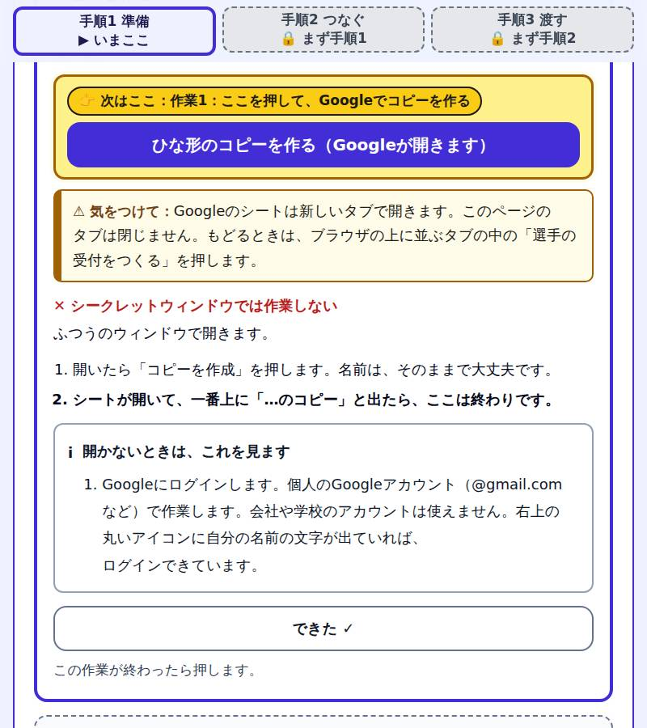

**手順3：画面の上の文字を読みます。**

- ✅ できた目印：「はじめての人は、約30分かかります。順番にボタンを押すだけです。」と、その下に「約30分は目安です。まだ測っていません。人によって変わります。」と出ています。その下に3つの札があり、「手順1 準備」だけが「▶ いまここ」です。
- ⚠ ちがう画面が出たら：「手順2 つなぐ」と「手順3 渡す」に「🔒 まず手順1」「🔒 まず手順2」と出て押せないのは、**まちがいではありません**。順番に進む決まりです。まず「手順1 準備」から始めます。

> 👉 ここから、「手順1 準備」の中に、4つの作業カードが並びます。上から順に、ひとつずつ終わらせます。

---

### 3-2　ひな形（見本の表）をコピーする（約3分）

**何をするか：** Googleに、見本の表（ひな形）を、自分用にコピーしてもらいます。

**なぜか：** 見本の表は、みんなが使う元の表です。自分用のコピーに書きます。

**このあとどうなるか：** 自分のGoogleの中に、自分の表ができます。申し込みは、この表にたまります。

**手順1：ブラウザの右上の丸いアイコンを見て、個人のGoogleアカウントでログインしているか確かめます。**

- ✅ できた目印：丸いアイコンに、自分の名前の文字が出ています。アイコンを押すと、『〜@gmail.com』のメールアドレスが見えます。
- ⚠ ちがう画面が出たら：会社や学校のアカウントのときは、使えません。個人のアカウントに切りかえます。ログインしていないときは、ログインします。

**手順2：「選手の受付をつくる」の画面の「作業1」のカードを見ます。**

- ✅ できた目印：黄色の札に「👉 次はここ：作業1：ここを押して、Googleでコピーを作る」と出ています。
- ⚠ ちがう画面が出たら：赤い文字で「いまは作業できません。ジムの担当者に連絡してください。」と出たときは、画面の写真を撮って、担当者に送ります。担当者が直します。

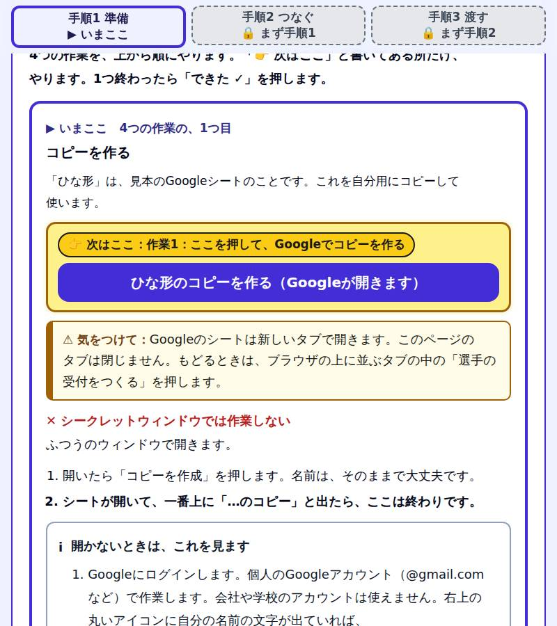

**手順3：青むらさきのボタン「ひな形のコピーを作る（Googleが開きます）」を押します。**

- ✅ できた目印：新しいタブでGoogleが開きます。『コピーを作成』と書かれたボタンが出ます。
- ⚠ ちがう画面が出たら：Googleのログイン画面が出たときは、個人のGoogleアカウントでログインします。ログインしたら、「選手の受付をつくる」のタブに戻って、もう一度押します。
- ⚠ ちがう画面が出たら：『アクセス権が必要です』と出たときは、右上の丸いアイコンで、自分のアカウントに切りかえます。
- ⚠ 注意：Googleの画面は、本物のGoogleでの確認がまだ終わっていません。少し違って見えることがあります。

**手順4：Googleの画面の『コピーを作成』を押します。**

- ✅ できた目印：表（シート）の画面が開き、一番上の名前が『〜のコピー』になっています。
- ⚠ ちがう画面が出たら：名前を書きかえる欄が出ても、名前は、そのままにします。
- ⚠ ちがう画面が出たら：『同じユーザーと共有』というチェック欄が出ても、**チェックは入れません**。共有すると、あとで受付が止まります。

**手順5：シートの上のメニューの並びを見て、「Tournament OS」があるか確かめます。**

- ✅ できた目印：『ファイル　編集　表示　挿入　表示形式　データ　ツール　拡張機能　ヘルプ』の並びの右に、「Tournament OS」が出ています。開いてから5〜10秒かかることがあります。
- ⚠ ちがう画面が出たら：出ないときは、10秒待ちます。それでも出ないときは、キーボードの F5 を押します（ページを読み直します）。それでも出ないときは、担当者に連絡します。

**手順6：ブラウザの一番上のタブから、「選手の受付をつくる」を押して、「選手の受付をつくる」の画面に戻ります。**

- ✅ できた目印：「作業1」のカードがまた見えます。
- ⚠ ちがう画面が出たら：Googleのタブは閉じません。あとでまた使います。

**手順7：作業1のカードの「できた ✓」を押します。**

- ✅ できた目印：カードの上が「✓ できた　4つの作業の、1つ目」になります。黄色の札が、2つ目のカードへ動きます。
- ⚠ ちがう画面が出たら：まちがえて押したときは、「まちがえた → やり直す（✓ を消す）」を押すと戻せます。

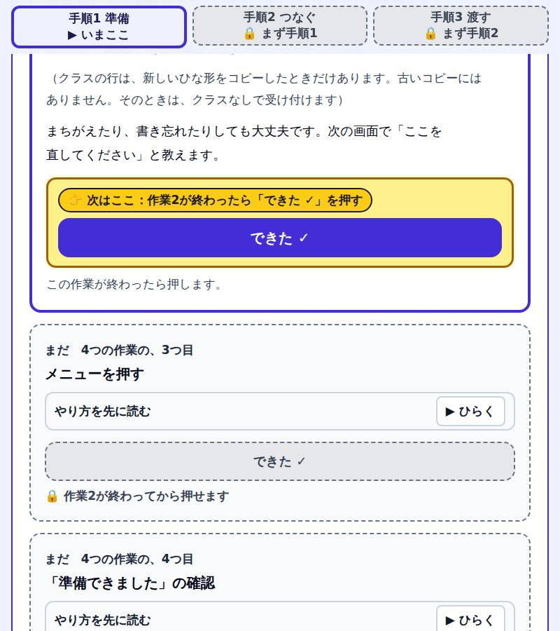

---

### 3-3　「設定」タブに書く（約5分）

**何をするか：** 大会の名前や日にちなどを、表に書きます。

**なぜか：** 選手の申し込みページに、この文字が出るためです。

**このあとどうなるか：** 書いた内容を、次のメニュー「① 最初の設定」が、読んで調べます。書き忘れがあれば、教えてくれます。

**書くルール：**

- 書くのは、**B列だけ**です。**A列（左の列）には書きません。**
- 黄色のマスで、C列に「✎ ここに書く」と出ている **6か所**を書きます。ほかに、使うときだけ書くものがあります。「入場曲」（B9。はじめから「なし」が入っています）、「クラス分け」（B13）、「階級分け」（B21）、「ロゴ」（B22）、いちばん下のほうの「花道の追加情報」と「誓約書」です。
- 書くマスのことを「セル」と呼びます。『B2』は『B列の2行目』という意味です。
- マスを1回押してから、打ちます。
- 書いたあとは **Enter キー**を押します。
- 日本語を打つと、文字に下線が付くことがあります。下線が付いたままなら、Enter をもう一度押します。1回目は、文字を決める Enter です。2回目は、マスに入れる Enter です。
- まちがえたら、そのマスを押して、打ち直します。

**手順1：Googleのシートの左下にある、「設定」という札（タブ）を押します。**

- ✅ できた目印：表が出ます。1行目に「項目」「値（ここに入れる）」「説明」があります。A列に「大会名」「開催日」…と続いています。B列の6か所が黄色です。
- ⚠ ちがう画面が出たら：「設定」が見つからないときは、10秒待ちます。そのあと、F5 を押します。それでも無いときは、3-4のメニュー「① 最初の設定」を押すと作られます。
- ⚠ 注意：このタブはシートの**一番下**に並ぶ札です。ブラウザの一番上の札ではありません。

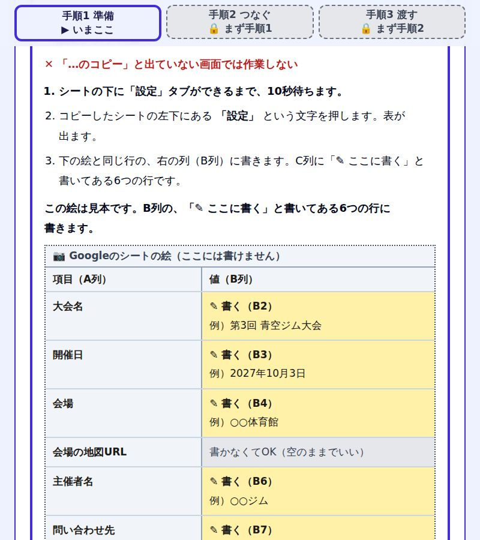

- この写真には、絵の上のほう（B2〜B7あたり）だけが写っています。アプリの画面を下へスクロールすると、絵の続きが見えます。絵の下のほうには、「クラス分け」（B13）の行と、その下の「（この下）」の行（「クラスの行が7つ続きます（B14〜B20）。はじめから入っています」）があります。そのあとに、「階級分け」（B21）の行、「ロゴ」（B22）の行、その下の「（この下）」の行（「区分の行が7つ（B23〜B29）続きます。はじめから入っています」）があります。いちばん下の近くには、「花道の追加情報」の行があります（「花道の質問をするときだけ「あり」（はじめは「なし」）」と書いてあります）。その下に、「誓約書」「保護者の同意」「ジム責任者の同意」「誓約書の文の確認」の4行と、「花道のルール」の行があります（どれも、はじめから入っています）。
- 本物のシートの「設定」タブは、B2からB35まで、**34行**あります。B2〜B20が、はじめからある19行です。B21〜B29が、階級分け・ロゴ・区分（階級：…）の9行です。B30が、花道の追加情報の1行です。B31〜B34が、誓約書の4行（誓約書・保護者の同意・ジム責任者の同意・誓約書の文の確認）です。いちばん下のB35が、花道のルールの1行です。区分の行を増やしたり消したりすると、この行の番号は動きます（A列の名前で探します）。

**次の表が、書く内容の一覧です。** 例は見本です。**自分の大会の内容に変えます。**

| 手順 | セル | 項目 | 書くこと | 例（見本） |
|---|---|---|---|---|
| 2 | B2 | 大会名 | 大会の名前。選手に見えます。 | 『第3回 青空ジム大会』 |
| 3 | B3 | 開催日 | 試合の日。年・月・日を全部書きます。 | 『2027年10月3日』（年は見本です） |
| 4 | B4 | 会場 | 試合をする場所の名前。選手に見えます。 | 『○○体育館』 |
| （とばす） | B5 | 会場の地図URL | **書かなくてOK。空のままにします。** | （空） |
| 5 | B6 | 主催者名 | 大会を開く人やジムの名前。選手に見えます。 | 『○○ジム』 |
| 6 | B7 | 問い合わせ先 | 選手が困ったとき連絡する先。電話番号か、LINEのURL。選手に見えます。 | 『03-0000-0000』（見本の番号） |
| 7 | B8 | 申込締切 | 申し込める最後の日。**開催日と同じか、それより前**にします。 | 『2027年9月20日』（年は見本です） |
| 8（使うときだけ） | B9 | 入場曲 | はじめから『なし』が入っています。選手に入場曲のリンクを書いてもらうときだけ、▼から『あり』を選びます。 | 『なし』 |
| （とばす） | B10〜B12 | 学年・年齢・意気込み | **書かなくてOK。** はじめから『必須』が入っています（選手に、必ず書いてもらいます）。選手が書かなくてもよいときだけ、▼から『任意』を選びます。 | （そのまま） |
| 9 | B13 | クラス分け | AクラスとBクラスに分けるときだけ『あり』。はじめは『なし』。 | 『あり』 |
| 10 | B14〜B20 | クラスの文 | はじめから入っています。**下の表のとおりか、見るだけ**です。 | 下の表 |
| 11 | B21 | 階級分け | 選手に出場区分と階級を選んでもらうときだけ『あり』。はじめは『なし』。 | 『あり』 |
| 12 | B22 | ロゴ | 千葉県キックボクシング協会（CKA）のロゴを出すときだけ『あり』。はじめは『なし』。 | 『あり』 |
| 13 | B23〜B29 | 区分と階級の表 | はじめから入っています。**使うときだけ**、下の表のとおりか、見ます。 | 下の表 |
| 13の2 | いちばん下の近くの行（B30） | 花道の追加情報 | 花道の選手に、アナウンスで使う追加の質問をするときだけ『あり』。はじめは『なし』。 | 『あり』 |
| 13の3 | いちばん下の行 | 花道のルール | 花道の選手には、クラスを選ばせません。かわりに見せる、1行の決まり。クラス分けが『あり』で、花道の区分があるときだけ使います。はじめから、原本から写した仮の文が入っています（確かめます）。 | はじめの文のまま |
| 13の4 | B31〜B34（いちばん下の近く） | 誓約書 | 申し込みの最後に、誓約書の□（✔を入れる欄）を出すときだけ『あり』。はじめは『なし』。すぐ下の3行（保護者の同意・ジム責任者の同意・誓約書の文の確認）は、はじめから入っています。 | 『あり』 |

- 日にちは、『2027年10月3日』『2027-10-03』『2027/10/3』のどれでも読めます。数字は全角でも大丈夫です。
- 『10月3日』だけ（年がない）や、本当にない日（『2027年2月30日』）は、あとでエラーになります。
- 年の『2027』は見本です。**本当の日にち**を書いてください。
- 「問い合わせ先」は、申し込みのページを見る**全員に見えます**。個人のケータイ番号は、書いてよいか、よく考えてください。ジムの電話番号などがおすすめです。迷ったら、担当者に聞いてください。
- 「入場曲」は、はじめから『なし』が入っています。『あり』にすると、選手は申し込みのとき、Apple MusicかYouTubeのURLを必ず入れます。『なし』なら、その欄は出ません。**あり／なしは、会長さんが大会ごとに決めます。書かなければ『なし』のままです。**
- 「申込締切」の日の23時59分59秒（日本時間）まで申し込めます。

**手順2：B2に、大会の名前を書きます。**

- ✅ できた目印：B2に『第3回 青空ジム大会』のような名前が入ります（自分の大会の名前にします）。
- ⚠ ちがう画面が出たら：A列に書いてしまったら、そのマスを押して Delete キーで消します。この名前は、**「① 最初の設定」を押す前に決めます**（あとで変えると、Googleドライブ（Googleのファイル置き場）の写真フォルダ（ファイルを入れる入れ物）の名前は、古いままになります）。

**手順3：B3に、開催日を書きます。**

- ✅ できた目印：B3に『2027年10月3日』のような日にちが入ります。
- ⚠ ちがう画面が出たら：『10月3日』だけだと、あとで「「開催日」は、2027年10月3日 のように入れてください」と出ます。そのときは、年も入れて打ち直します。

**手順4：B4に、会場の名前を書きます。**

- ✅ できた目印：B4に『○○体育館』のような会場名が入ります。
- ⚠ ちがう画面が出たら：B5（地図）は、とばします。何も書きません。

**手順5：B6に、主催者名（ジムの名前）を書きます。**

- ✅ できた目印：B6に『○○ジム』のような名前が入ります。
- ⚠ ちがう画面が出たら：B5に打ってしまったら、そのマスを押して Delete キーで消し、空に戻します。変なものが入っていると、あとでエラーになります。

**手順6：B7に、問い合わせ先を書きます。**

- ✅ できた目印：B7に電話番号やLINEのURLが入ります。たとえば『03-0000-0000』のような形です（本当のジムの番号にします）。
- ⚠ ちがう画面が出たら：個人のケータイ番号は、全員に見えます。迷ったら、書く前に担当者に聞きます。

**手順7：B8に、申し込みの最後の日を書きます。**

- ✅ できた目印：B8に『2027年9月20日』のような日にちが入ります。開催日と同じか、それより前の日です。
- ⚠ ちがう画面が出たら：開催日より後の日を打つと、あとで「「申込締切」は、開催日と同じか、それより前にしてください」と出ます。前の日に打ち直します。

**手順8：（選手に入場曲のリンクを書いてもらう大会だけ）B9の小さな▼から、「あり」を選びます。**

- ✅ できた目印：B9が『あり』になります。書いてもらわない大会は、はじめから入っている『なし』のままにして、この手順はとばします。
- 💡 B9のマスを押すと、右はしに小さな▼が出ます。
- ⚠ ちがう画面が出たら：▼の中の言葉しか入りません。『ある』など、ほかの言葉を打つと、Googleが『入力できません』のような注意を出して、止めます。▼から選び直します。
- B10〜B12（学年・年齢・意気込み）は、**書かなくて大丈夫**です。はじめから『必須』が入っていて、選手は必ず書きます。書かなくてもよい項目があるときだけ、そのマスの▼から『任意』を選びます。（聞かないときは『なし』）

**手順9：（AクラスとBクラスに分ける大会だけ）B13の小さな▼から、「あり」を選びます。**

- ✅ できた目印：B13が『あり』になります。分けない大会のときは、『なし』のままにして、この手順はとばします。
- ⚠ ちがう画面が出たら：A列に「クラス分け」の行が**無い**とき（表がB12で終わっているとき）は、古いコピーです。新しいひな形を、もう一度コピーします（3-2の手順3から）。

**手順10：B14からB20を目で見て、次の表と同じか確かめます。**

はじめから入っている文です。**同じなら、何も書きません。**

| セル | 項目 | 入っている文（Aクラス・Bクラスの場合） |
|---|---|---|
| B14 | 上のクラスの名前 | 『Aクラス』 |
| B15 | 上のクラスの条件 | 『3勝以上（3勝以下でも、会長・指導者の許可があればAクラスに出られます）』 |
| B16 | 上のクラスのルール | 『首相撲5秒／蹴り足キャッチはワンアタック（キャッチ後に1回だけ攻撃できる）／ワンマッチは顔面への膝蹴り禁止』 |
| B17 | 下のクラスの名前 | 『Bクラス』 |
| B18 | 下のクラスの条件 | 『アマチュア。2勝以下（例：初出場、2勝1敗、1勝3敗）』 |
| B19 | 下のクラスのルール | 『首相撲なし／蹴り足キャッチなし／膝蹴りなし／回転技なし』 |
| B20 | 上のクラスにする勝ち数 | 『3』 |

- ✅ できた目印：7つとも同じ文です。同じなら、何も書きません。
- ⚠ ちがう画面が出たら：1文字でもちがう、または空のマスがあるときは、上の表の文を見て、同じ文に打ち直します。（右どなりのC列の説明の文は、少しちがいます。打ち直すのは、上の表の文です。）
- 『3』は『3勝以上が上のクラス』という意味です。『3』なら、『3勝0敗』はAクラス、『2勝1敗』はBクラスです。
- B15とB18の文は、**自動では変わりません**。数字『3』を変えたら、文も自分で直します。
- ⚠ 申し込みが始まったあとは、「あり」と「なし」を切りかえません。クラスの名前も変えません。名簿に、古い名前と新しい名前が混ざるからです。
- ⚠ 文字の長さの上限：クラスの名前は12文字まで、条件は60文字まで、ルールは80文字までです。

**手順11：（階級分けを使う大会だけ）B21の小さな▼から、「あり」を選びます。**

- ✅ できた目印：B21が『あり』になります。階級を選んでもらわない大会のときは、『なし』のままにして、手順11〜13のうち、使わないものをとばします。
- 💡 「あり」にすると、選手は、申し込みのとき、先に「出場区分」を選び、つづけて「階級」を選びます。選ばないと送れません（4-3の2）。
- ⚠ ちがう画面が出たら：A列に「階級分け」の行が**無い**とき（表がB20で終わっているとき）は、古いコピーです。階級分けを使うなら、新しいひな形を、もう一度コピーします（3-2の手順3から）。使わないなら、このままで大丈夫です。

**手順12：（ロゴを出す大会だけ）B22の小さな▼から、「あり」を選びます。**

- ✅ できた目印：B22が『あり』になります。ロゴを出さない大会のときは、『なし』のままにして、この手順はとばします。
- ⚠ ちがう画面が出たら：このロゴは、千葉県キックボクシング協会（CKA）のものです。ほかの団体の大会では、『なし』のままにします（はじめから『なし』です）。「あり」にすると、申し込みページと「試合当日の画面」に、ロゴが出ます。

**手順13：（階級分けを使う大会だけ）B23からB29を目で見て、次の表と同じか確かめます。**

はじめから入っている文です（千葉県キックボクシング協会 Vol.7〔2026年12月20日大会〕の要項どおり）。**同じなら、何も書きません。**

| セル | 項目（A列） | 入っている文（B列） |
|---|---|---|
| B23 | 階級：小学生以下 | 『なし』 |
| B24 | 階級：中学生女子 | 『-37、-40、-43、-46、-49、-52、-55、-58』 |
| B25 | 階級：中学生男子 | 『-37、-40、-43、-46、-49、-52、-55、-58』 |
| B26 | 階級：高校生・一般女子 | 『-40、-43、-46、-50、-53、-56、-59、-62、-65』 |
| B27 | 階級：高校生・一般男子 | 『-50、-53、-56、-59、-62、-65、-68、-71、-74、-77、-80、-85、無差別』 |
| B28 | 階級：花道・女子（40歳以上） | 『-40、-45、-50、-55、-60、+60』 |
| B29 | 階級：花道・男子（40歳以上） | 『-55、-60、-65、-70、-75、-80、-85、無差別』 |

- ✅ できた目印：7つの区分の行が、そろっています。同じなら、何も書きません。
- 書き方：A列の『階級：』のあとが、選手に見える**区分の名前**です。1つの区分が1行です。B列には、選べる階級を、『、』か『,』で区切って書きます。『-37』は37kg以下、『+60』は60kgをこえる、『無差別』は体重の制限なし、という意味です。選手の画面には、『-37kg（37kg以下）』のように、記号と言葉の両方で出ます。
- 『なし』と書くと、その区分では、階級を選ばせません。『小学生以下』が、そうです（体重が近い人どうしで組みます）。
- 使わない区分は、**その行ごと消します**（行の番号の上で右クリックして、『行を削除』を押します）。消した行は、「① 最初の設定」を押しても、もどりません。区分をふやしたいときは、いちばん下に『階級：○○』の行を足して、B列に階級を書きます（12区分までです）。
- 数字だけ（『37』）は、「以下」なのか「こえる」なのか分からないので、止まります。『-37』か『+37』と書きます。
- ⚠ ちがう画面が出たら：書き方がまちがっていると、あとで「シートの「設定」タブを直してください。」と出ます。どの行がどうちがうかも、文に出ます。直して、もう一度確かめます（3-6）。
- ⚠ 申し込みが始まったあとは、区分や階級の名前を変えません。名簿に、古い名前と新しい名前が混ざるからです。「階級分け」の「あり」と「なし」も、切りかえません。
- ⚠ 文字の長さの上限：区分の名前は20文字まで、階級1つは16文字まで、1つの区分の階級は20こまでです。区分の名前を、『=』『+』『-』『@』で始めないでください。
- 体重が階級をこえていても、止めたり、警告したりしません。体重を量るのは、会場で人が見ます。

**手順13の2：（花道の選手に、追加の質問をする大会だけ）A列が「花道の追加情報」の行の、B列の小さな▼から、「あり」を選びます。**

- ✅ できた目印：その行のB列が『あり』になります。追加の質問をしない大会のときは、『なし』のままにして、この手順はとばします。
- 💡 この行は、表のいちばん下の近くにあります（誓約書の4行と、花道のルールの行が、その下に続きます）。区分の行を増やしたり消したりすると、行の番号が動くので、番号ではなく、A列の名前で探します。
- 💡 「あり」にすると、区分の名前に「花道」が入っている区分（はじめから入っている『花道・女子（40歳以上）』『花道・男子（40歳以上）』）を選んだ人にだけ、追加の質問が出ます（4-3の3）。ほかの区分の人には、何も増えません。
- ⚠ 使える条件：「階級分け」が『あり』で、区分の名前に「花道」が入った行が、1つはあること。そうでないと、あとで「設定」タブを直してください、と赤い文が出て、受付を始められません（9-2 E）。
- ⚠ ちがう画面が出たら：A列に「花道の追加情報」の行が**無い**ときは、古いコピーです。花道の追加の質問を使うなら、新しいひな形を、もう一度コピーします（3-2の手順3から）。使わないなら、このままで大丈夫です。
- ⚠ 申し込みが始まったあとで「あり」にしたときは、選手に渡すURLを、もう一度作って送り直します（前のURLには、追加の質問が出ません。そのURLで申し込むと、赤い文が出て、送れません）。
- ⚠ 追加の質問の答え（生年月日や職業を含みます）は、Googleのシートの「花道プロフィール」タブにだけ入ります（テストの申し込みは「テスト花道プロフィール」タブ）。人に見せません。「申込原本（個人情報あり）」や「OS取込用（連絡先なし）」には入りません。名簿のZIPにも、「試合の準備」の画面にも、「試合当日の画面」にも出ません。アナウンスで使う項目は、会長さんが、このタブを見て使います。

**手順13の3：（クラス分けと、花道の区分を使う大会だけ）A列が「花道のルール」の行の、B列の文を読んで、確かめます。**

- ✅ できた目印：その行のB列に、1行の文が入っています（はじめから入っています）。原本の募集要項と見くらべて、まちがいがなければ、そのままで大丈夫です。
- 💡 花道の出場区分を選んだ選手には、「クラス」（AクラスかBクラス）を選ばせません。かわりに、この文が、灰色の1行で出ます（4-3）。この行は、表のいちばん下にあります。区分の行の数で動くので、番号ではなく、A列の名前で探します。
- ⚠ これは、原本から写した**仮の文**です。会長さんが、原本と見くらべて、直すところがあれば、B列を書きかえます。120文字までです。空にすると、あとで「設定」タブを直してください、と赤い文が出て、受付を始められません（9-2 E）。
- ⚠ 文を書きかえたあとは、選手に渡すURLを、もう一度作って送り直します（前のURLには、前の文が入っています）。
- ⚠ ちがう画面が出たら：A列に「花道のルール」の行が**無い**ときは、古いコピーです。シートを開き直すか、「① 最初の設定」を押すと、いちばん下に足されます。クラス分けを使わない大会、花道の区分を使わない大会は、この行を見なくて大丈夫です。

**手順13の4：（申し込みの最後に、誓約書の□を出す大会だけ）A列が「誓約書」の行の、B列の小さな▼から、「あり」を選びます。**

- ✅ できた目印：その行のB列が『あり』になります。誓約書を使わない大会のときは、『なし』のままにして、この手順はとばします。
- 💡 「あり」にすると、選手は、申し込みの最後に、誓約書の□に✔を入れます。**全部の□に✔を入れないと、先へ進めません**（4-3の4）。署名（手書きの名前）の欄は、ありません。
- 💡 この行は、表のいちばん下の近くにあります（B31）。区分の行を増やしたり消したりすると、行の番号が動くので、番号ではなく、A列の名前で探します。そのすぐ下の3行（「保護者の同意」「ジム責任者の同意」「誓約書の文の確認」）は、はじめから入っています。意味は、次の表のとおりです。

| A列の名前 | はじめの値 | 選べる言葉 | 意味 |
|---|---|---|---|
| 保護者の同意 | 『18歳未満のみ』 | 『18歳未満のみ』『全員』『なし』 | 保護者（連帯責任者）の同意の□を、だれに出すか。年齢が空のときや、読めないときも出します（聞きそこなって、同意なしで通さないためです）。『18歳未満のみ』のときは、「年齢」を『必須』か『任意』にしておきます（『なし』だと、赤い文が出ます）。 |
| ジム責任者の同意 | 『あり』 | 『あり』『なし』 | 『あり』だと、選手に、ジム責任者のお名前・携帯電話・許可の確認を入れてもらいます。 |
| 誓約書の文の確認 | 『まだ』 | 『まだ』『済み』 | 会長さんが、「誓約書」タブの文を、原本と見くらべたあとに『済み』にします。『まだ』のあいだは、本番の申し込みは受け付けません（テスト用のURLは動きます）。 |

会長さんがやることは、この順番です。

1. 「誓約書」を『あり』にします（この手順）。
2. シートのメニュー「Tournament OS」→「① 最初の設定」を押します（3-4）。「誓約書」というタブと、「誓約記録」「テスト誓約記録」のタブができます。「誓約書」タブには、文がはじめから入ります。
3. シートの左下の「誓約書」タブを開いて、**原本の紙と見くらべます。** A列の2〜6行目が5つの項目、B2が保護者（連帯責任者）の同意の文、C2が団体・ジム責任者の同意の文です。
4. まちがいがあれば、そのマスを書きかえます。1マスに1項目です。項目は8個まで、1項目120文字まで、全部で700文字までです。
5. 原本と同じになったら、「設定」タブの、A列が「誓約書の文の確認」の行のB列を、▼から『済み』にします。
6. 「選手の受付をつくる」の画面で「もう一度確かめる」を押して、**選手に渡すURLを、新しく作って送ります。**

- ⚠ **この文は、オーナー（owner）が、原本から貼った文字です**（2026年10月22日）。AIは、誓約・同意の文を書いていません。直してもいません。会長さんが、原本と見くらべて、直します。見くらべるときは、3番目の項目の『帰属することし』のところを、とくによく見てください。原本の文字のまま貼ってありますが、言い方が、ふつうの文と少しちがいます。直すかどうかは、会長さんが決めます。オーナーの返事は『この文でOK』です。でも、シートの初めの値は、安全のため『まだ』のままです。
- ⚠ 「誓約書の文の確認」が『まだ』のままだと、本番のURLで申し込もうとした選手は、赤い「✕」で「主催者が、誓約書の文をまだ確認していません。送れません。」と出て、送れません。「選手の受付をつくる」の画面にも、赤い「✕」で「会長が原本と見比べて、設定タブの「誓約書の文の確認」を「済み」にするまで、本番のURLは選手に送らないでください。」と出ます。URLは出ますが、『済み』にするまで、選手に送りません。選手の画面では、入力がぜんぶ済んだとき、「入力内容を確認する →」のすぐ上にも、同じ赤い「✕」が出ます（黄色の「👉 次はここ」は、確認のボタンではなく、「主催者に電話する」に付きます。主催者の連絡先に電話番号が無いときは、黄色は付かず、連絡先の文字が出ます）。
- ⚠ 「誓約書」タブの文を直したあとは、前のURLでは申し込めません（「誓約書の文が、リンクを作ったあとで変わりました。主催者から、新しい申し込みリンクをもらってください。」と出ます）。必ず、新しいURLを作って、送り直します。設定タブの「保護者の同意」「ジム責任者の同意」を変えたときも同じです（前のURLのページには、✔を入れる欄が無いので、「誓約書の設定が、リンクを作ったあとで変わりました。主催者から、新しい申し込みリンクをもらってください。」と出ます）。この2つを変えたら、新しいURLを作ります。
- ⚠ 「誓約書」タブの文が空だったり、多すぎたりすると、「選手の受付をつくる」の画面に、赤い文が出ます（9-2 E）。直すマスも、文に書いてあります。
- ⚠ ちがう画面が出たら：A列に「誓約書」の行が**無い**ときは、古いコピーです。シートを開き直すか、「① 最初の設定」を押すと、いちばん下に足されます。
- ⚠ 「誓約書」タブが一度できたあとは、アプリは、そのタブを1マスも書きかえません（会長さんが直した文も、消したマスも、そのままです）。「誓約書」を『なし』にもどしても、タブは消えません。
- ⚠ 選手が✔した記録は、シートの「誓約記録」タブ（テストの申し込みは「テスト誓約記録」タブ）に、1人1行で残ります。並ぶのは、受付番号・申込日時・選手名・確認した項目・保護者の同意・ジム責任者の名前・ジム責任者の電話・許可の念押し・同意した文・文の指紋です。ジム責任者の名前と電話は、ほかの人の個人情報なので、このタブにだけ入ります。「申込原本（個人情報あり）」にも「OS取込用（連絡先なし）」にも、名簿のZIPにも、「試合の準備」の画面にも、「試合当日の画面」にも、対戦一覧表にも出ません。人に見せません。
- ⚠ 申し込みの件数と、誓約記録の件数を、ときどき見比べてください（「申込原本（個人情報あり）」の行数と、「誓約記録」の行数。誓約書を「あり」にしてからの分）。まれに、申し込みを保存したあと、誓約記録の行を書く前にGoogleが止まることがあります。そのときは、選手が送り直すと、記録が補われます。ただし、そのあいだに「誓約書」タブの文を直すと、補えません（申し込み自体は保存ずみで、記録だけ無い形になります）。文を直したら、新しいURLを作り、記録の件数も見ます。ちがっていたら、その選手に連絡して、確かめます。
- ⚠ この記録で足りるかどうかは、協会や専門家が決めることです。このアプリは、法律の助言はしません。

**手順14：「選手の受付をつくる」のタブを押します。**

- ✅ できた目印：作業のカードが見えます。
- ⚠ ちがう画面が出たら：Googleのタブは閉じません。あとでまた使います。

**手順15：作業2のカードの「できた ✓」を押します。**

- ✅ できた目印：「✓ できた　4つの作業の、2つ目」と出ます。黄色の札が、3つ目のカードへ動きます。
- ⚠ ちがう画面が出たら：押せないときは「作業1が終わってから押せます」と出ています。1つ目のカードを先に終わらせます。

---

### 3-4　メニュー「① 最初の設定」を押す（約5分。Googleの許可の画面が出ます）

**何をするか：** 「設定」タブの書き忘れを調べます。申し込みを入れる表と、写真を入れるフォルダを自動で作ります。架空の選手1件で、試しに動かします（自動テスト）。本物の名簿には入りません。

**なぜか：** 本番の前に、ちゃんと動くか確かめるためです。

**このあとどうなるか：** うまくいくと、シートの右下に「準備できました」の知らせが出ます。

**先に知っておいてください：**

- はじめて押すと、**Googleが、許可を聞く画面を何回か出します**。ふつうのことです。自分で作ったシートを使うための確認です。
- **途中で閉じません。** 指示どおり『許可』まで押します。
- 許可が終わったあと、何も起きなかったり、エラーが出たりすることがあります。**ふつうです。もう一度「① 最初の設定」を押します。（2回押すのがふつうです）**
- 許可の画面は、Googleが出す画面で、私たちはまだ本物を確認できていません。**こんな画面です、と書いておきます。違うときは、写真を担当者に送ってください。**
- 大会の名前は、押す前に決めておきます。ひな形のシート（コピー元）では押しません。**かならず、自分のコピーで押します。**

**手順1：Googleのシートのタブを開きます。**

- ✅ できた目印：一番上の名前が『〜のコピー』になっているシートが出ます。
- ⚠ ちがう画面が出たら：『〜のコピー』と出ていない画面では作業しません。

**手順2：シートの上のメニューの「Tournament OS」を押します。**

- ✅ できた目印：下にメニューが開き、5つの項目が上から順に並びます。「① 最初の設定」「② 受付を開始」「③ 受付を停止」「④ OS用の名簿ZIPを作る」「⑤ いまの状態を見る」。
- ⚠ ちがう画面が出たら：メニューが無いときは、F5 を押して、10秒待ちます。

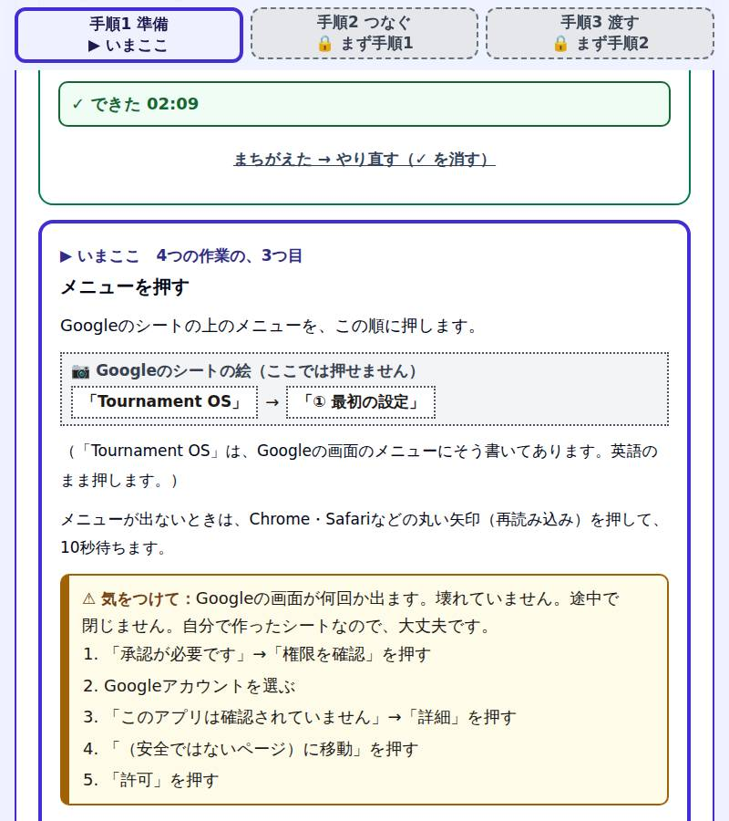

**手順3：「① 最初の設定」を押します。（1回目）**

- ✅ できた目印：『承認が必要です』と書かれた小さな箱が出ます。これが許可の画面の入り口です。
- ⚠ ちがう画面が出たら：シートの真ん中に白い箱が出て、題が「Tournament OS」、下に『OK』のボタンがあるときがあります。箱の中に「シートの「設定」タブを直してください。」と出たときは、書き忘れか書きまちがいがあります。箱の文に、足りない項目の名前が出ています。B列に書いて、もう一度「① 最初の設定」を押します。
- ⚠ ちがう画面が出たら：「このシートを作った本人のGoogleで開き直してください。」と出たときは、コピーを作ったときと同じアカウントで、開き直します。
- ⚠ ちがう画面が出たら：何も出ないときは、アドレス欄（ブラウザの上の細長い四角）の右に、四角に赤い×のような印が出ていないか見ます。（ポップアップ＝勝手に出る小さな窓、が止められた印です。）出ていたら、押して『常に許可』を選び、もう一度「① 最初の設定」を押します。

**手順4：『承認が必要です』の箱の『権限を確認』を押します。**

- ✅ できた目印：新しい小さなウィンドウが開き、Googleアカウントを選ぶ画面になります。
- ⚠ ちがう画面が出たら：『キャンセル』は押しません。押してしまったら、3-4の手順3からやり直します。
- ⚠ ちがう画面が出たら：『権限を確認』のかわりに『続行』と出ることがあります。そのときは『続行』を押します。（本物のGoogleでは確かめていません。）

**手順5：コピーを作ったときの、自分のアカウントを押します。**

- ✅ できた目印：黄色や赤の三角の印がついた、『このアプリは確認されていません』という注意の画面が出ます。**予定どおりです。**
- ⚠ ちがう画面が出たら：アカウントが2つ以上並んでいるときは、シートの右上の丸いアイコンと同じ名前を選びます。『別のアカウントを使用』は押しません。

> ⚠ **この次の画面は、注意の画面のように見えます。** 『このアプリは確認されていません』は、『Googleが、この作者（ジム）をまだ調べていない』という意味です。自分のシートに付いたプログラムなので、続けて大丈夫です。

**手順6：画面の左のほうにある、小さな灰色の『詳細』の文字を押します。**

- ✅ できた目印：画面の下に、新しい文字の行（『…（安全ではないページ）に移動』）が出ます。
- ⚠ ちがう画面が出たら：青くて大きい『安全なページに戻る』は**押しません**（押すと、最初からやり直しになります）。『詳細』が小さくて見えないときは、画面の下のほうを探します。

**手順7：『（安全ではないページ）に移動』と書かれた行を押します。**

- ✅ できた目印：『Googleアカウントへのアクセスを求めています』のような、許可の内容が並ぶ画面になります。
- ⚠ ちがう画面が出たら：行が出ないときは、画面を大きくするか、下へスクロールします（マウスのホイールを回します）。
- ⚠ ちがう画面が出たら：赤い画面で、『アクセスをブロック』『管理者によりブロックされています』などと出ることがあります。（『401 invalid_client』という英語の記号が出ることもあります。意味は読まなくて大丈夫です。）ブロック（止められること）の原因は、次のどれかが多いです。シークレット（InPrivate）の窓／Googleアカウントを2つ以上ログイン／会社や学校のアカウント。ウィンドウを全部閉じ、ふつうのウィンドウで、個人のアカウント1つだけにして、3-1の手順1からやり直します。

**手順8：『許可』を押します。**

- ✅ できた目印：ウィンドウが閉じて、シートに戻ります。ここで何も起きなかったり、エラーが出たりしても、ふつうです。
- ⚠ ちがう画面が出たら：許可の項目の前に、四角いチェック欄が並び、『すべて選択』と出ることがあります。そのときは、『すべて選択』にチェックを入れてから、『許可』（または『続行』）を押します。一部だけだと、あとで『権限が足りません』のエラーになります。

**手順9：もう一度、「Tournament OS」→「① 最初の設定」を押します。（2回目）**

- ✅ できた目印：しばらくして、シートの**右下**に黒い小さな箱が約20秒出ます。題は「Tournament OS」。文は「準備できました。架空の1件の自動テストも済みました。次は「拡張機能」→「Apps Script」→「デプロイ」→「新しいデプロイ」→「ウェブアプリ」です。」です。
- ⚠ ちがう画面が出たら：知らせは20秒で消えます。見のがしたら、「Tournament OS」→「⑤ いまの状態を見る」を押します。「自動テスト: 済み」と出れば、成功です。
- ⚠ ちがう画面が出たら：シートの真ん中に白い箱でエラーが出たら、文を読みます。下の『よくあるエラー』の表を見ます。
- ⚠ 時間：10秒から1分ほどかかります。待ちます。

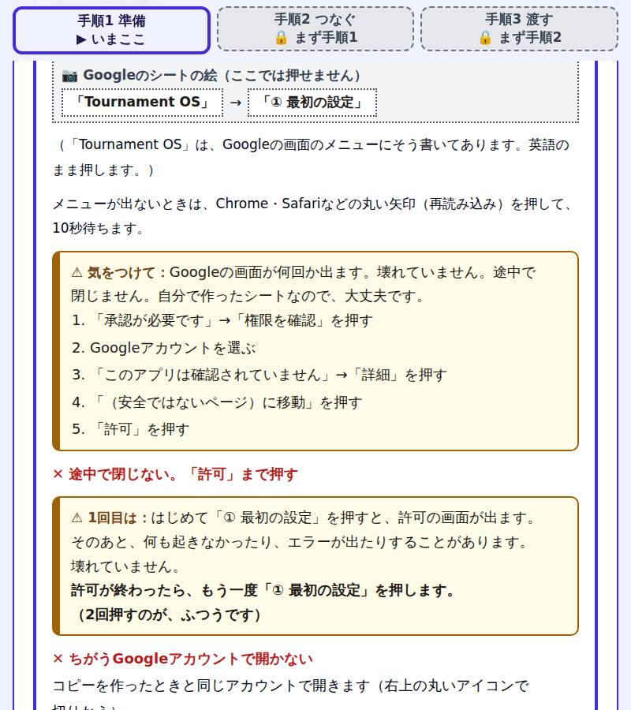

**手順10：「選手の受付をつくる」のタブを押します。**

- ✅ できた目印：作業のカードが見えます。
- ⚠ ちがう画面が出たら：Googleのタブは閉じません。あとでまた使います。

**手順11：作業3のカードの「できた ✓」を押します。**

- ✅ できた目印：「✓ できた　4つの作業の、3つ目」と出ます。
- ⚠ ちがう画面が出たら：「作業2が終わってから押せます」と出たら、2つ目を先に押します。

**手順12：作業4のカードを見て、Googleに「準備できました」と出たことを思い出します。**

- ✅ できた目印：カードに「Googleの画面に「準備できました」と出たら、ここは終わりです。」と書いてあります。
- ⚠ 見のがしても大丈夫です。「次の画面で自動で確かめます」。

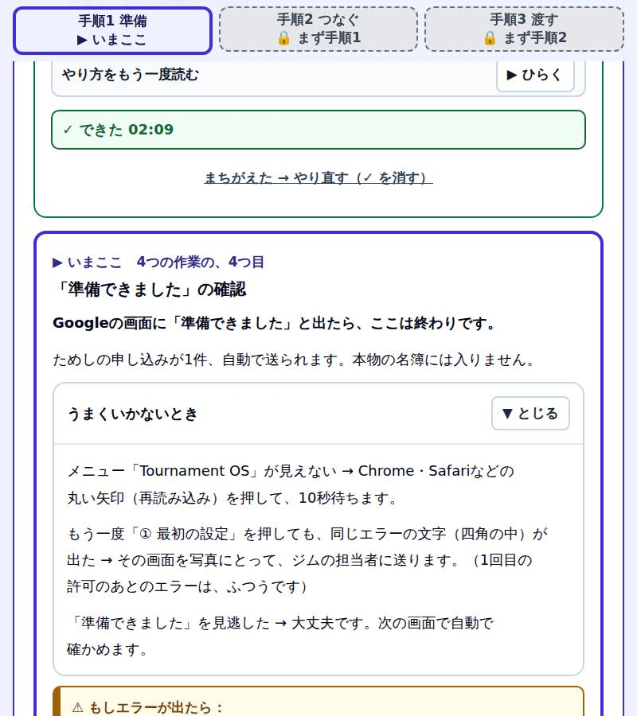

**手順13：作業4のカードの「できた ✓」を押します。**

- ✅ できた目印：4つとも「✓ できた」になります。黄色の札が、一番下のボタンへ動きます。
- ⚠ ちがう画面が出たら：押せないときは、下の「✓がなくても進む（次の画面で確かめます）」を使えます。

**手順14：長いボタン「「準備できました」と出た → 次へ（次の画面で自動で確かめます）」を押します。**

- ✅ できた目印：見出しが「いまここ 2 / 3：つなぐ（URLをはって、つなぐ）」に変わります。
- ⚠ ちがう画面が出たら：押せない間は、「🔒」のあとに、理由（たとえば「作業2が終わっていません」）が出ます。「わからなくても大丈夫です。次の画面で確かめます。」

#### よくあるエラー（①で赤い箱が出たとき）

| 箱の文 | 意味 | 直しかた |
|---|---|---|
| 「設定」タブの、次の欄を入れてください：… | 書き忘れがあります。 | 出た名前の行のB列に書いて、もう一度「① 最初の設定」を押します。 |
| 「（タブの名前）」タブのC1が「（いまの文字）」になっています… | 表の見出しが変わっています。 | 言われたマスを、言われた文字に直して、もう一度「① 最初の設定」を押します。わからなければ、タブを消さずに、担当者に聞きます。 |
| このシートを作った本人のGoogleで開き直してください。 | 別のアカウントで押しています。 | コピーを作ったアカウントに切りかえて、もう一度押します。 |
| 申込表と写真フォルダの共有を「制限付き・主催者本人だけ」にしてください。 | 共有が広がっています。 | シート右上の「共有」で、ほかの人を外し、「一般的なアクセス」を『制限付き』にします。 |
| 「開催日」は、2027年10月3日 のように入れてください | 開催日が読めません。 | B3に、年・月・日を全部入れます。 |

- エラーが出たら、**そのまま閉じません。画面の写真をとって、担当者に送ります。**

---

### 3-5　公開（ウェブアプリ）にする（約5分）

**何をするか：** 選手のスマホから、会長さんの表に申し込みを届ける道を作ります。この作業を『デプロイ』と呼びます（みんなが使えるように出すこと）。

**なぜか：** これをしないと、選手が申し込んでも、表に届きません。

**このあとどうなるか：** 『ウェブアプリ』のURLができます。『…/exec』で終わる長い文字です。それをコピーして、次の部で貼ります。

**先に知っておいてください：**

- 画面に『Apps Script』『デプロイ』『ウェブアプリ』という名前が出ます。（Apps Scriptは、『アップス スクリプト』と読みます）**そのまま押して大丈夫です。**
- 『新しいデプロイ』は**1回だけ**押します。何回も押すと、URLが何個もできて、どれが正しいか分からなくなります。
- 『デプロイをテスト』は**押しません**。URLの終わりが『/dev』になって、使えません。
- 『アクセスできるユーザー』を『全員』にしても、**シートや写真が公開されるわけではありません**。URLを知っている人が、申し込みを送れるだけです。メールや電話などの申し込みの内容は、外には出ません。

**手順1：「選手の受付をつくる」の画面の「Googleでの3つの操作」の、「操作1」を見ます。**

- ✅ できた目印：黄色の札に「👉 次はここ」と出ています。
- ⚠ 画面の絵は見本です。

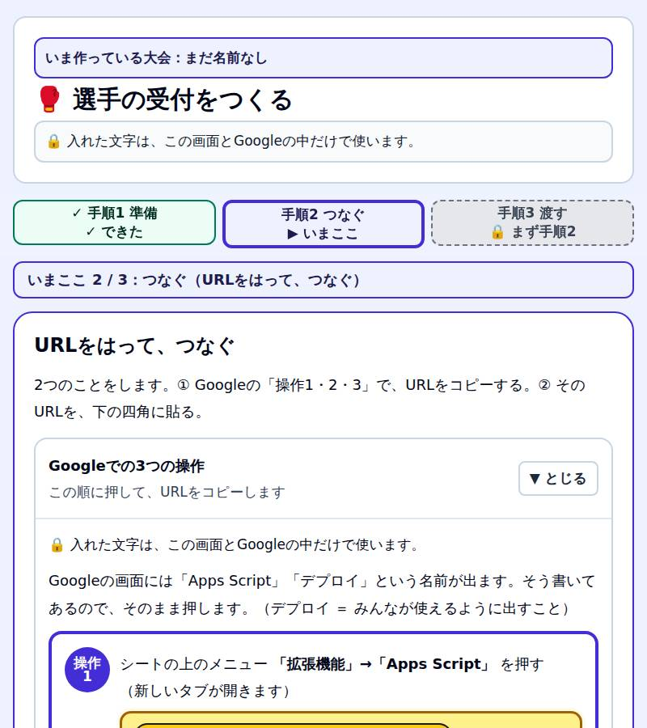

**手順2：Googleのシートのタブを開き、上のメニューの『拡張機能』→『Apps Script』を押します。**

- ✅ できた目印：新しいタブが開き、Apps Script（Googleのシートに付いているプログラムの画面）が出ます。左に『コード.gs』（または『Code.gs』）のようなファイルがあります。
- ⚠ ちがう画面が出たら：文字を、コピーしたり書きかえたりしません。『関数なし ▼』という選択ボタンも、さわりません。中が空っぽなら、担当者に連絡します。

**手順3：「選手の受付をつくる」のタブを押します。**

- ✅ できた目印：「操作1が終わった ✓」のボタンが見えます。
- ⚠ ちがう画面が出たら：Googleのタブは閉じません。あとでまた使います。

**手順4：「操作1が終わった ✓」を押します。**

- ✅ できた目印：黄色の札が「操作2が終わったら、ここを押す」へ動きます。
- ⚠ ちがう画面が出たら：まちがえたら、もう一度押すか、ボタンの説明を読みます。

**手順5：Apps Scriptのタブを押します。**

- ✅ できた目印：Apps Scriptの画面が見えます。
- ⚠ ちがう画面が出たら：タブを閉じてしまったときは、手順2からやり直します。

**手順6：右上の青い『デプロイ』を押します。**

- ✅ できた目印：小さなメニューが開きます。
- ⚠ ちがう画面が出たら：『デプロイをテスト』は押しません。

**手順7：『新しいデプロイ』を押します。**

- ✅ できた目印：『新しいデプロイ』と書かれた箱が出ます。
- ⚠ ちがう画面が出たら：『新しいデプロイ』は1回だけです。何回も押しません。

**手順8：箱の左上の『種類を選択』の横の歯車を押します。**

- ✅ できた目印：種類の一覧が開きます。
- ⚠ ちがう画面が出たら：歯車が見つからないときは、箱の左上を探します。

**手順9：『ウェブアプリ』を選びます。**

- ✅ できた目印：箱の中に、ウェブアプリの設定が出ます。
- ⚠ ちがう画面が出たら：『ライブラリ』『API 実行可能ファイル』『アドオン』ではなく、かならず『ウェブアプリ』を選びます。

**手順10：箱の中の3つの設定を見ます。**

- ✅ できた目印：種類が『ウェブアプリ』、実行が自分（あなたのメールアドレス）、『アクセスできるユーザー』が『全員』になっています。はじめから、この選び方になっています。
- ⚠ ちがう画面が出たら：『アクセスできるユーザー』が『自分のみ』や『Googleアカウントを持つ全員』になっているときは、『全員』に選び直します。そうしないと、LINEから開く選手が、Googleのログインを求められて、申し込めません。「説明」の欄は、空で大丈夫です。

**手順11：箱の右下にある青い『デプロイ』を押します。**

- ✅ できた目印：しばらくして、箱が変わります。『ウェブアプリ』の下に、『https://script.google.com/macros/s/…/exec』のような長いURLが出ます。URLの終わりが『/exec』です。
- ⚠ ちがう画面が出たら：『アクセスを承認』と出たら、押して、3-4の手順4〜8と同じ順で『許可』まで進みます。アカウントは、3-4の手順5で選んだのと同じ自分のアカウントです（ふつうは出ません）。
- ⚠ ちがう画面が出たら：箱の下に『完了』のボタンが出るときは、URLをコピーするまで押しません。（Googleの画面は、本物で確かめていません。ちがうときは、写真を担当者に送ります。）

**手順12：「選手の受付をつくる」のタブを押します。**

- ✅ できた目印：「操作2が終わった ✓」のボタンが見えます。
- ⚠ ちがう画面が出たら：Apps Scriptのタブは閉じません。このあと、手順14で、Googleに戻ってURLをコピーします。

**手順13：「操作2が終わった ✓」を押します。**

- ✅ できた目印：黄色の札が「操作3が終わったら、ここを押す」へ動きます。
- ⚠ ちがう画面が出たら：押す順番は、操作1、操作2、操作3の順です。

**手順14：Apps Scriptのタブを押します。**

- ✅ できた目印：『ウェブアプリ』の下に、長いURLが見えます。
- ⚠ ちがう画面が出たら：URLが見えなくなったときは、Apps Scriptの右上の『デプロイ』→『デプロイを管理』を押します。『ウェブアプリ』のURLが、もう一度出ます。

**手順15：『ウェブアプリ』のURLの横の『コピー』を押します。**

- ✅ できた目印：『コピーしました』のような小さな表示が、いっしゅん出ます。URLが、パソコンの『一時置き場』（クリップボード）に入りました。
- ⚠ ちがう画面が出たら：その下の長い『デプロイID』（デプロイにつく、英数字の番号）は、**コピーしません**（IDはURLではありません）。上のアドレス欄の文字も、コピーしません。『コピー』が押せないときは、URLをマウスで3回カチカチと押して全部えらび、Ctrl キーを押しながら C を押します。

**手順16：「選手の受付をつくる」のタブを押します。**

- ✅ できた目印：「操作3が終わった ✓」のボタンが見えます。
- ⚠ ちがう画面が出たら：Apps Scriptのタブは、閉じても大丈夫です。

**手順17：「操作3が終わった ✓」を押します。**

- ✅ できた目印：黄色の札が「👉 次はここ：ここにURLを貼る」へ動きます。下に、四角「ウェブアプリのURL 必須」が出ます。
- ⚠ ちがう画面が出たら：あとでURLをもう一度見たいときは、Apps Scriptの『デプロイ』→『デプロイを管理』で見られます。

---

### 3-6　「選手の受付をつくる」の画面に、URLを貼る（約2分）

**何をするか：** コピーしたURLを、「選手の受付をつくる」の画面に貼ります。

**なぜか：** アプリが、あなたのGoogleにつながるためです。

**このあとどうなるか：** アプリが自動で確かめます。つながると、シートに書いた内容が画面に出ます。まちがいがないか見て、次へ進みます。

**手順1：四角「ウェブアプリのURL」を、マウスで押します。**

- ✅ できた目印：四角の中で、文字を打つ線（カーソル）がチカチカします。
- ⚠ ちがう画面が出たら：四角が見えないときは、下へスクロールします。

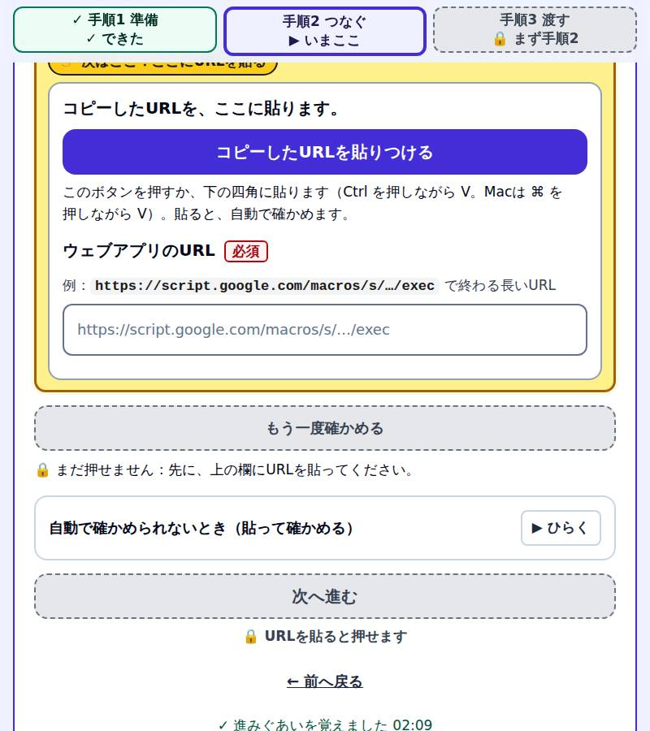

**手順2：キーボードの Ctrl キーを押しながら V を押して、貼り付けます。**

- ✅ できた目印：四角に、長いURLが入ります。「貼ると、自動で確かめます。」と書いてあるとおり、数秒で確かめが始まります。
- ⚠ ちがう画面が出たら：貼れないときは、ボタン「コピーしたURLを貼りつける」を押します。四角の中で右クリックして「貼り付け」を押しても、貼れます。
- ⚠ ちがう画面が出たら：画面の中に『Macは…』と書いてある文があります。Windowsでは関係ないので、読みとばします。

**手順3：数秒待って、画面の文字を読みます。**

- ✅ できた目印：「URLは、正しい形です。」と、時刻が出ます。続けて「✓ つながりました。次は「次へ進む」を押します。」と出ます。
- ⚠ ちがう画面が出たら：下の『URLを貼ったときのエラー』の表を見ます。

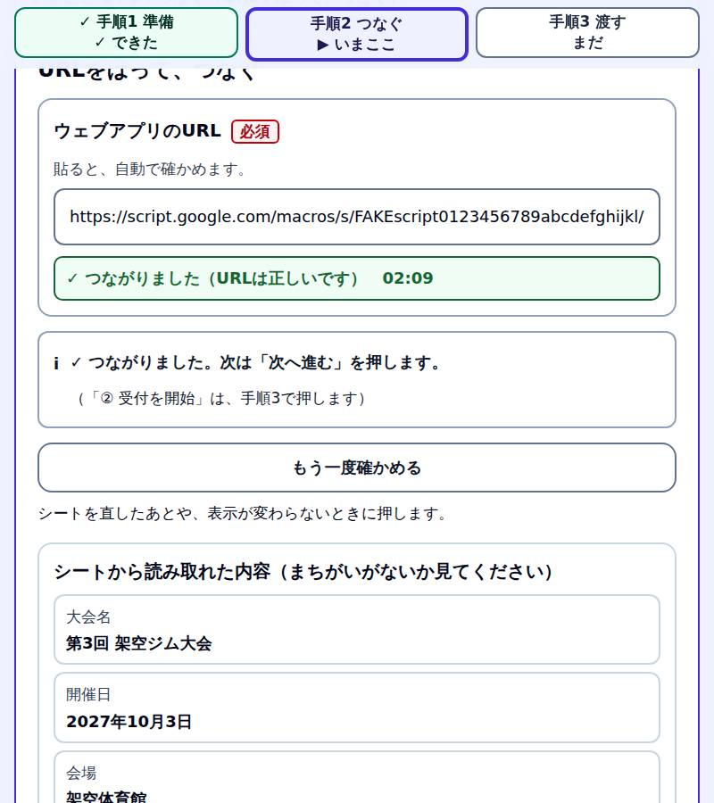

**手順4：「シートから読み取れた内容（まちがいがないか見てください）」を、読みます。**

- ✅ できた目印：大会名、開催日、会場、主催者名、問い合わせ先、申込締切、入場曲、学年、年齢、意気込み、クラス分け、階級分け、ロゴ、花道の追加情報が、並んでいます。クラス分けが「あり」なら、「クラス分け ✓ あり（Aクラス／Bクラス）。申し込みページに出ます」と出ます。階級分けが「あり」なら、「階級分け」のところに、『✓ あり（7区分）。申し込みページに出ます』と出ます（『7区分』は、区分の数です）。ロゴが「あり」なら、「ロゴ」のところに、「✓ あり（申し込みページと当日の画面に出ます）」と出ます。「なし」のときは、「なし（階級は分けません）」「なし（ロゴは出しません）」と出ます。花道の追加情報が「あり」なら、「花道の追加情報」のところに、「✓ あり（花道の区分を選んだ人にだけ、追加の質問が出ます）」と出ます。「なし」のときは、「なし（追加の質問は出しません）」と出ます。誓約書が「あり」なら、「誓約書」のところに、『✓ あり（5項目・保護者の同意：18歳未満のみ・ジム責任者：あり）・会長の確認：済み』のように出ます（『5項目』は、項目の数です）。まだ「済み」にしていないときは、赤い『✕ あり（…）・会長の確認：まだ』のように出ます（3-3の手順13の4）。「なし」のときは、この行は出ません。
- ⚠ ちがう画面が出たら：内容がちがうときは、シートの「設定」タブを直して、「もう一度確かめる」を押します。
- ⚠ ちがう画面が出たら：古いコピーで、クラスの行が無いときは「クラスなしで受け付けます」と出ます。クラスを使いたいなら、新しいひな形をコピーし直します。
- ⚠ ちがう画面が出たら：古いコピーで、階級分け・ロゴの行が無いときは、黄色で「このシートには、階級分け・ロゴの行がありません。」と出ます。止まりはしません。階級分けやロゴを使いたいなら、新しいひな形をコピーし直します。使わないなら、このままで大丈夫です。
- ⚠ ちがう画面が出たら：古い版のシート（Apps Scriptの上から2行目が『3.20261010.5』のもの）では、黄色で「このシートは古い版で、階級分け・ロゴに対応していません。」と出ます。止まりはしません。階級分け・ロゴ以外は、そのまま使えます。階級分けやロゴを使いたいなら、新しいひな形をコピーし直します。
- ⚠ ちがう画面が出たら：Apps Scriptの上から2行目が『3.20261019.6』のシートは、花道の追加の質問が使えない版です。「花道の追加情報」の行は『なし（追加の質問は出しません）』と読まれ、黄色の注意は出ません。ほかの機能は、そのまま使えます。花道の追加の質問を使いたいなら、新しいひな形をコピーし直すか、ジムの担当者がプログラムを入れかえます。使わないなら、このままで大丈夫です。

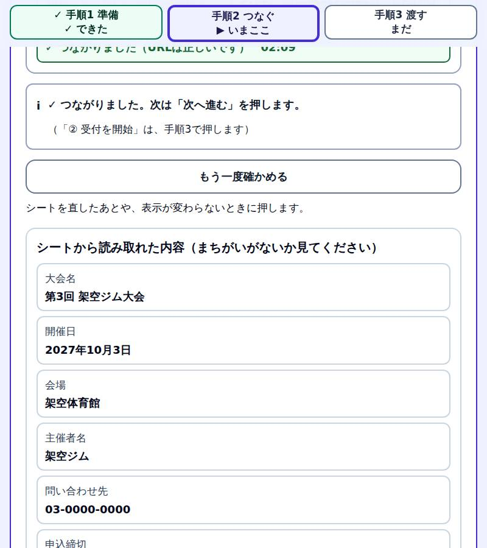

**手順5：まちがいがなければ、黄色い札の下の「次へ進む」を押します。**

- ✅ できた目印：見出しが「いまここ 3 / 3：渡す（選手に渡すURLを作る）」に変わります。
- ⚠ ちがう画面が出たら：押せない間は、「🔒」のあとに、理由が出ています。たとえば、「🔒URLを直すと押せます」や「🔒①が終わってから押せます」です。理由のとおりに直します。

#### URLを貼ったときのエラー

| 画面の文字 | 意味 | 直しかた |
|---|---|---|
| 「✕ URLではなく、ただの文字です」 | URLでない文字を貼りました。 | 『https://』で始まり、『/exec』で終わるURLを、コピーし直します。 |
| 「✕ これは「テスト用のURL」（/dev で終わる）です」 | 「デプロイをテスト」のURLです。 | 「新しいデプロイ」で出た、『/exec』で終わるURLを使います。 |
| 「✕まだ最初の設定が終わっていません（①がまだです）」 | ①を押していません。 | Googleのシートで「Tournament OS」→「① 最初の設定」を押します。そのあと「もう一度確かめる」。 |
| 「⚠気をつけて：あと少しです。」「つながりました。自動テストがまだです。」と、そのあとに続く『シートのメニューを押してください』という文 | 自動テストが終わっていません。 | 「Tournament OS」→「① 最初の設定」をもう一度押します。そのあと「もう一度確かめる」。 |
| 「Googleが、まだ「だれでも使える」になっていません」 | 「アクセスできるユーザー」が「全員」でありません。 | 「新しいデプロイ」をやり直して、「全員」にして、**新しいURL**を貼ります。「もう一度確かめる」だけでは直りません。 |
| 「会社や学校のGoogleアカウントでは、使えません」 | 個人のアカウントでありません。 | 個人のアカウントで、ひな形のコピーからやり直します。 |

---

### 3-7　メニュー「② 受付を開始」を押す（約1分）

**何をするか：** いま選手が申し込める状態にします。

**なぜか：** これを押すまで、選手は申し込めません。

**このあとどうなるか：** 「選手の受付をつくる」の画面が、5秒ごとに自動で確かめて、「✓ 受付中です」と出ます。

**手順1：「選手の受付をつくる」の画面の、「手順3 渡す」の、黄色い札を読みます。**

- ✅ できた目印：「👉 次はここ：Googleシートで「Tournament OS」→「② 受付を開始」を押す」と出ています。
- ⚠ ちがう画面が出たら：札が出ていないときは、3-6までが終わっているか見ます。

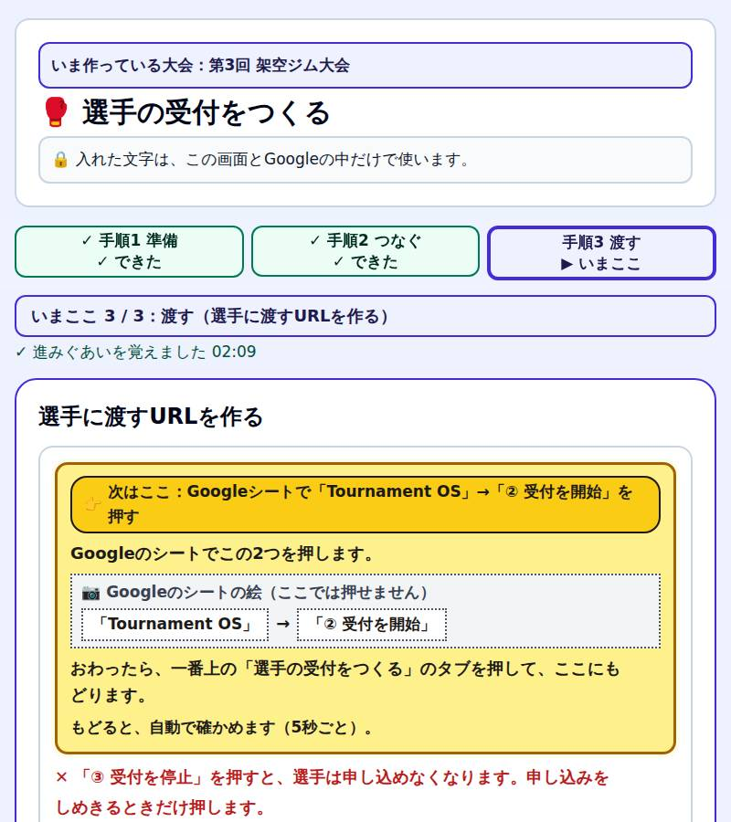

**手順2：Googleのシートのタブを開き、「Tournament OS」→「② 受付を開始」を押します。**

- ✅ できた目印：シートの右下に、「受付を開始しました。ブラウザの「選手の受付をつくる」のタブにもどると、自動で確かめます。出ないときは「もう一度確かめる」を押します。」と出ます。
- ⚠ ちがう画面が出たら：箱でエラーが出たときは、文を読みます。
  - 「先にテスト申込1件と写真の保存を確認してください。」→「① 最初の設定」をもう一度押します。
  - 「締切を過ぎています。「設定」タブの申込締切を直してください。」→B8を、これからの日にちに直します。
  - 「申込表と写真フォルダの共有を「制限付き・主催者本人だけ」にしてください。」→右上の「共有」で、ほかの人を外し、「一般的なアクセス」を『制限付き』にします。
  - 「「設定」タブの、次の欄を入れてください：」で始まる文 →3-3の表を見て、B列を直し、もう一度「② 受付を開始」を押します。
  - 「このシートを作った本人のGoogleで開き直してください。」→コピーを作ったときと同じアカウントに切りかえて、もう一度押します。
  - 直したら、もう一度押します。
- ✕ ここで「③ 受付を停止」は押しません。押すと、選手は申し込めなくなります。申し込みをしめきるときだけ押します。

**手順3：ブラウザの一番上の「選手の受付をつくる」のタブを押して、「選手の受付をつくる」の画面に戻ります。**

- ✅ できた目印：「選手の受付をつくる」の画面が見えます。
- ⚠ ちがう画面が出たら：画面を閉じていたら、3-1の手順2のリンクからもう一度開きます。入れたURLは、残っています。

**手順4：5秒ほど待って、画面の文字を読みます。**

- ✅ できた目印：「✓ 受付中です」「✓ 受付できます。選手に渡すURLをコピーできます。」と出ます。クラス分けが「あり」なら、「クラス分け：あり」と「申し込みページに出ます。」という緑の文も出ます（先頭に✓が付きます。かっこの中には、Aクラス／Bクラスの名前が入ります）。階級分けが「あり」なら、「階級分け：あり」と「申し込みページに出ます。」（かっこの中には、区分の数が入ります）、ロゴが「あり」なら、「ロゴ：あり」と「申し込みページと当日の画面に出ます。」という緑の文も出ます。
- ⚠ ちがう画面が出たら：変わらないときは、「もう一度確かめる」を押します。「受付が止まっています。選手は申し込めません。」と出たら、3-7の手順2を、もう一度やります。

---

### 3-8　選手に渡すURLをコピーする（約1分）

**何をするか：** 選手（保護者）に渡す、申し込みのURLをコピーします。送るのは、次の4-1でします。

**なぜか：** 選手は、このURLを押すと、スマホで申し込めます。

**このあとどうなるか：** 4-1で、LINEで選手に送ります。そのあと、申し込みが、会長さんのGoogleの表にたまっていきます。数日かかります。

**手順1：黄色い札の下の青むらさきのボタン「完成：選手へ渡すURLをコピー」を押します。**

- ✅ できた目印：ボタンの文字が「✓ コピーしました（もう一度押せます）」に変わります。
- ⚠ ちがう画面が出たら：押せないときは、「🔒まだ押せません：シートで「② 受付を開始」を押す」と出ています。3-7の手順2に戻ります。
- ⚠ ちがう画面が出たら：コピーできていないときは、「コピーできていません。」と出ます。その下の四角をクリック（マウスの左のボタンを押すこと）して、Ctrl を押しながら A（全部えらぶ）、つづけて Ctrl を押しながら C（コピー）を押します。
- ⚠ ちがう画面が出たら：誓約書が「あり」の大会で、「選手に渡すURL」の枠に、赤い「✕」で「会長が原本と見比べて、設定タブの「誓約書の文の確認」を「済み」にするまで、本番のURLは選手に送らないでください。」と出ているときは、まだ送りません。3-3の手順13の4の5番（「誓約書の文の確認」を『済み』にする）をして、「もう一度確かめる」を押してから、URLを作り直します。

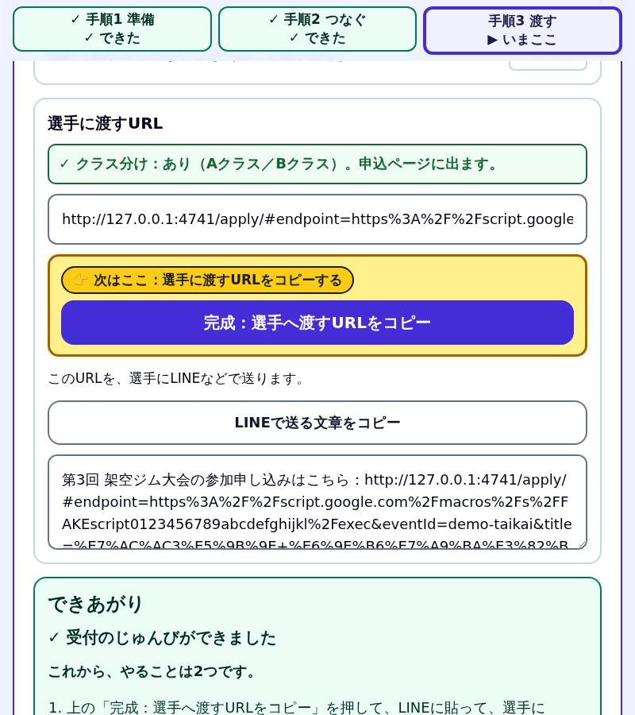

**手順2：「4-1」へ進みます。**

- ✅ できた目印：4-1の手順1から、LINEで送る準備をします。
- ⚠ ちがう画面が出たら：コピーしたURLが消えてしまったときは、手順1をもう一度押します。

> 👉 **ここまでで、第3章は終わりです。おつかれさまでした。** LINEで送るのは、次の4-1です。

### 設定を直したとき（あとで大会名などを変えたいとき）

選手に渡したURLの中には、大会名や日にちが、作ったときのまま入っています。シートの「設定」タブを直したら、次の3つをします。

1. 「選手の受付をつくる」の画面の「もう一度確かめる」を押します。
2. 「完成：選手へ渡すURLをコピー」を、もう一度押します。
3. 新しいURLを、もう一度選手に送ります。（前に送ったURLは、古い内容のままです）

### 次の大会を作るとき

前の大会のシートを、コピーして使い回しません。前の選手の名簿や電話番号が、新しい表に入ってしまうためです。

前の大会の「選手の受付をつくる」の画面のリンクも、そのまま使いません。前のURLと進みぐあいが、残っているためです。次の順で、新しい大会を作ります。

**手順1：「試合の準備」の画面を開きます。**

- ✅ できた目印：上に「いま開いている大会：」が出ます。
- ⚠ ちがう画面が出たら：お気に入りに入れた「試合の準備」のリンクから開きます。

**手順2：「大会をえらぶ・安心のしくみ（ほか）」を押して、開きます。**

- ✅ できた目印：「新しい大会をつくる（前回の設定を引き継ぐ）」のボタンが見えます。
- ⚠ ちがう画面が出たら：ボタンが見えないときは、下へスクロールします。

**手順3：「新しい大会をつくる（前回の設定を引き継ぐ）」を押します。**

- ✅ できた目印：赤いふちの箱が出ます。「やめる（ここにいる）」と「新しい大会へ」の2つのボタンがあります。
- ⚠ ちがう画面が出たら：迷ったら「やめる（ここにいる）」を押します。何も変わりません。前の大会は保存されていて、「続きから：」でまた開けます。

**手順4：「新しい大会へ」を押します。**

- ✅ できた目印：名簿と対戦カードが空の、新しい大会の画面が開きます。前の大会の「選手に書いてもらうこと」と会場だけが、引きつがれます。
- ⚠ ちがう画面が出たら：保存していない入力があるときは、先に保存します。保存できないと、移れません。

**手順5：「選手の受付をつくる画面へ →」を押します。**

- ✅ できた目印：「選手の受付をつくる」の画面が開きます。ここから、3-2の手順1に進みます。
- ⚠ ちがう画面が出たら：「選手の受付をつくる画面へ →」が見つからないときは、画面の上の「選手の受付をつくる画面へ →」を押します。

前の大会のシートは、消えません。前の大会が終わったら、「③ 受付を停止」を押して、シートの名前に『（終了）』などの目印を付けると、まちがえません。

### 第3章のチェックリスト

| チェック | 目印 |
|---|---|
| ☐ ひな形をコピーした | シートの一番上に『〜のコピー』と出ている |
| ☐ 「設定」タブを書いた | B2・B3・B4・B6・B7・B8に文字が入っている。入場曲のリンクを書いてもらうなら、B9が『あり』（はじめは『なし』）。クラスを分けるなら、B13が『あり』。階級を選んでもらうなら、B21が『あり』。ロゴを出すなら、B22が『あり』 |
| ☐ 「① 最初の設定」が成功した | 右下に「準備できました」と出た（または「⑤ いまの状態を見る」で「自動テスト: 済み」） |
| ☐ 公開（ウェブアプリ）した | 『…/exec』で終わるURLをコピーした |
| ☐ URLを貼って、つながった | 「✓ つながりました。次は「次へ進む」を押します。」と出た |
| ☐ 「② 受付を開始」を押した | 「✓ 受付中です」と出た |
| ☐ 選手に渡すURLをコピーした | 「✓ コピーしました（もう一度押せます）」と出た（LINEで送るのは4-1です） |

> ✅ 7つ全部に✓がついたら、第3章は完成です。あとは、申し込みが集まるのを待ちます。

### この章で、まだ確かめられていないこと

Googleの画面（『コピーを作成』、許可の画面、デプロイの画面、右下の知らせ）は、本物のGoogleでの確認が、まだ終わっていません。文字や順番が、少し違うことがあります。違う画面が出たら、画面の写真を撮って、ジムの担当者に送ります（9-2 J）。くわしくは、9-4を見ます。

---

## 第4章　選手に申し込んでもらう

### この章でやること

選手（保護者の方）に、LINEで『申し込みのURL』（URL＝インターネットの住所）を送ります。選手はスマホで申し込みます。

そうすると、申し込みが、会長さんのGoogleのシート（表）にたまっていきます。

- かかる時間：LINEで送るのは約5分です。申し込みが集まるまでは、数日かかります。
- 保護者の方が用意するものは、顔写真1枚です。入力の数は、申し込みページの上に出ます（たとえば『入力は全部で14個です。』。リンクの設定で変わります）。かかる時間は、測っていません。
- 次にやること：申し込みが集まったら、第5章で名簿を取り込みます。
- 飛ばしてよい所：4-2の画面の説明は、会長さんが自分で試したいときと、保護者の方から電話で聞かれたときだけ読めば大丈夫です。

⚠ 気をつけること：会長さんが『ためし』に申し込むと、本物の申し込みとして名簿に入ります。画面を見るだけにして、最後の「この内容で送信する」は押しません。

---

### 4-1　LINEで申し込みのURLを送る

**何をするか：** 第3章でコピーしたURLを、LINEで選手に送ります。

**なぜか：** 選手は、このURLを押すと、スマホで申し込めるからです。

**このあと：** 申し込みが、会長さんのGoogleの表にたまっていきます。数日かかります。

URLは長い文字です。途中を切ったり、直したりすると、開けなくなります。

**手順1：「選手の受付をつくる」の画面で、「LINEで送る文章をコピー」を押します。**

- ✅ できた目印：ボタンの文字が「✓ コピーしました」に変わります（緑の「✓」つき）。
- ⚠ ちがう画面が出たら：ボタンが押せない（灰色で「🔒」つき）ときは、第3章の手順をやり直します。シートで「② 受付を開始」を押していないことが多いです。

**手順2：パソコンのLINEを開きます。**

- ✅ できた目印：LINEのトーク（話す画面）の一覧が出ます。
- ⚠ ちがう画面が出たら：パソコンにLINEが入っていないときは、ジムの担当者に聞きます。スマホのLINEから送る方法を教えてもらえます。（パソコンのLINEの画面は、お使いの版で少しちがいます）

**手順3：送りたい相手（または保護者のグループ）のトークを開きます。**

- ✅ できた目印：下に、文字を入れる四角（入力欄）が出ます。

**手順4：入力欄を右クリックして、「貼り付け」を押します。**

（右クリック＝マウスの右のボタンを押すことです。キーボードなら、Ctrl を押しながら V を押します。）

- ✅ できた目印：入力欄に、次のような文が入ります。

> 『第3回 青空ジム大会の参加申し込みはこちら：https://…（長いURL）』

- ⚠ ちがう画面が出たら：文のおしりに、https で始まる長い文字が付いていなければ、手順1からやり直します。

**手順5：（なくてもOK）説明の文を足します。URLの行は、さわりません。**

URLの前や後ろに、次のような文を書くと、保護者の方が迷いません。

> 『第3回 青空ジム大会の参加申し込みはこちらです。
> https://…（長いURL）
> ・申し込みの締切は 9月20日 です。
> ・スマホで開いて、顔写真を1枚用意して入力します。
> ・最後に「この内容で送信する」を押して、「受付番号」の画面が出たら、その画面の写真（スクリーンショット）を残してください。
> ・クラス（AかB）は、戦績を見て、ご自分で選んでください。
> ・出場区分と階級は、出る体重に合うものを、ご自分で選んでください。（階級分けを使う大会だけ）』

- ✅ できた目印：URLの行はそのままで、まわりに文が足されています。
- ⚠ ちがう画面が出たら：『9月20日』は見本です。本当の締切の日に直します。URLの途中に文字を入れたり、消したりしません。

**手順6：送信のボタンを押します（または Enter キーを押します）。**

- ✅ できた目印：トークに、自分の文が出ます。
- ⚠ ちがう画面が出たら：まちがえて送ったときは、ジムの担当者に聞きます。URLは、会長さんのシートにだけつながっています。ほかの人には使われません。

⚠ 気をつけること：選手に送る前に、先に自分のスマホだけに送って、確かめると安心です。確かめるときは、見るだけにします。最後の「この内容で送信する」は押しません。（本物の申し込みとして、表に入ってしまうためです。）

**手順7：（おすすめ）自分のスマホにも送って、開いてみます。**

- ✅ できた目印：スマホで開くと、上に「申し込み受付中」と、『用意するもの：顔写真1枚。入力は全部で14個です。』が出ます（14の所は、リンクの設定で変わります。この手順書の大会のように、クラス分けが「あり」で、学年・年齢・意気込みが「必須」のときは14です）。
- ⚠ ちがう画面が出たら：「このページでは申し込めません」と出たら、URLが古いか、途中で切れています。第3章の「完成：選手へ渡すURLをコピー」を押し直して、新しいURLを送り直します。

**手順8：「選手の受付をつくる」の画面の下の「できあがり」の箱を読みます。**

- ✅ できた目印：「✓ 受付のじゅんびができました」と出ています。「申し込みが集まるまでは、押さなくて大丈夫です。」と書いてあります。
- ⚠ ちがう画面が出たら：「申し込みが集まったら：試合の準備の画面へ」の青むらさきのリンクは、**申し込みが集まってから**押します。いまは押しません。

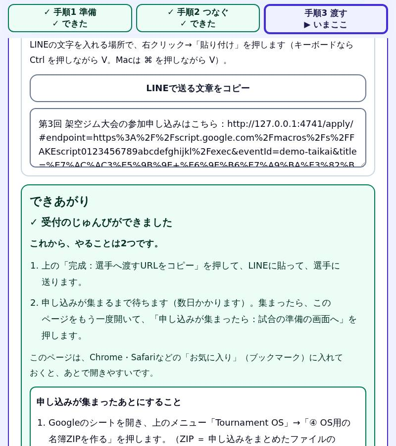

> 👉 **ここまでで、申し込みの準備は終わりです。** このページを、お気に入りに入れておくと、あとで開きやすいです（Ctrl キーを押しながら D）。申し込みが集まるまで、数日待ちます。

---

### 4-2　保護者の方が見る画面（スマホ）

**何をするか：** 保護者の方が、スマホで申し込みます。

**なぜか：** 会長さんが、電話で説明するときの参考にもなります。

**このあと：** 申し込みが、会長さんのGoogleの表にたまります。

選手の画面は、上から下に進みます。画面に4つの丸が出ます。「選手の情報」「連絡先」「確認して送る」「完了」です。

黄色の「👉 次はここ」の札が、いま入れる所を1つだけ教えてくれます。

**手順1：LINEで届いたURLを押します。**

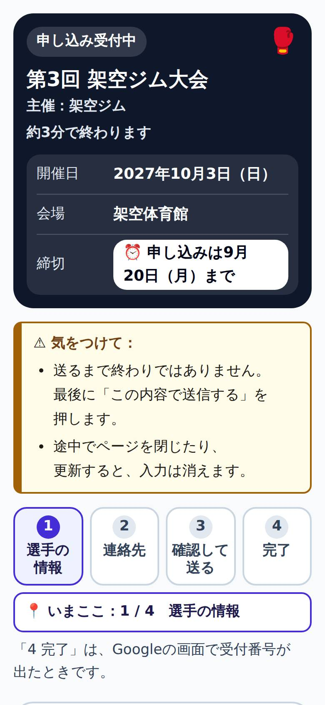

- ✅ できた目印：大会の名前と、日にち・会場・締切が出ます。「申し込み受付中」と、『用意するもの：顔写真1枚。入力は全部で14個です。』も出ます（14の所は、リンクの設定で変わります）。
- ⚠ ちがう画面が出たら：「送るまで終わりではありません。」と書いてあります。このあと、最後まで進みます。「途中でページ（タブ）を閉じると、入力は消えます。」とも書いてあります。閉じないでください。（更新したときは、選手の欄（ジム名・選手名・身長・体重など）の入力だけ、残っていることがあります。上に「戻す」が出ます。連絡先・写真・同意のチェック・花道の答え・誓約書の✔・ジム責任者の欄は、入れ直しです。手順19を見ます。）
- ⚠ 締切を過ぎたあとに開くと：本物のリンクでは、入力する欄と「入力内容を確認する →」が灰色になり、押せません。『申し込みの締切（9月20日）を過ぎました。主催者に連絡してください』と出ます（日にちは、リンクの締切です）。黄色の「次はここ」は、電話のところだけです（連絡先に電話番号があるとき）。主催者（会長さん）に電話して、相談します。会長さんが試すための、テスト用のリンクでは、止まりません。

**手順2：「ジム名」の四角に、通っているジムの名前を入れます。**

（例：『架空ジム』）

- ✅ できた目印：黄色の「👉 次はここ」が、次の欄に動きます。
- ⚠ ちがう画面が出たら：画面にある『例：…』は見本です。自分のジムの名前に直します。ジムに入っていない人（『無所属』『なし』など）は、「ジムに所属していない人は、参加できません。通っているジム・道場の名前を入れてください。」と赤く出て、参加できません。

**手順3：「選手名」の四角に、試合に出る人の名前を入れます。**

（例：『山田 太郎』）

- ✅ できた目印：黄色の札が、次の欄に動きます。
- ⚠ ちがう画面が出たら：保護者の方の名前ではなく、試合に出る人の名前です。

**手順4：「身長（cm）」の四角に、数字だけを入れます。**

（例：『165』）

- ✅ できた目印：黄色の札が、次の欄に動きます。
- ⚠ ちがう画面が出たら：「cm」は書かなくても大丈夫です。全角の数字（１６５）も、自動で直ります。

**手順5：「体重（kg）」の四角に、試合に出る体重を入れます。**

（例：『55』）

- ✅ できた目印：黄色の札が、次の欄に動きます。
- ⚠ ちがう画面が出たら：わからないときは、いまの体重で大丈夫です。身長と体重を逆に入れると、「逆ではありませんか？」と教えてくれます。
- 💡 階級分けを使う大会（シートの「階級分け」が「あり」の大会）では、「体重（kg）」のすぐ下に、「出場区分」と「階級」を選ぶ欄が出ます。選びかたは、4-3の2を見ます。使わない大会には、この欄はありません。

**手順6：「戦績」に、これまでの試合の成績を入れます。欄は3つあります（キックボクシング・他の格闘技・タイトル・入賞歴）。**

（例：『3勝1敗』の人は、キックボクシングの「試合数」に4、「勝ち」に3、「負け」に1と入れます。）

（戦績＝これまでの試合の成績のことです。）

- **キックボクシングの戦績**：「試合数」「勝ち」「負け」「引き分け」に数字を入れます。試合数には、スパーリング大会も入れます。はじめて試合に出る人は、「試合数」に「0」と入れると、入力は完了です。
- **他の格闘技の試合経験**：「なし」か「あり」を選びます。「あり」のときは、競技名・試合数・勝ち・負け・引き分け・勝敗なしを入れます。競技が2つ以上あるときは、「競技を追加する」を押します。勝敗が付かなかった試合は、「勝敗なし」に入れます（引き分けとは別です）。
- **タイトル・入賞歴**：「なし」か「あり」を選びます。「あり」のときは、大会名・獲得年・階級・タイトル名または入賞成績を入れます。2つ以上あるときは、「実績を追加する」を押します。
- ⚠ 赤い文は、スパーリング大会も含めて、戦績を正直に書いてほしいというお願いです。

- ✅ できた目印：入れた直後に、下の「クラス」の中に、黄色の目印が出ます。「戦績からは、」のあとに、クラスの名前が出ます。たとえば『戦績からは、Bクラスです』です。（黄色の目印は、クラス分けが「あり」の大会だけに出ます。）
- ⚠ ちがう画面が出たら：「試合数」と、勝ち・負け・引き分けの合計が合わないと、赤い文が出ます。合うように直します。（昔の申し込みの画面で、戦績の欄が1つだけのときは、はじめて試合に出る人は『初試合』と書きます。欄がからのときは、欄の下に「初試合なら、ここを押す」が出ます。押すと『初試合』が入ります。）黄色の目印の意味は4-4を見ます。

**手順7：（クラス分けが「あり」の大会だけ）「クラス」で、条件とルールを読んで、「Aクラス」か「Bクラス」の四角を押します。**

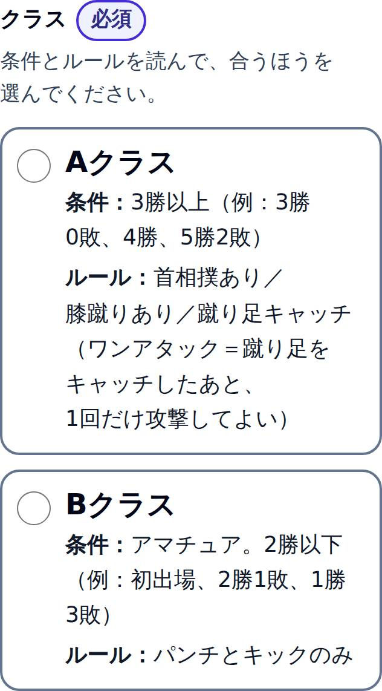

（この写真に出ている条件とルールの文は、古い版のものです。いまのはじめの文は、3-3の表のとおりです。選ぶ四角の形は、同じです。）

- ✅ できた目印：選んだ四角が緑になり、「えらびました」が付きます。
- ⚠ ちがう画面が出たら：選び方は4-3を見ます。目安とちがう方を選ぶと、赤い線が出ますが、そのまま送れます。

**手順8：「学年」「年齢」「意気込み」の四角に、入れます。（はじめの設定は「必須」です）**

- ✅ できた目印：3つとも入れると、黄色の「👉 次はここ」が、つぎの場所へ進みます。この3つは、クラス（ある大会だけ）のあと、入場曲（ある大会だけ）と「写真をえらぶ」の前に並んでいます。
- 書き方：「学年」は、小学生なら『小5』、中学生なら『中2』のように書きます。社会人の方は『社会人』と書きます（30文字まで）。出場区分を選ぶ大会では、大人の区分（区分の名前に「小学」「中学」「高校」「ジュニア」「キッズ」「幼」が入らないもの）を選ぶと、学年の欄は出ません（学年が必須の大会は『社会人』と自動で入ります）。「年齢」は数字だけ、「意気込み」は、ひとこと（試合への気持ちです）。
- ⚠ ちがう画面が出たら：「意気込み」は、試合当日の会場の画面に出ます。住所や電話番号は書きません。はじめは「必須」で、空のままでは先に進めません。主催者が「設定」タブで「任意」にしているときだけ、空のままでも先に進めます。「なし」にしているときは、その欄は出ません。

**手順9：（設定タブで入場曲が「あり」の大会だけ）「入場曲のリンク」の四角に、Apple MusicかYouTubeの曲のリンクを入れます。**

（例：『https://music.apple.com/…』）

- ✅ できた目印：黄色の札が、「📷 写真をえらぶ」に動きます。
- ⚠ ちがう画面が出たら：曲のアプリで「共有」→「リンクをコピー」を押して、四角に貼ります。「Spotify は使えません。Apple Music か YouTube で同じ曲を探してください」と出たときは、別のアプリで同じ曲を探します。入場曲が「なし」の大会には、この四角はありません。

**手順10：「📷 写真をえらぶ（撮る・アルバムから）」を押して、顔の写真を選びます。**

- ✅ できた目印：「写真OK」と出て、選んだ写真が小さく出ます。
- ⚠ ちがう画面が出たら：LINEの中で写真が選べないときは、LINEの右上の「…」を押して、「他のブラウザで開く」を押します。別のブラウザで開き直すと、入力は消えます。もう一度、最初から入れます。

写真は、顔が正面から見える写真にします。明るい所で撮ります。ひとりだけ写ります。帽子とサングラスは、なしにします。

**手順11：「連絡先のお名前」の四角に、連絡がつく人の名前を入れます。**

（例：『山田 花子』）

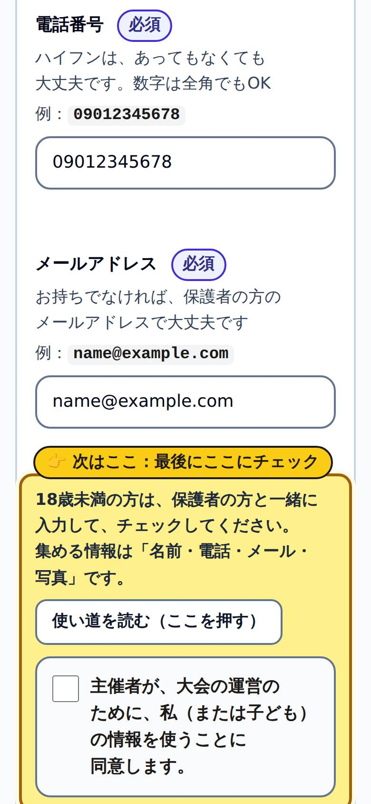

- ✅ できた目印：黄色の札が、次の欄に動きます。
- ⚠ ちがう画面が出たら：本人でも、保護者の方でも大丈夫です。連絡先は、主催者からの連絡だけに使います。

**手順12：「電話番号」の四角に、電話番号を入れます。**

（例：『09012345678』）

- ✅ できた目印：黄色の札が、次の欄に動きます。
- ⚠ ちがう画面が出たら：ハイフン（-）は、あってもなくても大丈夫です。

**手順13：「メールアドレス」の四角に、メールアドレスを入れます。**

（例：『name@example.com』）

- ✅ できた目印：黄色の札が、同意のチェックに動きます。
- ⚠ ちがう画面が出たら：お持ちでなければ、保護者の方のメールアドレスで大丈夫です。

**手順14：「使い道を読む（ここを押す）」を押します。**

- ✅ できた目印：使い道の説明が開きます。「どんな情報を、何のために使いますか？」と出ます。
- ⚠ ちがう画面が出たら：18歳未満の方は、保護者の方と一緒に入力します。

**手順15：読み終わったら、同意の四角にチェックを入れます。**

- ✅ できた目印：「入力」のあとに『14/14』のような数が出て、「ぜんぶ入りました」と緑で出ます。（数は大会の設定で変わります。この手順書の大会のように、クラス分けが「あり」で、学年・年齢・意気込みが「必須」のときは『14/14』です。クラス分けが「なし」の大会は『13/13』です。入場曲が「あり」なら、1つふえます。階級分けを使う大会では、「出場区分」の分で1つ、出場区分を選んだあと「階級」を選ぶ分で、もう1つふえます。誓約書を使う大会では、誓約書の□や、ジム責任者の名前・電話の分も、ふえます。）
- ⚠ ちがう画面が出たら：チェックを忘れると、同意の所が赤くなります。下のボタンが『あと5か所』のように変わり、押すと、入っていない所へ連れて行ってくれます。

**手順15の2：（誓約書が「あり」の大会だけ）「誓約書」の枠の□に、✔を入れます。**

- ✅ できた目印：「連絡先」の下に、「誓約書」の枠が出ます。「下の文を読んで、□に✔を入れてください。✔を入れないと、先へ進めません。」と書いてあります。□を全部✔すると、下のボタンが使えるようになります。
- ⚠ ちがう画面が出たら：✔が残っているあいだは、「入力内容を確認する →」が灰色で、理由が出ます（たとえば『誓約書の□が、あと3つ残っています』）。くわしくは、4-3の4を見ます。誓約書を使わない大会では、この枠は出ません。

**手順16：「入力内容を確認する →」を押します。**

- ✅ できた目印：「送る前の確認」の画面が出ます。まだ送っていません。「クラス：」のあとに『Bクラス』などが並びます。階級分けを使う大会では、「出場区分」と「階級」の行も並びます。誓約書を使う大会では、「誓約書」の行も並びます（4-3の4）。
- ⚠ ちがう画面が出たら：まちがいがあれば、「戻って直す（送信しません）」を押します。入力は消えません。「送ったあとは、ここでは直せません」と書いてあるので、電話番号とメールをよく読み合わせます。

**手順17：「この内容で送信する」を1回だけ押します。**

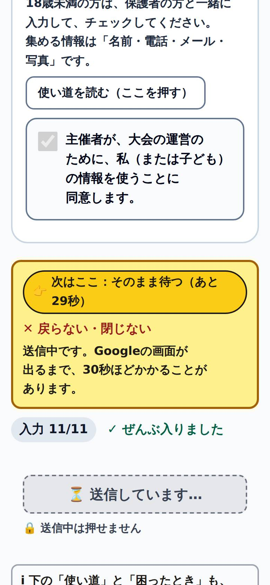

- ✅ できた目印：「送信中です。Googleの画面が出るまで、30秒ほどかかることがあります。」と出ます。黄色の札は「そのまま待つ」です。
- ⚠ ちがう画面が出たら：戻ったり、閉じたりしません。待つ秒の数字が、だんだん減っていきます。

**手順18：Googleの白い画面で「受付番号」が出たら、画面の写真（スクリーンショット）をとります。**

（スクリーンショット＝画面をそのまま写真にして残すことです。）

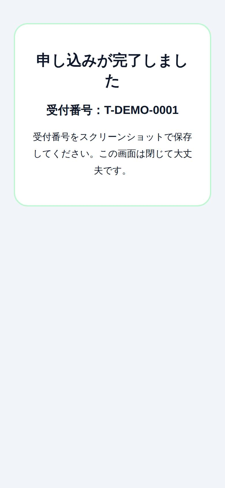

- ✅ できた目印：「申し込みが完了しました」と「受付番号」が出ます。（この写真は見本です。本物は、Googleが出す白い画面です）
- ⚠ ちがう画面が出たら：「送れませんでした」と出たら、ブラウザの「戻る」で直して、もう一度送ります。「保存結果の確認が必要です」と出たら、「受付番号が出るまで完了ではありません。」と書いてあります。「同じ申込を確認・再開する」のボタンが出たら、それを押します。新しく入れ直しません。

**手順19：もう1人（兄弟など）を申し込むとき。また、入力の途中で、ページを更新してしまったとき。**

送ると、画面ごとGoogleの白い画面に移ります。だから、申し込みページは、次の人のために、スマホの中（そのタブの中だけ）に、短い時間だけ、メモを残します。パソコンにも、Googleにも、ほかの場所にも、送りません。タブを閉じると、消えます。

- ✅ できた目印（送ったあと、申し込みページを開き直したとき）：「さっきと同じジム名・連絡先を入れました。」と出ます。ジム名・連絡先・個人情報の同意のチェックが、自動で入っています。選手の欄は空です。覚えているのは、60分のあいだだけです。（ジム責任者の名前と電話は、誓約書があるときだけ入ります。「許可」のチェックは、毎回、あらためて入れます。）
- ✅ できた目印（送ったあと、ブラウザの「戻る」で戻ってきたとき）：「別の人を申し込む（選手の入力だけ消す）」を押します。選手の入力と写真と誓約書の✔だけが消えて、ジム名と連絡先は残ります。
- ⚠ ちがう画面が出たら（別のジムの人、別の連絡先）：「変える」を押します。ジム名と連絡先が、空に戻ります。ジムのタブレットのように、いろいろな人が使う端末では、「変える」を押すか、タブを閉じます。
- ⚠ 入力の途中で、ページを更新したとき：『さっきの入力が残っています（◯分前）。』と出ます。「戻す」を押すと、選手の欄12個（ジム名・選手名・身長・体重・出場区分・階級・クラス・戦績・学年・年齢・意気込み・入場曲のリンク）が戻ります。「消す」を押すと、消えます。12時間たつと、自動で消えます。電話・メール・写真・個人情報の同意・花道の答え・誓約書の✔・保護者とジム責任者の欄は、残していないので、もう一度入れます。
- ⚠ スマホの設定（プライベートブラウズなど）で、この記憶が使えないときは、何も覚えません。申し込みは、いつもどおりできます。

---

### 4-3　Aクラス・Bクラスの選びかた

クラスは、これまでに**勝った数**だけで決めます。負けと引き分けは、数えません。

クラスの条件とルールは、第1章の表と同じです。言葉の意味は、10-5を見ます。

**判定表（勝った数で、クラスが決まります）**

| 勝った数 | クラス | 戦績の書き方の例 |
|---|---|---|
| 0勝 | Bクラス | 『初試合』『0勝3敗』 |
| 1勝 | Bクラス | 『1勝3敗』 |
| 2勝 | Bクラス | 『2勝1敗』『2勝5敗』 |
| 3勝 | Aクラス | 『3勝0敗』『3勝2敗』 |
| 4勝 | Aクラス | 『4勝』『4勝1敗』 |
| 5勝以上 | Aクラス | 『5勝2敗』『10勝10敗』 |

ポイントは、次の3つです。

- 『3勝0敗』は、Aクラスです。『2勝1敗』は、Bクラスです。
- 負けの数は、数えません。『2勝5敗』は、2勝なのでBクラスです。
- 引き分けも、数えません。『3勝1分け』は、3勝なのでAクラスです。

⚠ 気をつけること：この表は、シートの「設定」タブの「上のクラスにする勝ち数」が『3』のときの表です。この数字を変えた大会では、表の線が変わります。

Aクラスの条件の文には、『3勝以上（3勝以下でも、会長・指導者の許可があればAクラスに出られます）』と書いてあります。勝ちが3つに足りなくても、許可があれば、Aクラスに出られる、という意味です。申し込みページの黄色の「目安」は、勝った数だけで出します。許可のことは、見ません。

決めるのは、選手本人（保護者の方）です。画面の目安は、おおよその参考です。送るのは、止められません。

⚠ 気をつけること：**花道の出場区分を選んだ人は、クラスを選びません。** 「クラス」の欄が出なくなり、かわりに、シートの「花道のルール」の1行が、灰色で出ます（3-3の手順13の3）。花道でない出場区分に変えると、「クラス」の欄が戻ります。花道の人のクラスは、空のまま保存されます（準備の画面で、「クラスが入っていない」とは言いません）。

---

### 4-3の2　出場区分と階級の選びかた

**使うのは、階級分けの大会だけです。** シートの「設定」タブで「階級分け」が「あり」のときに、申し込みページに出ます。「なし」の大会には、この欄はありません。

**何をするか：** 選手（保護者の方）が、先に「出場区分」を選び、つづけて「階級」を選びます。2段で選びます。

**なぜか：** 体重の近い人どうしで戦えるように、グループを分けるためです。

**このあと：** 選んだ出場区分と階級は、シートの「申込原本（個人情報あり）」と、名簿のZIPに入ります。第6章で、赤と青の区分か階級がちがうと、赤い注意が出ます（6-4の2）。

**言葉の意味：** 出場区分は、年れいや男女のグループです（たとえば『中学生男子』）。選手の画面では「出場区分」と出ます。会長さんの画面（準備・当日・対戦一覧表）では、同じものが「区分」と出ます。階級は、その区分の中の、体重ごとのグループです（たとえば『-37kg（37kg以下）』）。くわしくは、10-5です。

はじめから入っている出場区分は、7つです（千葉県キックボクシング協会 Vol.7〔2026年12月20日大会〕の要項どおり。「設定」タブで直せます。3-3の手順13）。

| 出場区分（四角に出る名前） | 選べる階級（はじめから入っている表） |
|---|---|
| 小学生以下 | ありません（体重が近い人どうしで組みます） |
| 中学生女子 | -37kg から -58kg まで（8つ） |
| 中学生男子 | -37kg から -58kg まで（8つ） |
| 高校生・一般女子 | -40kg から -65kg まで（9つ） |
| 高校生・一般男子 | -50kg から -85kg まで（12こ）と、無差別 |
| 花道・女子（40歳以上） | -40kg から -60kg まで（5つ）と、+60kg |
| 花道・男子（40歳以上） | -55kg から -85kg まで（7つ）と、無差別 |

**手順1：「体重（kg）」のすぐ下にある、「出場区分」の四角を押します。**

- ✅ できた目印：「出場区分」の下に、「選んでください」と出た四角があります。「出場区分を選んでください。出場区分によって、選べる階級（体重で分けたグループ）がちがいます。」と書いてあります。四角を押すと、出場区分の一覧が開きます。
- ⚠ ちがう画面が出たら：「出場区分」の欄が出ないときは、この大会は階級分けを使っていません。何もしなくて大丈夫です。

**手順2：出る人に合う出場区分を、1つ押して選びます。**

- ✅ できた目印：四角に、選んだ出場区分の名前が入ります。階級のある出場区分なら、その下に「階級」の四角が出ます。黄色の「👉 次はここ」の札も、「階級」に動きます。
- ⚠ ちがう画面が出たら：出場区分を選び直すと、「階級」は空にもどります。前の出場区分の階級が、新しい出場区分に無いことがあるからです。もう一度、階級を選びます。

**手順3：（階級のある出場区分のとき）「階級」の四角を押して、体重に合う階級を選びます。**

- ✅ できた目印：「階級」の下に、「体重に合う階級を選んでください。」と書いてあります。階級の一覧には、その出場区分の階級だけが出ます。『-37kg（37kg以下）』『+60kg（60kgをこえる）』『無差別（体重の制限なし）』のように、記号と言葉が並んで出ます。選ぶと、四角に入ります。
- 読みかた：『-37kg』は、37kg以下です。『+60kg』は、60kgをこえる人です。『無差別』は、体重の制限がありません。
- ⚠ ちがう画面が出たら：体重が階級をこえていても、止めたり、警告したりしません。体重とくらべるのは、アプリではなく、会場で人が見ます。

**手順4：（『小学生以下』を選んだとき）階級は選びません。**

- ✅ できた目印：「階級」の四角のかわりに、灰色の文で「この出場区分には階級がありません。小学生の試合は、申し込みの体重を目安に、近い学年（1〜2年の差）・近い体重（2〜3kgの差）の選手どうしで組みます。目安なので、ちがうこともあります。」と出ます。そのまま、次の「戦績」へ進みます。
- ⚠ ちがう画面が出たら：「入力」のあとの数も、階級の分だけ、1つ少なくなります。まちがいではありません。

**手順5：出場区分や階級を選ばないまま、「入力内容を確認する →」を押したときを知ります。**

- ✅ できた目印：選ばなかった欄の下に、赤い「✕」で、「出場区分を選んでください。」または「階級を選んでください。」と出ます。選ぶと、赤い文は消えます。
- ⚠ ちがう画面が出たら：出場区分も階級も、選ばないと、「送る前の確認」へ進めません。（階級のない出場区分は、階級を選ばなくて大丈夫です）

**手順6：全部入れて「入力内容を確認する →」を押して、「送る前の確認」で見ます。**

- ✅ できた目印：「選手の情報」の中に、「出場区分」と「階級」の行が並びます。『小学生以下』のときの「階級」は、『なし（小学生の試合は、申し込みの体重を目安に、近い学年（1〜2年の差）・近い体重（2〜3kgの差）の選手どうしで組みます。目安なので、ちがうこともあります。）』と出ます。
- ⚠ ちがう画面が出たら：まちがえたときは、「選手の情報」の「直す」を押して、選び直します。

⚠ 気をつけること：選ぶのは、選手本人（保護者の方）です。アプリは、年れいや体重が、選んだ出場区分・階級に合っているかは、調べません（体重が階級をこえていても、止めたり警告したりしません）。申し込みページが調べるのは、数字の範囲だけです（年れいは1〜120、身長は50〜250、体重は10〜250）。体重の差は、対戦カードを作るときに、準備の画面が注意します（6-3）。『花道・女子（40歳以上）』『花道・男子（40歳以上）』は、40歳以上の人の出場区分です。選手から電話で『どれを選ぶの？』と聞かれたら、会長さんが、年れいと体重を聞いて、伝えます。送ったあとに、まちがいに気づいたときは、4-6を見ます。

---

### 4-3の3　花道の追加の質問に答える

**使うのは、花道の大会だけです。** シートの「設定」タブで「花道の追加情報」が「あり」のときに、花道の区分（名前に「花道」が入っている区分。はじめから入っているのは、『花道・女子（40歳以上）』と『花道・男子（40歳以上）』）を選んだ人にだけ、出ます。ほかの区分を選んだ人や、「なし」の大会には、この質問はありません。

**何をするか：** 選手（保護者の方）が、「花道の追加の質問」に答えます。「選手の情報」の続きで、「連絡先」の前に出ます。

**なぜか：** 花道の選手は、大会のアナウンスで紹介されます。その紹介に使う質問です（花道の別紙の項目と同じです）。

**このあと：** 答えは、会長さんのGoogleのシートの「花道プロフィール」タブにだけ入ります（テストの申し込みは「テスト花道プロフィール」タブ）。会長さんが、このタブを見て、アナウンスで使う項目を決めます。「試合の準備」の画面と「試合当日の画面」には、自動では出ません。

聞くのは、必須の6項目だけです。「選手の情報」で入れた、ジム名・選手名・身長・体重・戦績は、もう一度聞きません。花道の区分では、同じことを2回聞かないように、次の欄は画面に出ません（自動で入ります）：所属ジムのフリガナ（＝ジム名）、リングネーム（＝選手名）、そのフリガナ（＝氏名のフリガナ）、年齢（＝生年月日から計算）、学年（「学年」が必須の大会だけ『社会人』）、意気込み（「意気込み」が必須の大会だけ、花道の「メッセージ」と同じ文。会場の画面にも出ます）。確認の画面には、自動で入った値が出ます。任意だった「他格闘歴」「職業」は、必要最低限にするため、聞きません。「趣味・特技」は、「趣味・特技と、始めた理由」の1つの欄にまとめて書きます（シートの「趣味・特技」の列には『「始めた理由・良かった所」の欄に、まとめてあります』と入ります）。

| 項目（画面の名前） | 必須／任意 | 入れること（例は見本です） |
|---|---|---|
| 氏名のフリガナ | 必須 | 上の「選手名」のフリガナ。カタカナで入れます。例：『カクウ ハナミチイチロウ』 |
| 生年月日 | 必須 | 西暦で、年・月・日の3つの四角から選びます。年の一覧には、西暦のとなりに（ ）で和暦も出ます。例：『1975（昭和50）』『8月』『20日』 |
| キック歴（年） | 必須 | キックを始めてから何年か。数字だけ。1年に満たない時は 0。例：『5』 |
| 練習頻度（週に何回） | 必須 | 1週間に何回くらい練習するか。数字だけ。例：『3』 |
| 趣味・特技と、始めた理由 | 必須 | 趣味・特技と、キックを始めた理由・始めて良かったところを、まとめて書きます。300文字までです。例：『釣りが好きです。健康のために始めて、体力がつき、毎日が楽しいです。』 |
| メッセージ | 必須 | 意気込み、得意技、アナウンスで伝えてほしいことなど、自由に。300文字までです。（上のほうの「意気込み」とは、別の欄です） |

「必須」と「任意」は、項目の名前の横に出ます。いまは、他格闘歴と職業だけが「任意」です。「必須」と「任意」を変えたいときは、ジムの担当者に頼みます（変える場所は、`core/hanamichi.ts` の表と、Googleのプログラムの表の、同じ行です）。

**手順1：「出場区分」で、花道の区分を選びます。**

- ✅ できた目印：「連絡先」の前に、「＋ 花道の追加の質問」の枠が出ます。枠の中に、「花道の紹介の質問です。アナウンスで使います。」と、黄色の「⚠ 気をつけて」の箱で「住所や電話番号は書かないでください。」と出ます。
- ✅ できた目印（クラス分けの大会）：「クラス」の欄が消えて、かわりに、「花道のルール」の灰色の1行が出ます（4-3）。
- ⚠ ちがう画面が出たら：枠が出ないときは、この大会が、花道の追加の質問を使っていません。何もしなくて大丈夫です。花道でない区分に変えると、枠は消えます。入れた答えは、送られません。

**手順2：「必須」の項目を、上から順に入れます。**

- ✅ できた目印：項目ごとに、「必須」か「任意」の札が付いています。キック歴と練習頻度は、数字を入れます（『5年』『3回』と入れても、数字だけに直ります）。長い文の項目には、『あと◯文字（300文字まで）』のように、残りの文字数が出ます。
- ⚠ ちがう画面が出たら：入れていない所や、書き方がちがう所は、その項目のすぐ下に、赤い「✕」で出ます。「任意」の2つ（他格闘歴・職業）は、空でも進めます。

**手順3：生年月日を、年・月・日の順に選びます。**

- ✅ できた目印：四角が3つ並びます（スマホの細い画面では、年が1行、月と日が次の1行）。年の一覧は、1990年から1930年までが先に並び、そのあとに、1991年から今年までが並びます。年は、西暦のとなりに（ ）で和暦も書いてあります（たとえば『1986（昭和61）』『1989（昭和64・平成元）』『2019（平成31・令和元）』）。選ぶのは西暦の年で、保存されるのも西暦です。
- ⚠ ちがう画面が出たら：2月30日のような、ない日や、まだ来ていない日を選ぶと、赤い「✕」で出ます。選び直します。年れいが40歳以上かどうかは、調べません（40歳より若くても、送れます）。

**手順4：全部入れて「入力内容を確認する →」を押して、「送る前の確認」で見ます。**

- ✅ できた目印：「選手の情報」の下に、「花道の追加の質問」の枠が並び、6項目の答えが出ます。
- ⚠ ちがう画面が出たら：まちがえたときは、「花道の追加の質問」の「直す」を押して、直します。

⚠ 気をつけること：生年月日や職業は、個人情報です。答えは、この申し込みを送るまでの間だけ画面にあり、申し込みのリンクにも、この端末の中にも残りません（入力の途中保存にも、花道の答えは入りません）。送ると、会長さんのシートの「花道プロフィール」タブにだけ入ります。送ったあとに、まちがいに気づいたときは、4-6を見ます。

---

### 4-3の4　誓約書の□に✔を入れる

**使うのは、誓約書を使う大会だけです。** シートの「設定」タブで「誓約書」が「あり」のときに、申し込みページの**いちばん最後**（「連絡先」のあと）に、「誓約書」の枠が出ます。「なし」の大会（はじめの値）には、何も出ません。

**何をするか：** 選手（保護者の方）が、誓約書の□に✔を入れます。

**なぜか：** 大会に出る人（子どもは保護者の方）が、誓約書の内容に同意した、という記録を残すためです。署名（手書きの名前）はありません。

**このあと：** 全部の□に✔を入れると、次へ進めます。✔したことは、会長さんのシートの「誓約記録」タブ（テストの申し込みは「テスト誓約記録」タブ）に、そのときの文といっしょに、1行残ります。

文は、会長さんがシートの「誓約書」タブに書いたものが、そのまま出ます（番号は付きません）。出る枠は、3つあります。

| 枠 | 出る人 | 入れること |
|---|---|---|
| 誓約書の項目（□が項目の数だけ） | 全員 | 項目の文を読んで、1つずつ□に✔を入れます。 |
| 保護者（連帯責任者）の同意 | 「設定」タブの「保護者の同意」で決まります。『18歳未満のみ』なら、年齢が18歳未満の人（年齢が空・読めないときも出ます）。『全員』なら全員。『なし』なら出ません。 | 文を読んで、□に✔を入れます。年齢を入れ直して、18歳以上と未満が変わると、この枠は出たり消えたりします（消えると、✔も消えます）。年齢がまだ空（や読めない）ために出ているときは、枠の中に「年齢を入れると、18歳以上の方は、この欄が出なくなります。」と出ます。 |
| 団体・ジム責任者の同意 | 「設定」タブの「ジム責任者の同意」が『あり』のとき、全員 | 「ジム・道場名」は、上の「ジム名」が出ます（ここでは直せません）。「責任者のお名前」と「責任者の携帯電話（ハイフンなし）」を入れ、同意の□に✔を入れます。 |

**手順1：「誓約書」の枠で、項目を上から読んで、下の□に✔を入れます。**

- ✅ できた目印：枠の上に、「下の文を読んで、□に✔を入れてください。✔を入れないと、先へ進めません。」と書いてあります。□は1つです（『上の5つに、すべて同意します』のように出ます）。✔を入れた□は、緑になり、『✓ 入れました』と出ます。黄色の「👉 次はここ」の札は、次の□に動きます。
- ⚠ ちがう画面が出たら：✔を入れ忘れた□は、「この□に、✔を入れてください。」と赤い「✕」で出ます。

**手順2：（保護者の同意の枠が出たとき）文を読んで、□に✔を入れます。**

- ✅ できた目印：「保護者（連帯責任者）の同意」の枠の□が、緑になります。
- ⚠ ちがう画面が出たら：入れ忘れると、「保護者の方の同意の□に、✔を入れてください。」と赤い「✕」で出ます。

**手順3：（ジム責任者の枠が出たとき）「責任者のお名前」と「責任者の携帯電話（ハイフンなし）」を入れて、同意の□に✔を入れます。**

- ✅ できた目印：名前と電話が入り、2つの□に✔が入ると、緑になります。
- 💡 携帯電話は、070・080・090で始まる11けたです。ハイフン（-）や全角の数字でも、直して読みます。入れる四角の下に、見本の番号が出ています。
- 💡 同意の□の上に、「ジム責任者の許可を得てから、名前と電話番号を入れて、下の□に✔を入れてください。」と出ます。許可をとっていないときは、✔を入れません。名前を勝手に使わないための、念押しです（許可の□は、同意の□といっしょになりました）。
- ⚠ ちがう画面が出たら：電話が合っていないと、「携帯電話は11けたです。」などと赤い「✕」で出ます。固定電話や050の番号は、使えません。同意の□が空だと、「ジム責任者の同意の□に、✔を入れてください。」と出ます。
- 💡 近道：ジム責任者が連絡先の人と同じなら、「連絡先のお名前と電話を、ここにも入れる」を押すと、名前と電話が入ります。連絡先のお名前の欄の「選手名と同じにする」も、同じ近道です。
- ⚠ ジムに入っていない人は、参加できません。ジム名に『無所属』『むしょぞく』『所属なし』『なし』『フリー』『個人』『ジムなし』『通っていない』などと入れると、申し込みページに赤い「✕」で「ジムに所属していない人は、参加できません。通っているジム・道場の名前を入れてください。」と出て、先へ進めません。Googleの受付も、同じ理由で断ります（画面をすり抜けても、保存されません）。

**手順4：「入力内容を確認する →」を押して、「送る前の確認」で「誓約書」の行を見ます。**

- ✅ できた目印：「誓約書」の行に『5個ぜんぶに✔しました』のように出ます（数は、項目の数です）。保護者の枠が出た人は「保護者の同意」の行に『✔しました』、ジム責任者の枠が出た人は「ジム責任者」の行に『名前・電話・許可の確認』と、お名前と携帯電話が出ます。
- ⚠ ちがう画面が出たら：まちがえたときは、「誓約書」の「直す」を押して、直します。

⚠ **全部の□に✔を入れるまで、先へ進めません。** 「入力内容を確認する →」は灰色になり、理由が出ます（『誓約書の□が、あと3つ残っています』『ジム責任者の名前と電話が、まだです』）。押すと、入っていない所を、赤い「✕」で教えます。

⚠ 本番のURLで、会長さんが「誓約書の文の確認」を『済み』にしていないときは、「誓約書」の枠の上に、赤い「✕」で「主催者が、誓約書の文をまだ確認していません。送れません。」と出て、送信のボタンは灰色になります。入力がぜんぶ済んだときは、「入力内容を確認する →」のすぐ上にも、同じ赤い「✕」が出て、黄色の「次はここ」は「主催者に電話する」に付きます。会長さんに連絡します（テスト用のURLでは、この文は出ません）。

⚠ 会長さんが「誓約書」タブの文を直したあと、前のURLで送ろうとすると、「誓約書の文が、リンクを作ったあとで変わりました。主催者から、新しい申し込みリンクをもらってください。」と出て、保存されません。会長さんから新しいURLをもらいます。

⚠ 気をつけること：ジム責任者の名前と電話は、ほかの人の個人情報です。この申し込みを送るまでの間だけ画面にあり、申し込みのリンクには入りません。送ると、会長さんのシートの「誓約記録」タブにだけ入ります。送ったあとに、ほかの人を申し込むときのために、ジム責任者の名前と電話は、ジム名・連絡先といっしょに、このスマホのこのタブの中に60分だけ残ります（許可の□と同意の□は残りません。毎回、あらためて✔します）。

---

### 4-4　黄色の案内と、赤のやさしい注意の意味

申し込みページの「クラス」の中に出る、色のついた文です。どれも、**送るのを止める文ではありません**。（✕ がついた赤い文だけは、直さないと進めません）

| 色と記号 | 画面に出る文 | 意味 | どうするか |
|---|---|---|---|
| 黄色の「⚠」 | 「戦績からは、」のあとにクラスの名前（『戦績からは、Bクラスです』）と、「目安です。どちらにするかは、ご自分で決めてください。」 | 書いた戦績から、クラスの目安を教えています。 | クラスを選びます。目安と同じなら、そのまま進みます。 |
| 灰色の文 | 「戦績から、クラスの目安は出せませんでした。条件を読んで、選んでください。」 | 戦績の文字から、勝った数が読めませんでした。 | 条件を読んで、自分で選びます。 |
| 赤の「⚠」 | 「戦績と合っていますか？」のあとに、勝った数と目安のクラス（『戦績は2勝で、目安はBクラスです。』）と、「合っていれば、そのまま送れます。」 | 選んだクラスが、目安とちがいます。 | 合っていれば、そのまま送ります。まちがいなら、選び直します。 |
| 赤の「✕」 | 「クラスを選んでください」（『AクラスかBクラス』と続きます） | クラスが選ばれていません。 | どちらかを選びます。選ばないと、確認の画面へ進めません。 |

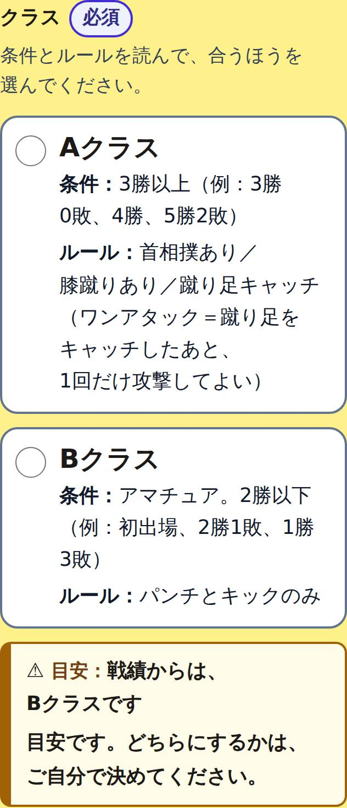

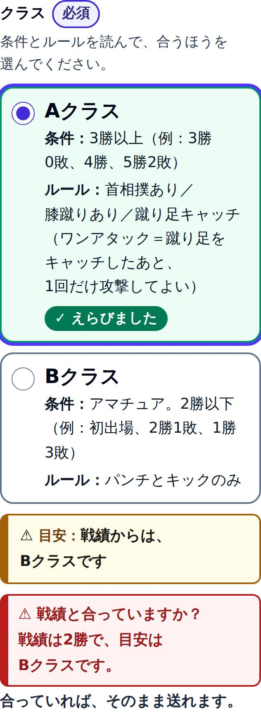

階級分けの大会の、出場区分・階級の赤い文（「出場区分を選んでください。」「階級を選んでください。」）は、4-3の2を見ます。

---

### 4-5　送ったあとの確認

**何をするか：** 申し込みが届いたかを、Googleのシートで見るだけで確かめます。

**なぜか：** 受付番号が表に入っていれば、申し込みが成功しているからです。

**このあと：** 申し込みが集まったら、第5章で名簿を取り込みます。

保護者の方が申し込むと、会長さんのGoogleのシートに、1行ふえます。書きかえません。

**手順1：Googleのシートのタブ（ブラウザの一番上に並ぶ名前）を開きます。**

- ✅ できた目印：コピーした自分のシートが出ます。一番上の名前が「…のコピー」になっています。
- ⚠ ちがう画面が出たら：シートが見つからないときは、第3章でシートを作ったときの、同じGoogleアカウントで開きます。

**手順2：シートの左下の、「申込原本（個人情報あり）」という名前を押します。**

- ✅ できた目印：申し込んだ人が、1人1行で並びます。1列目が「受付番号」です。クラス分けが「あり」の大会では、「クラス」の列（S列）に、『Aクラス』か『Bクラス』が入っています。階級分けが「あり」の大会では、そのとなりの「区分」「階級」の列に、選んだ区分と階級が入っています。
- ⚠ ちがう画面が出たら：「テスト申込」のタブは、ためしの申し込みです。本物ではありません。見まちがえないようにします。

**手順3：保護者の方に写真で送ってもらった「受付番号」が、1列目にあるか見ます。**

- ✅ できた目印：同じ番号の行が見つかります。
- ⚠ ちがう画面が出たら：見つからないときは、保護者の方の申し込みが、うまくいっていません。受付番号が出たかどうかを、もう一度聞きます。

⚠ 気をつけること：この表には、電話番号とメールアドレスが入っています。人に見せません。画面の写真も、チャットに貼りません。表の中は、直したり、行を消したりしません。シートを、ほかの人と共有もしません。

---

### 4-6　まちがえて申し込んだとき

| こまりごと | 保護者の方がすること | 会長さんがすること |
|---|---|---|
| 「受付番号」が出なかった | 直して、もう一度送って大丈夫です。 | 何もしません。 |
| 「受付番号」が出たあとで、名前・体重・クラス・区分・階級などの、まちがいに気づいた | もう一度、申し込みません。会長さんに連絡します。 | 第5章で名簿を取り込んだあと、その人の「直す」を押して、直します。直したら、第6章の「保存」を押します。 |
| 同じ人が、2回申し込んだ | 「申し込み済みです。同じ人を、もう一度送らないでください。」と画面に出ます。（申し込んだあとで、もう一度ページを開いたときに出ます。） | 第5章の5-5を見ます。片方を「消す」で消します。 |
| 兄弟など、別の選手も申し込みたい | 受付番号の画面の写真を撮ったあと、申し込みページを開き直します。ジム名と連絡先は、60分のあいだ、同じタブが覚えているので、自動で入ります（「さっきと同じジム名・連絡先を入れました。」と出ます）。「さっき、申し込みを送りました。」と出たら、「この表示を消す」を押します。選手の欄は空なので、別の選手の分だけを入れます。（送ったあと、ブラウザの「戻る」で戻ってきたときは、「別の人を申し込む（選手の入力だけ消す）」を押します。ジム名と連絡先は残ります。）共用のタブレットなどでは、「変える」を押すか、タブを閉じます。 | 何もしません。 |
| 花道の追加の質問の答えを、まちがえた | もう一度、申し込みません。会長さんに連絡します。 | シートの「花道プロフィール」タブの、その人の行（受付番号が同じ行）を直します。1行目（見出し）は、書き換えません。 |
| 誓約書のジム責任者の名前や電話を、まちがえた | 会長さんに、正しい名前と電話を連絡します。 | シートの「誓約記録」タブの、その人の行（受付番号が同じ行）を直します。1行目（見出し）は、書き換えません。 |
| 電話番号やメールを、まちがえた | 会長さんに、正しい番号を連絡します。 | 電話とメールは、名簿のZIPには入りません。シートの中は、自分では直さず、ジムの担当者に聞きます。 |
| 出場をやめたい | 会長さんに連絡します。 | 第5章で名簿を取り込んだあと、その人の「消す：」を押します。あとでZIPをもう一度選ぶと、その人は名簿にもどります。そのときは、もう一度「消す：」を押します。「消す」を使わず、対戦カードに入れないだけでも大丈夫です。 |
| 「現在、申し込みを受け付けていません。主催者へご連絡ください。」と出た | 会長さんに連絡します。 | 締切を過ぎたか、「③ 受付を停止」を押したあとです。受け付けてよいなら、ジムの担当者に聞いてください。設定を直したら、新しいURLを送り直します。（前のURLは、古い内容のままです） |

---

## 第5章　名簿を取り込む

### この章でやること

申し込みが集まったら、その名簿（選手の一覧）を、会長さんのパソコンのブラウザ（インターネットを見るソフト。ChromeかEdge）に入れます。これを『取り込む』と言います。

- Googleのシートのメニュー「④ OS用の名簿ZIPを作る」で、ZIPを作ります。（ZIP＝たくさんのファイルを、1つにまとめた箱のようなファイルです）
- そのZIPを、パソコンに保存します。（ダウンロード＝ネットからパソコンに保存することです）
- 保存したZIPを、アプリで選びます。

選手の名前・写真・体重・戦績は、**このパソコンの中だけ**に入ります。インターネットには送りません。電話番号とメールは、ZIPに入りません。

- かかる時間：約5分です。
- 次にやること：第6章で、対戦カードを作ります。
- 飛ばしてよい所：画面の「ほかの入れ方（Excel・他のジム・1人ずつ）」は、使いません。

**いちばん大事なこと：ZIPは、開かないし、解凍もしません。** ZIPは、**そのまま**アプリで選びます。アプリが、ZIPの中の名簿と写真を、自動で取り出します。

---

### 5-1　ZIPを作って、パソコンに保存する

**何をするか：** 名簿のZIPを作って、パソコンに保存します。

**なぜか：** 名簿は、パソコンに入れてから使うからです。

**このあと：** 5-2で、ZIPをアプリに入れます。

**手順1：Googleのシートのタブを開きます。**

- ✅ できた目印：自分のシートが出ます。一番上の名前が「…のコピー」になっています。
- ⚠ ちがう画面が出たら：シートが見つからないときは、第3章で使った、同じGoogleアカウントで開きます。

**手順2：シートの上のメニュー「Tournament OS」→「④ OS用の名簿ZIPを作る」を押します。**

- ✅ できた目印：シートの真ん中に、小さな箱が出ます。「名簿ZIPができました。」と書いてあります。
- ⚠ ちがう画面が出たら：「本番の申し込みはまだありません。テスト申込はこのファイルに混ぜません。」と出たら、まだ本番の申し込みが0件です。選手が申し込んだあとに、もう一度押します。「写真の合計が80MBを超えています。」（MB＝ファイルの大きさの単位です）と出たら、ジムの担当者に連絡します。メニューが出ないときは、再読み込み（ブラウザの左上の丸い矢印、またはキーボードの F5）を押して、10秒待ちます。

**手順3：小さな箱の「ここを押してダウンロード」を押します。**

- ✅ できた目印：新しいタブでGoogleドライブが開きます。ZIPのファイルの名前（『Tournament_OS_tos-…zip』のような名前）が見えます。（ドライブ＝Googleのファイル置き場です）
- ⚠ ちがう画面が出たら：まだ、パソコンには入っていません。箱が出ないときや、押せないときは、別の方法があります。Googleドライブ（drive.google.com）を開きます。『マイドライブ』の中の「Tournament OS 顔写真 - 大会名」フォルダを開いて、中の「Tournament_OS_（英数字）.zip」を探します。（フォルダ＝ファイルを入れておく入れ物です）

**手順4：Googleドライブの画面で、『ダウンロード』を押します。**

- ✅ できた目印：ブラウザの右上に、ダウンロードの印が出ます。
- ⚠ ちがう画面が出たら：『ウイルスをスキャンできません』のような注意が出たら、自分で作ったファイルです。『このままダウンロード』のようなボタンを押します。（Googleの画面の言葉は、お使いの時期で少しちがうことがあります）

**手順5：ダウンロードが終わったか、ブラウザの右上を見ます。**

- ✅ できた目印（Chromeの場合）：右上に、下向きの矢印の印が出ます。押すと、ZIPの名前が見えます。
- ✅ できた目印（Edgeの場合）：右上に、小さな窓が出て、ZIPの名前が見えます。
- ⚠ ちがう画面が出たら：この窓に出た**ファイルの名前は、押しません**。押すと、Windowsが、ZIPを開いてしまうことがあります。『ファイルを開く』も押しません。
- ⚠ ちがう画面が出たら：Edgeが『…一般的にダウンロードされていません』と出すことがあります。『保持する』のような言葉が出たら、それを押します。自分のシートで作ったファイルなので、保存して大丈夫です。

**手順6：（見るだけ）ZIPが、どこに入ったか確かめるために、エクスプローラーを開きます。**

（エクスプローラー＝Windowsで、フォルダやファイルを見る、黄色いフォルダの絵のソフトです。画面の下の黄色いフォルダの絵を押すと開きます。）

- ✅ できた目印：フォルダの窓が開きます。
- ⚠ ちがう画面が出たら：黄色いフォルダの絵が見つからないときは、Windowsキー（窓のマークのキー）を押しながら E を押します。

**手順7：エクスプローラーの左にある、『ダウンロード』を押します。**

- ✅ できた目印：『Tournament_OS_tos-…』という名前のファイルが、見つかります。
- ⚠ ちがう画面が出たら：Windowsの初期設定では、名前の最後の『.zip』が、見えないことがあります。ファイルの絵が、チャックのついたフォルダなら、ZIPです。同じファイルを2回ダウンロードすると、名前の最後に『(1)』が付きます。**新しい方**（更新日時が新しい方）を、あとで選びます。ZIPは、ダブルクリックしません。『すべて展開』も押しません。

---

### 5-2　アプリにZIPを取り込む

**何をするか：** 名簿のZIPを、アプリで選びます。

**なぜか：** 選手の名前と写真が、名簿に入るからです。

**このあと：** 名簿に選手が並びます。

**手順1：「選手の受付をつくる」の画面の下の、「申し込みが集まったら：試合の準備の画面へ」を押します。**

- ✅ できた目印：上に「いま開いている大会：」が出ます。はじめてのときは、名前が「まだ名前なし」でも大丈夫です。次の手順で、名前を入れます。灰色の「i」で「Googleの受付をつくる画面で決めた「選手に書いてもらうこと」を入れました。まだ保存していません。」と出ることがあります。クラスの名前やルールを引きついだ知らせです。そのままで大丈夫です。第6章の最後の「保存する」で残ります。
- ⚠ ちがう画面が出たら：「試合の準備」のタブがもう開いているときは、そのタブを押しても大丈夫です。このパソコンで前に作った大会を続けるときだけ、「大会をえらぶ・安心のしくみ（ほか）」を押して、その大会の「続きから：」で始まる行を押します。はじめての大会のときは、押しません。

**手順2：「1. 大会の情報」の「大会名」の四角に、大会の名前を入れます。**

（例：『第3回 青空ジム大会』。Googleのシートに書いたのと同じ名前にします。）

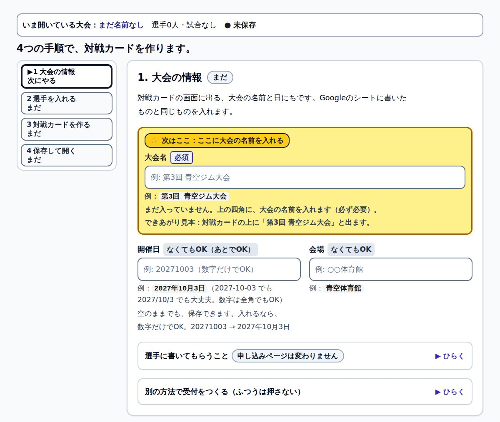

- ✅ できた目印：四角の下に、緑の文字で「できた」と出ます。いちばん上の「いま開いている大会：」のあとに、入れた名前が出ます。
- ⚠ ちがう画面が出たら：黄色の札「👉 次はここ」（「ここに大会の名前を入れる」と書いてあります）の下の四角が、「大会名」です。名前を入れないと、あとで「試合当日の画面を開く」が押せません。

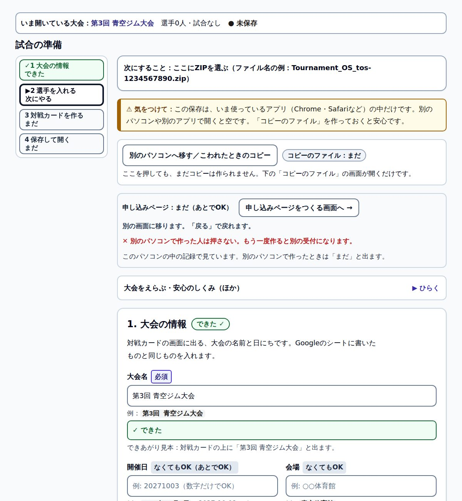

**手順3：（なくてもOK）「開催日」の四角に、大会の日にちを入れます。**

（例：『2027年10月3日』。数字だけの『20271003』でも入ります。）

- ✅ できた目印：四角の下に、「日にちを読みました：」または「自動で直しました：」と出ます。
- ⚠ ちがう画面が出たら：入れなくても、あとで入れても大丈夫です。「年がありません。」と赤く出たら、年も入れます。

**手順4：「2. 選手を入れる」の中の、白い大きな四角のボタン「ファイルを選ぶ」を押します。**

- ✅ できた目印：Windowsの『開く』という窓が出ます。黄色の札に「👉 次はここ」と出ています。
- ⚠ ちがう画面が出たら：窓が出ないときは、画面の下の青むらさきのボタン「↑ ファイルを選ぶ所へ」を押します。その場所へ行けます。選べるファイルは、「.zip」「.xlsx」「.csv」だけです。ほかのファイルは、『開く』の窓に出ません。

**手順5：『開く』の窓の、左にある『ダウンロード』を押します。**

- ✅ できた目印：ダウンロードしたファイルが、右に並びます。
- ⚠ ちがう画面が出たら：『ダウンロード』の字が無いときは、上の長い四角（アドレスの欄）に『ダウンロード』が出る所を探します。見つからないときは、5-1の手順6と手順7で、場所を確かめます。

**手順6：『Tournament_OS_…』のZIPを、1回だけ押して、選びます。**

- ✅ できた目印：そのZIPの行に色がつき、窓の下の『ファイル名』の四角に、ZIPの名前が入ります。
- ⚠ ちがう画面が出たら：新しい日付のファイルを選びます。ダブルクリック（続けて2回押す）は、しません。

**手順7：窓の右下の『開く』を押します。**

（この『開く』は、この窓のボタンです。ZIPの中を開くという意味ではありません。）

- ✅ できた目印：「選んだファイル」の下に、ZIPの名前が出ます。そして、緑の「できた：」で、「人分を読み込みました」と出ます。（例：『6人分を読み込みました（写真 6枚）』）
- ⚠ ちがう画面が出たら：赤い「まちがい：」が出たら、次の5-4を見ます。

---

### 5-3　取り込みがうまくいった目印

**何をするか：** 取り込みが、うまくいったかを見ます。

**なぜか：** 人数や写真が足りないと、あとで困るからです。

**このあと：** 第6章で、対戦カードを作ります。

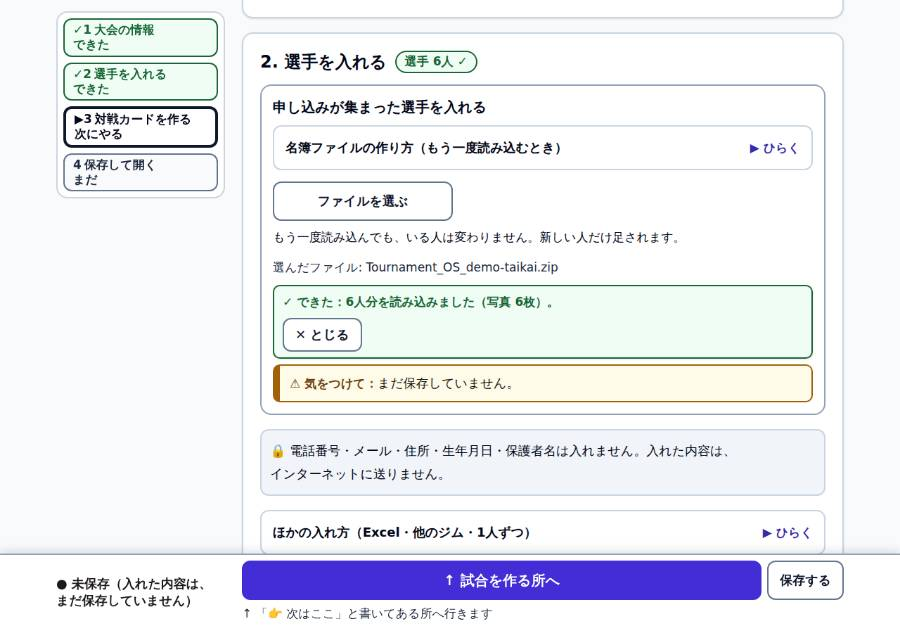

**手順1：「選んだファイル」と、緑の「できた：」を見ます。**

- ✅ できた目印：「できた：」のあとに、「人分を読み込みました」と、写真の枚数が出ます。人数と写真の枚数が、同じなら安心です。
- ⚠ ちがう画面が出たら：「写真がない選手」と出たら、写真が足りません。「写真は、あとでOKです」と書いてあります。あとで、その人の「写真を変える」で入れます。

**手順2：「入っています」と書いた緑の文（『6人 入っています（写真あり 6 / なし 0）』のような文）を見ます。**

- ✅ できた目印：左の「選手を入れる」の札が、緑の「✓」つきで「できた」になります。
- ⚠ ちがう画面が出たら：黄色の「まだ保存していません。」は、いまは気にしなくて大丈夫です。第6章で保存します。

**手順3：「選手の一覧」で、名前・ジム・クラス・体重と戦績・写真を見ます。**

（『選手の一覧（6人）』のように人数が付きます。）

- ✅ できた目印：全員の、名前・ジム・「クラス：」のあとのクラスの名前・体重・戦績・写真が出ています。階級分けの大会では、「区分・階級：」のあとに、区分と階級の札も出ます（たとえば『区分・階級：中学生男子・37kg以下』）。『小学生以下』は階級がないので、『区分・階級：小学生以下』と出ます。
- 💡 名簿のZIPの中の名簿（players.csv）には、「クラス」「区分」「階級」の列が入っています。階級分けを使わない大会は、今までと同じ列です。ZIPは開かないので、会長さんは、見なくて大丈夫です。
- 💡 選手の名前の下の「くわしい戦績」を押すと、キック・他の格闘技・タイトル・入賞歴が出ます。ZIPの中の records.csv（くわしい戦績）に入っていた人だけ出ます。古い申し込みの人には、出ません。
- ⚠ ちがう画面が出たら：取り込んだあとは、一覧がはじめから開いています。「▼ とじる」と出ていれば、開いています。閉じているときは、「ひらく」を押します。まちがいを見つけたら、その人の「直す」を押して、直します。人を消す「消す：」のボタンは、まだ押しません。

**手順4：左の「対戦カードを作る」の札が「次にやる」になっているのを見ます。**

- ✅ できた目印：黄色の「👉 次はここ」の札に、「試合を1つ作る」と出ます。
- ⚠ ちがう画面が出たら：何もしなくて大丈夫です。第6章へ進みます。

---

### 5-4　うまくいかなかったとき

**何をするか：** 取り込めなかったときの、直しかたを見ます。

**なぜか：** 赤い文に、次にやることが書いてあるからです。

**このあと：** 直したら、5-2の手順4からもう一度やります。

| 画面に出る文 | 意味 | どうするか |
|---|---|---|
| 「これは名簿ではありません」と「ZIPかExcel（.xlsx）か、CSVを選んでください。」 | ZIPではないファイルを選びました。 | 「今の名簿は変えていません。」と出るので安心です。もう一度「ファイルを選ぶ」を押して、ZIPを選びます。 |
| 「ZIPの中に players.csv が見つかりません。」 | ZIPの中に、名簿のファイル（players.csv。名簿の入った、かんたんな表のファイル）がありません。名簿が、いちばん外か、フォルダ1つの中にあれば、読めます。フォルダの中にフォルダが重なっているときは、読めません。 | シートのメニュー「④ OS用の名簿ZIPを作る」で作ったZIPを、そのまま選びます。 |
| 「写真がない選手」と「写真は、あとでOKです」 | 名簿だけ入って、写真が入っていません。 | 下の『ZIPを開いてしまったとき』の所を見ます。 |
| 「前の大会の人かもしれません。別の大会なら、足さないでください。」 | 前の大会の名簿が、残っているかもしれません。 | 別の大会の人なら、「足さない（もどす）」を押します。今回の大会の人なら、「このまま足す」を押します。 |

**ZIPを開いてしまったとき（写真が0枚になったとき）**

ZIPを開いて、中の名簿のファイル（players.csv）だけを選ぶと、選手は入りますが、写真が入りません。

直し方は、かんたんです。もう一度、**ZIPのまま**選びます。

（ZIPを展開してできたフォルダを、もう一度ZIPにしたものも、フォルダが1つ分なら読めます。プログラムの上では確かめてあります。Windowsでの実測は、まだです。）

**手順1：「ファイルを選ぶ」を押します。**

- ✅ できた目印：『開く』の窓が出ます。
- ⚠ ちがう画面が出たら：窓が出ないときは、5-2の手順4を見ます。

**手順2：ZIPを、もう一度選びます。**

- ✅ できた目印：「写真がなかった」と「人には、写真を足しました。」と出ます。
- ⚠ ちがう画面が出たら：選手の人数は、ふえません。前からいる人は、勝手に変わりません。

---

### 5-5　同じ人が2人いるとき

**何をするか：** 同じ人が2人いるとき、片方を消します。

**なぜか：** 同じ人を、2回試合に出さないためです。

**このあと：** 6章で、対戦カードを作ります。

同じ人が、2回申し込んだときなどに、同じ人が2人入ります。

**手順1：黄色の「⚠ 気をつけて」の文を読みます。**

- ✅ できた目印：「同じ名前の人が」「人 重なっています。足していません。」と出ます。アプリが、足さずに止めています。ZIPを選び直したときに、よく出ます。別の人なら、「別の人なら、足す」を押します。同じ人なら、何もしません。
- ⚠ ちがう画面が出たら：1つのZIPの中に、同じ人の申し込みが2つ入っているときは、「同じ名前とジムの人が」「組います」と出ます。名前と、番号が書いてあります。

**手順2：「選手の一覧」で、2人の体重・戦績・写真を見くらべます。**

- ✅ できた目印：どちらが正しいか、わかります。
- 💡 見くらべるのは、体重・戦績・番号です。番号は、行の上に書いてあります。
- ⚠ ちがう画面が出たら：わからないときは、保護者の方に聞きます。体重や戦績が、あとから直された方が、新しいことが多いです。

**手順3：消したい方の「消す：」のボタンを押します。**

（ボタンには、「消す：」のあとに名前が付いています。）

- ✅ できた目印：赤い枠の箱が出ます。「やめる」と「消す（もどせません）」の、2つのボタンが出ます。
- ⚠ ちがう画面が出たら：同じ人の申し込みが2つあるときは、「消す：」のあとに同じ名前が付いたボタンが、2つ並びます。上の行の体重・戦績・番号を見て、消したい方のボタンを選びます。
- ⚠ ちがう画面が出たら：その人が、もう試合に入っているときは、箱に『第1試合の赤コーナーが空になります』のように出ます。迷ったら「やめる」を押します。何も変わりません。

**手順4：まちがいがなければ、「消す（もどせません）」を押します。**

- ✅ できた目印：選手の一覧から、その人が消えます。
- ⚠ ちがう画面が出たら：「もどせません」と書いてあります。押す前に、もう一度、名前を確かめます。出場をやめた人は、あとでZIPを選び直すと、また入ります（5-6を見ます）。

⚠ 気をつけること：ZIPをもう一度選んでも、いる人は変わりません。「すでにいる人は、全員そのままです。」と出ます。
でも、**消した人は、もう一度選ぶと、また名簿に入ります。** （同じ名前とジムの人を消したときだけは、「同じ名前の人が」「人 重なっています。足していません。」と出て、入りません。）
ZIPを選び直したあとは、消した人が戻っていないか、「選手の一覧」で見ます。戻っていたら、もう一度「消す：」を押します。

---

### 5-6　あとから申し込みがふえたとき

**何をするか：** 新しい申し込みの人だけを、名簿に足します。

**なぜか：** すでにいる人は、そのままで、新しい人だけが入る決まりだからです。

**このあと：** 名簿の人数がふえます。最後に「保存する」を押します。

**手順1：5-1の手順1〜7を、もう一度やります。**

- ✅ できた目印：「ダウンロード」フォルダに、名前の最後に『(1)』が付いたZIPがふえます。
- ⚠ ちがう画面が出たら：「④ OS用の名簿ZIPを作る」は、何回押しても安全です。前のZIPは、Googleドライブのゴミ箱に入ります。選ぶのは、更新日時が新しい方です。

**手順2：「2. 選手を入れる」の「ファイルを選ぶ」を押して、新しいZIPを選びます。**

- ✅ できた目印：緑の「できた：」のあと、「新しく入った人は」に続けて人数が出ます。「すでにいる」に続けて人数と「人は、そのままにしました」とも出ます。
- ⚠ ちがう画面が出たら：「同じ名前の人が」「人 重なっています。足していません。」と出たときは、同じ人なら何もしません。別の人のときだけ「別の人なら、足す」を押します。

**手順3：消した人が、また入っていないか、「選手の一覧」で見ます。**

- ✅ できた目印：消した人が、いません。
- ⚠ ちがう画面が出たら：戻っていたら、その人の「消す：」をもう一度押します。

**手順4：「保存する」を押します。**

- ✅ できた目印：「✓ 保存済み」と時刻が出ます。

---

## 第6章　対戦カードを作る

### この章でやること

対戦カードは、だれとだれが戦うかを決めた表です。**1試合が、カード1枚**です。

これが、会長さんの、いちばん大事な作業です。

- かかる時間：10分から20分です。
- 次にやること：保存して、第8章の8-4で「コピーのファイル」を作ります。そのあと、大会の日に、第7章の「試合当日の画面」を開きます。
- 飛ばしてよい所：「ルール・体重の区分（なくてもOK）」（体重の区分＝体重の目安の名前。60kg など）は、書かなくて大丈夫です。クラスがちがう組み合わせのときだけ、使います。（この「体重の区分」は、選手が申し込みで選ぶ「出場区分」「階級」とは、別のものです。10-5を見ます）

**この章の進め方：黄色の「👉 次はここ」だけを見ます。** 黄色の札が、いま押す所を、1つだけ教えてくれます。ほかは、気にしなくて大丈夫です。

下の青むらさきのボタンにも、同じ仕事が書いてあります。黄色の札が、画面の下の方にあって見えないときは、青むらさきのボタンを押すと、その場所へ連れて行ってくれます。

**言葉の意味**

- 赤コーナー・青コーナー：リングの、2つの角の名前です。どちらを赤にしても、かまいません。画面では「▲ 赤コーナー」「■ 青コーナー」と、文字と形でも見分けられます。
- 体重差：2人の体重の、ちがいです。
- 契約体重：その試合で使う体重です。重い方の体重が、『46kg契約』のように出ます。

**注意（黄色や赤）が出ても、ほとんどの場合、保存できます。** 注意は、『よく確かめてください』という知らせです。止める文ではありません。

---

### 6-1　最初の1試合を作る

**何をするか：** 最初の1試合を作ります。

**なぜか：** だれとだれが戦うかを決めるためです。

**このあと：** 6-2で、2試合目からあとを作ります。

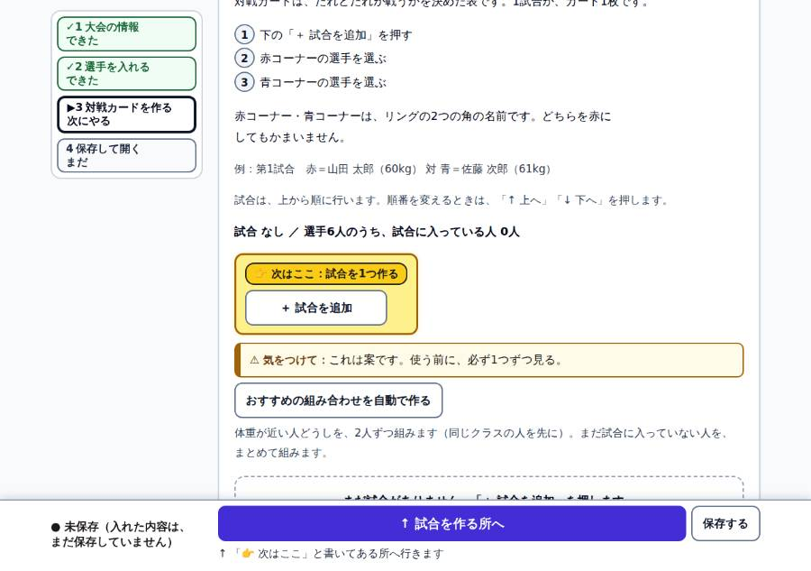

**手順1：「＋ 試合を追加」を押します。**

（黄色の札「👉 次はここ」に、「試合を1つ作る」と書いてあります。その下のボタンです。）

- ✅ できた目印：「第1試合」のカードが出ます。カードの左に「▲ 赤コーナー」、右に「■ 青コーナー」、まん中に「赤と青を入れかえる」が出ます。
- ⚠ ちがう画面が出たら：「＋ 試合を追加」が見えないときは、画面の下の青むらさきのボタン「↑ 試合を作る所へ」を押します。「選手が2人以上になると押せます」と出たら、第5章の取り込みを、もう一度見ます。

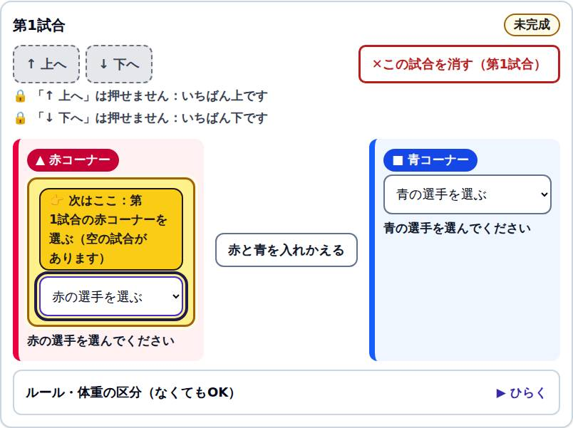

**手順2：「赤の選手を選ぶ」の四角を押します。**

（黄色の札「👉 次はここ」に、『第1試合の赤コーナーを選ぶ』と書いてあります。その下の四角です。）

- ✅ できた目印：選手の名前の一覧（リスト）が開きます。ジムごとに、まとまっています。名前の前に、クラスと体重が出ます。（たとえば『Bクラス 45kg 山田 太郎（架空ジムA）』）
- ⚠ ちがう画面が出たら：一覧が開かないときは、四角の右の「▼」を押します。

**手順3：一覧の中から、赤コーナーに出る選手の名前を1回押します。**

（例：『山田 太郎』）

- ✅ できた目印：カードの左に、選手の写真・名前・体重と戦績（『45kg・初出場』のように）・「クラス：」のあとにクラスの名前が出ます。階級分けの大会では、そのあとに、「区分・階級：」と、区分と階級も出ます。黄色の札が、青コーナーに動きます。
- ⚠ ちがう画面が出たら：まちがえたら、もう一度「赤の選手を選ぶ」の四角を押して、選び直します。

**手順4：「青の選手を選ぶ」の四角を押します。**

（黄色の札「👉 次はここ」に、『第1試合の青コーナーを選ぶ』のように書いてあります。その下の四角です。）

- ✅ できた目印：選手の名前の一覧が開きます。
- ⚠ ちがう画面が出たら：赤で選んだ人は、「（赤コーナーで選んでいます）」と出て、押せません。同じ人を、赤と青の両方には選べません。

**手順5：一覧の中から、青コーナーに出る相手の名前を1回押します。**

（例：『佐藤 次郎』）

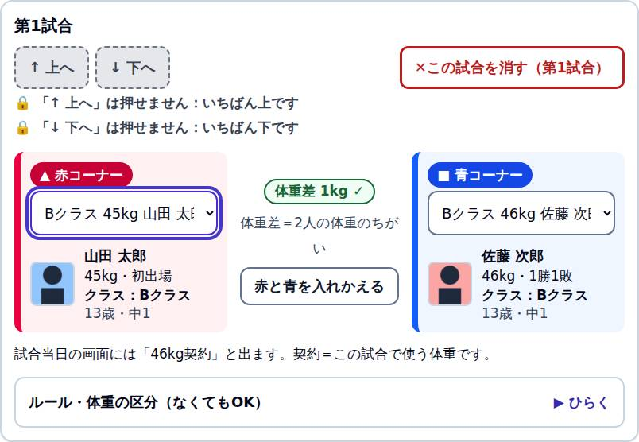

- ✅ できた目印：まん中に、緑の「体重差」（『体重差 1kg』のように、「✓」つき）が出ます。その下に、「試合当日の画面には」のあとに、「契約」がついた体重（『46kg契約』）が出ます。黄色の「👉 次はここ」の札が、「保存」に動きます。（試合を、まだ作りたいときは、6-2に進みます。保存は、6-8で押します。）
- ⚠ ちがう画面が出たら：まん中や下に、黄色や赤の文が出たときは、6-3から6-6を見ます。

---

### 6-2　2試合目と3試合目を作る

**何をするか：** 2試合目からあとの試合を作ります。

**なぜか：** だれとだれが戦うかを、全部決めるためです。

**このあと：** 6-3で、体重差の注意の見かたを知ります。

試合の数は、会長さんが決めた数です。ここでは、見本として、3試合を作ります。

黄色の「👉 次はここ」の札は、いま「保存」を教えています。でも、まだ試合を作りたいときは、自分で「＋ 試合を追加」を押します。

**手順1：画面の下の方の、「＋ 試合を追加」を押します。**

- ✅ できた目印：『第2試合』のカードが、いちばん下に出ます。黄色の「👉 次はここ」の札が、第2試合の赤コーナーに動きます。札には、『第2試合の赤コーナーを選ぶ』と書いてあります。
- ⚠ ちがう画面が出たら：「＋ 試合を追加」が見えないときは、下へ、マウスの輪を回して画面を動かします。空の試合がもうあるときは、「空の試合がもうあります。」と出ます。先に、その試合の赤と青を選びます。先に、その試合を作ります。

**手順2：第2試合の「赤の選手を選ぶ」を押して、選手を1人選びます。**

- ✅ できた目印：選手の写真と名前が出ます。黄色の札が、青コーナーに動きます。
- ⚠ ちがう画面が出たら：第1試合で使った人は、『（もう第1試合に入っています）』と出ます。ほかの人を選びます。同じ人を2試合に出すときは、6-5を見ます。

**手順3：第2試合の「青の選手を選ぶ」を押して、相手を1人選びます。**

- ✅ できた目印：まん中に「体重差」が出ます。黄色の札が、「保存」に動きます。
- ⚠ ちがう画面が出たら：注意の文が出たら、6-3から6-6を見ます。

**手順4：もう一度「＋ 試合を追加」を押します。**

- ✅ できた目印：『第3試合』のカードが、いちばん下に出ます。
- ⚠ ちがう画面が出たら：空の試合がもうあるときは、「空の試合がもうあります。」と出ます。先に、その試合の赤と青を選びます。

**手順5：第3試合の「赤の選手を選ぶ」を押して、選手を1人選びます。**

- ✅ できた目印：選手の写真と名前が出ます。
- ⚠ ちがう画面が出たら：使った人は、『（もう第2試合に入っています）』や「（ほかの試合に入っています）」と出ます。ほかの人を選びます。

**手順6：第3試合の「青の選手を選ぶ」を押して、相手を1人選びます。**

- ✅ できた目印：まん中に「体重差」が出ます。
- ⚠ ちがう画面が出たら：注意の文が出たら、6-3から6-6を見ます。

**手順7：「試合の一覧（押すと、その試合に移ります）」を見ます。**

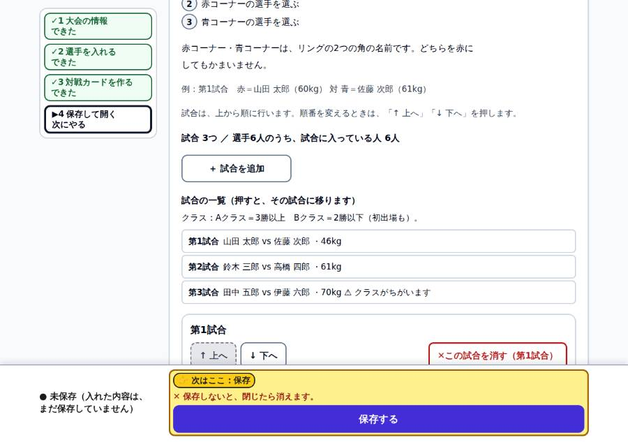

- ✅ できた目印：『第1試合』『第2試合』『第3試合』が並びます。それぞれに、『山田 太郎 vs 佐藤 次郎』のような名前と、『・46kg』のような体重が出ます。（『契約』の文字は、それぞれのカードの中に出ます。）
- ⚠ ちがう画面が出たら：「3. 対戦カードを作る」の見出しの横に、『試合 3つ』のように出ます。数が合わないときは、足りない試合を作ります。

近道（使わなくても大丈夫です）：「まだ試合に入っていない選手」の名前を押すと、空いている赤か青に、その人が入ります。

---

### 6-3　体重差の注意

**何をするか：** 体重差が大きいときの、画面の注意の見かたを知ります。

**なぜか：** 体重差が大きいと、けがの危険があるからです。

**このあと：** 6-4で、クラスがちがうときの赤い警告を見ます。

体重差が大きいと、けがの危険があります。体重差の大きさで、色が変わります。

| 体重差 | 画面に出るもの | どうするか |
|---|---|---|
| 5kg未満 | 緑の「体重差」（『体重差 1kg』のように、「✓」つき）。注意の箱は出ません。 | そのまま進みます。 |
| 5kg以上、10kg未満 | まん中に「体重差」（「⚠」つき）。黄色の「⚠ 気をつけて」の箱で、『体重差 7kg です。』のあとに「少し差があります。心配なときは、選び直します。」 | 保存はできます。心配なときは、選び直します。 |
| 10kg以上 | 赤の「✕」の文（『体重差 15kg：』のあとに「けがの危険があります。本当にこの2人ですか？」）。ボタンは「選び直す」と「この2人でよい」。 | 選び直すか、「この2人でよい」を押します。 |

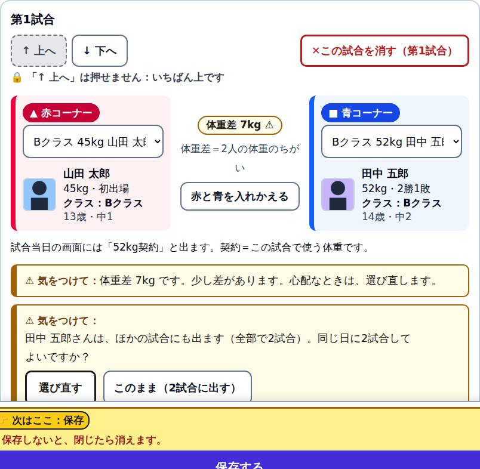

**手順1：赤い「けがの危険があります。本当にこの2人ですか？」の文が出たら、読みます。**

- ✅ できた目印：「選び直す」と「この2人でよい」の、2つのボタンがあります。
- ⚠ ちがう画面が出たら：何も押さなくても、保存はできます。ただし、本当にこの2人でよいか、先に確かめます。

**手順2：選び直すときは、「選び直す」を押します。**

- ✅ できた目印：青コーナーの四角が、選べる状態になります。
- ⚠ ちがう画面が出たら：赤コーナーを直したいときは、赤の四角を直接押します。

**手順3：この2人でよいときは、「この2人でよい」を押します。**

- ✅ できた目印：赤い文が、黄色に変わります。『体重差 25kg です』のあとに「この2人でよいと、確かめました」と出ます。
- ⚠ ちがう画面が出たら：押す前に、本当にこの2人か、もう一度確かめます。

---

### 6-4　クラスがちがう組み合わせの赤い警告

**何をするか：** クラスがちがう2人を組んだときの、赤い警告の見かたを知ります。

**なぜか：** クラスがちがうと、ルールがちがうからです。

**このあと：** 6-5で、同じ人を2回使ったときの注意を見ます。

赤コーナーがBクラスで、青コーナーがAクラスのときなど、2人のクラスがちがうと、赤い文が出ます。

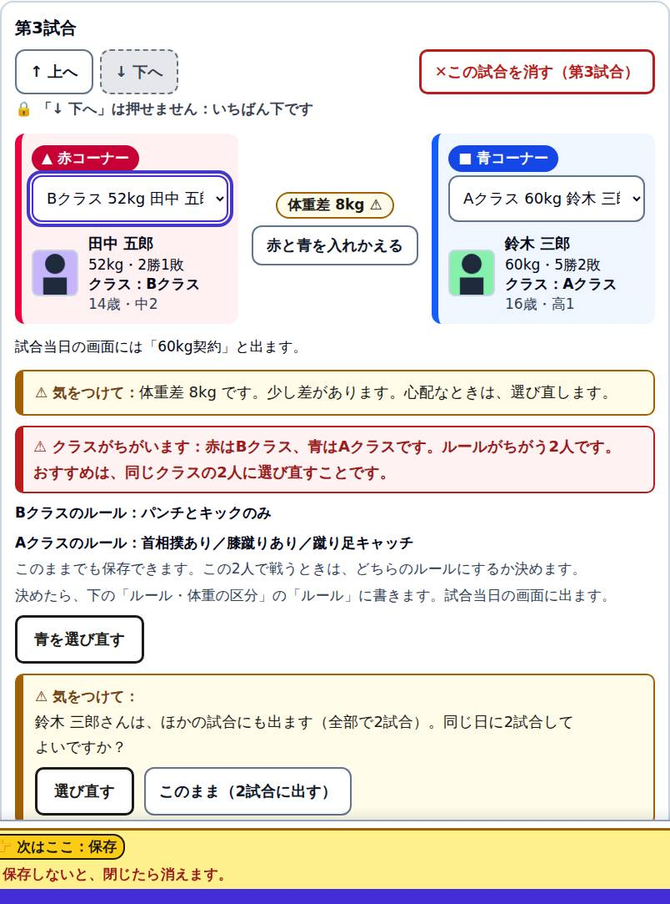

赤い文は、次のとおりです。

- 「クラスがちがいます：」のあとに、『赤はBクラス、青はAクラスです』のように出ます。さらに「ルールがちがうので、ふつうは同じクラスの人と戦います。」と続きます。
- そのあとに、2つのクラスのルールが、短い言い方で出ます。Bクラスは『Bクラスのルール：首相撲なし／蹴り足キャッチなし／膝蹴りなし／回転技なし』、Aクラスは『Aクラスのルール：首相撲5秒／蹴り足キャッチはワンアタック』です。（首相撲＝相手の首やからだをつかむ技、膝蹴り＝ひざで蹴る技、蹴り足キャッチ＝蹴った足をつかむことです。）
- Aクラスのルールの中の「ワンアタック」は、わかりにくい言葉なので、「ことばの説明：」の行が足されます。『ことばの説明：キャッチ後に1回だけ攻撃できる』と出ます。（Aクラスの長いルールの、かっこの中の文です。第1章の表にあります）

**この警告は、止める文ではありません。** 「このまま戦ってもかまいません。そのときは、主催者のあなたが、どちらのルールにするか決めて、「ルール」の欄に書きます。」と、画面に書いてあります。

上の「試合の一覧」にも、「クラスがちがいます」と出ます。

**手順1：赤い文と、2つのルールを読みます。**

- ✅ できた目印：『赤はBクラス、青はAクラス』のように、どちらがどのクラスか、わかります。
- ⚠ ちがう画面が出たら：クラスがちがう2人で戦うかどうかは、会長さんと、ジムの方で決めます。画面は、決めません。

**手順2：同じクラスの2人に直せるときは、「青を選び直す」を押します。**

- ✅ できた目印：青コーナーの四角が、選べる状態になります。
- ⚠ ちがう画面が出たら：赤を直したいときは、赤の四角を直接押します。

**手順3：同じクラスの、別の選手を選びます。**

- ✅ できた目印：赤い警告が消えます。
- ⚠ ちがう画面が出たら：もう1人の選手が見つからないときは、手順4へ進みます。

**手順4：クラスがちがう2人で戦うときは、赤い注意の中の「ルールを書く欄をひらく」を押します。**

- ✅ できた目印：「ルール・体重の区分（なくてもOK）」が開いて、「体重の区分」と「ルール」の、2つの四角が出ます。
- ⚠ ちがう画面が出たら：ここは、クラスがちがうときだけ使います。ふだんは、書かなくて大丈夫です。「ルール・体重の区分（なくてもOK）」の「ひらく」を押しても、同じ所が開きます。

**手順5：「ルール」の四角に、決めたルールを書きます。**

（例：『首相撲なし／蹴り足キャッチなし／膝蹴りなし／回転技なし』）

- ✅ できた目印：「試合当日の画面」の、2人の上に、大きな字で、このルールが出ます。
- ⚠ ちがう画面が出たら：「例：」と薄く出ている字は、見本です。決めたルールを、自分で書きます。

---

### 6-4の2　区分・階級がちがう組み合わせの赤い注意

**使うのは、階級分けの大会だけです。** 選手に、区分と階級が入っているときに出ます。

**何をするか：** 赤と青の、区分か階級がちがう2人を組んだときの、赤い注意の見かたを知ります。

**なぜか：** ふつうは、同じ区分・同じ階級の人どうしで戦うからです。

**このあと：** 6-5で、同じ人を2回使ったときの注意を見ます。

**区分・階級は、どこに出るか**

- 「選手の一覧」の選手には、「区分・階級：」のあとに、区分と階級の札が出ます（たとえば『区分・階級：中学生男子・37kg以下』）。
- 対戦カードの赤と青にも、それぞれ「区分・階級：」が出ます。
- 申し込みで選んだ区分・階級は、ZIPから名簿に入ります。手で入れたり直したりするときは、「1人ずつ入れる」と、名簿の「直す」の中に、「区分」と「階級」を選ぶ四角が出ます。どちらにも「なくてもOK」と書いてあります。入れなくても、保存できます。
- 「区分」を選ぶと、その区分の「階級」だけが出ます。『小学生以下』を選ぶと、階級はなく、「この区分には階級がありません。小学生の試合は、申し込みの体重を目安に、近い学年（1〜2年の差）・近い体重（2〜3kgの差）の選手どうしで組みます。目安なので、ちがうこともあります。」と出ます。わからないときは、「えらばない」を選びます。

**赤い注意の文は、次のとおりです。**

- 区分がちがうとき：「区分がちがいます（赤：」のあとに、赤の区分と、「／青：」のあとに青の区分が出ます。たとえば『区分がちがいます（赤：中学生男子／青：高校生・一般男子）。』です。さらに「ふつうは、同じ区分の人どうしで戦います。」と続きます。
- 区分は同じで、階級がちがうとき：「階級がちがいます（赤：」のあとに、赤の階級と、「／青：」のあとに青の階級が出ます。たとえば『階級がちがいます（赤：37kg以下／青：40kg以下）。』です。さらに「ふつうは、同じ階級の人どうしで戦います。」と続きます。
- 区分も階級もちがうときは、区分の注意だけが出ます。
- 赤か青の、どちらかに区分・階級が入っていないときは、この注意は出ません。（ちがうかどうか、わからないからです。下の黄色の注意が出ます）

**この注意は、止める文ではありません。** 赤い「⚠」がつきますが、保存も、「試合当日の画面を開く」も、できます。画面に「このまま戦ってもかまいません。違うときは、選び直します。」と書いてあります。決めるのは、会長さんと、ジムの方です。体重が階級をこえていても、止めたり、警告したりしません。

区分・階級の注意は、クラスの注意（6-4）とは、別の箱です。クラスもちがうときは、2つの箱が、上下に並んで出ます。

上の「試合の一覧」にも、「⚠ 区分・階級がちがいます」と出ます。いちばん下の黄色の注意にも、「区分や階級がちがう試合」という言葉が入ります。

**手順1：赤い文を読みます。**

- ✅ できた目印：『赤：37kg以下／青：40kg以下』のように、どちらがどの階級（区分）か、わかります。
- ⚠ ちがう画面が出たら：区分・階級がちがう2人で戦うかどうかは、会長さんと、ジムの方で決めます。画面は、決めません。

**手順2：同じ区分・階級の2人に直せるときは、「青を選び直す」を押します。**

- ✅ できた目印：青コーナーの四角が、選べる状態になります。
- ⚠ ちがう画面が出たら：赤を直したいときは、赤の四角を直接押します。

**手順3：同じ区分・階級の、別の選手を選びます。**

- ✅ できた目印：赤い注意が消えます。
- ⚠ ちがう画面が出たら：同じ区分・階級の人が見つからないときは、そのまま戦ってもかまいません。何もしなくて大丈夫です。

**手順4：選手の区分・階級が、まちがっているときは、その人の「直す」を押します。**

- ✅ できた目印：「区分」と「階級」を選ぶ四角が出ます。選び直して、「この内容で直す」を押すと、赤い注意が、なくなるか、変わります。
- ⚠ ちがう画面が出たら：区分や階級が入っていない人がいると、黄色で「区分・階級が入っていない／設定にない人：」と出ます。保存はできます。ただし、区分・階級がちがう試合かどうか、確かめられません。「その人を直す」を押して、入れます。（入れなくても大丈夫です）

**おすすめの組み合わせ（6-7）**を使うと、アプリは、同じ区分・階級の人を、先に組みます。それでも、区分や階級がちがう組ができたときは、赤い「⚠」で「区分・階級がちがう組が」のあとに数が出ます。「区分・階級がちがう試合へ」を押すと、その試合へ行けます。

---

### 6-5　同じ人を2回使ったとき・同じジムのとき

**何をするか：** 同じ人を2試合に入れたときの、黄色の箱の見かたを知ります。

**なぜか：** 同じ日に2試合してよいか、確かめるためです。

**このあと：** 6-6で、試合を消す・順番を変える方法を見ます。

同じ選手を、2つの試合に入れたときは、黄色の箱が出ます。

**手順1：黄色の「さんは、ほかの試合にも出ます」の箱を読みます。**

（『鈴木 三郎さんは、ほかの試合にも出ます（全部で2試合）。』のあとに「同じ日に2試合してよいですか？」と出ます。）

- ✅ できた目印：「選び直す」と「このまま（2試合に出す）」の、2つのボタンが出ます。
- ⚠ ちがう画面が出たら：名前は、選んだ人の名前に変わります。箱は、人ごとに出ます。赤と青の両方が、ほかの試合にも出る人のときは、箱が2つ出ます。ボタンも、2つずつ出ます。

**手順2：選び直すときは、「選び直す」を押します。**

- ✅ できた目印：その人の四角が、選べる状態になります。
- ⚠ ちがう画面が出たら：まちがえたら、「このまま（2試合に出す）」を押さないで、「選び直す」を押します。

**手順3：同じ日に2試合してよいときだけ、「このまま（2試合に出す）」を押します。**

- ✅ できた目印：その人の黄色の箱が消えます。箱が2つ出ているときは、もう1つの箱にも、同じように答えます。
- ⚠ ちがう画面が出たら：押す前に、本当に2試合してよいか、確かめます。

その他の黄色や赤の文は、次のとおりです。

| 画面に出る文 | 意味 | どうするか |
|---|---|---|
| 黄色の「の2人です。ふつうは、ちがうジムの人と組みます。」（『同じジム（架空ジムA）の2人です。』のように、ジムの名前が付きます） | 同じジムの2人です。 | 同じジムでよければ、そのままで大丈夫です。 |
| 赤の「同じ人かもしれません：」で始まる文 | 名簿に、同じ人が2人いるかもしれません。 | 「青を選び直す」を押すか、第5章の5-5を見ます。 |
| 「未完成」の札 | 赤か青が、まだ選ばれていません。 | 黄色の札のとおりに、選びます。 |

---

### 6-6　試合を消す・順番を変える・元にもどす

**何をするか：** 試合を消す、順番を変える、元にもどす方法を知ります。

**なぜか：** まちがえても、あわてずに直せるようにするためです。

**このあと：** 6-7を読みとばして、6-8で保存します。

**手順1：消したい試合の、赤い枠のボタン「この試合を消す」を押します。**（ボタンには『（第1試合）』のように、試合の番号も付いています）

- ✅ できた目印：その試合が消えます。「消しました：」のあとに、試合の番号と、『山田 太郎 vs 鈴木 三郎』のような名前が出ます。あとの試合の番号が、1つずつ前に動きます。
- ⚠ ちがう画面が出たら：ボタンは、試合の数だけ並びます。ボタンの『第1試合』の数字は、消したい試合の数字です。ボタンの文字を読んで、まちがえないようにします。

**手順2：まちがえて消したときは、「消した試合を元にもどす」を押します。**

- ✅ できた目印：消した試合が、もとの場所にもどり、「試合を戻しました。」と出ます。（その前に、戻した試合の番号が付きます。）「このページを閉じるまで戻せます」と、画面に書いてあります。
- ⚠ ちがう画面が出たら：ページを閉じると、元にもどせません。まちがえたら、すぐ押します。
- ⚠ ちがう画面が出たら：「消した試合を元にもどす」の同じボタンが、2つ出ることがあります。どちらを押しても同じです。

**手順3：順番を変えたいときは、そのカードの「↑ 上へ」か「↓ 下へ」を押します。**

- ✅ できた目印：試合の順番が、入れかわります。
- ⚠ ちがう画面が出たら：いちばん上の試合では、「「↑ 上へ」は押せません：いちばん上です」と出ます。いちばん下の試合では、「「↓ 下へ」は押せません：いちばん下です」と出ます。試合は、上から順に行われます。

**手順4：赤と青を逆にしたいときは、「赤と青を入れかえる」を押します。**

- ✅ できた目印：赤の選手と青の選手が、入れかわります。
- ⚠ ちがう画面が出たら：注意の文は、入れかえたあとも、そのままです。

**手順5：選手が出られなくなったとき（欠場）は、「選手の一覧」で、その人の「欠場にする」を押します。**

- ✅ できた目印：その人の札に、赤い「✕ 欠場」が付きます。ボタンは「欠場をやめる」に変わります。その人が入っている試合のカードに、赤い「⚠」の行で、「欠場です。相手を決め直すか、この試合を消してください。」と出ます（その前に、赤か青か、名前が付きます）。「保存する」を押すと、A3の対戦一覧表と、試合当日の画面にも「欠場」と出ます。
- ⚠ ちがう画面が出たら：まちがえて押したときは、「欠場をやめる」を押します。「おすすめの組み合わせ」には、欠場の人は入りません。名簿のファイルを取り込み直しても、「欠場」は消えません。「コピーのファイルから戻す」と、コピーを作ったときの「欠場」の状態にもどります（8-4）。

---

### 6-7　（なくてもOK）おすすめの組み合わせを自動で作る

**何をするか：** 体重の近い人を、自動で組み合わせます。

**なぜか：** 手で選ぶ手間を、へらすためです。使わなくても大丈夫です。

**このあと：** 6-8で保存します。

まだ試合に入っていない人が2人以上いるとき、体重の近い人を、2人ずつ組んでくれます。体重差5kg以内に同じクラスの人がいれば、その人を先に組みます。階級分けの大会では、区分・階級が入っている人は、同じ区分・階級の人も先に探します。会長さんは、使わなくて大丈夫です。

**手順1：使うときは、「おすすめの組み合わせを自動で作る」を押します。**

- ✅ できた目印：「おすすめの組み合わせを」「つ、いちばん下に足しました。」と出ます。足された試合に、「案」の札が付きます。
- ⚠ ちがう画面が出たら：黄色の「おすすめは、コンピューターが作った下書き（案）です。使う前に、1つずつ見てください。」が出ます。そのまま信じずに、1つずつ見ます。

**手順2：『1つ目の案を見る』のボタンを押します。**

（黄色の札「👉 次はここ」に、「案を1つずつ確かめる」と書いてあります。その下のボタンです。押すたびに、『2つ目の案を見る』『3つ目の案を見る』…と変わります。）

- ✅ できた目印：1つ目の案の試合へ、画面が動きます。

**手順3：案の試合を、1つずつ見て、確かめます。**

- ✅ できた目印：赤と青の選手、体重差、クラスが読めます。階級分けの大会では、区分・階級も読めます。
- ⚠ ちがう画面が出たら：気に入らないときは、「案を全部消す（この案を取り消す）」を押すと、案だけが消えます。

---

### 6-8　保存する

**何をするか：** 作った対戦カードを、このパソコンの中に保存します。

**なぜか：** 保存しないと、閉じたときに消えるからです。

**このあと：** 「じゅんび OK」になれば、大会の日に「試合当日の画面を開く」を押せます。

**手順1：画面のいちばん下の「4. 保存して開く」の、チェックを見ます。**

- ✅ できた目印：「大会の名前」「日にち」と、『選手 6人』『写真 6/6』『試合 3つ』のような数、そして「保存」が並びます。保存の前までは「✓」が付きます。「保存」だけは、「○ まだ」です。
- ⚠ ちがう画面が出たら：赤い「✕ 直すところ」が出たら、その文のとおりに直します。『第1試合へ』のような青むらさきのボタンを押すと、その試合へ連れて行ってくれます。

**手順2：黄色の「気をつけたいところが」で始まる文が出たら、読みます。**

- ✅ できた目印：「気をつけたいところが」のあとに数が出て、「保存はできます。ただし、試合の前に、1つずつ確かめてください」と書いてあります。
- ⚠ ちがう画面が出たら：この文が出ないときは、何もしなくて大丈夫です。

**手順3：「見直す：」のボタンを押して、確かめます。**

（ボタンは『見直す：第1試合へ』のようになっています。）

- ✅ できた目印：注意のある試合へ、画面が動きます。
- ⚠ ちがう画面が出たら：見るだけでも大丈夫です。

**手順4：「保存する」を押します。**

（黄色の札「👉 次はここ」に、「保存」と書いてあります。その下のボタンです。）

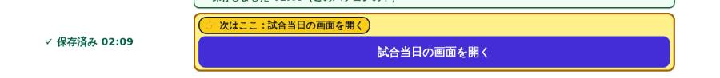

- ✅ できた目印：「保存済み」と時刻（『02:09』のような）が、緑の「✓」つきで出ます。「保存しました」「（このパソコンの中）」とも出ます。
- ⚠ ちがう画面が出たら：「ここまでを保存する」を押しても同じです。保存が終わるまで、ほかのボタンは押しません。

**手順5：「じゅんび OK」を確かめます。**

- ✅ できた目印：「4. 保存して開く」に、緑の「じゅんび OK」が「✓」つきで出ます。「試合当日は、このパソコンで「試合当日の画面を開く」を押します。」と書いてあります。左の4つの札が、ぜんぶ緑になります。黄色の「👉 次はここ」の札は、「試合当日の画面を開く」に動きます。
- ⚠ ちがう画面が出たら：「試合当日の画面を開く」が押せないとき（「まだ開けません」）は、上の「✕ 直すところ」を直します。

保存の4つの状態（未保存・保存中・保存済み・保存失敗）の見かたは、8-1にまとめてあります。

⚠ 気をつけること：1文字でも直すと、また「● 未保存」にもどります。直したら、もう一度「保存する」を押します。

> 👉 次は、第8章の8-4で「コピーのファイル」（引継ぎファイル）を作ります。そのあと、大会の日に第7章へ進みます。

---

### 6-9　A3の対戦一覧表をつくる（掲示用）

**何をするか：** 決めた対戦カードを、A3の紙（3〜4枚くらい）の一覧表にして、印刷します。PDFのファイルにもできます。

**なぜか：** 会場の壁に貼って、選手や保護者の方が、だれとだれが戦うかを、ひと目で分かるようにするためです。組み合わせと試合の順番は、会長さんが決めたものを、そのまま載せます。この一覧表の画面は、組み合わせを決めません。（6-7の「おすすめの組み合わせ」は、準備の画面で、使いたいときだけ押すものです）

**このあと：** 第7章（大会の当日）へ進みます。

**手順1：準備の画面の下の「A3の対戦一覧表をつくる」を押します。**

- ✅ できた目印：新しい画面「対戦一覧表（A3）」が、別のタブで開きます。大会名と、紙のプレビュー（印刷されるのと同じ形）が出ます。
- ⚠ ちがう画面が出たら：対戦カードがまだないときは、このボタンは押せません。6-1で試合を作ります。まだ保存していない直しがあるときは、このボタンが、先に保存してから開きます。

**手順2：「印刷の前に確かめてください」の文を読みます。**

- ✅ できた目印：確かめることがなければ、「どの試合も、赤と青が決まっています。そのまま印刷できます。」と緑で出ます。（写真をととのえている間は、緑は出ません。）
- ⚠ ちがう画面が出たら：「選手がまだ決まっていません」「欠場の選手がいます」「名前が入っていない選手がいます」「大会の名前がまだ入っていません」と黄色で出たときは、準備の画面で直します。上の「この画面を閉じる」で準備の画面にもどり、直して「保存する」を押します。そのあと、準備の画面の「A3の対戦一覧表をつくる」を、もう一度押します。直さなくても、印刷はできます。（決まっていない所は「未定」と出ます。）
- ⚠ ちがう画面が出たら：「名前・ジム名・クラスの文字が長くて、紙の上で一部が「…」と切れます」と出たときは、その試合の文字が、紙の上で切れます。1ページの試合数をへらすと、文字が大きくなって入ることがあります。それでも切れるときは、準備の画面で、名前やジム名の書き方を確かめます。

**手順3：「紙の向き」と「1ページに載せる試合の数」を選びます。**

- ✅ できた目印：『全12試合 → A3 3枚（1ページ 4 試合）』のように、紙の数が出ます。プレビューも、その形に変わります。
- ⚠ ちがう画面が出たら：枚数を決めたいときは、「A3を3枚にする」か「A3を4枚にする」を押します。試合が少なすぎる・多すぎるときは、その枚数にできないので、ボタンが灰色になり、理由が出ます。「自動」は、A3が4枚くらいになる数にもどします。ただし、試合が少ない・多いときは、4枚にならないことがあります。「横」にすると、1枚に2列で並びます（左の列を上から下へ、つづけて右の列）。
- ⚠ ちがう画面が出たら：数は、「－」「＋」か、数の欄に打って決めます。打つときは、そのまま「12」のように打てます。Enter（またはほかの所を押す）で、決まります。1ページに載せられる数には上限があり、上限では「＋」が灰色になって、「これ以上ふやせません」と出ます。
- ⚠ ちがう画面が出たら：「ルール」は、短いときだけ載ります。まん中の列に入りきらない文字は、切らずに省いて、黄色の文で、どの試合の文字が載らないかを知らせます。1ページの試合数をへらすと載ることもありますが、長いルールは、1ページ1試合でも載りません。

**手順4：「一覧表に載せるもの」を選びます。**

- ✅ できた目印：「ジム名」「クラス・区分・階級」のチェックを外すと、そのぶんが消えます。氏名は、いつも載ります。「ルール」は、はじめは載りません（長いため）。「小さな顔写真」も、**はじめは載りません**（チェックなし）。壁に貼る紙に載せてよいかは、会長さんが決めます。載せるときは、「小さな顔写真」にチェックを入れます。そのとき、すぐそばに、黄色の「顔写真が、壁に貼る紙に載ります。申し込みページの『使い道』にも書いてあります。」が出ます。チェックを外すと、この文は消えます。一度えらんだ「載せるもの」は、このブラウザが覚えています（開き直しても、そのままです）。 大会のロゴが「あり」の設定のときは、各ページの上に、ロゴも印刷されます。
- ⚠ ちがう画面が出たら：「小さな顔写真」にチェックを入れたとき、写真がない選手は、名前の横が灰色の四角になります。全員の写真がないときは、「小さな顔写真」のチェックを外すと、文字だけになります。名前・ジム名・顔写真は、載せると、会場に貼る紙に載ります。載せてよいかは、会長さんが決めます。電話番号・生年月日・健康のこと・同意の記録は、一覧表には出ません（選ぶ欄もありません）。

**手順5：「印刷する（PDFにもできます）」を押します。**

- ✅ できた目印：印刷の画面が開きます。用紙は A3（縦か横）が選ばれます。プリンターを選ぶ欄（Chromeでは『送信先』）を『PDFに保存』にすると、PDFのファイルができます。Safariでは、左下の『PDF』から『PDFとして保存』を選びます。ファイルの名前は、たいてい『対戦一覧表 大会名』になります。
- ⚠ ちがう画面が出たら：この手順は、まだ本物のパソコン（Edge・Safari）と本物のA3プリンターでは、確かめていません。最初の1回は、必ず、試し刷りで確かめます。
- ⚠ ちがう画面が出たら：ボタンが押せないときは、「写真を、一覧表の大きさにととのえています」と出ています。少し待ちます。印刷の画面の言葉は、ブラウザによってちがいます。用紙が A3 にならないときは、印刷の画面の用紙の欄を A3 にします。

**手順6：あとから、相手・順番・欠場を変えたときは、準備の画面で直して「保存する」を押します。**

- ✅ できた目印：そのあと、準備の画面の「A3の対戦一覧表をつくる」を、もう一度押すと、新しい一覧表が開きます。この画面の「保存した時刻」が、「保存する」を押した時刻になっていれば、新しい内容です。もう一度、「印刷する（PDFにもできます）」を押します。
- ⚠ ちがう画面が出たら：一覧表を開いたままにしてあるときは、そのタブに切りかえると、自動で入れかわることもあります。入れかわらないときは、「最新の内容を読み込む」を押します。「最新の内容を読み込みました」と緑で出たら、読めています。「読み込めませんでした」と赤で出たときは、いま出ているのは前の内容です。もう一度押します。
- ⚠ ちがう画面が出たら：「欠場」の選手は、一覧表では、名前に取り消し線が引かれて、『▲ 赤 欠場』のように札が付きます。欠場の選手の写真は出ません。相手を決め直すときは、準備の画面で直して「保存する」を押します。
- ⚠ ちがう画面が出たら：コピーのファイルを使うときは、8-4を見ます。

---

## 第7章　大会の当日

### この章でやること

試合の日に、会場のパソコンで、いまの試合を大きく出します。1試合ずつ進めます。

- かかる時間：開いて確かめるのは、約5分です。
- 前の日にやること：第6章で、保存まで終わらせます。そのあと、第8章の8-4で、コピーのファイルを作ります。
- 飛ばしてよい所：「一覧」の使いかたは、全部の試合を見たいときだけ読みます。

**大事なこと：** 「試合当日の画面」は、対戦カードを作った**同じパソコン**の、**同じブラウザ**（ChromeかEdge）で開きます。データは、そのパソコンのブラウザの中にだけあります。別のパソコンでは、空になります。別のパソコンで使うときは、「コピーのファイル」で戻します（8-5）。

「試合の準備」の画面は、第6章で使った「試合の準備」の画面のことです。

---

### 7-1　前の日までにやっておくこと

**何をするか：** 大会の前の日までに、準備を終わらせます。

**なぜか：** 当日、あわてないためです。

**このあと：** 7-2で、大会の日に「試合当日の画面」を開きます。

| やること | どうなればOKか |
|---|---|
| 第6章で保存する | 「✓ 保存済み」と出ます。 |
| 「コピーのファイル」を作る | USBメモリにも入れます。（作りかたは、8-4を見ます） |
| 一覧を紙に出しておく（おすすめ） | 画面が固まったときの、紙の控えになります。 |
| 練習で「次の試合 →」を押したとき | 「試合の準備」の画面で、「試合当日の画面を第1試合にもどす」を押して、保存します。（下の手順A〜D）本番の途中では押しません。 |
| 会場に着いたら、先に画面を開く | 画面は、閉じずに残します。（画面を閉じたあとに開くには、ネットが必要です） |

**練習のあとに、第1試合にもどすとき**

**手順A：（練習のあとだけ）「試合の準備」の画面の「4. 保存して開く」を見ます。**

- ✅ できた目印：「じゅんび OK」の下に、赤い「✕ 本番の途中なら押さない。」と、「試合当日の画面を第1試合にもどす」のボタンが出ています。
- ⚠ ちがう画面が出たら：ボタンが見えないときは、いまの試合がもう第1試合です。何もしなくて大丈夫です。

**手順B：「試合当日の画面を第1試合にもどす」を押します。**

- ✅ できた目印：赤いふちの箱が出ます。「やめる（何も変えない）」と「第1試合にもどす」の2つのボタンがあります。
- ⚠ ちがう画面が出たら：迷ったら「やめる（何も変えない）」を押します。

**手順C：「第1試合にもどす」を押します。**

- ✅ できた目印：緑で「もどしました。保存すると、試合当日の画面も第1試合になります。」と出ます。

**手順D：「保存する」を押します。**

- ✅ できた目印：「✓ 保存済み」と時刻が出ます。

---

### 7-2　「試合当日の画面」を開く

**何をするか：** 大会の日に使う画面を開きます。

**なぜか：** 1試合ずつ、大きく出すためです。

**このあと：** 7-3で、画面の見かたを見ます。

**手順1：会場のパソコンで、ChromeかEdgeを開きます。**

- ✅ できた目印：ブラウザの画面が出ます。
- ⚠ ちがう画面が出たら：『シークレット』（Chrome）や『InPrivate』（Edge）の窓では、使えません。ふつうの窓で開きます。

**手順2：「試合の準備」の画面を開きます。**

- ✅ できた目印：上に「いま開いている大会：」と、今日の大会の名前が出ます。『選手6人・試合3つ』のような数と、「保存済み」も出ます。
- ⚠ ちがう画面が出たら：大会の名前が空のときは、「大会をえらぶ・安心のしくみ（ほか）」を押して開き、今日の大会の「続きから：」で始まる行を押します。前の日に、Ctrl を押しながら D を押して、お気に入りに入れておくと、開きやすいです。
- ⚠ ちがう画面が出たら：10秒たっても開かず、黄色の「ページが、なかなか開きません。」と出たときは、F5 を押して、もう一度待ちます。会場のネットが遅いときに出ます。文の中の『Safari』は、会長さんには関係ありません。

**手順3：「4. 保存して開く」の、「試合当日の画面を開く」を押します。**

- ✅ できた目印：新しいタブが開きます。準備のタブは、閉じなくて大丈夫です。もどるときは、ブラウザの一番上のタブの並びの「試合の準備」を押します。
- ⚠ ちがう画面が出たら：新しいタブが開かない設定のときは、同じ画面で開きます。もどるときは、画面の「戻る」ボタン（←）を押します。試合が0のときは、開けません。第6章の、はじめからやり直します。

---

### 7-3　1試合ずつの画面の見かた

**何をするか：** 「試合当日の画面」に出る、選手とルールの見かたを知ります。

**なぜか：** 会場で、迷わず読み上げるためです。

**このあと：** 7-4で、次の試合へ進みます。

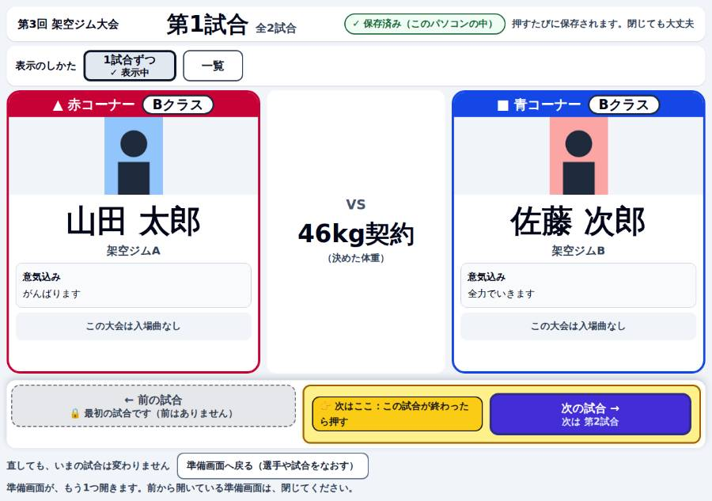

**手順1：上の帯を見ます。**

- ✅ できた目印：大会の名前、「第1試合」、『全3試合』のような試合の数、緑の「保存済み」（「このパソコンの中」と続きます）が出ます。「押すたびに保存されます。ネットが弱いときは、閉じないでください」とも書いてあります。シートの「ロゴ」が「あり」の大会では、大会名の左に、丸いロゴ（千葉県キックボクシング協会のロゴ）も出ます。「なし」の大会には、出ません。
- ⚠ ちがう画面が出たら：「保存できていません」と赤く出たら、7-6を見ます。

**手順2：画面の左と右を見ます。**

- ✅ できた目印：左に「▲ 赤コーナー」、クラス、写真、名前、ジム、「意気込み」が出ます。右に「■ 青コーナー」が出ます。まん中に「VS」と、『46kg契約』のような体重が出ます。階級分けの大会では、クラスのとなりに、区分・階級の札も、同じ色の帯の中に出ます（たとえば『中学生男子・37kg以下』）。
- ⚠ ちがう画面が出たら：赤と青のクラスがちがうと、赤い文「クラスがちがう試合です（赤：」が出ます。「準備画面で組み合わせを確かめてください。試合は、このまま進められます。」と書いてあります。会長さんは、「試合の準備」の画面で組み合わせを確かめます。
- ⚠ ちがう画面が出たら：赤と青の区分か階級がちがうと、別の赤い文「区分がちがいます（赤：」（階級なら「階級がちがいます（赤：」）が出ます。「ふつうは、同じ区分の人どうしで戦います。」（階級なら「ふつうは、同じ階級の人どうしで戦います。」）のあとに、「準備画面で組み合わせを確かめてください。試合は、このまま進められます。」と続きます。クラスの文と、両方出ることもあります。どちらも、試合を進めるのは止めません。会長さんは、「試合の準備」の画面で確かめます（6-4の2）。

**手順3：ルールを見ます。**

- ✅ できた目印：2人の上に、大きな字で「ルール」が出ます。（第6章の手順で、書いたときだけです）
- ⚠ ちがう画面が出たら：何も出ないときは、ルールを書いていません。大丈夫です。

**手順4：入場曲の札を見ます。**

- ✅ できた目印：設定が「なし」のときは、「この大会は入場曲なし」と出ます。
- ⚠ ちがう画面が出たら：設定が「あり」の大会で、「入場曲なし（曲を用意）」と黄色く出たら、その選手の曲が、まだ入っていません。曲のリンクを、「試合の準備」の画面で直します。
- ⚠ ちがう画面が出たら：入場曲を使わない大会でも、黄色の「入場曲なし（曲を用意）」が出ることがあります。そのときは、気にしなくて大丈夫です。（入場曲の「あり」「なし」は、Googleのシートの「設定」タブのB9で決めます。3-3の手順8を見ます。9-4も見ます。）

**手順5：（入場曲が「あり」の大会だけ）選手の下の「▶ 入場曲を開く」を押します。**

- ✅ できた目印：新しいタブで、Apple MusicかYouTubeの曲の画面が開きます。「試合当日の画面」には、黄色の「⚠」で、「別のタブで開きました。曲は自分で再生ボタンを押します。試合の画面にもどるには、タブを切りかえます。」と出ます。
- ⚠ ちがう画面が出たら：曲は自動では鳴りません。曲の画面で、再生ボタンを自分で押します。曲のあとは、ブラウザの一番上のタブから、試合の画面のタブを押してもどります。

---

### 7-4　次の試合へ進む・前の試合へ戻る

**何をするか：** 試合が終わったら、次の試合を出します。

**なぜか：** 会場の人に、いまの試合をはっきり見せるためです。

**このあと：** 7-5で、全部の試合を一覧で見ます。

**手順1：「次の試合 →」を押します。**

（試合が終わってから、押します。黄色の札「👉 次はここ」に、「この試合が終わったら押す」と書いてあります。）

- ✅ できた目印：「第2試合」に変わります。黄色の「気をつけて：」に、「第1試合 → 第2試合に進みました」のように出て、「第1試合にもどす」のボタンが出ます。保存は、自動です。
- ⚠ ちがう画面が出たら：まちがえて進めたら、「第1試合にもどす」のボタンを押します。ボタンを続けて何回も押しても、1回しか進みません。少し間をあけて押したときは、「いま進んだところです（続けて押したぶんは、無視しました）」と出ます。ほとんど同時に押したときは、何も出ません。

**手順2：前の試合に戻りたいときは、「← 前の試合」を押します。**

- ✅ できた目印：前の試合が出ます。
- ⚠ ちがう画面が出たら：第1試合では、「最初の試合です（前はありません）」と出て、押せません。

**手順3：最後の試合まで進めます。**

- ✅ できた目印：最後の試合では、「次の試合 →」の所に「これが最後の試合です。押せません」と出ます。黄色の札は、「一覧」に動きます。
- ⚠ ちがう画面が出たら：試合が1つだけの大会では、「この大会は1試合だけです」と出ます。

---

### 7-5　一覧で、ぜんぶの試合を見る

**何をするか：** 全部の試合を、一覧で見ます。紙に出すこともできます。

**なぜか：** 画面が固まったときの、紙の控えにもなるからです。

**このあと：** 7-6で、画面が固まったときの方法を見ます。

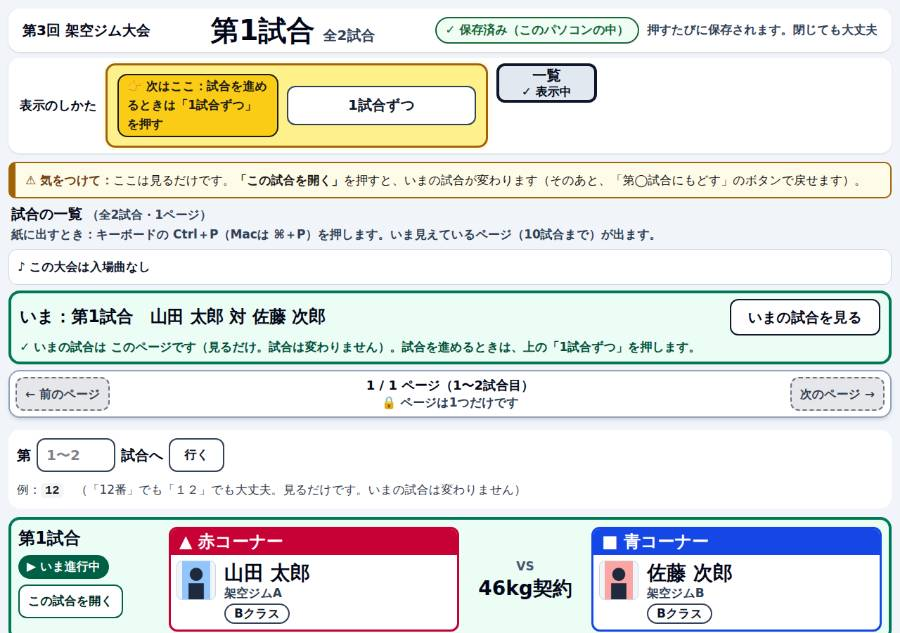

**手順1：画面の上の「表示のしかた」の、「一覧」を押します。**

- ✅ できた目印：「試合の一覧」と、試合の数が出ます。いまの試合に、「いま進行中」の札が付きます。上に「ここは見るだけです。」と出ます。
- ⚠ ちがう画面が出たら：元の画面に戻るときは、「1試合ずつ」を押します。
- 階級分けの大会では、各行の選手に、区分・階級の札も出ます（紙にも出ます）。区分や階級がちがう試合の行には、赤い「⚠」の文も出ます（紙には出ません）。

**手順2：（見るだけ）「次のページ →」「← 前のページ」で、ページを動かします。**

- ✅ できた目印：10試合ずつ、ページが変わります。「いまの試合」は、変わりません。
- ⚠ ちがう画面が出たら：「試合へ」の前の四角に数字を入れて「行く」を押すと、その試合へ飛べます。これも、見るだけです。

**手順3：紙に出すときは、キーボードで、Ctrl を押しながら P を押します。**

- ✅ できた目印：印刷の窓が出ます。
- ⚠ ちがう画面が出たら：画面に『Macは…』と書いてある文が出ても、Windowsでは読まなくて大丈夫です。いま見えているページが、紙に出ます（10試合まで）。

⚠ 気をつけること：一覧の「この試合を開く」を押すと、**いまの試合が変わります**。見るだけなら、押しません。まちがえたときは、『第◯試合にもどす』のボタンで戻せます。

---

### 7-6　画面が固まったとき

**何をするか：** 画面が動かないときの、順番を知ります。

**なぜか：** ボタンを押すたびに保存されているので、あわてなくて大丈夫だからです。

**このあと：** 動き出したら、7-4の続きに戻ります。

「試合当日の画面」は、ボタンを押すたびに保存されます。だから、画面を読み込み直しても、いまの試合は変わりません。

**手順1：まず、5秒から10秒、待ちます。**

- ✅ できた目印：画面が、動きます。
- ⚠ ちがう画面が出たら：「⏳ 保存しています…」と出ているときは、保存中です。そのまま待ちます。

**手順2：ボタンを何回も押さずに、「保存できていません。試合は進んでいません」が出ていないか見ます。**

- ✅ できた目印：出ていなければ、いまの試合は、そのままです。（この赤い文は、保存に3秒以上かかったときに出ます。）
- ⚠ ちがう画面が出たら：「失敗：保存できなかったため、試合は進めていません。」と出たら、黄色の札「もう一度押す」が付いたボタンを、もう一度押します。赤い文を閉じるときは、「くわしく見る」を押します。「わかった（閉じる）」が出るので、それを押します。

**手順3：動かないときは、キーボードの F5 を押して、画面を読み込み直します。**

- ✅ できた目印：「このパソコンのデータを読んでいます…」と出て、3秒ほどで、さっきの試合の画面が出ます。
- ⚠ ちがう画面が出たら：「読めません。3秒たっても、画面が出ません」と出たら、「もう一度ひらく」を押します。

**手順4：それでも出ないときは、このタブを閉じて、「試合の準備」から開き直します。**

- ✅ できた目印：「試合当日の画面を開く」で、新しいタブが開きます。
- ⚠ ちがう画面が出たら：「この大会は、このブラウザにありません」と出たら、大会を作った、同じパソコンの、同じブラウザで開いていません。作ったパソコンのChromeかEdgeで、開き直します。

**手順5：それでも動かないときは、前の日に出した紙の一覧を見て、試合を進めます。**

- ✅ できた目印：紙で、次の試合がわかります。
- ⚠ ちがう画面が出たら：あとで、画面を写真にとって、ジムの担当者に送ります。

---

### 7-7　試合の途中で、選手や試合を直したいとき

**何をするか：** 試合の途中で、選手や試合を直します。

**なぜか：** まちがいに気づいたときに、直せるようにするためです。

**このあと：** 直したら、「試合当日の画面を開く」で、もどります。

**手順1：「試合当日の画面」の、いちばん下の「準備画面へ戻る（選手や試合をなおす）」を押します。**

- ✅ できた目印：この画面が、「試合の準備」の画面に変わります。新しいタブは開きません。「直しても、いまの試合は変わりません」と書いてあります。
- ⚠ ちがう画面が出たら：「この画面は、準備画面に変わります。もとの準備画面が開いたままなら、閉じてください。」と書いてあります。新しいタブは開きません。「試合当日の画面」にもどるには、「試合の準備」の画面で「試合当日の画面を開く」を押します。

**手順2：直したら、「保存する」を押します。**

- ✅ できた目印：「✓ 保存済み」が出ます。
- ⚠ ちがう画面が出たら：「保存できません：別の画面で内容が変わりました」と出たら、黄色い箱で選びます。迷ったら、「やめる（何も変えない）」を押して、8-1の状態⑤を読みます。

---

## 第8章　保存・引継ぎ・復元

### この章でやること

**まず、結論です。** このアプリには、大会のデータ（選手・写真・対戦カード）が、会長さんの**パソコンの中**にだけ保存されます。正しくは、ブラウザ（インターネットを見るソフト）の中です。このアプリは、インターネットのどこかに預けてはいません。（申し込みの元データは、会長さんのGoogleのシートとドライブにあります。名簿のZIPにも、同じ選手の情報が入っています。）だから、**パソコンがこわれたとき**や、**別のパソコンで使いたいとき**のために、**「コピーのファイル」**を作っておきます。

- **何をするか：** ①いまの保存の状態を見分ける。②「コピーのファイル」を作って、USBメモリ（持ち運べる小さな保存の道具）にも入れる。③別のパソコンで、そのファイルから元に戻す。
- **なぜ必要か：** 停電、パソコンの故障、ブラウザのデータの削除で、パソコンの中のデータが消えることがあるからです。コピーがあれば、同じ状態に戻せます。
- **このあと、どうなるか：** 第7章の大会の当日を、安心して迎えられます。
- **かかる時間：** 保存の見かたは約3分。コピーを作るのは約5分。別のパソコンで戻すのは約5分です。
- **とばしてよい所：** 8-6（データのあるパソコンで戻すとき）と8-7（元に戻しかた）は、必要になったときに読めば大丈夫です。

> **ことばの注意：** この手引きでは、大会のデータをパスワードで守った、1つのファイルを、画面の名前のとおり、**「コピーのファイル」**と呼びます。前の版では、『引継ぎファイル』『バックアップ』（万一のための控え）とも書きました。どれも、同じものです。

> **お願い：** 画面の中に、『Macは…』と書いてある文や、ほかの機械の説明が出ても、**読みとばして**大丈夫です。会長さんのパソコン（Windows）には関係がありません。

---

### 8-1　保存の4つの状態の見かた

**この節でやること：** 画面の下の帯と、一番上の1行を見て、いまの保存の状態を知ります。色だけでなく、**言葉と記号**でも出ます。

**手順1：画面の一番上の1行を見ます。**

- ✅ できた目印：「いま開いている大会：第3回 架空ジム大会　選手6人・試合3つ　✓ 保存済み 02:09」のような1行が出ています。（大会の名前や数、時刻は、会長さんの画面の内容です）
- ⚠ ちがう画面が出たら：「いま開いている大会：まだ名前なし」と出ているときは、大会の名前をまだ入れていません。「● 未保存」と出ているときは、次の手順2と、下の表を見ます。

**手順2：画面の一番下の帯の、左のほうの文字を見ます。**

- ✅ できた目印：「● 未保存」「⏳ 保存中…」「✓ 保存済み」「保存失敗」のどれかが出ています。
- ⚠ ちがう画面が出たら：画面の幅がせまいと、文字の場所が、少しちがいます。言葉は同じです。

**保存の状態は、次の4つです。**（もう1つ、「別の画面で内容が変わりました」が出ることがあります）

| 状態 | 画面の言葉 | 色と印 | 意味 | することは |
|---|---|---|---|---|
| ① 未保存 | 「● 未保存（入れた内容は、まだ保存していません）」 | 黄色の札「👉 次はここ：保存」と、赤い「✕ 保存しないと、閉じたら消えます。」 | 入れた内容が、まだパソコンに残っていません。 | 青むらさきのボタン「保存する」を押します。 |
| ② 保存中 | 「⏳ 保存中…（そのままお待ちください）」 | 黄色の札「👉 次はここ：保存が終わるまで待つ」。ボタンは点線で「保存中…」 | 保存をしています。数秒で終わります。 | 何も押さずに、待ちます。 |
| ③ 保存済み | 「✓ 保存済み 02:09」「✓ 保存しました 02:09（このパソコンの中）」 | 緑の「✓」 | 保存できました。 | 何もしなくて大丈夫です。 |
| ④ 保存失敗 | 「✕ 保存失敗」（上の1行にも出ます） | 赤い箱。「失敗：」のあとに「保存できませんでした。」と、理由が出ます。黄色の「コピーのファイルを作る」のボタンも出ます。 | 保存できていません。このページを閉じると、入れた内容が消えます。 | **ページを閉じません。** 「コピーのファイルを作る」を押します。 |
| （⑤ 食いちがい） | 「保存できません：別の画面で内容が変わりました」 | 赤い「✕」と、黄色い箱 | 同じ大会を2つの画面で開いて、内容がちがってしまいました。 | 黄色い箱で、どちらかを選びます（下の状態⑤を見ます）。 |

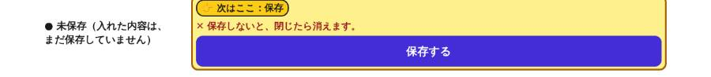

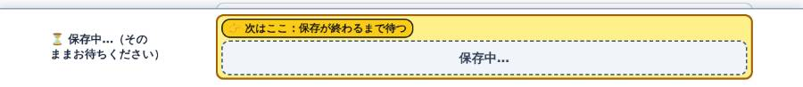


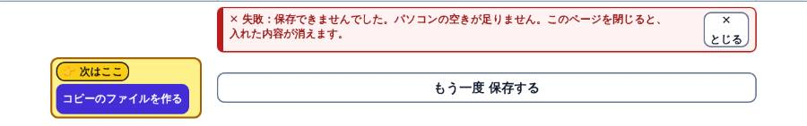

⚠ 気をつけること：**保存したあとで、1文字でも直すと、また「● 未保存」にもどります。** 直したら、もう一度「保存する」を押します。

⚠ 気をつけること：**「✓ 保存済み」の「保存」は、いま使っているブラウザの中に残すことです。** パソコンの外には出ません。だから、このあとの「コピーのファイル」も作ります。

#### 状態④「保存失敗」になったとき

**何をするか：** 保存できなかった理由を読んで、まず「コピーのファイル」を作ります。

**なぜか：** このページを閉じると、入れた内容が消えるからです。

**このあと：** 空きを作って、もう一度保存します。

**手順1：赤い箱を、最後まで読みます。**

- ✅ できた目印：「パソコンの空きが足りません」「保存場所が開けません」「どこかの欄が長すぎます」のように、理由が書いてあります。
- ⚠ ちがう画面が出たら：理由が書いていないときは、「また失敗しました。コピーのファイルに入れておくと安心。」と出ます。そのまま、次の手順2に進みます。

**手順2：このページを閉じずに、「コピーのファイルを作る」を押します。**

- ✅ できた目印：「コピーのファイルを作る・戻す」の箱が開きます。作り方は、8-4です。
- ⚠ ちがう画面が出たら：「✕ とじる」を押すと、赤い箱だけが閉じます。ページが閉じるわけではありません。

**手順3：パソコンの空きを作ります。**（いらないファイルを消すなど）

- ✅ できた目印：空きが増えました。
- ⚠ ちがう画面が出たら：空きの作りかたがわからないときは、パソコンのことをよく知っている人に聞きます。それまでは、「コピーのファイル」があれば安心です。

**手順4：「もう一度 保存する」を押します。**

- ✅ できた目印：「✓ 保存済み」に変わります。
- ⚠ ちがう画面が出たら：また「保存失敗」になったら、ページを閉じずに、「コピーのファイル」を作って（8-4）、ジムの担当者に画面の写真を送ります。

#### 状態⑤「別の画面で内容が変わりました」になったとき

**何をするか：** 2つの画面のうち、どちらの内容を使うかを選びます。

**なぜか：** 同じ大会を、2つの画面で開いたまま保存すると、片方の変更が消えるからです。

**このあと：** 片方の画面を閉じます。

「保存できません：別の画面で内容が変わりました」や、赤い「止まってください」の文が出たときです。同じ大会を、2つの画面で開いたときに出ます。（画面は、ブラウザの上に並ぶ「タブ」＝ページの見出し、のことです。）**先に片方で保存すると、もう片方の画面は、それを知らない**からです。

**手順1：黄色い箱の、「迷ったら：」の文を読みます。**

- ✅ できた目印：「さっき試合当日の画面で、試合を進めただけなら「別の画面の内容を使う」。ここで たくさん入力したなら「いまの入力を残す」。」と書いてあります。
- ⚠ ちがう画面が出たら：どちらを選ぶまでも、保存はできません。急がなくて大丈夫です。

**手順2：書いてあるとおりに、2つのボタンのどちらかを押します。**

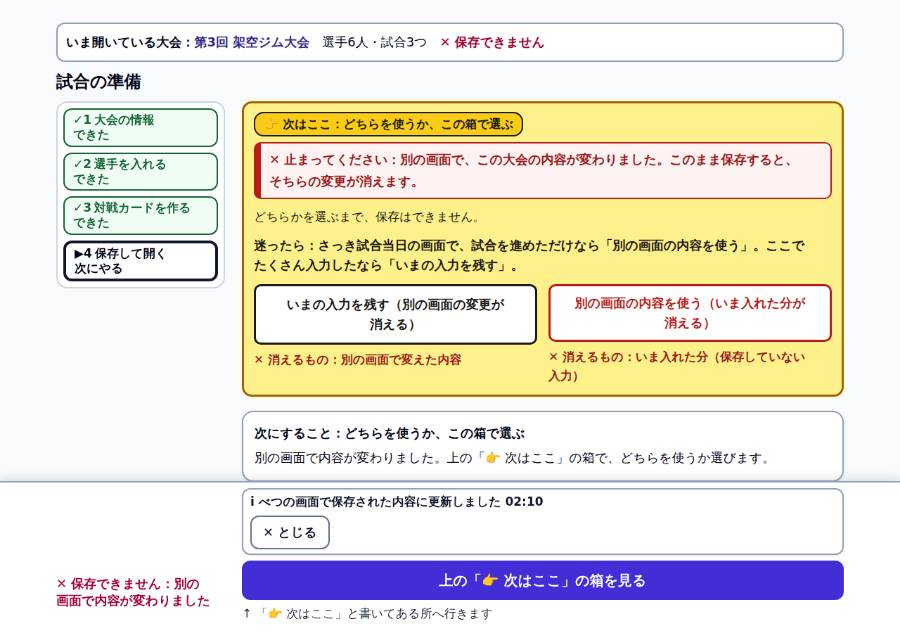

- ✅ できた目印：「別の画面の内容を使う」を押すと、確認の箱が出ます。左の大きい「やめる（何も変えない）」を押せば、何も変わりません。
- ⚠ ちがう画面が出たら：「いまの入力を残す」を押したときは、確認の箱は出ません。すぐ「● 未保存」になります。もう一度「保存する」を押します。
- ⚠ ちがう画面が出たら：2つのボタンは、**どちらも、消えるものがあります。** 「いまの入力を残す（別の画面の変更が消える）」と「別の画面の内容を使う（いま入れた分が消える）」です。迷ったら「やめる」を押して、第8章の8-7を読みます。

**手順3：片方の画面を閉じます。**

- ✅ できた目印：画面が1つだけになります。
- ⚠ ちがう画面が出たら：2つ開いたままにしないことが、いちばんの予防です。

---

### 8-2　「コピーのファイル」って、なに？

**「コピーのファイル」は、いまの大会のデータを、パスワードで守った、1つのファイルにしたものです。** 名前の最後は『.tournament.enc』です。ファイルの名前は、『大会番号-日付.tournament.enc』の形です。たとえば『taikai-lq3k9x2a-20271003.tournament.enc』です。

パスワードを知らない人には、開けません。

| | 入っている | 入っていない |
|---|---|---|
| 内容 | 名簿（選手の一覧）・写真・対戦カード・「選手に書いてもらうこと」の設定 | **Googleの受付の設定**（受付のURL＝インターネットの住所や、受付の開始・停止）。電話番号・メールも入っていません。 |
| 理由 | 大会の中身を、そっくり別の場所に移せます。 | Googleの受付は、Googleのシートの中にあるからです。 |

**いつ作るか（目安）：**

| いつ | なぜ |
|---|---|
| 対戦カードを保存したあと | 大会の準備が、いったん完成したからです。 |
| 大会の前の日 | 当日にパソコンがこわれても、すぐ戻せるからです。 |
| 選手や試合を直したあと | 画面に「⚠ 前のコピーのあとで変更あり」と出ます。古いコピーは、直す前の内容です。 |
| 「⚠ 気をつけて：コピー未作成：停電や故障で消えると戻せません。」が出たとき | まだ一度も作っていません。 |

- ⚠ ちがう画面が出たら：「別のパソコンへ移す／こわれたときのコピー」のボタンを押しても、**まだコピーは作られません。** 「下の「コピーのファイル」の画面が開くだけです」と書いてあります。

---

### 8-3　パスワードの決めかた

**この節でやること：** 「コピーのファイル」に付ける、パスワード（自分だけの合言葉）を決めます。

**なぜ大事か：** パスワードを忘れると、**だれにも、戻せません。** 作った人にも、ジムの担当者にも、戻せません。だから、**紙に書いて**とっておきます。

**決まりは、この3つです。**（アプリが止めるのは、10文字に足りないときと、「紙に書きました」のチェックが無いときだけです。半角にするのは、打ちまちがいを防ぐための、おすすめです。）

| 決まり | くわしく |
|---|---|
| 半角の英数字 | 半角は、せまい文字です（abc 123）。全角（ａｂｃ １２３）や、ひらがなは使いません。画面は「全角と空白は半角に直して使います」と書いてありますが、はじめから半角で入れるのが安全です。 |
| 10文字以上 | 数が足りないと、「🔒 押せません：あと7文字 必要です」のように出ます。 |
| 紙にも書く | 「紙に書きました」にチェックを入れないと、ボタンが押せません。 |

**手順1：（紙に書きます）覚えやすい言葉を、ローマ字で2つ決めます。**（たとえば、好きな花と、好きな季節）

- ✅ できた目印：紙に、『sakura』と『haru』のような、2つの言葉が書けました。（見本です。そのまま使わず、自分の言葉にします）
- ⚠ ちがう画面が出たら：画面の見本『hanabi2027x』も、**見本**です。そのまま使わず、自分の言葉に変えます。

**手順2：（紙に書きます）うしろに、4けたの数字をつけます。**（たとえば、大会の年）

- ✅ できた目印：紙に、『sakuraharu2027』のような文字が書けました。数えると、10文字以上です。
- ⚠ ちがう画面が出たら：10文字に足りないときは、言葉か数字を足します。

**手順3：紙に、はっきり書きます。**

- ✅ できた目印：紙に、パスワードがはっきり書いてあります。『l（小さいエル）』と『1（数字）』、『O（大文字のオー）』と『0（ゼロ）』のように、まぎらわしい文字は、横に説明を書きます。
- ⚠ ちがう画面が出たら：書いたあとで、ちがいがないか、画面の「文字を見る」を押して、見くらべます。

**手順4：紙を、ジムの引き出しなど、人が見ない場所にしまいます。**

- ✅ できた目印：紙が、しまう場所に入りました。
- ⚠ ちがう画面が出たら：**パソコンやモニターにはりつけません**（パソコンがなくなると、いっしょになくなります）。**LINEやメールに、パスワードを書きません**（ほかの人に見られることがあります）。

---

### 8-4　「コピーのファイル」を作る（約5分）

**この節でやること：** パソコンの中の大会のデータを、パスワードつきのファイルにします。そのあと、USBメモリにも入れます。

**なぜ：** パソコンがこわれても、USBメモリに入れておけば、元に戻せるからです。

**このあと：** ファイルが『ダウンロード』フォルダ（ダウンロードしたファイルが入る場所）に入ります。そのファイルを、USBメモリにコピーします。

**手順1：画面の下の帯で、「✓ 保存済み」になっているか見ます。**

- ✅ できた目印：「✓ 保存済み 02:09」のように出ています。
- ⚠ ちがう画面が出たら：「● 未保存」のときは、先に「保存する」を押します（8-1）。**まだ保存していない変更も、「コピーのファイル」には入ります。** でも、先に保存するほうが安心です。

**手順2：4番「保存して開く」の中の、「コピーのファイルを作る・戻す」を押して、開きます。**

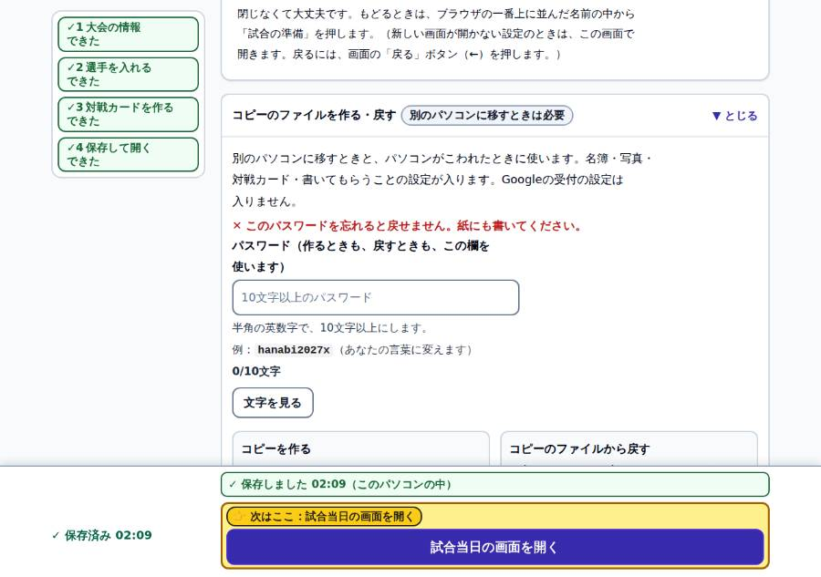

- ✅ できた目印：「別のパソコンに移すときと、パソコンがこわれたときに使います。名簿・写真・対戦カード・書いてもらうことの設定が入ります。Googleの受付の設定は入りません。」と、赤い「✕ このパスワードを忘れると戻せません。紙にも書いてください。」が出ます。
- ⚠ ちがう画面が出たら：画面の上の「別のパソコンへ移す／こわれたときのコピー」を押しても、箱が開くだけで、コピーは作られません。それで大丈夫です。もう開いているときは、「▼ とじる」と出ています。押すと閉じてしまうので、押しません。

**手順3：「パスワード（作るときも、戻すときも、この欄を使います）」の四角に、決めたパスワードを入れます。**

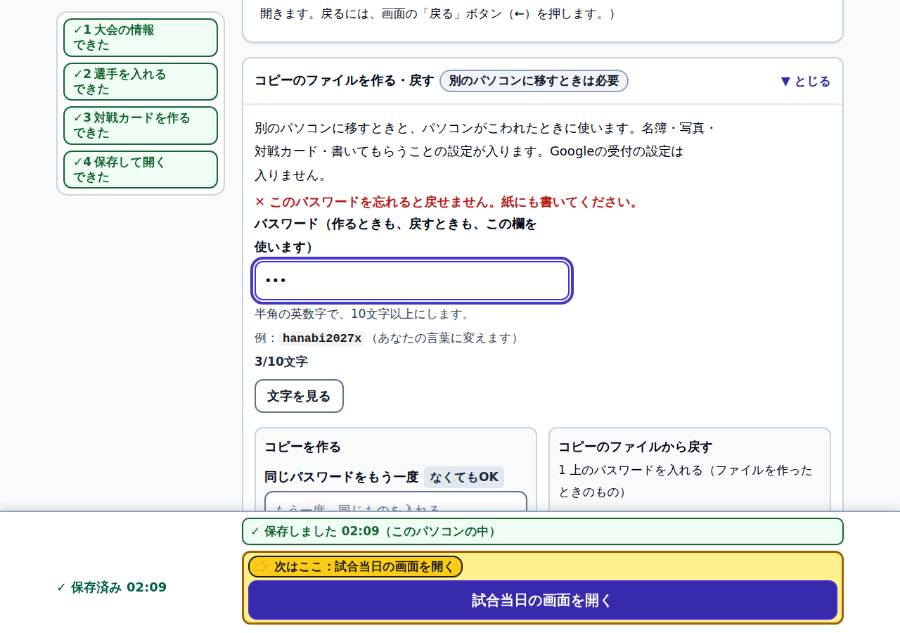

- ✅ できた目印：四角の下の数が、「11/10文字 ✓」のように、10以上になります。
- ⚠ ちがう画面が出たら：「3/10文字」のように少ないときは、「🔒 押せません：あと7文字 必要です」と出ます。足りない分を足します。入れた文字が見えなくて不安なときは、「文字を見る」を押すと、見えます。見終わったら「文字をかくす」を押します。

**手順4：（なくてもOK）下の「同じパスワードをもう一度」の四角に、同じパスワードを、もう一度入れます。**

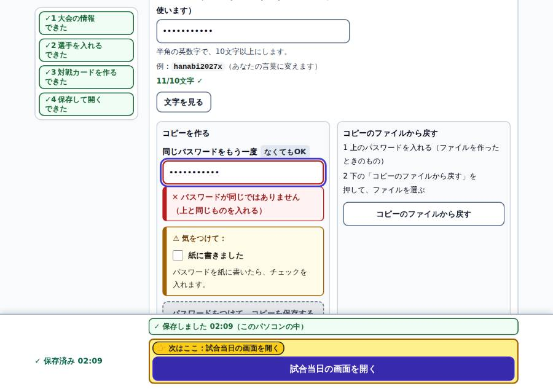

- ✅ できた目印：「✓ 同じです」と出ます。
- ⚠ ちがう画面が出たら：「✕ パスワードが同じではありません（上と同じものを入れる）」と出たら、打ちまちがいです。上と同じものを入れ直します。この手順は、とばしても大丈夫です（打ちまちがいを防ぐための、おまけです）。

**手順5：パスワードを、紙に書きます。**（8-3の手順3）

- ✅ できた目印：紙に、パスワードが書いてあります。
- ⚠ ちがう画面が出たら：まだ書いていないときは、先に書きます。書かずに進むと、あとで戻せなくなります。

**手順6：「紙に書きました」の四角に、チェックを入れます。**

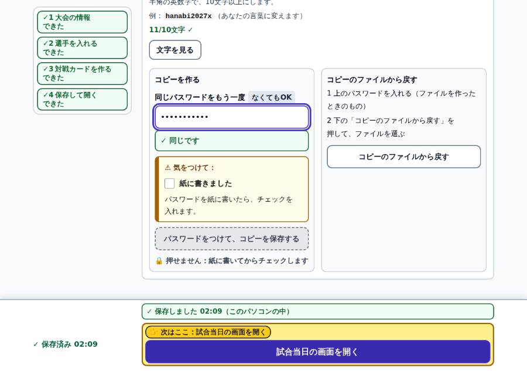

- ✅ できた目印：「パスワードをつけて、コピーを保存する」のボタンが、押せる形になります。
- ⚠ ちがう画面が出たら：書く前に押すと、「🔒 押せません：紙に書いてからチェックします」と出ます。

**手順7：「パスワードをつけて、コピーを保存する」を押します。**

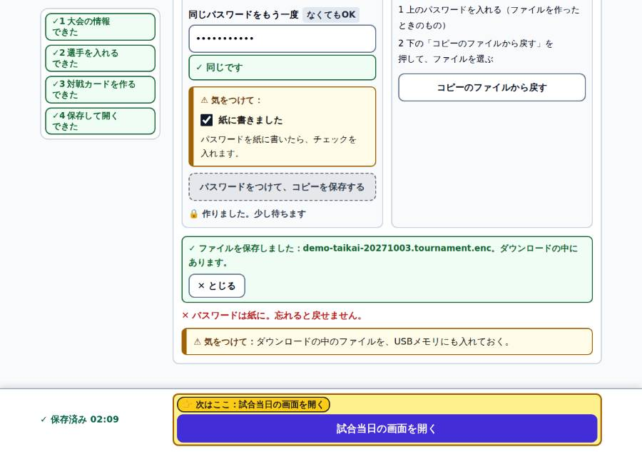

- ✅ できた目印：「ファイルを保存しました：」のあとに、ファイルの名前（たとえば『taikai-lq3k9x2a-20271003.tournament.enc』）が出て、「ダウンロードの中にあります。」と続きます。ボタンは「🔒 作りました。少し待ちます」になります。続けて「✕ パスワードは紙に。忘れると戻せません。」と、「⚠ 気をつけて：ダウンロードの中のファイルを、USBメモリにも入れておく。」が出ます。
- ⚠ ちがう画面が出たら：「失敗：コピーのファイルを作れませんでした。もう一度「パスワードをつけて、コピーを保存する」を押してください。」と出たら、もう一度押します。

**手順8：ブラウザの右上の、ダウンロードの印を見ます。**

- ✅ できた目印：Chromeでは、右上に下向きの矢印（ダウンロード）の印が出て、ファイルの名前が見えます。Edgeでは、右上に小さな窓（ポップアップ）が出て、ファイルの名前が見えます。（Windowsでの見た目は、まだ実機で確かめていません。形がちがっても、ファイルの名前が見えれば大丈夫です）
- ⚠ ちがう画面が出たら：保存する場所を聞く窓（『名前を付けて保存』）が出たときは、場所を『ダウンロード』にして、『保存』を押します。ファイルの名前の最後が『.tournament』だけに見えることがあります（Windowsが『.enc』を隠しているためです）。そのままで大丈夫です。

**手順9：エクスプローラー（フォルダやファイルを見るソフト）を開きます。**

画面の一番下の細い帯（タスクバー）にある、黄色いフォルダの絵を押します。（別のやり方：キーボードの Windowsキー（窓のマークのキー）を押しながら E を押します。）

- ✅ できた目印：エクスプローラーの窓が開きます。
- ⚠ ちがう画面が出たら：黄色いフォルダの絵が見つからないときは、Windowsキー＋E を試します。

**手順10：エクスプローラーの、左の一覧の『ダウンロード』を押します。**

- ✅ できた目印：右に、さっきの『…tournament.enc』のファイルが見えます。
- ⚠ ちがう画面が出たら：見つからないときは、右上の『並べ替え』で、日付の新しい順にします。または、右上の検索の四角に『tournament』と入れます。

**手順11：USBメモリを、パソコンの差し込み口に差します。**

- ✅ できた目印：エクスプローラーの左の一覧に、USBメモリの名前（『USB ドライブ』のような名前）が増えます。
- ⚠ ちがう画面が出たら：出ないときは、10秒待ちます。差し込み口を変えてみます。

**手順12：『…tournament.enc』のファイルを、1回だけ押して、選びます。**

- ✅ できた目印：そのファイルの行に色がつき、エクスプローラーの左下に『1 個の項目を選択』のような文字が出ます。（Windowsの版で、言葉が少しちがいます。）
- ⚠ ちがう画面が出たら：ダブルクリック（続けて2回押す）はしません。選ぶだけです。

**手順13：キーボードの Ctrl を押しながら C を押します。**（コピー）

- ✅ できた目印：見た目は変わりません。それで大丈夫です。次の手順16で貼ると、コピーできたか分かります。
- ⚠ ちがう画面が出たら：うまくいったか不安なときは、ファイルを右クリックして「コピー」を押しても、同じです。

**手順14：エクスプローラーの左の一覧で、USBメモリの名前を押します。**

- ✅ できた目印：USBメモリの中身が、右に出ます。
- ⚠ ちがう画面が出たら：左の『ダウンロード』の中のファイルを、まちがえて消さないよう、注意します。

**手順15：右の白い所を、1回押します。**

- ✅ できた目印：USBメモリの中の、何もない所が選ばれます。
- ⚠ ちがう画面が出たら：ファイルの上を押さないようにします。

**手順16：キーボードの Ctrl を押しながら V を押します。**（貼り付け）

- ✅ できた目印：USBメモリの中に、同じ名前のファイルが入ります。
- ⚠ ちがう画面が出たら：右クリック→「貼り付け」でも同じです。

**手順17：左の一覧で、USBメモリの名前を右クリックして、『取り出し』を押します。**

- ✅ できた目印：『ハードウェアを安全に取り外すことができます』のような知らせが出ます。（Windowsでの見た目は、まだ実機で確かめていません）
- ⚠ ちがう画面が出たら：『使用中です』と出たら、エクスプローラーの窓をいったん閉じて、もう一度やります。

**これで、「コピーのファイル」が、2か所（パソコンのダウンロードフォルダと、USBメモリ）に入りました。**

---

### 8-5　別のパソコンで戻す（約5分）

**この節でやること：** 2台目のパソコンで、「コピーのファイル」から、大会を戻します。

**なぜ：** パソコンを替えるときや、こわれたときに、同じ大会の続きができるからです。

**このあと：** 2台目に、選手・写真・対戦カードが、そっくり入ります。元のパソコンのデータは、そのまま残ります（コピーなので、消えません）。

**用意するもの：**

- USBメモリ（「コピーのファイル」が入っているもの）
- パスワードを書いた紙
- 2台目のパソコン（ChromeかEdgeが入っていて、インターネットにつながるもの）

**手順1：2台目のパソコンで、ChromeかEdgeを、ふつうのウィンドウで開きます。**

- ✅ できた目印：ブラウザの画面が出ます。
- ⚠ ちがう画面が出たら：シークレット（Edgeでは『InPrivate』）の窓は、使えません。いったん閉じて、ふつうの窓で開きます。

**手順2：「試合の準備」の画面を開きます。** 1台目で使ったのと、同じリンクを開きます。リンクは、ジムの担当者から届いた「試合の準備」のリンクです。アドレス（ブラウザの上の細長い四角に出る、インターネットの住所）の途中に、『/private/』が入っています。

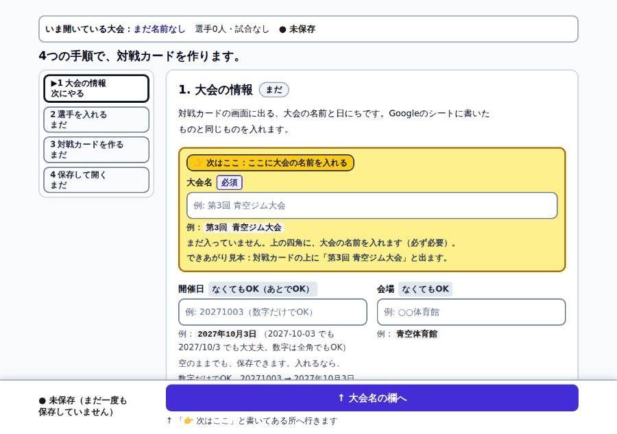

- ✅ できた目印：「いま開いている大会：まだ名前なし　選手0人・試合なし　● 未保存」と出ます。空の画面で、まちがいではありません。
- ⚠ ちがう画面が出たら：別の画面が出たときは、アドレスを見直します。上に「試合の準備」と出ていれば、大丈夫です。ここでは、「新しい大会をつくる」は押しません。

**手順3：USBメモリを、2台目のパソコンに差します。**

- ✅ できた目印：エクスプローラーの左の一覧に、USBメモリの名前が出ます。
- ⚠ ちがう画面が出たら：出ないときは、10秒待ちます。

**手順4：画面の一番下の「コピーのファイルを作る・戻す」を押して、開きます。**（上の「別のパソコンへ移す／こわれたときのコピー」を押しても、同じ箱が開きます）

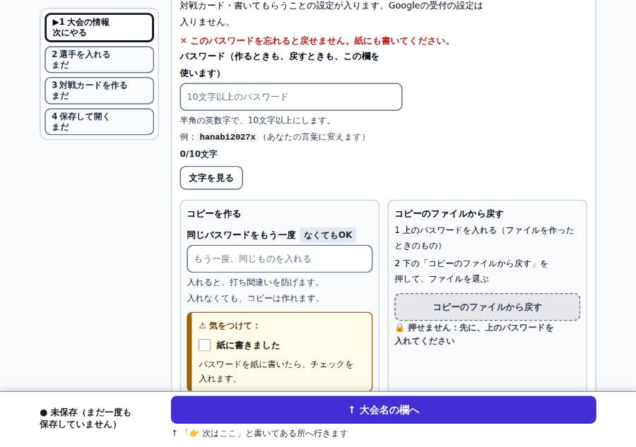

- ✅ できた目印：「コピーのファイルから戻す」の欄が出ます。「1 上のパスワードを入れる（ファイルを作ったときのもの）」と書いてあります。続けて「2 下の「コピーのファイルから戻す」を押して、ファイルを選ぶ」と書いてあります。
- ⚠ ちがう画面が出たら：「▼ とじる」と出ているときは、もう開いています。

**手順5：「パスワード」の四角に、作ったときのパスワードを入れます。**（紙を見ながら）

- ✅ できた目印：「🔒 押せません：先に、上のパスワードを入れてください」の文が消えます。「コピーのファイルから戻す」のボタンが、押せる形になります。
- ⚠ ちがう画面が出たら：入力が全角になっていないか、前後に空白が入っていないか、見ます。「文字を見る」を押すと、入れた文字が見えます。

**手順6：「コピーのファイルから戻す」の、大きな四角のボタンを押します。**

- ✅ できた目印：Windowsの『開く』の窓が出ます。
- ⚠ ちがう画面が出たら：窓が出ないときは、もう一度押します。

**手順7：『開く』の窓で、左の一覧のUSBメモリの名前を押します。**

- ✅ できた目印：USBメモリの中身が、右に出ます。
- ⚠ ちがう画面が出たら：『ダウンロード』にファイルをコピーしてあるときは、左の『ダウンロード』を押します。

**手順8：『…tournament.enc』のファイルを、1回押して、選びます。**

- ✅ できた目印：そのファイルの行に色がつき、窓の下の『ファイル名』の四角に、ファイルの名前が入ります。
- ⚠ ちがう画面が出たら：窓の『開く』は、ファイルを選ぶためのボタンです。ファイルの中を開く、という意味ではありません。

**手順9：窓の右下の『開く』を押します。**

- ✅ できた目印：赤いふちの確認の箱が出ます。赤い「✕」のあとに「消える」と書いてあり、続けて「コピーの内容を戻します（なくなるものはありません）」と出ます。『選手0人→6人・試合0つ→3つ』のような数も出ます。箱の中には、次の文も書いてあります。
  - 『第3回 架空ジム大会』のコピー（選手6人・写真6枚・試合3つ・10月3日 14:03）を戻します。
  - 「（いまの内容は空です）コピーの内容に入れかわりますが、なくなるものはありません。」
  - 「下のボタンを押すまで、何も変わりません。」

  （大会の名前、数、日付と時刻は、会長さんの大会のものです。）
- 💡 空のパソコンでは、消えるものはありません。赤い文は、そのまま押して大丈夫です。
- ⚠ ちがう画面が出たら：黄色いふちの箱で、「戻す」と「コピーの内容を戻します（なくなるものはありません）」と書いてあることもあります。そのときは、右のボタンが「コピーの大会を入れる（なくなるものはありません）」になっています。手順11で、そのボタンを押します。

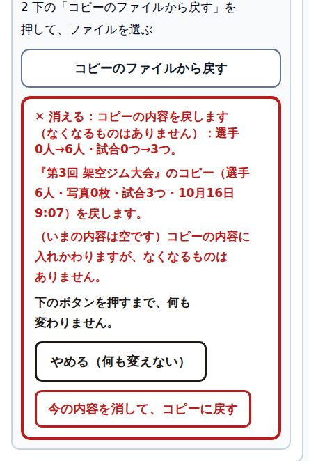

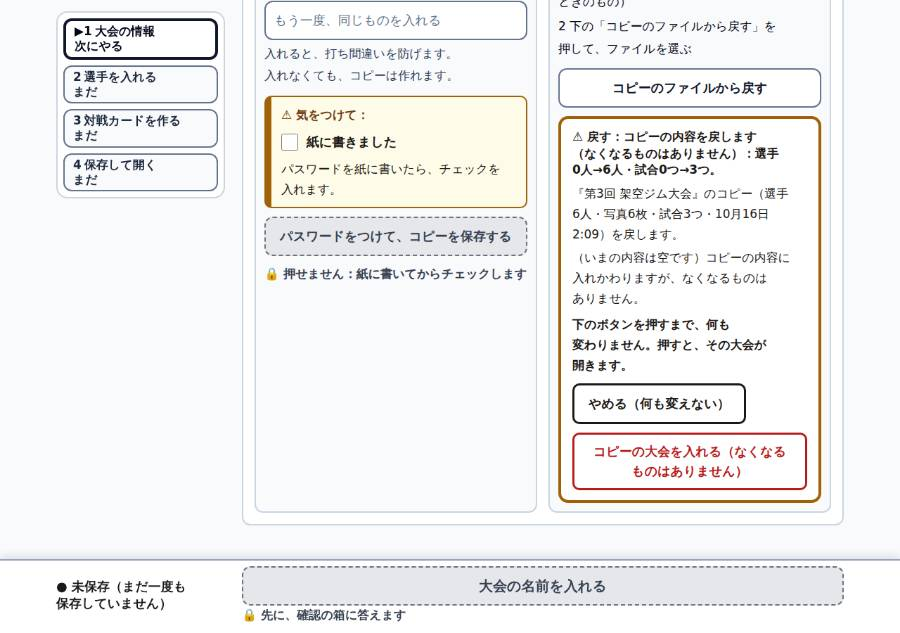

- ⚠ ちがう画面が出たら：「失敗：戻せませんでした。パスワードがちがいます。日本語入力が全角になっていないか、前後に空白がないか見て、もう一度入れてください。」と出たら、パスワードを見直して、手順5からやり直します。「今のデータは変わっていません。」と書いてあるので、安心です。

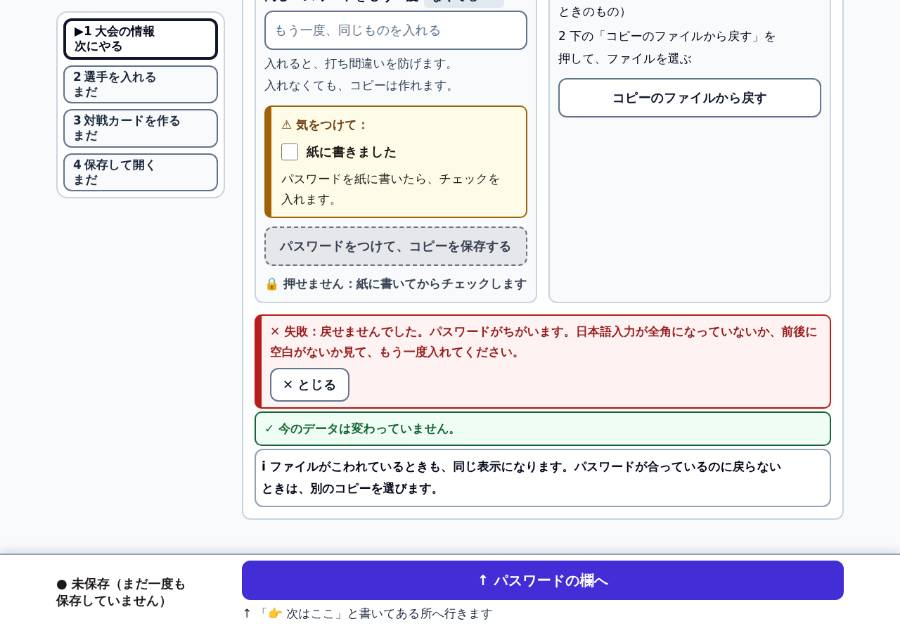

- ⚠ ちがう画面が出たら：ファイルがこわれているときも、同じ文が出ます。「パスワードが合っているのに戻らないときは、別のコピーを選びます。」と書いてあります。USBメモリに、別のコピーがあれば、それを選びます。

**手順10：確認の箱の文を、読みます。**

- ✅ できた目印：選手と試合の数が、元のパソコンと同じか、見えます。
- ⚠ ちがう画面が出たら：数がちがうときは、ちがうファイルかもしれません。「やめる（何も変えない）」を押して、手順6からやり直します。

**手順11：赤いふちの右のボタン「今の内容を消して、コピーに戻す」を押します。**

- ✅ できた目印：「戻しました。」のあとに、大会の名前・選手6人・試合3つが出て、「すでに保存ずみです。」と続きます。一番上は「選手6人・試合3つ　✓ 保存済み」になり、左の4つの札が、ぜんぶ「できた」（緑）になります。

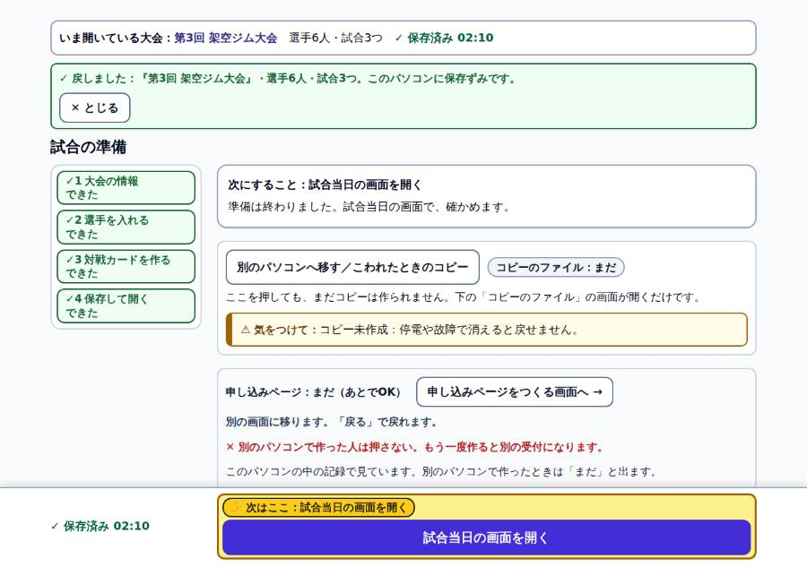

- ⚠ ちがう画面が出たら：黄色いふちの箱のときは、ボタン「コピーの大会を入れる（なくなるものはありません）」を押します。画面が開き直って、「戻しました：」のあとに、『大会の名前』・選手の数・試合の数が出て、「このパソコンに保存ずみです。」と続きます。
- ⚠ ちがう画面が出たら：やめたいときは、左の「やめる（何も変えない）」を押します。何も変わりません。

**手順12：選手の一覧と、試合の数を見て、元のパソコンと同じか、確かめます。**

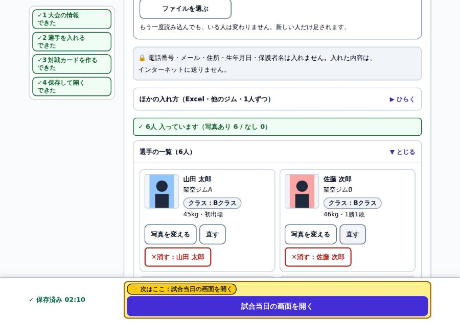

- ✅ できた目印：選手の人数と、写真、対戦カードの数が、元のパソコンと同じです。
- ⚠ ちがう画面が出たら：ちがうときは、別の（古い）「コピーのファイル」を選んだかもしれません。もう一度、手順6からやり直して、新しいコピーを選びます。

**手順13：戻したあとの注意を読みます。**

- ✅ できた目印：「⚠ 気をつけて：コピー未作成：停電や故障で消えると戻せません。」が出ているときは、新しい「コピーのファイル」を、このパソコンで作り直します（8-4）。
- ⚠ ちがう画面が出たら：**2台のパソコンで、同じ大会を、別々に直さないでください。** 2台のあいだで、内容は自動では同じになりません。直すのは、1台だけにします。

> **大事なこと：** 2台目で戻したら、**大会の当日は、この2台目で**「試合当日の画面を開く」を押します。ふだんのパソコンで作った内容は、2台目には、自動では伝わりません。

---

### 8-6　すでにデータのあるパソコンで戻すとき

**何をするか：** すでにデータがあるパソコンで、「コピーのファイル」から戻します。

**なぜか：** コピーの内容に入れかえたいときのためです。

**このあと：** いまの内容が、コピーの内容に入れかわります。

すでに大会が入っているパソコンで、「コピーのファイル」から戻すと、**いまの内容が、コピーの内容に入れかわります。** そのため、赤い確認の箱が出ます。

**手順1：確認の箱の、赤い文を読みます。**

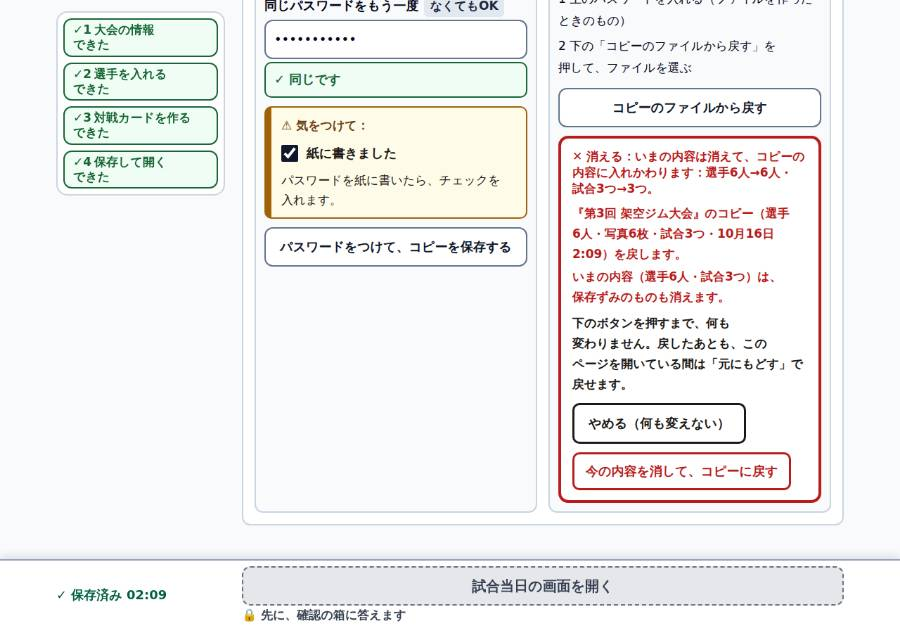

- ✅ できた目印：「✕ 消える：いまの内容は消えて、コピーの内容に入れかわります：選手6人→4人・試合3つ→2つ。」のように、**減る数**が書いてあります。「⚠ 減ります：選手が6人から4人になります。」のような文も出ます。「このコピーは3日前のものです。」のように、古さも出ます。
- ⚠ ちがう画面が出たら：「⚠ このコピーは空です。」と出たときは、選手も試合も入っていないコピーです。戻すと、いまの内容が、空になります。ふつうは、戻しません。

**手順2：迷ったら、左の大きい「やめる（何も変えない）」を押します。**

- ✅ できた目印：「やめました。何も変えていません。」と出ます。
- ⚠ ちがう画面が出たら：「やめる」は、いつでも安全です。

**手順3：本当に戻すときだけ、「今の内容を消して、コピーに戻す」を押します。**

- ✅ できた目印：「戻しました。」のあとに、大会の名前と数が出て、「すでに保存ずみです。」と続きます。ボタン「元にもどす（このページを開いている間だけ）」が出ます。
- ⚠ ちがう画面が出たら：**「✕ 元にもどせるのは、この画面を閉じるまで。」** です。ページを閉じる前に、まちがいに気づいたら、「元にもどす」を押します。「戻す前の内容に、もどしました。」と出ます。色だけで見分けず、ボタンの**文字**を読んで、押します。

**手順4：（別の大会が入っているパソコンだけ）黄色の「このコピーは」で始まる文を読みます。**

- ✅ できた目印：「いまの画面は別の大会なので、何も変えていません。」と書いてあります。「大会を開く（そのあと、もう一度ファイルを選ぶ）」のボタンが出ます。
- ⚠ ちがう画面が出たら：「大会を開く（そのあと、もう一度ファイルを選ぶ）」を押すと、その大会の画面が開き直されて、パスワードの欄が空になります。もう一度パスワードを入れて、「コピーのファイルから戻す」で、同じファイルを選びます。保存していない入力があるときは、ブラウザが『サイトを離れますか？』と聞きます。迷ったら『キャンセル』を押して、先に「保存する」を押します。

---

### 8-7　まちがえたときの、元の戻しかた

**すぐ見たいとき用の表です。** 『やってしまったこと』の行を探して、右の『どうするか』のとおりにします。

| やってしまったこと | 元に戻せるか | どうするか |
|---|---|---|
| 入れた文字を、まちがえた（まだ保存していない） | 戻せます | その場で、直します。直したら、「保存する」を押します。 |
| 試合のカードを、消した | **戻せます**（このページを閉じるまで） | 「消した試合を元にもどす」を押します。画面に「まちがえたときは「消した試合を元にもどす」を押します（このページを閉じるまで戻せます）」と出ます。 |
| 選手を、消した | 消した人は、戻せません | 名簿のファイルを、もう一度選びます。（ZIPは、名簿と写真をまとめた箱です。CSVは、かんたんな表のファイルです）「新しく入った人は1人です。」と出て、消した人だけが、また入ります。試合の席は、空のままです。 |
| 名簿の取り込みで、別の大会の人を足してしまった | 戻せます（すぐなら） | 黄色い注意の「足さない（もどす）」を押します。「足した」と人数のあとに、「人を取り消して、名簿をもとにもどしました。」と出ます。 |
| ファイルの内容で、手で直した所が書きかわった | 戻せません | 確認の箱では、迷ったら「やめる（何も変えない）」を押します。押したあとは、戻せません。 |
| 選手の情報を直している途中で、やめたくなった | 戻せます | 「やめる」を押します。確認の箱で、「続けて直す（何も消さない）」か「直した内容を消す」を選びます。 |
| 「試合当日の画面」で、試合を進めすぎた | 戻せます | 黄色い「第◯試合にもどす」を押します。進めた直後の10秒は、大きなボタンで出ます。そのあとは、小さなボタンか、「← 前の試合」で戻れます。 |
| 一覧の「この試合を開く」を押して、いまの試合が変わってしまった | 戻せます | 「第◯試合にもどす」を押します。 |
| 「試合当日の画面を第1試合にもどす」を押して、保存してしまった | もう戻せません | 「次の試合 →」を押して、いまの試合まで進めます。**本番の途中なら、このボタンは押しません。** |
| 「コピーのファイル」から戻して、まちがいに気づいた | 戻せます（ページを閉じる前なら） | 「元にもどす（このページを開いている間だけ）」を押します。 |
| 「別の画面の内容を使う」を押した | 戻せません | 確認の箱で、迷ったら「やめる」を押します。 |
| 新しい大会へ移った | 戻せます | いまの大会は保存されています。「続きから：」で始まる行を押すと、また開けます。 |
| 受付を止めてしまった（Google側：「③ 受付を停止」） | 戻せます | シートの「Tournament OS」→「② 受付を開始」を押します。申し込みのデータは、消えていません。 |
| 「① 最初の設定」を、何回も押した | 心配いりません | 何度押しても、同じ表と、同じフォルダを使います（作り直しません）。 |
| 『新しいデプロイ』を、何回も押した | 心配いりません | 最後にできた、新しいURLを、「選手の受付をつくる」の画面に、貼り直します。前のURLは使いません。 |

---

### 8-8　何が消えて、何が消えないか

| 場面 | 消えるもの | 消えないもの |
|---|---|---|
| 「✓ 保存済み」のあとで、画面を閉じる | なし | 名簿・写真・対戦カードは、このパソコンのブラウザの中に残ります。 |
| 「● 未保存」のまま、画面を閉じる | **入れた内容**（保存していない分） | 前に保存した分は、残ります。 |
| ネットが切れる | なし | 入力と保存は、できます。ただし、画面を閉じたあとに開き直すには、ネットが必要です。 |
| 別のパソコンや、スマホで開く | なし（ただ、空に見えます） | 元のパソコンのデータは、そのままです。 |
| 同じパソコンでも、ブラウザを変える（ChromeからEdgeなど） | なし（ただ、空に見えます） | ブラウザごとに、保存場所が別だからです。作ったブラウザで開きます。 |
| 同じパソコンで、Chromeの右上の丸いアイコンから、別の人（プロフィール）に切りかえる | なし（ただ、空に見えます） | プロフィールごとに、保存場所が別だからです。大会を作ったときの人（プロフィール）で開きます。 |
| ブラウザの『閲覧データの削除』（ブラウザが覚えている記録を消す操作）で、『Cookieと他のサイトデータ』（Cookie＝サイトがブラウザに残す小さな記録）を消す | **大会のデータが消えることがあります** | 消すとき以外は、消えません。**大会の前後に、この操作はしません。** 「コピーのファイル」があれば、戻せます。 |
| 「コピーのファイル」から戻す | いまの内容（入れかわります） | 確認の箱で、数が出ます。「やめる」で止められます。 |
| 選手を消す | その人と、試合の席 | ほかの選手は、そのままです。 |
| Googleのシートで「③ 受付を停止」を押す | なし | 申し込み・写真・表は、1つも消えません。 |
| 「④ OS用の名簿ZIPを作る」をもう一度押す | 前のZIP（ゴミ箱に入ります。戻せます） | 新しいZIPが、全員ぶんで作り直されます。 |

⚠ 気をつけて：**ふつうは、保存したデータは、勝手には消えません。** ただし、パソコンの空きがとても少なくなったときなどに、ブラウザが古いデータを整理することがあります。だから、**「コピーのファイル」**を、USBメモリに入れておきます。

---

### 8-9　第8章のチェックリスト

大会の前の日に、チェックを入れて確かめます。

- ☐ 画面の下の帯が「✓ 保存済み」になっている。
- ☐ 「コピーのファイルを作る」で、ファイルを作った。
- ☐ 「ダウンロード」フォルダに、『…tournament.enc』がある。
- ☐ USBメモリにも、同じファイルが入っている。
- ☐ パスワードを、紙に書いた。紙は、人が見ない場所にしまった。
- ☐ パスワードを、LINEやメールには書いていない。
- ☐ 2台目のパソコンで、戻せることを、一度は確かめた（できれば）。
- ☐ 画面に「⚠ 前のコピーのあとで変更あり」が出ていないか、見た。出ていたら、コピーを作り直した。

---

### この章で、まだ確かめられていないこと

Windowsでの見た目は、まだ実機で確かめていません。対象は、ダウンロードの印、エクスプローラー、『開く』の窓、USBメモリへのコピーです。本物の2台目のパソコンでの復元も、まだです。見た目がちがうときは、画面の写真を撮って、ジムの担当者に送ります（9-2 J）。くわしくは、9-4を見ます。

---

## 第9章　こまったとき

### この章でやること

**まず、結論です。** 画面に赤い文（✕）や、黄色い文（⚠）が出ても、**あわてなくて大丈夫です。** 多くの場合、『次にやること』を教える知らせです。赤い文には、『何がちがうか』と「次にやること」が書いてあります。この章は、その文の**意味**と、**次にやること**を、表にしたものです。

- **何をするか：** 困ったときに、画面の文から、直しかたを探します。
- **なぜ：** 文の意味が分かれば、落ち着いて直せるからです。
- **このあと、どうなるか：** 直したあとは、止まった所の続きから進めます。
- **かかる時間：** 探すのは1〜2分です。直すのは、ほとんど5分以内です。
- **読みとばしてよい所：** 画面にそのような文が出るまでは、9-3の長い表は、読まなくて大丈夫です。

むずかしい言葉は、第10章（ことばの説明）で引けます。

> **画面の文の表し方：** この章の表は、ふつうのかぎかっこ（｢ ｣）を付けずに、画面の文字を**そのまま**写しています。`／`は、同じ場面で出る別の文の区切りです。`{ }`は、場面で変わる文字（名前や数）です。`…`は、長い文の省略です。`（ ）`の中は、ボタンの名前や、色の説明です。Windows以外のための説明の文は、`…`にして省いてあります。

### 9-0　3つのやくそく

| やくそく | くわしく |
|---|---|
| ① 閉じない・あわてない | 赤い文が出ても、ページを閉じません。入れた内容は、画面に残っていることが多いです。 |
| ② 文を、そのまま読む | 赤い文に、次にやることが書いてあります。まず、その文を、最後まで読みます。 |
| ③ 写真を撮って、担当者に送る | 直らないときは、画面の写真を撮って、ジムの担当者に送ります。（9-2 J） |

---

### 9-1　こまったことから探す表

『こまったこと』の行を探して、右の場所を見ます。『No.』は、9-3の表の左はしの番号です。

| こまったこと | 見る場所 |
|---|---|
| Googleの『承認が必要です』『このアプリは確認されていません』で止まった | 9-2 A（No.51〜53、No.460） |
| 『アクセスをブロック』『401 invalid_client』と出た | 9-2 A のケース4 |
| 「① 最初の設定」を押したのに、何も起きない | 9-2 D（No.53） |
| 「① 最初の設定」を2回押した、何回も押した | 9-2 D |
| URLを貼ったら、赤い「✕」が出た（「テスト用のURL」「シートのURL」など） | 9-2 B（No.86〜98、No.105〜108） |
| 「Googleが、まだ「だれでも使える」になっていません」と出た | 9-2 B のケース3（No.106） |
| 「申込表の1行目（見出し）が、変わっています」と出た | 9-2 C（No.125〜126、No.455） |
| 「シートの「設定」タブに、直すところがあります」と出た | 9-2 E（No.127〜129、No.457） |
| 「共有が、「制限付き」になっていません」と出た | 9-2 F（No.124） |
| 名簿のZIPが読めない、「これは名簿ではありません」と出た | 9-2 G（No.320〜325） |
| 写真が0枚になった | 9-2 G の『写真が0枚のとき』（No.311） |
| パスワードを忘れた | 9-2 H |
| 選手から『申し込めない』『こんな文が出た』と言われた | 9-2 I と、9-3の②の表（選手の申し込みページ） |
| 画面の写真を撮って、担当者に送りたい | 9-2 J |
| 保存できない、「保存失敗」と出た | 第8章 8-1（No.388〜390） |
| 「別の画面で内容が変わりました」と出た | 第8章 8-1（No.389、No.391〜393） |
| 「この大会は、このブラウザにありません」と出た | 第7章 7-6、第8章 8-5（No.414〜415） |
| 「試合当日の画面を開く」が押せない | No.383〜384 |
| 試合を進めすぎた、消してしまった | 第8章 8-7 |
| 体重差の赤い文が出た、クラスがちがうと出た | 第6章 6-3、6-4（No.366〜368） |
| 「区分がちがいます」「階級がちがいます」と出た | 第6章 6-4の2（No.368-2、No.437-2） |
| 申し込みページで「出場区分を選んでください。」「階級を選んでください。」と出た | 第4章 4-3の2（No.208-2、No.208-3） |
| 「区分・階級が入っていない／設定にない人」と出た | 第6章 6-4の2（No.368-3） |
| 「このシートには、階級分け・ロゴの行がありません。」と出た | 3-6、3-3の手順11〜13（No.131-2、No.132-2） |
| 「ひな形のリンクがありません」「いまは作業できません」と出た | No.26〜27（担当者に連絡します） |
| 「Googleの版が古いです」と出た | No.120（写真を撮って、担当者に送ります） |
| 「このブラウザは古いです」と出た。画面の一部が見えない。ページがなかなか開かない | 9-2 K（No.17、No.20-2、No.20-3、No.258） |
| 選手が出られなくなった（欠場にしたい・欠場にしたのを元にもどしたい） | 6-6の手順5 |
| A3の対戦一覧表を印刷したい／一覧表の画面に、黄色・灰色・赤の文が出た | 6-9、9-3の『一覧表（A3）の画面に出る文』（一1〜一12） |

---

### 9-2　場面ごとの、くわしい直しかた

---

#### A　Googleの許可の画面で止まったとき

**これは何か：** はじめて「① 最初の設定」を押すと、Googleが『このプログラムに、シートやドライブを使わせてよいですか？』と聞いてきます。これが**許可の画面**です。ふつうは、5つの画面が、順に出ます。**こわれているのではありません。** 自分で作ったシートなので、安心して進めます。

**このあと、どうなるか：** 許可が済むと、「① 最初の設定」が最後まで動いて、「準備できました」の知らせが出ます。　**かかる時間：** 約5分です。

**なぜ止まりやすいか：** 画面は、Google自身が出すので、この手引きの文字と、**少しちがうことがあります。**（本物のGoogleの画面は、まだ確かめていません。文字は、「選手の受付をつくる」の画面の案内と、シートのプログラムの文から書いています）

**ふつうの順番（5つの画面）：**

| 画面 | 画面の文字 | 押すもの |
|---|---|---|
| 1 | 『承認が必要です』 | 『権限を確認』 |
| 2 | アカウントを選ぶ画面 | コピーを作ったときと同じ、自分のアカウント |
| 3 | 『このアプリは確認されていません』 | 小さな『詳細』（『安全なページに戻る』は押しません） |
| 4 | 『（安全ではないページ）に移動』 | その行 |
| 5 | 許可の内容の画面 | 『許可』 |

終わったら、**もう一度「① 最初の設定」を押します。**（2回押すのが、ふつうです）

**ケース1：『承認が必要です』の箱が出ない／何も起きない**

**手順1：ブラウザの、アドレス（上の細長い四角）の右はしを見ます。**

- ✅ できた目印：四角に赤い×がついた印（『ポップアップがブロックされました』）が出ています。
- ⚠ ちがう画面が出たら：印がないときは、10秒待ちます。それでも何も起きないときは、もう一度、シートの「Tournament OS」→「① 最初の設定」を押します。

**手順2：その印を押して、『常に許可』のような項目を選びます。**

- ✅ できた目印：選んだあとに、印が消えるか、『完了』などのボタンが出ます。
- ⚠ ちがう画面が出たら：項目の言葉は、ブラウザが決めています。『許可』と書いてある項目を選びます。

**手順3：もう一度、「Tournament OS」→「① 最初の設定」を押します。**

- ✅ できた目印：『承認が必要です』の箱が出ます。
- ⚠ ちがう画面が出たら：それでも出ないときは、画面の写真を撮って、ジムの担当者に送ります。（9-2 J）

**ケース2：『詳細』が見つからない**

**手順1：『このアプリは確認されていません』の画面の、左のほうを見ます。**

- ✅ できた目印：小さい灰色の『詳細』の文字が見えます。
- ⚠ ちがう画面が出たら：見えないときは、画面の下のほうへ、マウスのホイールを回して、下に動かします。

**手順2：『詳細』を押します。**

- ✅ できた目印：画面の下に、新しい文字の行（『…（安全ではないページ）に移動』）が出ます。
- ⚠ ちがう画面が出たら：青くて大きい『安全なページに戻る』は、押しません。押すと、最初からやり直しになります。

**手順3：『（安全ではないページ）に移動』と書いてある行を押します。**

- ✅ できた目印：許可の内容が並ぶ画面になります。
- ⚠ ちがう画面が出たら：この文は、『Googleが、このシートのプログラムの作者を、まだ調べていない』という意味です。自分のシートなので、続けて大丈夫です。

**ケース3：『安全なページに戻る』を押してしまった／『キャンセル』を押してしまった**

**手順1：シートの「Tournament OS」→「① 最初の設定」を、もう一度押します。**

- ✅ できた目印：『承認が必要です』の箱が、また出ます。
- ⚠ ちがう画面が出たら：何も起きないときは、ケース1を見ます。

**手順2：上の『ふつうの順番』で、『許可』まで進みます。**

- ✅ できた目印：ウィンドウが閉じて、シートにもどります。
- ⚠ ちがう画面が出たら：こわれていません。何回やり直しても、大丈夫です。

**ケース4：赤い画面で『アクセスをブロック』『401 invalid_client』などと出た**

**手順1：開いている窓を、全部閉じます。**

- ✅ できた目印：ブラウザが、すべて閉じました。
- ⚠ ちがう画面が出たら：閉じる前に、画面の写真を撮っておくと、あとで担当者に見せられます。（9-2 J）

**手順2：ChromeかEdgeを、ふつうの窓で開きます。**（シークレット／InPrivateではない窓）

- ✅ できた目印：窓の上に、帽子とサングラスの絵（Chromeのシークレット）や『InPrivate』（Edge）が出ていません。窓全体が暗い灰色のときも、シークレットです。
- ⚠ ちがう画面が出たら：出ているときは、その窓を閉じて、開き直します。

**手順3：右上の丸いアイコンを押して、ログインしているアカウントを見ます。**

- ✅ できた目印：コピーを作ったときの、自分のアカウント**1つだけ**が出ています。
- ⚠ ちがう画面が出たら：2つ以上のアカウントが出ているときは、ほかのアカウントを『ログアウト』にします。

**手順4：「選手の受付をつくる」の画面を開いて、作業1の手順から、やり直します。**

- ✅ できた目印：シートが開いて、「Tournament OS」のメニューが見えます。
- ⚠ ちがう画面が出たら：やり直しても出るときは、画面の写真を撮って、担当者に送ります。（その画面に、あなたのメールアドレスが写っているときは、写真を公開の場所に貼りません）

**ケース5：『管理者によりブロックされています』と出た**

**手順1：いまのアカウントが、会社や学校のものでないか、右上の丸いアイコンで見ます。**

- ✅ できた目印：『@gmail.com』のような、個人のアカウントです。
- ⚠ ちがう画面が出たら：会社や学校のアカウントのときは、このシステムは使えません。

**手順2：個人のGoogleアカウントで、「選手の受付をつくる」の作業1（コピーを作る）から、やり直します。**

- ✅ できた目印：新しいコピーが、個人のアカウントにできます。
- ⚠ ちがう画面が出たら：むずかしいときは、担当者に連絡します。

**ケース6：許可したのに、あとで『権限が足りません』のようなエラーが出た**

**手順1：もう一度、「Tournament OS」→「① 最初の設定」を押します。**

- ✅ できた目印：許可の内容の画面が出ます。
- ⚠ ちがう画面が出たら：画面が出なければ、もう許可ずみです。ほかの原因なので、写真を撮って、担当者に送ります。

**手順2：許可の項目の前に、四角いチェック欄が並んでいるときは、『すべて選択』にチェックを入れます。**

- ✅ できた目印：すべての四角にチェックが入ります。
- ⚠ ちがう画面が出たら：チェック欄がない画面のときは、何もしません。

**手順3：『許可』（または『続行』）を押します。**

- ✅ できた目印：ウィンドウが閉じます。一部だけ許可すると、あとのメニューでエラーが出ます。
- ⚠ ちがう画面が出たら：手順1から、やり直します。

---

#### B　『URLがちがう』と言われたとき

**これは何か：** ここは、「選手の受付をつくる」の画面の「手順2 つなぐ」のことです。貼ったURL（インターネットの住所）を、アプリが調べます。まちがっていると、赤い「✕」で教えてくれます。**正しいURLは、1種類だけ**です。

**このあと、どうなるか：** 「URLは、正しい形です。」と出て、「次へ進む」に進めます。　**かかる時間：** 約5分です。

**正しいURLの見分けかた：**

| 見る場所 | 正しい形 |
|---|---|
| 最初 | 『https://script.google.com/macros/s/』で始まります。 |
| 最後 | 『/exec』で終わります。 |
| 長さ | 長い英数字が入っています（見本：『https://script.google.com/macros/s/…/exec』）。 |

**赤い文の種類と、直しかた：**

| 貼ったもの | 画面の赤い文 | 直しかた |
|---|---|---|
| シートのアドレス | 「これは「シートのURL」です」 | デプロイの画面の『ウェブアプリ』の下の、『/exec』で終わるURLを貼ります。 |
| ひな形のコピー用リンク | 「これは「ひな形のコピーを作るURL」です」 | 同上 |
| 練習用のURL（『/dev』で終わる） | 「これは「テスト用のURL」（/dev で終わる）です」 | 『新しいデプロイ』で出た、『/exec』のURLを使います。『デプロイをテスト』は押しません。 |
| Apps Scriptの画面のアドレス | 「これは「Apps Scriptの編集画面のURL」です」 | 『ウェブアプリ』の横の『コピー』を押します。上のアドレス欄は、コピーしません。 |
| 長い英数字だけ（ID） | 「それはIDです」 | URLの横の『コピー』を押します。 |
| ログイン画面のアドレス | 「これは「Googleのログインの画面のURL」です」 | 『/exec』のURLを貼ります。 |
| 会社や学校のアカウントのURL | 「会社や学校のGoogleアカウントでは、使えません（URLに /a/macros/ が入っています）」 | 個人のGoogleアカウントで、3-2のコピーからやり直します。 |
| 記号だけ／文章／途中で切れたもの | 「URLではありません」「URLではなく、ただの文字です」「URLが最後まで入っていません」 | 『コピー』ボタンで、最後までコピーし直します。 |
| 長すぎる文字 | 「文字が長すぎます」 | URLだけをコピーし直します。 |
| ほかのサイトのURL | 「これは「ウェブアプリ」のURLではありません」 | 正しいURLを貼ります。 |

**ケース1：正しいURLを、もう一度さがす**

**手順1：Googleのシートのタブを開きます。**（ブラウザの上に並ぶタブです）

- ✅ できた目印：シートが出ます。
- ⚠ ちがう画面が出たら：タブが見つからないときは、「選手の受付をつくる」の作業1のボタンで、もう一度開きます。

**手順2：上のメニューの『拡張機能』→『Apps Script』を押します。**

- ✅ できた目印：新しいタブで、Apps Scriptの画面が開きます。
- ⚠ ちがう画面が出たら：中が空っぽのときは、ジムの担当者に連絡します。

**手順3：右上の『デプロイ』→『デプロイを管理』を押します。**

- ✅ できた目印：『ウェブアプリ』と、長いURLが出ます。
- ⚠ ちがう画面が出たら：何も出ないときは、まだデプロイしていません。『デプロイ』→『新しいデプロイ』を、**1回だけ**押します。

**手順4：『ウェブアプリ』のURLの横の『コピー』を押します。**

- ✅ できた目印：『コピーしました』のような表示が、一瞬出ます。
- ⚠ ちがう画面が出たら：押せないときは、URLをマウスで3回カチカチと押して、全部えらびます。そのあと、キーボードの Ctrl を押しながら C を押します。

**手順5：上のタブの「選手の受付をつくる」を押して、もどります。**

- ✅ できた目印：「手順2 つなぐ」の画面です。
- ⚠ ちがう画面が出たら：Apps Scriptのタブは、閉じても大丈夫です。

**手順6：URLの四角を押して、キーボードの Ctrl を押しながら A を押します。**

- ✅ できた目印：四角の中の文字が、全部えらばれます。
- ⚠ ちがう画面が出たら：四角が空のときは、手順7に進みます。

**手順7：キーボードの Ctrl を押しながら V を押します。**（貼り付け）

- ✅ できた目印：「URLは、正しい形です。」と出ます。
- ⚠ ちがう画面が出たら：まだ赤い文が出るときは、上の表で、直しかたを見ます。

**ケース2：「Googleにつながりませんでした」と出た**

**手順1：URLが、最後の『/exec』まで、入っているか見ます。**

- ✅ できた目印：『/exec』で終わっています。
- ⚠ ちがう画面が出たら：途中で切れているときは、ケース1で、コピーし直します。

**手順2：パソコンが、ネットにつながっているか見ます。**

- ✅ できた目印：ほかのページ（たとえば、検索のページ）が開きます。
- ⚠ ちがう画面が出たら：ネットがつながっていないときは、つながってから、「もう一度確かめる」を押します。

**手順3：「もう一度確かめる」を押します。**

- ✅ できた目印：「URLは、正しい形です。」と出ます。
- ⚠ ちがう画面が出たら：それでも動かないときは、ケース3を見ます。

**ケース3：「Googleが、まだ「だれでも使える」になっていません」と出た**

これは、デプロイ（公開）の設定で、『アクセスできるユーザー』が『全員』になっていないときに出ます。**「もう一度確かめる」だけでは、直りません。** 前のURLを、もう一度調べるだけだからです。

**手順1：Apps Scriptの画面で、『デプロイ』→『新しいデプロイ』を押します。**

- ✅ できた目印：『新しいデプロイ』の箱が出ます。
- ⚠ ちがう画面が出たら：『種類を選択』の歯車から、『ウェブアプリ』を選びます。

**手順2：『アクセスできるユーザー』を、『全員』にします。**

- ✅ できた目印：『アクセスできるユーザー』が『全員』になります。（『全員』は、申し込みを送れるという意味です。シートや写真が公開されるわけではありません）
- ⚠ ちがう画面が出たら：『自分のみ』や『Googleアカウントを持つ全員』になっているときは、『全員』に選び直します。

**手順3：右下の青い『デプロイ』を押します。**

- ✅ できた目印：新しいURLが出ます。
- ⚠ ちがう画面が出たら：『アクセスを承認』と出たら、『許可』まで押します。

**手順4：出た新しいURLの『コピー』を押して、「選手の受付をつくる」の画面に、貼り直します。**

- ✅ できた目印：「URLは、正しい形です。」と出ます。
- ⚠ ちがう画面が出たら：**前のURLは、使いません。**

---

#### C　「申込表の1行目（見出し）が、変わっています」と出たとき

**これは何か：** 申し込みがたまる表には、**1行目に、決まった見出し**が入っています。この見出しを、書き換えたり、列を足したり、並べかえたりすると、**受付が止まります。** 個人情報を守るための、安全装置です。申し込みのデータは、消えていません。

**このあと、どうなるか：** 見出しが直ると、受付が、また動きます。申し込みのデータは、そのままです。　**かかる時間：** 約5分です。

**直すのは、見出しだけです。** 申し込みの中身（選手の名前など）は、さわりません。

**確かめたい見出し（正しい文字）：**

「申込原本（個人情報あり）」と「テスト申込」の1行目は、**21列**です。

| 1つ目 | 2つ目 | 3つ目 | 4つ目 | 5つ目 |
|---|---|---|---|---|
| A：「受付番号」 | B：「申込日時」 | C：「大会ID」 | D：「所属ジム」 | E：「選手名」 |
| F：「学年」 | G：「年齢」 | H：「身長」 | I：「体重」 | J：「戦績・競技歴」 |
| K：「試合への意気込み」 | L：「入場曲URL（Apple Music推奨）」 | M：「顔写真URL」 | N：「連絡先氏名」 | O：「連絡先電話番号」 |
| P：「連絡先メールアドレス」 | Q：「同意」 | R：「リクエストID」 | S：「クラス」 | T：「区分」 |
| U：「階級」 | | | | |

「OS取込用（連絡先なし）」と「テストOS取込用」の1行目は、**14列**です。

| 1つ目 | 2つ目 | 3つ目 | 4つ目 | 5つ目 |
|---|---|---|---|---|
| A：「管理番号」 | B：「ジム名」 | C：「選手名」 | D：「学年」 | E：「年齢」 |
| F：「身長」 | G：「体重」 | H：「戦績・競技歴」 | I：「試合への意気込み」 | J：「入場曲URL（Apple Music推奨）」 |
| K：「顔写真URL」 | L：「クラス」 | M：「区分」 | N：「階級」 | |

古いコピーで、右はしの『クラス』『区分』『階級』のうち、1〜3マスがないときは、「① 最初の設定」が、そのマスだけ、自動で足します。

「花道の追加情報」を「あり」にした大会だけ、「花道プロフィール」と「テスト花道プロフィール」の1行目も、調べます。**16列**です。

| 1つ目 | 2つ目 | 3つ目 | 4つ目 | 5つ目 |
|---|---|---|---|---|
| A：「受付番号」 | B：「申込日時」 | C：「所属ジム」 | D：「選手名」 | E：「氏名のフリガナ」 |
| F：「所属ジムのフリガナ」 | G：「リングネーム」 | H：「リングネームのフリガナ」 | I：「生年月日」 | J：「キック歴（年）」 |
| K：「練習頻度（週に何回）」 | L：「他格闘歴」 | M：「職業」 | N：「趣味・特技」 | O：「始めた理由・良かった所」 |
| P：「メッセージ」 | | | | |

「誓約書」を「あり」にした大会だけ、「誓約記録」と「テスト誓約記録」の1行目も、調べます。**10列**です。

| 1つ目 | 2つ目 | 3つ目 | 4つ目 | 5つ目 |
|---|---|---|---|---|
| A：「受付番号」 | B：「申込日時」 | C：「選手名」 | D：「確認した項目」 | E：「保護者の同意」 |
| F：「ジム責任者の名前」 | G：「ジム責任者の電話」 | H：「許可の念押し」 | I：「同意した文」 | J：「文の指紋」 |

個人情報のタブなので、右はしの見出しが空でも、自動では足しません。言われたマスを、手で直します。

**手順1：赤い文を、最後まで読みます。** たとえば、『「申込原本（個人情報あり）」タブのC1を、「受付番号」に直してください。』のような文です。

- ✅ できた目印：タブの名前（たとえば「申込原本（個人情報あり）」）と、マスの番号（たとえば『C1』）と、あるべき文字が分かります。
- ⚠ ちがう画面が出たら：どのタブか分からないときは、「申込表の1行目（見出し）が変わっています。ジムの担当者に、この画面を見せてください。」と出ます。担当者に見せます。

**手順2：Googleのシートの、一番下に並ぶタブから、言われたタブを押します。**

- ✅ できた目印：そのタブの表が出ます。
- ⚠ ちがう画面が出たら：「タブ」は2種類あります。ここで押すのは、**シートの下**のタブです。

**手順3：言われたマス（たとえば『C1』）を、1回押します。**

- ✅ できた目印：そのマスが、青い枠で囲まれ、画面の左上の小さな四角に、マスの番号（たとえば『C1』）が出ます。
- ⚠ ちがう画面が出たら：1行目は守られていて、さわると警告が出ることがあります。このときは、直すためなので、警告の『OK』を押して進みます。（本物のGoogleでの確認は、まだです。警告の文字は、ちがうことがあります。分からなければ、担当者に聞きます）

**手順4：正しい文字を打って、Enterキーを押します。**

- ✅ できた目印：マスの文字が、正しい文字になります。
- ⚠ ちがう画面が出たら：日本語を打つときは、文字を決めるEnterと、マスに入れるEnterで、2回押すことがあります。

**手順5：列が足されていたときは、足された列を消します。** 列の上の英字（『D』など）を右クリックします。『列 D を削除』のような項目を押します。

- ✅ できた目印：足された列が消えます。
- ⚠ ちがう画面が出たら：『「申込原本（個人情報あり）」タブの1行目に、列が足されています（V1）。足したV列を消してください。』のような文が出たときの手順です。**もとからある列は、消しません。** 迷ったら、担当者に聞きます。

**手順6：「選手の受付をつくる」の画面にもどって、「もう一度確かめる」を押します。**

- ✅ できた目印：赤い文が消えます。
- ⚠ ちがう画面が出たら：直せないときは、**そのタブを消さずに**、ジムの担当者に聞きます。申し込みが入っているかもしれません。テスト用のタブ（「テスト申込」「テストOS取込用」）だけは別です。タブの名前の最後に『_古い』をつけて、「① 最初の設定」を押します。新しいタブができます。

**タブが「見つからない」「空になっている」と出たとき：** 次の文が出ます。「「申込原本（個人情報あり）」タブが見つからない（または、空になっている）ので、受付を止めています。」「① 最初の設定」を押すと、見出しだけの、新しいタブを作ります。ただし、**申し込みが入っていたタブを、消してしまったときは、①を押す前に、ジムの担当者に聞きます。** Googleの『ファイル』→『変更履歴』で、戻せることがあります。

---

#### D　「① 最初の設定」を、2回押したとき／何も起きないとき

**これは何か：** 「① 最初の設定」は、**何回押しても、安全**です。同じ表と、同じフォルダを使い、作り直しません。**はじめて押したとき**は、許可の画面が出るので、そのあと、**何も起きないことがあります。それはふつうです。**

**このあと、どうなるか：** 「準備できました」の知らせが出て、次は、デプロイ（公開）の手順です。　**かかる時間：** 約3分です。

**手順1：許可の画面が出たら、『許可』まで押します。**（9-2 A）

- ✅ できた目印：ウィンドウが閉じて、シートにもどります。
- ⚠ ちがう画面が出たら：ここで何も起きなかったり、エラーが出たりしても、こわれていません。

**手順2：もう一度、「Tournament OS」→「① 最初の設定」を押します。**

- ✅ できた目印：しばらくして、シートの右下に、小さな黒い知らせが、20秒ほど出ます。「準備できました。架空の1件の自動テストも済みました。次は「拡張機能」→「Apps Script」→「デプロイ」→「新しいデプロイ」→「ウェブアプリ」です。」
- ⚠ ちがう画面が出たら：知らせは、10秒〜1分ほどで出ます。待ちます。

**手順3：知らせを見のがしたら、「Tournament OS」→「⑤ いまの状態を見る」を押します。**

- ✅ できた目印：小さな箱に「設定: 済み」「自動テスト: 済み」と出ます。『OK』を押すと閉じます。（⑤は、何も書き換えません。迷ったら、これを押します）
- ⚠ ちがう画面が出たら：「設定: まだ（① 最初の設定を押す）」のときは、①を、もう一度押します。「設定：」のあとに「直す所があります」と出て、かっこ（　）で理由が続くときは、かっこの中の文のとおりに、「設定」タブを直します。

**エラーが出たとき：**

| 画面の文 | 意味 | 次にやること |
|---|---|---|
| 「受付が混み合っています。」（シートに出る箱） | 同時にほかの操作が動いていて、25秒待っても、順番が来ませんでした。 | 1分待って、もう一度押します。押しすぎません。 |
| 『Exception: …』（Googleが出す英語の文） | Google自身が出す、英語のエラーです。Googleが混んでいるときなどに出ます。 | 1分待って、もう一度押します。同じ文が、また出たら、写真を撮って担当者に送ります。 |
| 「自動テストを最後まで確認できませんでした。もう一度「① 最初の設定」を押してください。」 | 最後の自動テストが、最後まで確かめられませんでした。 | もう一度「① 最初の設定」を押します。同じ文が2回出たら、写真を撮って担当者に送ります。 |
| 「このシートを作った本人のGoogleで開き直してください。」 | いま押した人のアカウントが、①を最初に押した人とちがいます。 | コピーを作ったときと同じアカウントにして（右上の丸いアイコン）、ほかのアカウントはログアウトします。シートを開き直して、もう一度押します。 |

⚠ ひな形（コピー元のシート）では、「① 最初の設定」を**押しません。** 必ず、自分で作った「…のコピー」のシートで押します。

---

#### E　「設定」タブを直してくださいと出たとき

**これは何か：** Googleのシートの「設定」タブに、書き忘れや、書きまちがいがあります。**書くのは、B列だけ**です。A列（左の列）は、書き換えません。

**このあと、どうなるか：** 赤い文が消えて、手順を先へ進められます。　**かかる時間：** 約5分です。

**手順1：赤い文の、「Googleの言葉」の行を、読みます。**

- ✅ できた目印：「「開催日」は、2027年10月3日 のように入れてください」のような文が出ています。
- ⚠ ちがう画面が出たら：画面によっては、赤い文の上のほうで、「会場の地図URL」の直し先が「会場（B4）：▼から選び直す」と出ることがあります。これは、画面の小さなまちがいです。**「Googleの言葉」の行を、信じてください。** 会場の地図URLは、本当は**B5**です。

**手順2：下の表で、文を探します。**

- ✅ できた目印：自分の文と同じ行が見つかります。
- ⚠ ちがう画面が出たら：見つからないときは、9-3の表（No.127〜129、No.457）を見ます。

**手順3：「設定」タブのB列の、言われた行に、書き直します。**

- ✅ できた目印：マスの文字が、直ります。
- ⚠ ちがう画面が出たら：A列には書きません。▼から選ぶマスは、▼の中の言葉だけが入ります。

**手順4：「選手の受付をつくる」の画面にもどって、「もう一度確かめる」を押します。**

- ✅ できた目印：赤い文が消えます。
- ⚠ ちがう画面が出たら：シートから「① 最初の設定」のエラーが出たときは、「① 最初の設定」を、もう一度押します。

| 画面の文 | 意味 | 次にやること |
|---|---|---|
| 「「設定」タブの、次の欄を入れてください：…」 | 書いていない欄があります。足りない欄の名前が、あとに出ます。 | その名前の行の、B列に書きます。（書くのは、黄色い6行と、使うときだけ書く入場曲・クラス・階級分け・ロゴの行です） |
| 「「開催日」は、2027年10月3日 のように入れてください」 | 開催日が読めません（月日だけ、本当にない日、数字が足りない、など）。『2027-10-03』は、書き方の見本です。 | B3に、年・月・日を全部入れます。たとえば『2027年10月3日』です。年は見本です。本当の日にちを書きます。 |
| 「「申込締切」は、2027年9月20日 のように入れてください」 | 申込締切が読めません。 | B8に、年・月・日を全部入れます。 |
| 「「申込締切」は、開催日と同じか、それより前にしてください」 | 申込締切が、開催日より後の日になっています。 | B8を、開催日と同じか、前の日にします。 |
| 「「会場の地図URL」は、Googleマップの共有URLにするか、空にしてください」 | B5に、Googleマップの共有URL以外が入っています。 | B5を、空にします（Deleteキー）。 |
| 「「入場曲」は、あり／なし のどれかにしてください」 | B9に、『あり』『なし』以外の言葉が入っています。（「学年」「年齢」「意気込み」「クラス分け」「花道の追加情報」「誓約書」「保護者の同意」「ジム責任者の同意」「誓約書の文の確認」も、同じ形で出ます。誓約書の4つの行は、文の終わりに、A列がその行の名前の行のB列、と場所が出ます） | そのマスの▼から、選び直します。 |
| 「「上のクラスの名前」と「下のクラスの名前」は、ちがう名前にしてください」 | 2つのクラスの名前が、同じです（全角・半角のちがいだけでも、同じとみなされます）。 | B14とB17を、ちがう名前にします。例：『Aクラス』と『Bクラス』。 |
| 「「上のクラスの条件」は60文字までにしてください」 | 文が長すぎます。上限は、名前が12文字、条件が60文字、ルールが80文字です。「大会名」「会場」「主催者名」「問い合わせ先」は300文字、「会場の地図URL」は500文字です。 | 言われた欄の文を、短くします。 |
| 「「上のクラスの名前」は、「=」「+」「-」「@」で始めないでください」 | クラスの名前の最初の文字が、計算式とまちがえられる記号です。 | 最初の記号を、消します。 |
| 「「上のクラスにする勝ち数」は、1から99の数字で入れてください（例：3）」 | B20が、数字ではないか、0です。 | B20に、『3』のような数字を入れます。 |
| 「「階級分け」が「あり」ですが、「階級：…」の行がありません」 | 階級分けが「あり」なのに、区分の行（A列が『階級：○○』の行）が、1つもありません。（使わない区分の行を、全部消したときなど） | 『階級：中学生男子』のような行を、いちばん下に足すか、B21を『なし』にします。 |
| 「「階級：…」の行は12こまでです」 | 区分の行が、13行以上あります。 | 使わない区分の行を、消します。 |
| 「「花道の追加情報」が「あり」ですが、選べる区分に「花道」の入った名前がありません（「階級分け」を「あり」にして、区分の名前に「花道」を入れるか、A列が「花道の追加情報」の行のB列を「なし」にしてください）」 | 花道の追加情報が「あり」なのに、選手が選べる区分に、名前に「花道」が入った区分がありません。（階級分けが「なし」のときも、同じ文が出ます） | 「階級分け」を「あり」にして、区分の名前に「花道」を入れるか、A列が「花道の追加情報」の行のB列を「なし」にします（行の番号は動くので、A列の名前で探します）。 |
| 「「花道のルール」が空です（A列が「花道のルール」の行のB列に、花道の選手に見せる1行を書いてください）」 | クラス分けが「あり」で、花道の区分があるのに、A列が「花道のルール」の行のB列が空です。（行そのものが無い古いコピーでは、この文は出ません。行が足されるまでは、花道の選手も、今までどおりクラスを選びます。行が足されるのは、シートを開いたときと、「① 最初の設定」を押したときです） | その行のB列に、1行の文を書きます（120文字まで）。行が無いときは、シートを開き直すか、「① 最初の設定」を押します。 |
| 『「花道のルール」は120文字までにしてください（A列が「花道のルール」の行のB列を、いまの○文字から短くしてください）』 | その行のB列の文が、121文字以上です。（○の所に、いまの文字数が入ります） | 120文字までに、短くします。 |
| 「「誓約書」が「あり」ですが、「誓約書」タブがありません（「① 最初の設定」を押して作るか、使わないなら、A列が「誓約書」の行のB列を「なし」にしてください）」 | 誓約書が「あり」なのに、「誓約書」タブがありません。 | 「① 最初の設定」を押して、タブを作ります。使わないなら、A列が「誓約書」の行のB列を『なし』にします。 |
| 「「誓約書」タブのA列（A2〜A9）に、誓約の項目が1つもありません（原本のとおりに、1マスに1項目ずつ書いてください）」／『「誓約書」タブの項目が○個あります（8個までなので、A2〜A9に収めてください）』／『「誓約書」タブの項目が長すぎます（1項目120文字までなので、A○のマスを短くしてください）』／『「誓約書」タブの文字の合計が多すぎます（項目と、保護者・ジム責任者の文を合わせて700文字までなので、いまの○文字を短くしてください）』 | 「誓約書」タブの項目が、0個か、9個以上です。または、1項目が120文字をこえているか、文字の合計が700文字をこえています。（○の所に、数が入ります） | 「誓約書」タブのA2〜A9に、原本のとおり、1マスに1項目ずつ入れます。長いマスは、短くします。 |
| 「「保護者の同意」が「なし」ではないのに、「誓約書」タブのB2（保護者の同意の文）が空です（文を書くか、「保護者の同意」を「なし」にしてください）」／「「ジム責任者の同意」が「あり」なのに、「誓約書」タブのC2（ジム責任者の同意の文）が空です（文を書くか、「ジム責任者の同意」を「なし」にしてください）」 | 同意の□を出す設定なのに、その同意の文が空です。 | 「誓約書」タブのB2（保護者）かC2（ジム責任者）に、原本の文を入れます。出さないなら、「保護者の同意」か「ジム責任者の同意」を『なし』にします。 |
| 「「保護者の同意」が「18歳未満のみ」ですが、「年齢」が「なし」です（年齢を聞かないと18歳未満かどうか分からないので、「年齢」を「必須」か「任意」にするか、「保護者の同意」を「全員」か「なし」にしてください）」 | 年齢を聞かないのに、18歳未満の人にだけ保護者の同意を求める設定になっています。 | 「年齢」を『必須』か『任意』にするか、「保護者の同意」を『全員』か『なし』にします。 |
| 「「階級：」のあとに、区分の名前を書いてください」 | A列が『階級：』だけで、区分の名前がありません。 | 『階級：中学生男子』のように、区分の名前を書きます。 |
| 『階級：○○』の区分の名前は20文字までにしてください／『階級：○○』と同じ区分の名前が、2つあります（「○○」の所に、区分の名前が入ります） | 区分の名前が長すぎるか、同じ名前の行が2つあります。（「階級：」のあとの文字が、名前です） | 名前を短くします。同じ名前は、どちらかを変えるか、1行消します。 |
| 「階級：」で始まるA列の名前のあとに、「：」と、階級の書き方のまちがいが出る文（「空です」「同じ階級が2回あります」「階級が多すぎます（20こまで）」『37』は、以下なら『-37』、こえるなら『+37』と書いてください、など） | その区分の階級の書き方がちがいます。 | B列を、『-37、-40、+60、無差別』のように、『、』で区切って書きます。数字だけ（『37』）は、『-37』か『+37』にします。階級のない区分は、『なし』と書きます。 |
| 「Googleの保存容量が、ほとんど残っていません」のあとに、あと何MBかが出て、「写真が保存できなくなります。」と続く文 | Googleの保存場所の空きが、約200MBより少なくなっています。 | Googleドライブやメールの、いらないものを消して、空きを作ります。または、担当者に連絡します。 |

⚠ 気をつけて：**「クラス分け」や「階級分け」を「あり」にしたあとで、「あり」と「なし」を切りかえたり、クラスの名前・区分の名前・階級の名前を変えたりしないでください。** 申し込みが始まったあとに変えると、名簿に、古い名前と新しい名前が混ざります。

---

#### F　「共有が、「制限付き」になっていません」と出たとき

**これは何か：** 申し込みの表と、写真のフォルダは、**会長さんだけが見られる**状態でなければなりません。個人情報（電話番号やメール、顔写真）を守るためです。ほかの人にも見える状態だと、**受付が止まります。** 選手の画面には、「ただいま受付に問題があります。主催者へご連絡ください。」と出ます。

**このあと、どうなるか：** 受付が、また動きます。　**かかる時間：** 約5分です。

**手順1：Googleのシートの、右上の「共有」を押します。**

- ✅ できた目印：「共有」の箱が出ます。
- ⚠ ちがう画面が出たら：「共有」が見つからないときは、シートのタブが開いているか、見ます。

**手順2：『ほかの人』として入っている人がいたら、外します。**

- ✅ できた目印：自分（持ち主）だけが、残ります。
- ⚠ ちがう画面が出たら：**手伝いの人にも、共有しません。** 名簿は、ZIPで渡します。

**手順3：「一般的なアクセス」を、「制限付き」にします。**

- ✅ できた目印：「制限付き」になります。
- ⚠ ちがう画面が出たら：「リンクを知っている全員」になっていたら、「制限付き」に選び直します。

**手順4：Googleドライブの「Tournament OS 顔写真」フォルダも、手順1〜3と同じにします。**

- ✅ できた目印：フォルダも「制限付き」で、自分だけです。
- ⚠ ちがう画面が出たら：フォルダの名前は、『Tournament OS 顔写真 - 大会名』です。見つからないときは、Googleドライブの上の検索の四角に『Tournament OS』と入れます。

**手順5：「選手の受付をつくる」の画面にもどって、「もう一度確かめる」を押します。**

- ✅ できた目印：赤い文が消えます。
- ⚠ ちがう画面が出たら：わからないときは、ジムの担当者に連絡します。

---

#### G　名簿のZIPが読めないとき

**これは何か：** 「試合の準備」の画面で、「ファイルを選ぶ」から選んだ名簿が、読めなかったときです。**ZIPは、開かずに、そのまま選びます。** アプリが、中身を、自分で取り出します。

**このあと、どうなるか：** 「できた：」と、人数のあとの「人分を読み込みました」が出て、選手が名簿に入ります。　**かかる時間：** 約5分です。

**まず、おぼえておくこと：**

| しないこと | 理由 |
|---|---|
| ZIPをダブルクリックして、開く | 中身が見えるだけで、名簿として読めません。開いてしまったときは、そのまま閉じて、**もとのZIPのファイル**を選びます。 |
| 右クリックの『すべて展開』を押す | 展開すると、フォルダになります。**もとのZIPは、そのまま**残してあるので、それを選びます。 |
| フォルダの中から、「players.csv」だけを取り出して選ぶ | 6人は入りますが、**写真は0枚**になります。 |
| フォルダごと、新しく圧縮し直す | フォルダ1つ分なら、読めます。中に『players.csv』と『photos』フォルダがあるときです。フォルダが重なっていると、読めません。迷ったら、シートの④で作ったZIPを、そのまま選びます。 |

**写真が0枚のとき（「players.csv」だけを選んだとき）：** 画面に、「できた：6人分を読み込みました（写真 0枚）。」「写真がない選手：6人（写真は、あとでOKです）」と出ます。**直しかた：** ZIPを、もう一度選びます。「写真がなかった6人には、写真を足しました。」と出ます。（ほかの人の内容は、変わりません）

**手順1：赤い文を読みます。**

- ✅ できた目印：「まちがい：」で始まる赤い文が出ます。その中に、「これは名簿ではありません」と書いてあります。
- ⚠ ちがう画面が出たら：「今の名簿は変えていません。」と出ます。安心して、選び直せます。

**手順2：エクスプローラーを開いて、左の『ダウンロード』を押します。**

- ✅ できた目印：『Tournament_OS_tos-（英数字）.zip』のファイルが見えます。
- ⚠ ちがう画面が出たら：同じZIPを、2回ダウンロードすると、名前の最後に『(1)』が付きます。**新しいほう**（日付が新しいもの）を選びます。

**手順3：「試合の準備」の画面の、「ファイルを選ぶ」を押します。**

- ✅ できた目印：Windowsの『開く』の窓が出ます。
- ⚠ ちがう画面が出たら：窓が出ないときは、画面の下の青むらさきのボタン「↑ ファイルを選ぶ所へ」を押します。

**手順4：5-2の手順5〜7をやります。**

（『開く』の窓で、左の『ダウンロード』を押します。次に、『Tournament_OS_…zip』を1回押します。最後に、右下の『開く』を押します。）

- ✅ できた目印：「選んだファイル：」のあとにZIPの名前（『Tournament_OS_…zip』のような名前）が出て、「できた：6人分を読み込みました（写真 6枚）。」とも出ます。
- ⚠ ちがう画面が出たら：「ZIPの中に players.csv が見つかりません。」と出たときは、④で作った、**もとのZIP**ではありません。シートの「Tournament OS」→「④ OS用の名簿ZIPを作る」を、もう一度押して、作り直します。

**ZIPが見つからないとき：** シートの「④ OS用の名簿ZIPを作る」を押しただけでは、まだパソコンに入りません。出た箱の「ここを押してダウンロード」を押して、Googleドライブの『ダウンロード』まで押します。箱が出ないときは、Googleドライブの「Tournament OS 顔写真 - 大会名」のフォルダを開きます。中の『Tournament_OS_（英数字）.zip』の『ダウンロード』を押します。

**個人情報の列があるとき：** 「個人情報の列があります：」のあとに『電話番号』などが出る赤い文が出たら、そのファイルは、シートの④で作ったZIPではありません。④で作ったZIPには、電話番号もメールも、入りません。

---

#### H　パスワードを忘れたとき

**これは何か：** 「コピーのファイル」のパスワードを、忘れたときです。**パスワードがないと、その「コピーのファイル」は、だれにも開けません。** ジムの担当者にも、開けません。

**このあと、どうなるか：** 新しい「コピーのファイル」を作るか、名簿を作り直して、大会を続けられます。　**かかる時間：** 約10分です。

**手順1：まず、紙のメモを、さがします。**

- ✅ できた目印：紙が見つかり、パスワードが分かります。
- ⚠ ちがう画面が出たら：見つからないときは、手順2に進みます。

**手順2：打ちまちがいが、ないか見ます。**（全角になっていないか、前後に空白が入っていないか、大文字と小文字がちがっていないか）

- ✅ できた目印：「文字を見る」を押すと、入れた文字が見えます。紙とくらべて、合っていれば、戻せます。
- ⚠ ちがう画面が出たら：「戻せませんでした。パスワードがちがいます。」と出たら、もう一度、入れ直します。（この文の前に、赤い「失敗：」が付きます。）緑の「今のデータは変わっていません。」は、別の行です。

**手順3：どうしても分からないときは、いまのパソコンの中の大会が、残っているか見ます。**

- ✅ できた目印：「いま開いている大会：」のあとに、大会の名前と、選手の人数が出ます。
- ⚠ ちがう画面が出たら：「続きから」の一覧に、大会が出ているときは、それを押して、開きます。

**手順4：大会が残っていたら、新しいパスワードで、新しい「コピーのファイル」を作ります。**（第8章 8-4）

- ✅ できた目印：新しい「コピーのファイル」が、できます。
- ⚠ ちがう画面が出たら：古い「コピーのファイル」は、使えません。消さずに、そのままおいておいても大丈夫です。

**手順5：大会が残っていないときは、シートの「④ OS用の名簿ZIPを作る」で、名簿を作り直します。**

- ✅ できた目印：新しいZIPができます。申し込みの内容は、Googleのシートに残っています。
- ⚠ ちがう画面が出たら：対戦カードは、作り直しになります。（第5章・第6章）

---

#### I　選手から『申し込めない』と言われたとき

**これは何か：** 選手（保護者）のスマホに、赤い文や、Googleの白い画面が出て、困っているときです。**まず、選手に、画面に出た文を、そのまま読んでもらう**か、画面の写真を送ってもらいます。

**このあと、どうなるか：** 選手が、もう一度送れて、受付番号が出ます。　**かかる時間：** 約5分です。

**手順1：選手に、画面の写真（スクリーンショット）を送ってもらいます。**

- ✅ できた目印：出た文が見えます。
- ⚠ ちがう画面が出たら：電話で聞くときは、『いま、画面に何と出ていますか？ 文字を、そのまま読んでください』と聞きます。

**手順2：その文を、9-3の②の表（選手の申し込みページ）で探します。**

- ✅ できた目印：同じ文が見つかり、『会長がやること』が分かります。
- ⚠ ちがう画面が出たら：見つからないときは、9-3の②の表（No.182〜253）を見ます。

**手順3：『会長がやること』のとおりに、直します。** そのあと、選手に、『もう一度、送ってみてください』と伝えます。

- ✅ できた目印：選手の画面に、「申し込みが完了しました」と「受付番号」が出ます。
- ⚠ ちがう画面が出たら：**選手に、新しく入力し直してもらわないでください。** 二重の申し込みになることがあります。画面のボタンで、「同じ申込を確認・再開する」を押してもらいます。

---

#### K　ChromeやEdgeが古いとき

**これは何か：** ブラウザが古いと、画面の一部が見えなかったり、「このブラウザは古いです。」と出たりします。ブラウザを新しくすると、直ります。　**かかる時間：** 約5分です。

**手順1：Chromeの右上の『⋮』（縦の3つの点）を押します。**（Edgeは『…』（横の3つの点）です）

- ✅ できた目印：メニューが開きます。
- ⚠ ちがう画面が出たら：『⋮』の横に『更新』と出ているときは、それを押して『再起動』を押します。

**手順2：Chromeは『ヘルプ』→『Google Chrome について』を押します。**（Edgeは『設定』→『Microsoft Edge について』です）

- ✅ できた目印：自動で新しい版を探して、入れ始めます。
- ⚠ ちがう画面が出たら：Windowsの画面は、本物で確かめていません。ちがうときは、画面の写真を撮って、担当者に送ります（9-2 J）。

**手順3：『再起動』を押します。**

- ✅ できた目印：ブラウザが閉じて、また開きます。大会の画面を開き直します。
- ⚠ ちがう画面が出たら：文の中の『Safari』『Mac』『macOS』は、会長さんには関係ありません。

#### J　画面の写真を撮って、担当者に送るとき

**これは何か：** 直らないときは、**画面の写真**を、ジムの担当者に送ると、すぐ分かります。**スクリーンショット**は、パソコンの画面を、そのまま写真にすることです。

**このあと、どうなるか：** 担当者が、画面を見て、直しかたを教えてくれます。　**かかる時間：** 約3分です。

**手順1：写したい画面を出したまま、キーボードの Windowsキー（窓のマークのキー）と Shift キーを押しながら、S を押します。**

- ✅ できた目印：画面が少し暗くなります。画面の上に、四角を切り取る道具が出ます。
- ⚠ ちがう画面が出たら：何も起きないときは、キーボードの『PrtSc』（プリントスクリーン。画面を写すキー）を押します。画面全体が、コピーされます。

**手順2：写したい所を、マウスの左ボタンを押したまま、斜めに動かして、囲みます。そのあと、ボタンを放します。**

- ✅ できた目印：画面の右下に、小さな知らせが出て、写真がコピーされます。
- ⚠ ちがう画面が出たら：Windowsの見た目は、まだ実機で確かめていません。ちがうときは、担当者に聞きます。

**手順3：LINEの、担当者とのトーク画面を開きます。**

- ✅ できた目印：メッセージを書く四角が見えます。
- ⚠ ちがう画面が出たら：パソコンのLINEがないときは、スマホで、パソコンの画面を写真に撮ります。

**手順4：メッセージを書く四角を1回押して、キーボードの Ctrl を押しながら V を押します。**

- ✅ できた目印：四角の中に、写真が出ます。
- ⚠ ちがう画面が出たら：出ないときは、手順1から、やり直します。

**手順5：送る前に、写真に、見せてはいけないものが写っていないか、見ます。**

- ✅ できた目印：次のものが、写っていません。

| 写っていると困るもの | どうするか |
|---|---|
| 選手や保護者の、電話番号・メールアドレス・住所 | 写っているときは、写さない形にして撮り直します。 |
| 選手の顔写真 | 写っているときは、写さない形にして撮り直します。 |
| パスワード | **パスワードは、LINEやメールに書いたり、写したりしません。** |

- ⚠ ちがう画面が出たら：写真は、**ジムの担当者だけ**に送ります。ほかの人や、公開の場所には、送りません。

**手順6：送信します。**

- ✅ できた目印：トーク画面に、写真が出ます。
- ⚠ ちがう画面が出たら：送るときは、『いつ・どの画面で・何を押したら』出たのかも、一言、書きます。たとえば、『①を押したら、この赤い文が出ました』です。

---

### 9-3　画面に出た文から探す表

**この節の使いかた：** 画面に出た文の、**最初の数文字**を、探します。**キーボードの Ctrl を押しながら F を押す**と、ブラウザの右上に、探す四角が出ます。そこに、文の一部を打つと、表の中で、その場所が黄色く光ります。

**表の見かた：**

| 列 | 意味 |
|---|---|
| No. | 表の番号です。9-1の表からも、この番号で呼びます。 |
| 色と印 | 画面での色と、記号です。**色だけでなく、言葉や記号でも書いてあります。** |
| 画面に出た文 | 画面の文字を、そのまま写したものです。 |
| 意味 | その文は、どういう意味か。 |
| 次にやること | 次に、何をするか。 |

**色と印の意味：**

| 印 | 意味 |
|---|---|
| 濃い黄色の「👉 次はここ」 | いま押す・書く場所です。 |
| 黄色の「⚠」 | 気をつけてください。こわれてはいません。止まらないことが多いです。 |
| 赤い「✕」 | まちがい、または失敗です。文のとおりに直します。 |
| 赤い「⚠」（止まらない注意） | 送ったり、保存したりは、できます。でも、確かめてください。 |
| 緑の「✓」 | できました。 |
| 灰色の「🔒」 | いまは押せません。理由が、あとに書いてあります。 |
| 灰色の「i」 | 説明です。 |
| 赤いふちの確認の箱 | 大事なことを、押す前に、確かめる箱です。迷ったら、左の大きい「やめる」を押します。 |

**画面の記号：** ①＝「選手の受付をつくる」の画面／②＝選手の申し込みページ（スマホ）／③＝「試合の準備」の画面／④＝「試合当日の画面」／G＝Googleの画面（シート・結果画面）。


#### ① 「選手の受付をつくる」の画面


##### ①-1　画面の上の部分（3つの手順の札）

| No. | 色と印 | 画面に出た文（画面のとおり） | 意味 | 次にやること |
|---:|---|---|---|---|
| 1 | ふつうの文字（色なし） | じゅんびしています… | 画面を開いている途中の表示です。 | 2〜3秒、待ちます。 |
| 2 | 青むらさきの枠 | いま作っている大会：{大会名 または まだ名前なし} | いま、どの大会の準備をしているかを出す帯です。「まだ名前なし」は、大会の名前がまだ入っていないという意味です。 | 大会の名前が合っているか見ます。 |
| 3 | ふつうの文字（色なし） | 選手の受付をつくる | この画面の名前です。ブラウザ（インターネットを見るソフト）の上のタブ（ページの見出し）にも、この名前が出ます。 | Googleから戻るときは、上のタブの「選手の受付をつくる」を押します。 |
| 4 | ふつうの文字（色なし） | はじめての人は、約30分かかります。順番にボタンを押すだけです。／約30分は目安です。まだ測っていません。人によって変わります。 | この画面全体にかかる時間の目安です（はじめての人の場合）。まだ測っていない見積もりです。 | あわてず、上から順に進めます。 |
| 5 | 灰色の「i」（説明） | 🔒 入れた文字は、この画面とGoogleの中だけで使います。 | 入れた文字は、この画面とGoogleの中だけで使う、という安心の説明です。 | 読むだけで大丈夫です。 |
| 6 | 灰色の枠 | 手順1 準備 ／ 手順2 つなぐ ／ 手順3 渡す（それぞれの下に「▶ いまここ」「✓ できた」「まだ」『🔒 まず手順{N}』） | 画面の上に並ぶ3つの大きな札です。いまの場所と、どこまで終わったかが分かります。 | 「▶ いまここ」の手順をやります。「🔒」の手順は、まだ押せません。 |
| 7 | 青むらさきの枠 | いまここ {N} / 3：{準備｜つなぐ｜渡す}（パソコンでは続けて（ひな形をコピーして、設定を書く／URLをはって、つなぐ／選手に渡すURLを作る）） | 3つのうち、何番目をやっているかを出す帯です。 | 書いてあることを、順にやります。 |
| 8 | 緑の「✓」 | ✓ いまは、やることはありません | 手順3まで全部終わって、いま押すものがない状態です。 | 選手にURL（インターネットの住所）を送って、申し込みが集まるのを待ちます。 |
| 9 | 赤い「✕」 | まだ押せません。上の順番どおりに進めます。先に、手順1の4つの作業をします。 | 手順1が終わる前に、上の「手順2 つなぐ」を押したときの注意です。 | 手順1に戻って、4つの作業を進めます。 |
| 10 | 赤い「✕」 | まだ押せません。上の順番どおりに進めます。URLを貼って確かめるのが先です。 | 手順2が終わる前に、「手順3 渡す」を押したときの注意です。 | 手順2でURLを貼って、「つながりました」と出るまで進めます。 |
| 11 | 灰色の「i」（説明） | いま進んだところです。もう一度押すと戻れます。 | 「前へ戻る」を、進んだ直後に押したときに出ます。まちがえて2回押すのを防ぐためです。 | 戻りたいときは、少し待ってから、もう一度押します。 |
| 12 | 緑の「✓」 | ✓ 進みぐあいを覚えました {時刻} | どこまで進んだかを、このパソコンのブラウザが覚えた、という知らせです。 | 何もしなくて大丈夫です。あとで同じパソコンで開くと、続きから始まります。 |
| 13 | 緑の「✓」 | 続きから始めました。いまは3つのうち{N}つ目です。 | 前に途中まで進めていたので、その続きから開いた、という知らせです。 | いまの手順を、続けます。 |
| 14 | 赤い「✕」 | この画面を閉じると、URLが消えます。この画面の進みぐあいを、覚えておけません。 | ブラウザが『進みぐあいを覚える』ことができない状態です。シークレットウィンドウ（記録を残さない窓）で開いているときなどに出ます。 | ふつうのウィンドウで開き直します。URLは紙にも書いておきます。 |
| 15 | 灰色の「i」（説明） | 画面を閉じると最初からになります。URLだけ、紙などに控えておいてください。 | 上の赤い文の続きの説明です。 | URLを紙に書き写して、とっておきます。 |
| 16 | 濃い黄色の「👉 次はここ」 | 次はここ：「設定を書き出す」を押して保存する | 覚えられない状態のとき、いま押すのは「設定を書き出す」ボタンです。 | 「設定を書き出す」を押します。ファイルは「ダウンロード」フォルダに入ります。 |
| 17 | 黄色の「⚠」 | 気をつけて：Chromeで開いてください。　このページは Chrome が一番たしかです。…一部が見えないことがあります。 | 古いブラウザ、または古い版のChromeやEdgeで開いたときの注意です。止まりはしません。 | ChromeかEdgeを新しくします（9-2 K）。文の中の『Safari』『Mac』は、会長さんには関係ありません。 |
| 18 | 黄色の「⚠」 | 気をつけて：大会番号を『{x}』に直しました。別の大会と同じ番号になっていないか確認してください。 | アドレス欄（ブラウザの上の細長い四角）に入っていた大会番号に、使えない文字があったので、自動で直した知らせです。 | ふだんは何もしません。別の大会の画面を開いたつもりなら、アドレスを見直します。 |
| 19 | 黄色の「⚠」 | 気をつけて：大会の名前がありません。「試合の準備」から開き直します。（下に「試合の準備を開く」のリンク） | どの大会か分からないアドレスで開いたときの注意です。 | 下の「試合の準備を開く」のリンクを押して、そこから入り直します。 |
| 20 | 緑の「✓」 | 設定を読み込みました（{大会名}）（{時刻}）。 | 「別のパソコンで続ける」で選んだ設定のファイルを、読み込めた知らせです。 | 手順2に進むので、続きをやります。 |
| 20-2 | 黄色の「⚠」（画面のいちばん上） | このページは、JavaScript（ジャバスクリプト）を使います。ブラウザの設定で、JavaScript を「オン」にしてください。そのあと、ページを開き直してください。（設定がわからないときは、Chrome か Safari で開いてください。） | 画面を動かす小さなプログラム（JavaScript）が、ブラウザで切ってあります。ふつうのChromeやEdgeは、はじめからオンです。『Safari』は会長さんには関係ありません。 | Chromeは、右上の『⋮』→『設定』→『プライバシーとセキュリティ』→『サイトの設定』→『JavaScript』で、『サイトでJavaScriptを使用できるようにする』を選びます。Edgeは、右上の『…』→『設定』→『Cookie とサイトのアクセス許可』→『JavaScript』で、『許可』にします。そのあと F5 を押します。（Windowsの画面は、未確認です。ちがうときは、写真を担当者に送ります。） |
| 20-3 | 黄色の「⚠」（画面のいちばん上） | ページが、なかなか開きません。ブラウザが古いかもしれません。Chrome か、新しい Safari で、開き直してください。 | 10秒たっても、画面ができません。会場のネットが遅いか、ブラウザが古いときです。『Safari』は読みとばします。 | まず、1分待ちます。変わらないときは F5 を押します。それでも動かないときは、ネットがつながっているか見て、9-2 K でブラウザを新しくします。 |

##### ①-2　手順1「ひな形をコピーして、設定を書く」

| No. | 色と印 | 画面に出た文（画面のとおり） | 意味 | 次にやること |
|---:|---|---|---|---|
| 21 | ふつうの文字（色なし） | ひな形をコピーして、設定を書く | 手順1の見出しです。「ひな形」は、見本のGoogleシートのことです。 | 下の4つの作業を、上から順にやります。 |
| 22 | ふつうの文字（色なし） | 4つの作業を、上から順にやります。「👉 次はここ」と書いてある所だけ、やります。1つ終わったら「できた ✓」を押します。 | 手順1のやり方の説明です。 | 黄色の「👉 次はここ」の札がある所だけをやります。1つ終わったら「できた ✓」を押します。 |
| 23 | 灰色の札 | 4つの作業の、{N}つ目（前に「✓ できた」「▶ いまここ」「まだ」）。作業の名前は「コピーを作る」「「設定」タブに書く」「メニューを押す」「「準備できました」の確認」 | 4つの作業カードの見出しです。前に「✓ できた」「▶ いまここ」「まだ」のどれかが付きます。 | 「▶ いまここ」のカードだけを進めます。 |
| 24 | ふつうの文字（色なし） | 「ひな形」は、見本のGoogleシートのことです。これを自分用にコピーして使います。 | 「ひな形」という言葉の説明です。見本のGoogleシートを、自分用にコピーして使います。 | 読むだけで大丈夫です。 |
| 25 | ふつうの文字（色なし） | 読み込んでいます… | ひな形のリンクを読み込んでいる途中です。 | 数秒、待ちます。 |
| 26 | 赤い「✕」 | いまは作業できません。ジムの担当者に連絡してください。 | ひな形のコピー用リンクが、画面に入っていません。運営側の設定もれで、会長さんのせいではありません。 | この画面の写真を撮って、ジムの担当者に送ります。 |
| 27 | ふつうの文字（色なし） | 「ひな形のリンクがありません」と伝えます。あなたが直す必要はありません。 | 上の赤い文の続きです。担当者への伝え方です。 | 担当者に『ひな形のリンクがありません』と伝えます。自分で直す必要はありません。 |
| 28 | 黄色の「⚠」 | 気をつけて：ジムの担当者の人だけ。会長は、下の説明を読まなくて大丈夫です。 | 「ジムの担当者向けの説明を見る」を押したときの注意です。 | 会長さんは、下の説明を読まなくて大丈夫です。 |
| 29 | 濃い黄色の「👉 次はここ」 | 次はここ：作業1：ここを押して、Googleでコピーを作る（ボタンは「ひな形のコピーを作る（Googleが開きます）」） | いま押すのは、このボタンです。押すと、Googleが新しいタブで開きます。 | 「ひな形のコピーを作る（Googleが開きます）」を押します。 |
| 30 | 濃い黄色の「👉 次はここ」 | 次はここ：作業1が終わったら「できた ✓」を押す（作業2〜4も同じ形） | コピーができたら、「できた ✓」を押す番です。作業2〜4も同じ形です。 | 「できた ✓」を押します。 |
| 31 | 黄色の「⚠」 | 気をつけて：Googleのシートは新しいタブで開きます。このページのタブは閉じません。もどるときは、ブラウザの上に並ぶタブの中の「選手の受付をつくる」を押します。 | Googleは別のタブで開く、という注意です。 | このページのタブは閉じません。戻るときは、上のタブの「選手の受付をつくる」を押します。 |
| 32 | 赤い「✕」 | ✕ シークレットウィンドウでは作業しない　（続き：ふつうのウィンドウで開きます。） | シークレットウィンドウでは、Googleへのログインが続かず、進みぐあいも覚えられません。（Edgeでは『InPrivate』という名前です） | ふつうのウィンドウで開き直します。 |
| 33 | ふつうの文字（色なし） | 開いたら「コピーを作成」を押します。名前は、そのままで大丈夫です。／シートが開いて、一番上に「…のコピー」と出たら、ここは終わりです。 | 作業1の、2つの操作です。 | 1つずつ、順にやります。 |
| 34 | 灰色の「i」（説明） | 開かないときは、これを見ます：Googleにログインします。個人のGoogleアカウント（@gmail.com など）で作業します。会社や学校のアカウントは使えません。右上の丸いアイコンに自分の名前の文字が出ていれば、ログインできています。 | コピーの画面が開かないときの、原因の説明です。 | 個人のGoogleアカウントでログインしてから、やり直します。 |
| 35 | 灰色の「🔒」（押せない） | 作業1が終わってから押せます／作業{N}が終わってから押せます | 前の作業が終わるまで、「できた ✓」は押せません。その理由です。 | 前の作業を先に終わらせます。 |
| 36 | 赤い「✕」 | まだ押せません：作業1が先です／まだ押せません：作業{N}が先です | 押せない「できた ✓」を押したときの注意です。 | 前の作業に戻ります。 |
| 37 | 緑の「✓」 | ✓ できた{ 時刻} | その作業を「できた」にした印です。 | 次の作業に進みます。 |
| 38 | 灰色の下線つきボタン | まちがえた → やり直す（✓ を消す） | 「できた」を取り消すボタンです。 | まちがえて押したときだけ、押します。 |
| 39 | ふつうの文字（色なし） | この作業が終わったら押します。 | 「できた ✓」ボタンの下の説明です。 | 作業が終わってから押します。 |
| 40 | ふつうの文字（色なし） | やり方をもう一度読む／やり方を先に読む | 終わった作業や、まだの作業の説明を、開いたり閉じたりするボタンです。 | 読みたいときだけ、押します。 |
| 41 | 赤い「✕」 | ✕ 「…のコピー」と出ていない画面では作業しない | 作業2のはじめの注意です。ひな形そのものを書き換えると、コピーした人みんなのシートがこわれます。 | シートの一番上に「…のコピー」と出ているか、見てから書き始めます。 |
| 42 | ふつうの文字（色なし） | シートの下に「設定」タブができるまで、10秒待ちます。／コピーしたシートの左下にある「設定」という文字を押します。表が出ます。／下の絵と同じ行の、右の列（B列）に書きます。C列に「✎ ここに書く」と書いてある6つの行です。 | 作業2のやり方です。「タブ」は、シートの下に並ぶ名前のことです。 | 1つずつ、順にやります。 |
| 43 | 灰色の絵 | 📷 Googleのシートの絵（ここには書けません）。表の見出し：項目（A列）／値（B列）。行：大会名（B2）✎ 書く 例）第3回 青空ジム大会／開催日（B3）例）2027年10月3日／会場（B4）例）○○体育館／会場の地図URL（B5）書かなくてOK（空のままでいい）／主催者名（B6）例）○○ジム／問い合わせ先（B7）例）03-0000-0000／申込締切（B8）例）2027年9月20日／入場曲（B9）書かなくてOK（はじめから「なし」が入っています）。選手に入場曲のリンクを書いてもらうときだけ、▼から「あり」を選ぶ／学年・年齢・意気込み（B10〜B12）書かなくてOK（はじめから「必須」が入っています）。選手が書かなくてもよいときだけ、▼から「任意」を選ぶ／クラス分け（B13）分けるときだけ「あり」（はじめは「なし」）／（この下）クラスの行が7つ続きます（B14〜B20）。はじめから入っています／階級分け（B21）分けるときだけ「あり」（はじめは「なし」）／ロゴ（B22）出すときだけ「あり」（はじめは「なし」）／（この下）区分の行が7つ（B23〜B29）続きます。はじめから入っています／花道の追加情報 花道の質問をするときだけ「あり」（はじめは「なし」）／誓約書 誓約書の□を出すときだけ「あり」（はじめは「なし」）／保護者の同意 書かなくてOK（はじめから「18歳未満のみ」が入っています）／ジム責任者の同意 書かなくてOK（はじめから「あり」が入っています）／誓約書の文の確認 文を原本と見比べたあとで「済み」にする（はじめは「まだ」）／花道のルール 書かなくてOK（はじめから文が入っています。会長が確認します） | 「設定」タブの見本の絵です。この絵では押せません。黄色い行が、書く場所です。 | 本物のシートで、同じ行のB列に書きます。 |
| 44 | 赤い「✕」 | ✕ 左の列（A列）には書かない。B列の、「✎ ここに書く」の行だけに書く | A列には項目の名前が入っています。書き換えると、読み取れなくなります。 | B列の、「✎ ここに書く」の行だけに書きます。 |
| 45 | ふつうの文字（色なし） | 必ず書くのは6つです。日にちは「2027年10月3日」のように書きます（年は見本です。本当の日にちを書きます）。／（2027-10-03 でも 2027/10/3 でも大丈夫です。数字は全角でもOKです） | 必ず書くのは6つです。日にちの書き方の説明も入っています。 | 6つ書きます。日にちは『2027年10月3日』のように書きます（年は見本です）。 |
| 46 | ふつうの文字（色なし） | この大会でAクラス・Bクラスに分けるときだけ、表の下のほうの「クラス分け」（B13）を「あり」にします。はじめは「なし」です。クラスの名前・条件・ルールは、はじめから入っています。直したいときだけ書き換えます。 | AクラスとBクラスに分けるかどうかの決め方です。 | 分けるときだけ、B13を「あり」にします（▼から選びます）。 |
| 47 | 灰色の見本 | 例：この大会 ＝ Aクラス：3勝以上・首相撲5秒／蹴り足キャッチはワンアタック（キャッチ後に1回だけ攻撃できる）／ワンマッチは顔面への膝蹴り禁止。Bクラス：アマチュア。2勝以下（初出場もここ）・首相撲なし／蹴り足キャッチなし／膝蹴りなし／回転技なし。 | クラスの例です。勝った数だけで決めます。 | 読むだけで大丈夫です。 |
| 48 | ふつうの文字（色なし） | （クラスの行は、新しいひな形をコピーしたときだけあります。古いコピーにはありません。そのときは、クラスなしで受け付けます）／まちがえたり、書き忘れたりしても大丈夫です。次の画面で「ここを直してください」と教えます。 | 安心のための説明です。古いコピーには、クラスの行がありません。 | まちがえても、次の画面で教えてくれます。進んで大丈夫です。 |
| 48-3 | ふつうの文字（色なし） | 花道の選手に、アナウンスで使う追加の質問をするときだけ、いちばん下の「花道の追加情報」を「あり」にします（A列が「花道の追加情報」の行のB列）。「階級分け」が「あり」で、区分の名前に「花道」が入っているときだけ使えます。はじめは「なし」です。 | 花道の追加の質問の決め方です。使わない大会は、何もしなくて大丈夫です。 | 使うときだけ、「花道の追加情報」を「あり」にします（▼から選びます）。くわしくは、3-3です。 |
| 48-4 | ふつうの文字（色なし） | 申し込みの最後に、誓約書の□（✔を入れる欄）を出すときだけ、「誓約書」を「あり」にします（A列が「誓約書」の行のB列）。はじめは「なし」です。「あり」にして「① 最初の設定」を押すと、「誓約書」というタブができて、文が入ります。この文は、原本から写した文字です。会長が原本と見比べて、まちがいがあれば、「誓約書」タブで直します。見比べて、よければ、「誓約書の文の確認」を「済み」にします。「済み」にするまで、本番の申し込みは受け付けません（テスト用は動きます）。 | 誓約書の使い方の説明です。使わない大会は、何もしなくて大丈夫です。 | 使うときだけ、3-3の手順13の4のとおりにします。 |
| 48-2 | ふつうの文字（色なし） | 選手に区分と階級（階級＝体重で分けたグループ）を選んでもらうときだけ、「階級分け」を「あり」にします。申し込みページと当日の画面にロゴを出すときだけ、「ロゴ」を「あり」にします。どちらも、はじめは「なし」です。区分と階級の表は、はじめから入っています。直したいときだけ書き換えます。／（階級分け・ロゴの行も、新しいひな形をコピーしたときだけあります。古いコピーにはありません。そのときは、階級分け・ロゴなしで受け付けます） | 階級分けとロゴの決め方です。使わない大会は、何もしなくて大丈夫です。 | 使うときだけ、B21（階級分け）とB22（ロゴ）を「あり」にします（▼から選びます）。くわしくは、3-3です。 |
| 49 | ふつうの文字（色なし） | Googleのシートの上のメニューを、この順に押します。／📷 Googleのシートの絵（ここでは押せません）「Tournament OS」→「① 最初の設定」／（「Tournament OS」は、Googleの画面のメニューにそう書いてあります。英語のまま押します。） | 作業3のやり方です。絵は見本で、押せません。 | 本物のシートの、上のメニュー「Tournament OS」→「① 最初の設定」を押します。 |
| 50 | ふつうの文字（色なし） | メニューが出ないときは、Chrome・…などの丸い矢印（再読み込み）を押して、10秒待ちます。 | シートの上にメニューが見えないときの、対処法です。 | ブラウザの丸い矢印（再読み込み）を押して、10秒待ちます。キーボードの F5 でも同じです。 |
| 51 | 黄色の「⚠」 | 気をつけて：Googleの画面が何回か出ます。壊れていません。途中で閉じません。自分で作ったシートなので、大丈夫です。（下に5つ：「承認が必要です」→「権限を確認」を押す／Googleアカウントを選ぶ／「このアプリは確認されていません」→「詳細」を押す／「（安全ではないページ）に移動」を押す／「許可」を押す） | はじめて「① 最初の設定」を押すと出る、Googleの許可の画面の順番です。Google側の画面なので、文字が少しちがうことがあります。 | 順に押して、「許可」まで進みます。ちがう画面なら、写真を撮って担当者に送ります。 |
| 52 | 赤い「✕」 | ✕ 途中で閉じない。「許可」まで押す | 許可の途中で閉じると、設定が途中のままになります。 | 最後の「許可」まで押します。 |
| 53 | 黄色の「⚠」 | 気をつけて（1回目は）：はじめて「① 最初の設定」を押すと、許可の画面が出ます。そのあと、何も起きなかったり、エラーが出たりすることがあります。壊れていません。／許可が終わったら、もう一度「① 最初の設定」を押します。（2回押すのが、ふつうです） | はじめての①は、2回押すのがふつう、という説明です。許可のあとに、何も起きないことがあります。こわれていません。 | 許可が終わったら、もう一度「① 最初の設定」を押します。 |
| 54 | 赤い「✕」 | ✕ ちがうGoogleアカウントで開かない　（続き：コピーを作ったときと同じアカウントで開きます（右上の丸いアイコンで切りかえ）。） | ちがうGoogleアカウントで進めると、あとで「デプロイした人のGoogleアカウントが、①を押した人とちがいます」と出ます。 | 右上の丸いアイコンで、コピーを作ったときと同じ人か確かめます。 |
| 55 | 灰色の折りたたみ | Googleの許可画面で、もっと詳しく：自分のアカウントを選びます。「詳細」の文字が小さくて見えないときは、画面の下のほうを探して押します。そのあと、上の1〜5の順に押して「許可」まで進みます。 | 許可の画面の、くわしい説明です。 | 必要なときだけ、開いて読みます。 |
| 56 | ふつうの文字（色なし） | Googleの画面に「準備できました」と出たら、ここは終わりです。／ためしの申し込みが1件、自動で送られます。本物の名簿には入りません。 | 作業4の説明です。「準備できました」は、Googleのシートの右下に出る小さな知らせです。 | 知らせを見たら、「できた ✓」を押します。 |
| 57 | ふつうの文字（色なし） | うまくいかないとき：メニュー「Tournament OS」が見えない → Chrome・…などの丸い矢印（再読み込み）を押して、10秒待ちます。／もう一度「① 最初の設定」を押しても、同じエラーの文字（四角の中）が出た → その画面を写真にとって、ジムの担当者に送ります。（1回目の許可のあとのエラーは、ふつうです）／「準備できました」を見逃した → 大丈夫です。次の画面で自動で確かめます。 | 作業4でつまずいたときの、3つの対処です。 | 自分の画面に当てはまる行のとおりにします。 |
| 58 | 黄色の「⚠」 | 気をつけて：もしエラーが出たら　1 そのまま閉じない　2 画面を写真にとる　3 ジムの担当者に送る | Googleにエラー（うまくいかなかった知らせ）が出たときの、3つの行動です。 | この3つを、順にやります。 |
| 59 | 灰色の表 | よくある4つ（左がGoogleの言葉、右が直し方）：「「設定」タブの、次の欄を入れてください：…」→「設定」タブの、B列の「✎ ここに書く」の行に書いて、もう一度「① 最初の設定」を押す／「「（タブの名前）」タブのC1が「（いまの文字）」になっています。「（あるべき文字）」に直してください。」→言われたタブの、言われたマスを、言われた文字に直して、もう一度「① 最初の設定」を押す。「列が足されています」と出たときは、足した列を消す。直せなければ、ジムの担当者に連絡／「このシートを作った本人のGoogleで開き直してください。」→コピーを作ったときと同じGoogleアカウントに切りかえて、もう一度押す／「申込表と写真フォルダの共有を「制限付き・主催者本人だけ」にしてください。」→シート右上の「共有」→「一般的なアクセス」を「制限付き」にする。Googleドライブの「Tournament OS 顔写真」フォルダも、同じように「制限付き」にする。わからなければ、ジムの担当者に連絡 | よくあるエラーの文と、直し方の早見表です。左がGoogleの言葉、右が直し方です。 | 自分の画面の文と左をくらべて、右のとおりにします。くわしくは、この章の9-2を見ます。 |
| 60 | 黄色の「⚠」 | 気をつけて：「タブ」は2種類あります。まぜないでください。　1 ブラウザ（Chrome・…など）の一番上に並ぶ名前。このページの名前は「選手の受付をつくる」です。押すと切りかえられます。　2 Googleシートの一番下に並ぶ名前（シートの下の「設定」と書いたタブ）。これは、シートの中の表です。 | 「タブ」には2種類あります。ブラウザの上のタブと、Googleシートの下のタブです。 | どちらのタブの話か、分けて読みます。 |
| 61 | 濃い黄色の「👉 次はここ」 | 次はここ：「準備できました」と出た → 次へ のボタンを押す（ボタンの文字：「準備できました」と出た → 次へ（次の画面で自動で確かめます）） | 4つの作業が全部「できた」になったので、手順2に進むボタンです。 | 押して、手順2に進みます。 |
| 62 | 灰色の「🔒」（押せない）／赤い「✕」 | 作業{N}が終わっていません／ひな形のリンクができるまで押せません　赤の注意：まだ押せません：作業{N}が終わっていません | 作業が残っているのに「次へ」を押したときの理由です。 | 先に、残っている作業を終わらせます。 |
| 63 | ふつうの文字（色なし） | わからなくても大丈夫です。次の画面で確かめます。／（リンク）✓がなくても進む（次の画面で確かめます） | 「できた ✓」を押さなくても進める、抜け道です。 | 作業は終わったのにボタンが押せないときだけ、使います。 |

##### ①-3　手順2「URLをはって、つなぐ」

| No. | 色と印 | 画面に出た文（画面のとおり） | 意味 | 次にやること |
|---:|---|---|---|---|
| 64 | ふつうの文字（色なし） | URLをはって、つなぐ／2つのことをします。① Googleの「操作1・2・3」で、URLをコピーする。② そのURLを、下の四角に貼る。 | 手順2の見出しと説明です。URLは『インターネットの住所』のことです。 | Googleで操作1〜3をして、できたURLを下の四角に貼ります。 |
| 65 | ふつうの文字（色なし） | Googleでの3つの操作（この順に押して、URLをコピーします／見直したいときに ひらきます） | Googleで、URLを取り出す3つの操作が入った折りたたみです。 | 開いて、操作1から順にやります。 |
| 66 | ふつうの文字（色なし） | Googleの画面には「Apps Script」「デプロイ」という名前が出ます。そう書いてあるので、そのまま押します。（デプロイ ＝ みんなが使えるように出すこと） | むずかしい名前の説明です。「デプロイ」は、みんなが使えるように出すことです。 | 英語や専門の名前のボタンも、書いてあるとおりに押して大丈夫です。 |
| 67 | 濃い黄色の「👉 次はここ」 | 次はここ：操作{N}が終わったら、ここを押す（ボタン：操作{N}が終わった ✓） | いまやる操作は、1つだけです。終わったら、このボタンを押します。 | Googleで操作をして、この画面に戻って押します。 |
| 68 | ふつうの文字（色なし） | 操作1：シートの上のメニュー「拡張機能」→「Apps Script」を押す（新しいタブが開きます） | 操作1です。Apps Script（Googleシートにプログラムを入れる場所）を開きます。 | シートの上のメニュー「拡張機能」→「Apps Script」を押します。 |
| 69 | ふつうの文字（色なし） | 操作2：a. 右上の「デプロイ」→「新しいデプロイ」を押す。　b. 「種類を選択」の歯車 →「ウェブアプリ」を選ぶ。　c. 右下の「デプロイ」（Googleの青いボタン）を押す。「アクセスを承認」と出たら「許可」まで押す（手順1の作業3と同じ）。 | 操作2です。受付を、選手がスマホから使える形にして、公開します。 | a・b・cの順に、1つずつ押します。 |
| 70 | 黄色の「⚠」 | 気をつけて：「新しいデプロイ」は1回だけ押します。何回も押すと、URLが何個もできます。 | 何回も押すと、古いURLが残って、どれが正しいか分からなくなります。 | 「新しいデプロイ」は1回だけ押します。 |
| 71 | 赤い「✕」 | ✕ 「デプロイをテスト」は押さない（URLが /dev になって使えません） | 「デプロイをテスト」で出るURLは、練習用で、本番には使えません。 | 「デプロイをテスト」は押しません。 |
| 72 | ふつうの文字（色なし） | 操作3：「ウェブアプリ」のURL（…/exec で終わる長い文字）の横の「コピー」を押す。コピーしたら、この画面にもどって、下の「ウェブアプリのURL」の四角に貼ります。（絵：📷 Googleの画面の絵（ここでは押せません）ウェブアプリ／https://script.google.com/macros/s/…/exec／◀ ここの「コピー」／↑ 「コピー」の文字を押します） | 操作3です。URLをコピーします。絵は見本で、押せません。 | 「ウェブアプリ」のURLの横の「コピー」を押します。この画面に戻って、四角に貼ります。 |
| 73 | ふつうの文字（色なし） | Googleが英語のときは: Deploy → New deployment → Deploy、Copy | Googleの画面が英語のときの、読みかえです。 | 英語のときだけ見ます。 |
| 74 | ふつうの文字（色なし） | Googleの画面で、この3つが下のようになっていれば正しいです（最初から選ばれています）：種類：ウェブアプリ／実行：自分／アクセス：全員 | デプロイの画面の3つの設定の見本です。「全員」は、申し込みを送れる人、という意味です。 | 3つが同じになっているか見ます。ちがうときは、次の行を見ます。 |
| 75 | ふつうの文字（色なし） | 設定が違っていたら：「デプロイ」の画面で、3つの選ぶところを見ます（違っていたら選び直します）。種類：「ウェブアプリ」／実行するユーザー：「自分」／アクセスできるユーザー：「全員」／「全員」は、申込を送れるという意味です。申込表と写真フォルダが公開されるわけではありません。 | 3つの設定の、直しかたです。 | 「種類」「実行するユーザー」「アクセスできるユーザー」を、書いてあるとおりに選び直します。 |
| 76 | ふつうの文字（色なし） | おわったら、一番上の「選手の受付をつくる」のタブを押して、ここにもどります。 | Googleから、このページに戻る方法です。 | 上のタブの「選手の受付をつくる」を押します。 |
| 77 | 緑の「✓」 | できた／できた（URLが入りました） | その操作が終わった印です。 | 次の操作に進みます。 |
| 78 | 灰色の下線つきボタン | まちがえた → 操作{N}をやり直す | 「できた」を取り消すボタンです。 | まちがえたときだけ、押します。 |
| 79 | 濃い黄色の「👉 次はここ」 | 次はここ：コピーしたURLを、ここに貼ります。／URLを貼る場所です。上の操作1〜3が終わってから使います。 | URLを貼る四角の案内です。上の操作1〜3が終わってから使います。 | 四角を押して、キーボードの Ctrl を押しながら V を押します。または「コピーしたURLを貼りつける」ボタンを押します。 |
| 80 | ふつうの文字（色なし） | コピーしたURLを貼りつける（ボタン）／このボタンを押すか、下の四角に貼ります（Ctrl を押しながら V。…）。貼ると、自動で確かめます。 | URLの貼りかたの説明です。（Windows以外の説明は…で省いてあります） | 四角を押して、Ctrl を押しながら V を押します。貼ると、自動で確かめます。 |
| 81 | ふつうの文字（色なし） | ウェブアプリのURL　必須　／例：https://script.google.com/macros/s/…/exec で終わる長いURL | URLを貼る欄の名前と、例です。「ウェブアプリ」は、インターネットから使えるプログラムのことです。 | 「/exec」で終わるURLを貼ります。 |
| 82 | 黄色の「⚠」 | 気をつけて：小さな「ペースト」が出たら、それを押します。 | スマホ用の注意です。パソコンでは出ません。 | 読みとばします。 |
| 83 | 赤い「✕」 | コピーした文字がありません。Googleの画面で「コピー」を押してから、もう一度ここを押します。まだのときは、下の「Googleでの3つの操作」を見ます。 | 「コピーしたURLを貼りつける」ボタンを押したのに、コピーした文字が空でした。 | Googleで「コピー」を押してから、もう一度押します。 |
| 84 | 赤い「✕」 | コピーしたのはURLではありません（入れていません）。Googleの画面で、/exec で終わるURLの「コピー」を押してから、もう一度ここを押します。 | コピーした中身が、URLではありませんでした。 | 「/exec」で終わるURLの「コピー」を押してから、もう一度押します。 |
| 85 | 赤い「✕」 | このボタンでは貼れませんでした。下の四角をクリックして、Ctrl を押しながら V（…）を押します。スマホのときは、四角を長く押して「貼り付け」を選びます。 | ボタンでは貼れませんでした、という知らせです。（Windows以外の説明は…で省いてあります） | 下の四角を押して、Ctrl を押しながら V を押します。 |
| 86 | 赤い「✕」 | これは「シートのURL」です／正しいものは、デプロイの画面の「ウェブアプリ」の下にある、/exec で終わる長いURLです。 | 貼ったURLは、Googleシートのアドレスでした。 | デプロイの画面の「ウェブアプリ」の下にある、「/exec」で終わるURLを貼ります。 |
| 87 | 赤い「✕」 | これは「ひな形のコピーを作るURL」です／正しいものは、デプロイの画面の「ウェブアプリ」の下にある、/exec で終わる長いURLです。 | 貼ったURLは、最初のコピー用のリンクでした。 | 「/exec」で終わるURLを貼ります。 |
| 88 | 赤い「✕」 | これは「テスト用のURL」（/dev で終わる）です／「新しいデプロイ」で出た、/exec で終わるURLを使います。「デプロイをテスト」は押しません。 | 貼ったURLは、練習用の『/dev』で終わるものでした。 | 「新しいデプロイ」で出た「/exec」で終わるURLを使います。「デプロイをテスト」は押しません。 |
| 89 | 赤い「✕」 | これは「Apps Scriptの編集画面のURL」です／デプロイのあとに出る「ウェブアプリ」のURL（…/exec で終わる）の横の「コピー」を押します。上のアドレス欄は、コピーしません。 | 貼ったURLは、Apps Scriptの画面のアドレスでした。 | 「ウェブアプリ」の横の「コピー」を押します。上のアドレス欄は、コピーしません。 |
| 90 | 赤い「✕」 | それはIDです／URLの横の「コピー」を押してください。 | 貼ったのは、長い英数字だけ（ID＝番号のようなもの）でした。URLではありません。 | URLの横の「コピー」を押します。 |
| 91 | 赤い「✕」 | これは「Googleのログインの画面のURL」です／正しいものは、デプロイの画面の「ウェブアプリ」の下にある、/exec で終わる長いURLです。 | 貼ったURLは、Googleのログイン画面のアドレスでした。 | 「/exec」で終わるURLを貼ります。 |
| 92 | 赤い「✕」 | 会社や学校のGoogleアカウントでは、使えません（URLに /a/macros/ が入っています）／個人のGoogleアカウント（@gmail.com など）で、ひな形のコピーからやり直します。むずかしいときは、ジムの担当者に連絡してください。 | 会社や学校のGoogleアカウントで作ったURLです。このシステムでは使えません。 | 個人のGoogleアカウント（@gmail.com など）で、手順1のコピーからやり直します。むずかしいときは担当者に連絡します。 |
| 93 | 赤い「✕」 | URLではありません／https:// で始まるURLを貼ってください。正しいものは、デプロイの画面の「ウェブアプリ」の下にある、/exec で終わる長いURLです。 | 貼ったのは、記号だけでした。 | 「https://」で始まるURLを貼ります。 |
| 94 | 赤い「✕」 | URLが最後まで入っていません／…/exec のところまで、全部コピーしてください。 | URLが途中で切れています。 | 「コピー」ボタンで、最後までコピーし直します。 |
| 95 | 赤い「✕」 | URLではなく、ただの文字です／https:// で始まるURLを貼ってください。正しいものは、デプロイの画面の「ウェブアプリ」の下にある、/exec で終わる長いURLです。 | 貼ったのは、文章でした。URLではありません。 | URLを貼ります。 |
| 96 | 赤い「✕」 | 文字が長すぎます／URLだけをコピーし直してください。正しいものは、デプロイの画面の「ウェブアプリ」の下にある、/exec で終わる長いURLです。 | 貼った文字が長すぎます（4000字より長い）。 | URLだけをコピーし直します。 |
| 97 | 赤い「✕」 | これは「ウェブアプリ」のURLではありません／正しいものは、デプロイの画面の「ウェブアプリ」の下にある、/exec で終わる長いURLです。 | ほかのサイトのURLなどで、「ウェブアプリ」のURLではありません。 | 正しいURLを貼ります。 |
| 98 | 灰色の見本 | 例：正しい形は https://script.google.com/macros/s/…/exec で終わる長いURL | URLの赤い文の下に、いつも付く見本です。 | 見本とくらべます。 |
| 99 | 緑の「✓」 | 自動で直しました：{前} → {後} | 前後のかぎかっこ（｢ ｣）や空白などを、自動で取りのぞいた知らせです。 | 直ったURLで、先に進みます。 |
| 100 | ふつうの文字（色なし） | URLは、正しい形です。{時刻} | URLの形は正しいです。つながったかどうかは、すぐ下の知らせ（No.117、No.116）で分かります。 | 次の表示を見ます。 |
| 101 | 黄色の「⚠」 | 気をつけて：貼った文字を読みました（Googleにはつないでいません）。 | 「貼って確かめる」で貼った文字を読んだ状態です。Googleには、つないでいません。 | いまの内容が合っているか見ます。 |
| 102 | 黄色の「⚠」 | 気をつけて：URLの形はOKです。でも、Googleにつながるか確かめられませんでした。入れたURLは残っています。下の説明を見て、「もう一度確かめる」を押してください。 | URLの形はよいのですが、Googleにつながるか確かめられませんでした。入れたURLは残っています。 | 「もう一度確かめる」を押します。 |
| 103 | 灰色の「i」（説明） | URLの形はOKです。いまGoogleにつないで確かめています… | 確かめている最中の表示です。 | 数秒、待ちます。 |
| 104 | 灰色の見本 | 古いURLを消して、新しいURLを貼ります（四角を押して、Ctrl を押しながら A で全部えらび、Ctrl を押しながら V。…）。／貼ると、自動で確かめます。 | 古いURLを、新しいURLに入れかえる方法です。（Windows以外の説明は…で省いてあります） | 四角を押して、Ctrl を押しながら A で全部えらび、Ctrl を押しながら V で貼ります。 |
| 105 | 赤い「✕」 | URLの形が違います／…/exec で終わる「ウェブアプリ」のURLを、もう一度コピーして貼ってください。 | 「もう一度確かめる」を押しましたが、URLの形が正しくありません。 | 「/exec」で終わるURLを、もう一度コピーして貼ります。 |
| 106 | 赤い「✕」 | Googleが、まだ「だれでも使える」になっていません／1 Googleの「デプロイ」→「新しいデプロイ」を、もう一度押す。2 「アクセスできるユーザー」が「全員」か見て、「デプロイ」を押す。3 出た新しいURLの「コピー」を押して、{上の｜手順2の}四角に貼り直す（前のURLは使いません）。／「もう一度確かめる」だけでは直りません。前のURLを確かめるだけだからです。 | Googleのアクセスが「全員」になっていないので、ログインを求められました。 | 「新しいデプロイ」をもう一度して、「全員」にします。出た新しいURLを貼り直します。「もう一度確かめる」だけでは直りません。 |
| 107 | 赤い「✕」 | これは、このひな形のURLではありません／ひな形のコピーを作り直して、そのURLを貼ります。 | つながりましたが、このシステムの受付ではありませんでした。 | 手順1に戻って、ひな形のコピーを作り直します。 |
| 108 | 赤い「✕」 | Googleにつながりませんでした／ネットにつながっているか、見てください。入れたURLは、そのまま残っています。（開く「だめなとき」：この4つを見ます。1 URLを最後まで全部コピーしたか見ます（…/exec で終わります）。2 「デプロイ」の「アクセスできるユーザー」が「全員」になっているか見ます。3 このパソコンがネットにつながっているか見ます。4 それでもだめなら、下の「自動で確かめられないとき（貼って確かめる）」を開きます。） | ネットか設定の問題で、Googleにつながりませんでした。入れたURLは残っています。 | 下の4つ（URLは最後まであるか、「全員」か、ネットはつながっているか、貼って確かめるか）を、順に見ます。 |
| 109 | ふつうの文字（色なし） | 自動で確かめられないとき（貼って確かめる）：1 下のボタンで、確かめるページを開きます。文字が出ます。2 その文字を、すべてコピーします。3 この画面に戻って、下の欄に貼ります。（ボタン：確かめるページを開く／欄：出た文字を貼る　なくてもOK（自動で確かめられるときは、使いません）） | 自動で確かめられない人のための、手作業の方法です。ふつうは使いません。 | 使わなくて大丈夫です。 |
| 110 | 黄色の「⚠」 | 気をつけて：文字は { で始まり } で終わります。前後の説明や ``` があっても、自動で取りのぞきます。 | 貼る文字の形の説明です。{ で始まり } で終わります。 | 出た文字を、全部コピーして貼ります。 |
| 111 | ふつうの文字（色なし） | 新しいタブが開きます。見終わったら、ブラウザの上に並ぶタブの中の「選手の受付をつくる」を押してもどります。／出る文字には、大会の設定と受付の状態だけが入っています。メールアドレスや鍵、申込の内容は入っていません。貼った文字は、読めなくても消えません。 | 新しいタブで確認のページが開きます。出る文字には、メールや鍵、申し込みの内容は入っていません。 | 見終わったら、上のタブの「選手の受付をつくる」を押して戻ります。 |
| 112 | 灰色の「🔒」（押せない） | 先に、URLを直します。上の「✕」の文のとおりに直すと押せます。／先にURLを貼ります。上の欄にURLを貼ると押せます。 | 「確かめるページを開く」が押せない理由です。 | 先にURLを直す、または貼ります。 |
| 113 | 赤い「✕」 | 貼った文字を読めません。確かめるページに出た文字を、すべてコピーして貼ってください。 | 貼った文字が、決まった形ではありません。 | 確かめるページに出た文字を、全部コピーして貼ります。 |
| 114 | 赤い「✕」 | これは、この大会の受付の文字ではありません。「ウェブアプリ」のURLで開いたページの文字を、すべて貼ってください。 | これは、この大会の受付の文字ではありません。 | 「ウェブアプリ」のURLで開いたページの文字を、全部貼ります。 |
| 115 | 緑の「✓」 | 読めました（Googleにはつないでいません） | 貼った文字が読めました。 | 内容を見ます。 |
| 116 | 緑の「✓」 | ✓ 受付中です／✓ 受付できます。選手に渡すURLをコピーできます。／次は「次へ進む」を押します。手順3で、選手に渡すURLをコピーします。 | 受付が始まっています。手順2では「次へ進む」、手順3ではURLのコピーに進めます。 | 書いてあるボタンを押します。 |
| 117 | 灰色の「i」（説明） | ✓ つながりました。次は「次へ進む」を押します。（「② 受付を開始」は、手順3で押します） | つながりましたが、受付はまだです。手順2での表示です。 | 「次へ進む」を押します。 |
| 118 | 灰色の「i」（説明） | あと1つで完成です／つながりました。テストもできています。次は、シートのメニュー「Tournament OS」→「② 受付を開始」を押してください。 | 手順3での表示です。つながっていますが、受付が止まっています。 | シートで「② 受付を開始」を押します。 |
| 119 | 黄色の「⚠」 | 気をつけて：あと少しです。つながりました。自動テストがまだです。シートのメニュー「Tournament OS」→「① 最初の設定」をもう一度押してください。（下に絵：📷 Googleのシートの絵（ここでは押せません）「Tournament OS」→「① 最初の設定」） | 自動テストがまだ終わっていません。 | シートの「Tournament OS」→「① 最初の設定」を、もう一度押します。 |
| 120 | 赤い「✕」 | Googleの版が古いです。ここから先に進めません／この画面の写真を、ジムの担当者に送ります。あなたが直す必要はありません。／（担当者向け）ひな形を新しい版にしてから、もう一度「デプロイ」します。（「デプロイを管理」→ 鉛筆 →「新バージョン」→「デプロイ」でも直ります） | コピーしたシートの中のプログラムが古い、という意味です。 | この画面の写真を撮って、ジムの担当者に送ります。自分で直す必要はありません。 |
| 121 | 赤い「✕」 | まだ最初の設定が終わっていません（①がまだです）／Googleのシートで、下の絵のとおりに押します。 | メニューの「① 最初の設定」を、まだ押していません。 | Googleのシートで、「Tournament OS」→「① 最初の設定」を押します。 |
| 122 | 赤い「✕」 | 申込表のタブが見つかりません／『{タブ名}』タブが見つかりません。Googleのシートのメニュー「Tournament OS」→「① 最初の設定」を押すと、作り直します。 | 必要なタブ（シート下の見出し）が見つかりません。 | 「① 最初の設定」をもう一度押すと、作り直します。 |
| 123 | 赤い「✕」 | デプロイした人のGoogleアカウントが、①を押した人とちがいます／デプロイは、①を押したのと同じGoogleアカウントでやり直します。（Googleの右上の丸いアイコンで、どのアカウントか確かめます）　1 Googleの右上の丸いアイコンを押して、いまのアカウントを見ます。2 ①を押したアカウントでなければ、そのアカウントに切りかえます。3 Apps Scriptの「デプロイ」→「新しいデプロイ」を押します。出た新しいURLを、手順2の「ウェブアプリのURL」の四角に貼り直します。（ボタン：Googleの3つの操作を開く／手順2へ戻る） | デプロイ（公開）した人と、①を押した人のアカウントがちがいます。 | 右上の丸いアイコンで、①を押した人と同じアカウントにします。そのアカウントで「新しいデプロイ」をして、新しいURLを貼ります。 |
| 124 | 赤い「✕」 | シートか写真フォルダの共有が、「制限付き」になっていません／1 Googleのシートの右上の「共有」を押します。「一般的なアクセス」を「制限付き」にします。ほかの人が入っていたら外します。2 Googleドライブの「Tournament OS 顔写真」フォルダも、同じようにします。3 わからないときは、ジムの担当者に連絡します。／直したら、このページの「もう一度確かめる」を押します。 | シートか写真フォルダの共有が、「制限付き」になっていません。個人情報を守るために、持ち主だけが見られる状態が必要です。 | シート右上の「共有」で、「一般的なアクセス」を「制限付き」にします。ほかの人は外します。写真フォルダも同じにして、「もう一度確かめる」を押します。 |
| 125 | 赤い「✕」 | 申込表の1行目（見出し）が、変わっています／『{タブ名}』タブの{マス}を、『{あるべき文字}』に直してください。（1行目に列を足したときは、その列を消します。行や列を足したり、並べかえたりしないでください）／直せないときは、このタブを消さずに、ジムの担当者に聞きます。申込が入っているかもしれません。（テストのタブのときは：直せないときは、このタブの名前を『{タブ名}_古い』に変えて、メニュー「① 最初の設定」を押します。新しいタブができます。）／直したら、このページの「もう一度確かめる」を押します。 | 申込表の1行目（見出し）が、書き換えられています。受付が止まっています。 | 言われたタブのマスを、言われた文字に直します。1行目に足した列は消します。直せないときは、そのタブを消さずに担当者に聞きます。 |
| 126 | 赤い「✕」 | 申込表の1行目（見出し）が変わっています。ジムの担当者に、この画面を見せてください。／どのタブか、わからないときは、ジムの担当者に聞きます。 | 見出しが変わっていますが、どのタブか分かりません。 | この画面を担当者に見せます。 |
| 127 | 赤い「✕」 | シートの「設定」タブに、直すところがあります／{項目}（{セル}）：書いてありません。{書き方}　など　／Googleの言葉：…／直したら、このページの「もう一度確かめる」を押します。 | 「設定」タブに、直すところがあります。 | 言われたセル（B3などの番号）を直して、「もう一度確かめる」を押します。 |
| 128 | 赤い「✕」 | 「設定」タブの行ごとに：{名前}（{セル}）：書いてありません。そのあとに、書き方（大会名：例：第3回 青空ジム大会 のように入れる／開催日：2027年10月3日 のように入れる／会場：例：○○体育館 のように入れる／主催者名：例：○○ジム のように入れる／問い合わせ先：電話番号か、LINEのURLを入れる／申込締切：2027年9月20日 のように入れる（開催日と同じか、その前の日）／入場曲：▼から「なし」を選ぶ（はじめは「なし」。選手に入場曲のリンクを書いてもらうときだけ「あり」）／クラスの欄：右どなり（C列）の例を見て書く） | 設定タブの、行ごとの書き方です。 | そのとおりに書きます。 |
| 129 | 赤い「✕」 | 開催日（B3）：2027年10月3日 のように入れる／申込締切（B8）：開催日と同じか、それより前の日にする／会場（B4）：▼から選び直す　など | 書き方がちがう項目の、直し方です。（注意：「会場の地図URL」の直し先が、画面では「B4」と出ますが、本当はB5です） | 赤い文の下の「Googleの言葉」の行を信じて、直します。 |
| 130 | 赤い「✕」 | このままでは写真が保存できません／やること：ジムの担当者に「Googleの保存場所がいっぱい」と伝える／Googleの言葉：Googleの保存容量が、ほとんど残っていません（あと約{N}MB）。写真が保存できなくなります。… | Googleの保存場所（ドライブ）の空きが、200MB（容量の単位）より少なくなっています。 | 担当者に、「Googleの保存場所がいっぱい」と伝えます。 |
| 131 | 黄色の「⚠」 | 気をつけて：このシートには、クラス分けの行がありません。クラスを使うときは、新しいひな形をもう一度コピーします（手順1）。クラスを使わないときは、このままで大丈夫です。 | 古い版のコピーなので、クラス分けの行がありません。 | クラスを使うなら、手順1から新しくコピーします。使わないなら、そのままで大丈夫です。 |
| 132 | 黄色の「⚠」 | 気をつけて：このGoogleの版は、クラス分けに対応していません。クラスを使う大会は、ひな形をもう一度コピーするか、Apps Scriptで「デプロイを管理」→ 鉛筆 →「新バージョン」→「デプロイ」を押します。クラスを使わないときは、このままで大丈夫です。階級分けとロゴも、新しい版のシートで使えるようになります。 | このシートのプログラムが古く、クラス分けに対応していません。 | クラスを使うなら、新しいひな形をコピーします。使わないなら、そのままで大丈夫です。 |
| 131-2 | 黄色の「⚠」 | 気をつけて：このシートには、階級分け・ロゴの行がありません。階級分け（体重で分けたグループ）やロゴを使うときは、新しいひな形をもう一度コピーします（手順1）。使わないときは、このままで大丈夫です。 | 古い版のコピーなので、階級分け・ロゴの行がありません。止まりはしません。 | 階級分けやロゴを使うなら、手順1から新しくコピーします。使わないなら、そのままで大丈夫です。 |
| 132-2 | 黄色の「⚠」 | 気をつけて：このシートは古い版で、階級分け・ロゴに対応していません。階級分け（体重で分けたグループ）やロゴを使う大会は、新しいひな形をもう一度コピーします（手順1）。いま使っているシートをそのまま使うときは、ジムの担当者が、そのシートの Apps Script のプログラムを新しい版に入れかえて、「デプロイを管理」→ 鉛筆 →「新バージョン」→「デプロイ」を押します。使わないときは、このままで大丈夫です。 | このシートのプログラムが、階級分け・ロゴに対応していない版です（Apps Scriptの上から2行目が『3.20261010.5』など）。階級分け・ロゴ以外は、そのまま使えます。 | 階級分けやロゴを使うなら、新しいひな形をコピーします。使わないなら、そのままで大丈夫です。 |
| 133 | 緑の「✓」 | クラス分け：あり（{上のクラスの名前}／{下のクラスの名前}）。申し込みページに出ます。 | クラスを選ぶ欄が、申し込みページに出る、という確認です。 | 手順3で確かめます。 |
| 133-2 | 緑の「✓」 | 階級分け：あり（{N}区分）。申し込みページに出ます。／ロゴ：あり。申し込みページと当日の画面に出ます。 | 区分と階級を選ぶ欄が申し込みページに出ること、ロゴが出ることの確認です。 | 手順3で確かめます。 |
| 133-3 | 緑の「✓」 | 花道の追加情報：あり。花道の区分を選んだ人にだけ、追加の質問が出ます。 | 花道の追加の質問が、花道の区分を選んだ人に出る、という確認です。 | 手順3で確かめます。 |
| 133-4 | 黄色の「⚠」 | 気をつけて：花道のルール：{文の先頭30字}…（原本から写した仮の文。会長の確認が必要） | 花道の選手にクラスを選ばせないかわりに、申し込みページで見せる1行です。原本から写した仮の文なので、会長さんの確認が要ります。先に進むのは止めません。 | 3-3の手順13の3で確かめます。 |
| 133-5 | 緑の「✓」 | 誓約書：あり（{N}項目・保護者の同意：{18歳未満のみ／全員／なし}・ジム責任者：{あり／なし}）・会長の確認：済み。 | 誓約書が「あり」で、会長さんが「誓約書の文の確認」を「済み」にしている、という確認です。「なし」のときは出ません。 | 手順3で確かめます。 |
| 133-6 | 赤い「✕」 | 誓約書：あり（{N}項目・保護者の同意：{18歳未満のみ／全員／なし}・ジム責任者：{あり／なし}）・会長の確認：まだ。会長が原本と見比べて、設定タブの「誓約書の文の確認」を「済み」にするまで、本番のURLは選手に送らないでください。 | 誓約書が「あり」なのに、会長さんが文の確認を、まだ「済み」にしていません。URLは出ますが、本番の申し込みは、申し込みページもGoogleの受付も、断ります。 | 「誓約書」タブの文を原本と見くらべて、「設定」タブの「誓約書の文の確認」を『済み』にします。「もう一度確かめる」を押して、URLを作り直します。（3-3の手順13の4） |
| 134 | 赤い「✕」 | クラス分けが「あり」ですが、クラスの内容を読めませんでした。「設定」タブのクラスの欄（B13〜B20）を確かめてください。 | クラス分けが「あり」ですが、クラスの内容が読めません。 | B13〜B20を見直します。 |
| 134-2 | 赤い「✕」 | 階級分けが「あり」ですが、区分と階級の表を読めませんでした。「設定」タブの「階級：…」の行を確かめてください（階級は、-37、-40、+60、無差別 のように書きます）。 | 階級分けが「あり」ですが、区分と階級の表が読めません。どの行がどうちがうかは、「シートの「設定」タブを直してください。」の下に出ます。 | 「階級：…」の行（B23〜B29）を見直して、「もう一度確かめる」を押します（3-3の手順13）。 |
| 135 | 赤い「✕」 | {クラスの｜}文が長すぎて、選手に渡すURLに入りません。『{項目}』（セル {B?}）を短くしてください。 | クラスの文が長すぎて、選手に渡すURLに入りません。 | 言われたセルの文を、短くします。 |
| 134-3 | 赤い「✕」 | 『誓約書が「あり」ですが、「誓約書」タブの文を読めませんでした（項目は8個まで、1項目120文字まで、全部で700文字までなので、「誓約書」タブを確かめてください）。』 | 誓約書が「あり」ですが、文が読めません。 | 「誓約書」タブの項目と文を見直します。 |
| 135-3 | 赤い「✕」 | 誓約書の文が長すぎて、選手に渡すURLに入りません。「誓約書」タブの項目を、減らすか短くしてください。 | 誓約書の文が長すぎて、選手に渡すURLに入りません。 | 「誓約書」タブの項目を、減らすか、短くします。 |
| 135-2 | 赤い「✕」 | 階級の表（区分と階級）が長すぎて、選手に渡すURLに入りません。「設定」タブの「階級：…」の行を、減らすか短くしてください。 | 区分と階級の表が長すぎて、選手に渡すURLに入りません。 | 使わない区分の行を消すか、階級を減らします。 |
| 136 | 黄色の「⚠」 | 気をつけて：つながりました。でも、先に直すところがあります／シートの「設定」タブの、開催日（B3）か申込締切（B8）が、過ぎた日になっています。直して、「もう一度確かめる」を押します。（または：下の「シートから読み取れた内容」に、✕の所があります。「設定」タブを直して、「もう一度確かめる」を押します。） | つながりましたが、先に直すところがあります。開催日（B3）か申込締切（B8）が、過ぎた日になっているか、読み取れない所があります。 | シートの「設定」タブを直して、「もう一度確かめる」を押します。 |
| 137 | ふつうの文字（色なし） | シートから読み取れた内容（まちがいがないか見てください）：大会名／開催日／会場／主催者名／問い合わせ先／申込締切／入場曲（あり／なし／（シートにありません））／学年／年齢／意気込み（必ず書く／聞かない／書いても、書かなくてもOK）／クラス分け（✓ あり（Aクラス／Bクラス）。申し込みページに出ます／なし（クラスは分けません）／✕ あり（でも、クラスの内容を申込ページに入れられません。…）／⚠ このシートには、クラスの行がありません）／階級分け（✓ あり（{N}区分）。申し込みページに出ます／なし（階級は分けません）／✕ あり（でも、区分と階級の表を申し込みページに入れられません。シートの「設定」タブの「階級：…」の行を直して、「もう一度確かめる」を押します）／⚠ このシートには、階級分けの行がありません／⚠ このシートは古い版で、階級分けに対応していません）／ロゴ（✓ あり（申し込みページと当日の画面に出ます）／なし（ロゴは出しません）／⚠ このシートでは、ロゴを使えません）／花道の追加情報（✓ あり（花道の区分を選んだ人にだけ、追加の質問が出ます）／なし（追加の質問は出しません））／誓約書（「あり」のときだけ出る行。✓ あり（{N}項目・保護者の同意：…・ジム責任者：…）・会長の確認：済み／✕ あり（…）・会長の確認：まだ） | シートの内容を読み取って並べた、確認の欄です。 | まちがいがないか、目で見て確かめます。 |
| 138 | 赤い「✕」 | 未入力：{項目}（シートの「設定」タブの {セル} に書いてください） | 読み取った項目が、空っぽです。 | 言われたセルに書いて、「もう一度確かめる」を押します。 |
| 139 | 赤い「✕」 | この日にちは過ぎています。年（2027など）はまちがっていませんか？ シートの「設定」タブの {B3｜B8} を直して、「もう一度確かめる」を押します。 | 日にちが、きのう以前になっています。年のまちがいが多いです。 | B3かB8の年（『2027』など）を見直して、「もう一度確かめる」を押します。 |
| 140 | ふつうの文字（色なし） | まだ読み取れません。上の直しものを直して、「もう一度確かめる」を押すと、ここに出ます。／違っていたら、シートの「設定」タブを直して、「もう一度確かめる」を押します。 | まだシートの内容を読み取れていません。 | 上の直しものを直して、「もう一度確かめる」を押します。 |
| 141 | ふつうの文字（色なし） | もう一度確かめる（ボタン）／次は、この「もう一度確かめる」を押します。／シートを直したあとや、表示が変わらないときに押します。／⏳ 確かめています…（そのままお待ちください） | Googleにつなぎ直して、もう一度確かめるボタンです。 | シートを直したあとや、表示が変わらないときに押します。 |
| 142 | 灰色の「🔒」（押せない）／赤い「✕」 | 🔒 まだ押せません：上の「✕」の文のとおりに、URLを直してください。／🔒 まだ押せません：先に、上の欄にURLを貼ってください。（押すと赤で：まだ押せません：… も出る） | 「もう一度確かめる」が押せない理由です。URLがまだ入っていないか、正しくありません。 | URLを貼る、または直します。 |
| 143 | 灰色の「🔒」（押せない） | Googleにつながるまで押せません。少し待っても変わらないときは「もう一度確かめる」を押します／Googleの版が古いので押せません。ジムの担当者に連絡してください／①が終わってから押せます／①をもう一度押してから押せます／デプロイをやり直してから押せます／共有を「制限付き」に直してから押せます／申込表の1行目を直して、「もう一度確かめる」を押してから押せます／「設定」タブを直して、「もう一度確かめる」を押してから押せます／Googleの保存場所の問題が直ってから押せます／①をもう一度押してから押せます／未入力があります（シートの「設定」タブに書いてから）／日にちが過ぎています（シートの「設定」タブを直してから）／URLを貼ると押せます／URLを直すと押せます（上の「✕」の文のとおりに）／URLを最後まで貼ると押せます | 「次へ進む」が、灰色の点線で押せない理由の一覧です。 | 書いてある理由のとおりに直すと、押せるようになります。 |
| 144 | 赤い「✕」 | まだ進めません：{理由} | 押せない「次へ進む」を押したときの注意です。 | 書いてある理由を直します。 |
| 145 | 灰色の「i」（説明） | ✓ 進めます。つぎは手順3で、シートの「② 受付を開始」を押して、選手に渡すURLを作ります。 | 手順2が終わって、「次へ進む」が押せる状態です。 | 「次へ進む」を押します。 |
| 146 | ふつうの文字（色なし） | ← 前へ戻る | 前の手順に戻るボタンです。 | 戻りたいときだけ押します。 |

##### ①-4　手順3「選手に渡すURLを作る」

| No. | 色と印 | 画面に出た文（画面のとおり） | 意味 | 次にやること |
|---:|---|---|---|---|
| 147 | ふつうの文字（色なし） | 選手に渡すURLを作る | 手順3の見出しです。 | 下を、上から順にやります。 |
| 148 | 赤い「✕」 | 受付が止まっています。選手は申し込めません。 | いったん始まった受付が、いま止まっています。選手は申し込めません。 | シートで「Tournament OS」→「② 受付を開始」を押します。 |
| 149 | 濃い黄色の「👉 次はここ」 | 次はここ：Googleシートで「Tournament OS」→「② 受付を開始」を押す／Googleのシートでこの2つを押します。／もどると、自動で確かめます（5秒ごと）。 | 受付を始める操作です。押すと、選手が申し込めるようになります。 | シートで「② 受付を開始」を押して、この画面に戻ります。戻ると、5秒ごとに自動で確かめます。 |
| 150 | ふつうの文字（色なし） | 受付は、もう始まっています。選手に渡すURLを、下でコピーします。（30秒ごとに、受付が続いているか確かめます） | 受付が始まっています。30秒ごとに、受付が続いているか確かめています。 | 下で、選手に渡すURLをコピーします。 |
| 151 | ふつうの文字（色なし） | 先に、上の「✕」の文のとおりに直します。／⏳ いま確かめています… | 受付できる状態ではありません。 | 上の赤い「✕」の文のとおりに直します。 |
| 152 | 赤い「✕」 | ✕ 「③ 受付を停止」を押すと、選手は申し込めなくなります。申し込みをしめきるときだけ押します。／また受け付けるときは、シートで「Tournament OS」→「② 受付を開始」を押します。 | 「③ 受付を停止」を押すと、選手は申し込めなくなります。 | 申し込みをしめきるときだけ押します。また受け付けるときは「② 受付を開始」を押します。 |
| 153 | 黄色の「⚠」 | 気をつけて：URLを送ったあとで、シートの「設定」タブを直したとき：1 上の「もう一度確かめる」を押す。2 「完成：選手へ渡すURLをコピー」を、もう一度押す。3 新しいURLを、もう一度 選手に送る。（前に送ったURLは、古い内容のままです） | URLの中に設定が入っているので、設定を直したら、URLを作り直す必要があります。 | 1「もう一度確かめる」、2「完成：選手へ渡すURLをコピー」、3 新しいURLを送り直す、の順にやります。 |
| 154 | 黄色の「⚠」 | 気をつけて：いまは確認できません（URLはそのままです）。 | 定期的な確認が、一時的にうまくいきませんでした。URLはそのままです。 | 少し待ちます。 |
| 155 | 灰色の「i」（説明） | 受付のURLがありません。前の画面でURLを貼ってください。／🔒 まだ押せません：前の画面でURLを貼ってください。 | 受付のURLが入っていません。手順2が終わっていません。 | 前の画面で、URLを貼ります。 |
| 156 | ふつうの文字（色なし） | 選手に渡すURL／まだありません。受付が始まると、ここに出ます。 | 選手に渡すURLを出す場所です。受付が始まると、ここに出ます。 | 受付が始まるのを待ちます。 |
| 157 | 濃い黄色の「👉 次はここ」 | 次はここ：選手に渡すURLをコピーする（ボタン：完成：選手へ渡すURLをコピー） | 最後の大事な操作です。 | 「完成：選手へ渡すURLをコピー」を押してから、LINEに貼ります。 |
| 158 | 灰色の「🔒」（押せない）／赤い「✕」 | 🔒 まだ押せません：シートで「② 受付を開始」を押す | 受付がまだ始まっていないので、コピーできません。 | 先に、シートで「② 受付を開始」を押します。 |
| 159 | ふつうの文字（色なし） | このURLを、選手にLINEなどで送ります。 | コピーする前の説明です。 | コピーして、選手に送ります。 |
| 160 | 緑の「✓」 | ✓ コピーしました（もう一度押せます）／コピー済み {時刻} | URLをコピーできました。 | LINEの入力欄で、右クリックして「貼り付け」を押します。 |
| 161 | ふつうの文字（色なし） | LINEの文字を入れる場所で、右クリック→「貼り付け」を押します（キーボードなら Ctrl を押しながら V。…）。 | LINEへの貼りかたです。（Windows以外の説明は…で省いてあります） | 右クリック→「貼り付け」、または Ctrl を押しながら V を押します。 |
| 162 | ふつうの文字（色なし） | LINEで送る文章をコピー（ボタン）／✓ コピーしました。文章は『{大会名}の参加申し込みはこちら：{URL}』 | URLと文章を、まとめてコピーするボタンです。文章は『（大会名）の参加申し込みはこちら：（URL）』の形です。 | コピーして、LINEに貼って送ります。 |
| 162-2 | 灰色の「i」（説明） | 選手に送る前に、知っておくこと：選手のスマホに、一時的に残るもの／選手の申し込み画面は、入力の途中では、選手の欄（ジム名・選手名・身長・体重など）だけを、そのスマホのそのページの中にだけ、一時的に覚えておけます。{残さない物}は、途中では覚えません。送信するか、「消す」を押すか、ページ（タブ）を閉じると、消えます。／送ったあと、もう1人申し込む人のために、ジム名と連絡先を、そのスマホのそのタブの中に60分だけ覚えます。タブを閉じると消えます。個人情報の同意のチェックも、いっしょに覚えます。（誓約書で「ジム責任者の同意」を使うシートでは「個人情報の同意のチェックと、ジム責任者の名前・電話も、いっしょに覚えます。」）／共用の端末（ジムのタブレットなど）では、「変える」を押すか、タブを閉じるように、選手に伝えてください。このメモは、ネットには送りません。送った申し込みの保存先は、これまでと同じ、主催者のGoogleのシートとドライブだけです。 | 選手の画面が、スマホの中に何を覚えるかの説明です（会長さんのパソコンには、何も残りません）。{残さない物}は、このシートにある物だけ名前が出ます：いつも『連絡先・写真・同意のチェック』。花道を「あり」にしたシートは「花道の答え」、誓約書を「あり」にしたシートは「誓約書の✔」、ジム責任者の同意があるシートは「ジム責任者の欄」も並びます（「なし」のシートには、花道・誓約書の言葉は出ません）。 | 読んでから、LINEで送ります。共用のタブレットを使う人には、「変える」を押すように伝えます。 |
| 163 | 赤い「✕」 | コピーできていません。／パソコン：上の四角をクリックして、Ctrl を押しながら A（全部えらぶ）、つづけて Ctrl を押しながら C（コピー）。…スマホ：四角を長く押して「コピー」。 | 自動のコピーに失敗しました。（Windows以外の説明は…で省いてあります） | 上の四角をクリックして、Ctrl を押しながら A で全部えらび、Ctrl を押しながら C でコピーします。 |
| 164 | 赤い「✕」 | 先に送ったURLは古い内容です。新しいURLを送り直します。／（黄）新しいURLをコピーする | 設定を直したので、URLが変わりました。前に送ったURLは、古い内容のままです。 | 新しいURLをコピーして、送り直します。 |
| 165 | 濃い黄色の「👉 次はここ」 | 次はここ：四角を長く押して「コピー」を選ぶ | コピーできなかったときの案内です。パソコンでは、四角を押して Ctrl を押しながら C です。 | 四角の文字を選んで、コピーします。 |
| 166 | 緑の「✓」 | できあがり／✓ 受付のじゅんびができました／これから、やることは2つです。1 上の「完成：選手へ渡すURLをコピー」を押して、LINEに貼って、選手に送ります。2 申し込みが集まるまで待ちます（数日かかります）。集まったら、このページをもう一度開いて、「申し込みが集まったら：試合の準備の画面へ」を押します。 | この画面の、最終ゴールです。 | 1 URLをLINEで選手に送る、2 申し込みが集まるのを待つ、の2つをやります。 |
| 167 | ふつうの文字（色なし） | このページは、Chrome・…などの「お気に入り」（ブックマーク）に入れておくと、あとで開きやすいです。 | このページを「お気に入り」に入れておくと、あとで開きやすい、という案内です。 | キーボードの Ctrl を押しながら D で、お気に入りに入れられます。 |
| 168 | 緑の枠 | 申し込みが集まったあとにすること：1 Googleのシートを開き、上のメニュー「Tournament OS」→「④ OS用の名簿ZIPを作る」を押します。（ZIP ＝ 申し込みをまとめたファイルのことです）2 小さな箱が出ます。箱の中の「ここを押してダウンロード」を押します。箱が出ないときや、押せないときは、Googleドライブの「Tournament OS 顔写真 - 大会名」フォルダを開き、中の「Tournament_OS_（英数字）.zip」を開きます。3 Googleドライブが開きます。ZIPの「ダウンロード」を押します（「ダウンロード」フォルダに入ります）。4 「試合の準備」の画面で「ファイルを選ぶ」を押して、そのファイル（名前の最後が .zip）を選びます。 | 申し込みが集まったあとの、ZIPの取り出しかたです。ZIPは、たくさんのファイルを1つにまとめた箱です。開かずに、そのまま選びます。 | 1〜4の順に、1つずつやります。 |
| 169 | 黄色の「⚠」 | 気をつけて：「④ OS用の名簿ZIPを作る」を押しても、まだパソコンには入りません。上の3番の「ダウンロード」を押します。ZIPは、同じ名前で1つだけ残ります（前のZIPは、ゴミ箱に入ります）。 | 「④ OS用の名簿ZIPを作る」を押しただけでは、まだパソコンに入りません。 | 箱の中の「ここを押してダウンロード」と、Googleドライブの「ダウンロード」まで押します。 |
| 170 | ふつうの文字（色なし） | 申し込みが集まったら：試合の準備の画面へ（リンク）／別の画面（試合の準備）に移ります。「戻る」で、ここに戻れます。申し込みが集まるまでは、押さなくて大丈夫です。 | 「試合の準備」の画面に進むリンクです。 | 申し込みが集まってから押します。それまでは押さなくて大丈夫です。 |
| 171 | 黄色の「⚠」 | 気をつけて：任意：本物の申込画面でも、テストしてみる（⚠ これは練習用。選手には送らない）／自動テストは済んでいます。選手が見る画面を自分の目で確かめたいときだけ、使ってください。架空の選手を1件送ります（本物の連絡先は使いません）。（リンク：テスト申込を開く（新しいタブ）） | 練習用の申し込みを送って試せる、おまけの機能です。選手には送りません。 | 見たいときだけ使います。使わなくて大丈夫です。 |

##### ①-5　おまけ（使わなくてよい機能）

| No. | 色と印 | 画面に出た文（画面のとおり） | 意味 | 次にやること |
|---:|---|---|---|---|
| 172 | ふつうの文字（色なし） | 別のパソコンで続ける：この画面で入れたURLを、ファイルにして持ち運べます。この画面が覚えている受付URLだけを書き出します。大会の中身はGoogleのシートにあります。個人情報と鍵は入りません。（ボタン：設定を書き出す／ファイルをえらぶ）選ぶファイルの名前：tournament-os-setup-{大会番号}.json | このパソコンで入れたURLを、ファイルにして別のパソコンへ持っていく機能です。個人情報とカギは入りません。 | 別のパソコンで続けるときだけ使います。 |
| 173 | 緑の「✓」 | 書き出しました：tournament-os-setup-{大会番号}.json（{時刻}）／見つからないときは「ダウンロード」フォルダを開きます。大会の中身はGoogleのシートにあります。個人情報と鍵は入っていません。 | 設定のファイルを書き出せました。「ダウンロード」フォルダに入っています。 | 見つからないときは、エクスプローラー（フォルダを見るソフト）で「ダウンロード」フォルダを開きます。 |
| 174 | 赤い「✕」 | 書き出せませんでした。もう一度「設定を書き出す」を押してください。 画面の設定は消えていません。／設定に連絡先や鍵らしい文字が入っています。書き出しを止めました。 | 書き出しに失敗しました。画面の設定は消えていません。 | もう一度「設定を書き出す」を押します。 |
| 175 | 赤い「✕」 | このファイルは使えません（何も変わっていません）（例：選ぶファイル：tournament-os-setup-{大会番号}.json） | 選んだファイルは使えません。何も変わっていません。 | 書き出した、正しいファイルを選びます。 |
| 176 | 赤い「✕」 | 設定ファイルを読めません。書き出したファイルを選んでください。 この画面の設定は変えていません。／これはTournament OSの設定ファイルではありません。 この画面の設定は変えていません。／設定ファイルの名札が正しくありません。／設定ファイルの受付URLが正しくありません。／読み込めませんでした。書き出したファイルを選んでください。 この画面の設定は変えていません。 | 設定ファイルの中身が、ちがうか、こわれています。何も変わっていません。 | 書き出したファイルを選び直します。 |
| 177 | 赤い「✕」 | 別の大会のファイルです。この画面の設定は変えていません。（リンク：その大会の画面を開く（{大会番号}）） | 別の大会のファイルを選びました。何も変わっていません。 | リンクから、その大会の画面を開きます。 |
| 178 | 赤い「✕」 | このファイルにはURLが入っていません。何も変えません。 | このファイルには、URLが入っていません。 | 別のファイルを使います。 |
| 179 | 灰色の「i」（説明） | このファイルは、いまの設定と同じです。何も変えていません。／やめました。何も変えていません。 | いまの設定と同じです。または、やめたので、何も変えていません。 | 何もしなくて大丈夫です。 |
| 180 | 赤いふちの確認の箱 | ✕ 取り消せない：いまのURLが消えて、ファイルのURLに変わります／消えるURL（いま）：{URL}／新しいURL（ファイル）：{URL}／ボタン：やめる（何も変えない）（左・大きい）／今のURLを消して、ファイルのURLにする | いまのURLが消えて、ファイルのURLに変わる、という確認の箱です。 | 迷ったら、左の大きい「やめる（何も変えない）」を押します。 |
| 181 | 黄色の「⚠」 | 気をつけて：ジムの担当者だけ。会長は、ここを押さなくて大丈夫です。（「ジムの担当者だけ（会長は開かなくて大丈夫です）」の折りたたみ）赤：✕ このシートでは「① 最初の設定」を押さない（ひな形シートで①を押すと、コピーした全員の設定が壊れます） | 運営側の人だけが使う説明です。ひな形のシートでは「① 最初の設定」を押してはいけません。 | 会長さんは開かなくて大丈夫です。 |

#### ② 選手の申し込みページ（スマホの画面）


##### ②-1　ページを開いたとき

| No. | 色と印 | 画面に出た文（画面のとおり） | 意味 | 次にやること |
|---:|---|---|---|---|
| 182 | ふつうの文字（色なし） | よみこみ中… | 申し込みページを開いている途中の表示です。 | 待ちます。 |
| 183 | 濃い色の帯 | 申し込み受付中／テスト用画面（本番ではありません）／締切を過ぎています　（見出しの上の小さな札） | ページの状態を知らせる、見出しの上の小さな札です。「テスト用画面」と「締切を過ぎています」のときは、赤い札に「✕」が付きます。 | 札を見て、本番のページか確かめます。 |
| 184 | 濃い色の帯 | {大会名}　主催：{主催者名}　用意するもの：顔写真1枚。入力は全部で{入力の数}個です。　（花道・誓約書を使うリンクだけ、次の行）{出場区分・年齢}によって、入力の数が変わることがあります。　開催日 {2027年10月3日（日）}　会場 {会場名}　締切 ⏰申し込みは{9月20日（月）}まで | ページの上に出る、大会の案内です。日にちには曜日も付きます。入力の数は、いまの数です。花道の出場区分を選ぶと花道の質問が、18歳未満の年齢（や年齢が空のとき）は保護者の欄が出るので、数が変わることがあります（変わるリンクのときだけ、そう書いてあります）。 | 大会の名前・日にち・会場が合っているか見ます。 |
| 185 | ふつうの文字（色なし） | 選手のみなさん、申し込みを待っています／大会の申し込み／未定 | 大会の情報が読めないときの、代わりの表示です。 | 主催者（会長さん）に確かめます。 |
| 186 | 赤い「✕」 | このページでは申し込めません／理由：リンクが古いか、途中で切れています／やること：主催者に「新しいリンクをください」と言う | LINEで届いたURLが途中で切れているか、古いときに出ます。 | 主催者に「新しいリンクをください」と言います。電話のリンクがあれば押します。 |
| 187 | ふつうの文字（色なし） | 📞 主催者に電話する（{電話番号}）／連絡先：{問い合わせ先}／連絡先がありません。リンクをくれた人に聞いてください | 困ったときの連絡先です。 | 書いてある電話番号に電話します。 |
| 188 | 赤い「✕」 | これはテストです。ここから送っても、大会には届きません | テスト用のリンクを開いています。ここから送っても、大会には届きません。 | 本物のリンクで、申し込み直します。 |
| 189 | 赤い「✕」 | 申し込みの締切は過ぎています（{M月D日}まで） | いまは、締切の日を過ぎています。 | 主催者に電話して、相談します。 |
| 189-2 | 灰色の点線「🔒」 | 申し込みの締切（{M月D日}）を過ぎました。主催者に連絡してください | 本番のリンクで、締切の日（日本時間の23時59分59秒）を過ぎたあとに出ます。入力する欄と「入力内容を確認する →」は灰色になって、押せません。テスト用のリンクでは止まりません。ページの上と、ボタンの下の2か所に同じ文が出ます。 | 主催者に電話して、相談します（黄色の「次はここ」は電話のところ）。 |
| 190 | 黄色の「⚠」 | 気をつけて：申し込みの締切は『{書かれた文字}』です。過ぎていないか、確かめてください | 締切が日にちとして読めなかったときの注意です。 | 締切が過ぎていないか、自分で確かめます。 |
| 191 | 緑の「✓」 | ✓ さっき、申し込みを送りました。受付番号の画面が出た方は、もう申し込み済みです。／✕ 同じ人の申し込みを、2回しないでください／別の選手を申し込む／この表示を消して、別の選手を申し込む | 2時間以内に、申し込みを送ったことがある印です。二重申し込みを防ぎます。 | 同じ人は、もう送りません。兄弟など別の選手のときだけ、下のボタンを押します。 |
| 192 | 黄色の「⚠」 | 気をつけて：別の大会のリンクです。入力を消して新しく始めますか？ | 入力の途中で、別の大会のリンクが開かれました。 | 下の確認の箱で選びます。 |
| 193 | 赤いふちの確認の箱 | ✕ 消えます：いま入れた内容／選手の情報・写真・連絡先が、ぜんぶ消えます／消したあとは、元にもどせません／ボタン：今のまま続ける（左・大きい）／消して新しく始める | 入れた内容が全部消える、という確認の箱です。 | 迷ったら、左の大きい「今のまま続ける」を押します。 |
| 194 | 黄色の「⚠」 | 気をつけて：送るまで終わりではありません。最後に「この内容で送信する」を押します。／途中でページ（タブ）を閉じると、入力は消えます。更新したときは、選手の欄（ジム名・選手名・身長・体重など）の入力だけ、残っていることがあります（上に「戻す」が出ます）。{残さない物}は、入れ直しになります。 | {残さない物}は、このリンクにある物だけ名前が出ます：いつも『連絡先・写真・同意のチェック』。花道の質問が出ているときは「花道の答え」、誓約書のリンクでは「誓約書の✔」、ジム責任者の欄があるリンクでは「ジム責任者の欄」も並びます（誓約書も花道も無い、ふつうのリンクには、その言葉は出ません）。タブを閉じると、入力は消える、という注意です。更新したときは、選手の欄12個だけが、このスマホのこのタブの中に残っていることがあります（お名前・電話・メール・写真・同意のチェック・花道の答え・誓約書の✔・ジム責任者の欄は、残りません）。 | 最後まで入力して、「この内容で送信する」を押します。 |
| 194-2 | ふつうの文字（灰色の「i」の枠） | さっきの入力が残っています（{N}分前）。残しているのは、選手の欄だけです。{残さない物}は、残していません。／ボタン：戻す／消す | ページを更新した（開き直した）あとに、フォームの上に出ます。選手の欄12個（ジム名・選手名・身長・体重・出場区分・階級・クラス・戦績・学年・年齢・意気込み・入場曲のリンク）だけを、このスマホのこのタブが、12時間まで覚えています。自動では入りません。黄色の「次はここ」ではありません（ボタンは灰色）。 | 続きから入れるときは「戻す」、いらないときは「消す」を押します。「戻す」のあと、まちがいがないか、見ます。 |
| 194-3 | ふつうの文字（灰色の「i」の枠） | さっきと同じジム名・連絡先を入れました。（個人情報の同意のチェックが入っていたときは「個人情報の同意のチェックも入っています。」、ジム責任者の名前・電話が入っていたときは「ジム責任者の名前・電話も入っています。」が続きます。）共用の端末（ジムのタブレットなど）では、「変える」を押すか、タブを閉じてください。／ボタン：変える | 申し込みを送ったあと、60分以内に、同じタブで申し込みページを開いたときに出ます。ジム名・連絡先・個人情報の同意（と、ジム責任者の名前・電話）が、自動で入ります。選手の欄・写真・誓約書の✔・「許可」の✔は入りません。下書きがあるときは、下書きの枠が先に出ます（枠はいつも1つだけ）。 | 同じジム・同じ連絡先なら、そのまま選手の分を入れます。ちがうときは「変える」を押します（ジム名と連絡先が空に戻ります）。 |
| 194-4 | 緑の「✓」 | さっきの入力を戻しました。まちがいがないか、見てください。／保存してあった入力を消しました。／ジム名と連絡先を、空にしました。 | 「戻す」「消す」「変える」を押したあとの知らせです。 | 戻したときは、入った内容を見て、まちがいを直します。 |
| 195 | ふつうの文字（色なし） | 申し込みの流れ：1 選手の情報／2 連絡先／3 確認して送る／4 完了（いまの場所に「📍 いまここ」「（いまここ）」、済んだ所に✓）／スマホでは『📍 いまここ：{N} / 4　{名}』 | 申し込み全体の、進みぐあいです。いまの場所に「📍 いまここ」が付きます。 | いまの場所を見て、進めます。 |
| 196 | ふつうの文字（色なし） | （画面には出ません。4 完了は、Googleの画面で受付番号が出たときに済みになります。） | 4 完了の意味の説明です。 | 受付番号が出るまでは、終わりではありません。 |

##### ②-2　「1 選手の情報」

| No. | 色と印 | 画面に出た文（画面のとおり） | 意味 | 次にやること |
|---:|---|---|---|---|
| 197 | ふつうの文字（色なし） | 選手の情報／「必須」のところは、ぜんぶ入れてください。 | 1番目の入力ブロックです。 | 「必須」の所を、全部入れます。 |
| 198 | ふつうの文字（色なし） | 必須／任意（空でもOK）の札 | 「必須」は入れないと送れない欄です。「任意」は空でもよい欄です。 | 「必須」は必ず入れます。 |
| 199 | ふつうの文字（色なし） | 欄の説明と例：ジム名（通っているジム・道場の名前です。ジムに所属していない人は、参加できません。例：フラットアップジム）／選手名（本名を入れてください。例：山田 太郎）／身長（cm）（数字だけ入れてください。「cm」は書かなくてもOK。例：170）／体重（kg）（試合に出る体重（kg）です。例：55）／戦績（試合の成績です。はじめてなら「初試合」と書いてください。例：初試合 ／ 3勝1敗 ／ 空手3年）／学年（小学生は「小5」、中学生は「中2」のように書いてください。社会人の方は「社会人」と書いてください。30文字までです。例：小5 ／ 中2 ／ 高1 ／ 社会人）／年齢（数字だけ入れてください。例：15）／意気込み（試合で紹介される一言です。必ず書いてください。／書かなくても大丈夫です。例：全力でがんばります）／入場曲のリンク（Apple Music か YouTube の、曲のリンクを貼ってください。例：https://music.apple.com/…） | 各欄の書き方と例です。「戦績」は、これまでの試合の成績のことです。 | 例のとおりに入れます。 |
| 200 | 灰色の「i」（説明） | i 保護者の名前ではなく、出る人の名前／試合に出る体重です（わからない時は、今の体重）／曲のアプリで「共有」→「リンクをコピー」 | 欄の下の、小さな説明です。 | 読んでから入れます。 |
| 201 | 灰色の「i」（説明） | あと{N}文字（500文字まで）／⚠ 会場の画面に出ます。住所や電話番号は書かない | 意気込みの欄の、文字数の案内と注意です。意気込みは、会場の画面に出ます。 | 住所や電話番号は、書きません。 |
| 202 | 黄色の「⚠」 | 気をつけて：初試合なら「初試合」と書いてください | 戦績に「なし」などと書いたときの注意です。 | はじめての試合なら、『初試合』と書き直します。 |
| 203 | 黄色の「⚠」 | 気をつけて：身長と体重が、逆ではありませんか？ いま、身長{N}cm、体重{N}kgと入っています。 | 体重のほうが大きい数字なので、身長と体重が逆かもしれない、という注意です。送ることは止めません。 | 合っていれば、そのままで大丈夫です。 |
| 203-2 | ふつうの文字（色なし） | 出場区分　必須／出場区分を選んでください。出場区分によって、選べる階級（体重で分けたグループ）がちがいます。／選んでください（四角の中の最初の言葉）／階級　必須／体重に合う階級を選んでください。／この出場区分には階級がありません。小学生の試合は、申し込みの体重を目安に、近い学年（1〜2年の差）・近い体重（2〜3kgの差）の選手どうしで組みます。目安なので、ちがうこともあります。 | 階級分けの大会だけに出る欄です。「体重（kg）」のすぐ下にあります。先に出場区分を選ぶと、その出場区分の階級だけが出ます。『小学生以下』のように階級のない出場区分は、階級の欄のかわりに、灰色の文が出ます。 | 出場区分を選んで、つづけて階級を選びます。（4-3の2） |
| 203-3 | ふつうの文字（色なし） | 花道の追加の質問（見出し。「＋」の印つき）／花道の紹介の質問です。アナウンスで使います。／（黄色の⚠）住所や電話番号は書かないでください。／氏名のフリガナ・所属ジムのフリガナ・リングネーム・リングネームのフリガナ・生年月日・キック歴（年）・練習頻度（週に何回）・他格闘歴・職業・趣味・特技・始めた理由・良かった所・メッセージ（それぞれ「必須」か「任意」の札つき） | 花道の追加の質問の枠です。花道の区分を選んだときだけ、「連絡先」の前に出ます。大会が使っていないときは、出ません。 | 上から順に答えます。（4-3の3） |
| 203-4 | ふつうの文字（色なし） | 誓約書（見出し。「＋」の印つき）／下の文を読んで、□に✔を入れてください。✔を入れないと、先へ進めません。／（項目の文は、会長さんが「誓約書」タブに書いたとおり。そのあとに大きな□が1つ）／保護者（連帯責任者）の同意（枠の見出し。文と、大きな□）／団体・ジム責任者の同意（枠の見出し。文と、ジム・道場名と、責任者のお名前 必須と、責任者の携帯電話（ハイフンなし） 必須と、許可の念押しの1行と、同意の□） | 誓約書の枠です。誓約書を使う大会だけ、「連絡先」の続きに出ます。保護者の枠は、年齢で出たり消えたりします。ジム責任者の枠は、「ジム責任者の同意」が『あり』のとき、全員に出ます。 | 上から順に、□に✔を入れます。（4-3の4） |
| 203-5 | 灰色の「🔒」（押せない） | 誓約書の□が、あと{N}つ残っています／ジム責任者の名前と電話が、まだです／ジム責任者の電話が、携帯電話の番号になっていません（電話を入れたが、携帯電話の形ではないとき。黄色の札は『責任者の携帯電話を直す』、赤い帯は『直す所：責任者の携帯電話』になります） | 「入力内容を確認する →」が押せない理由です。誓約書の□が全部✔されるまで、出ます。 | □に✔を入れます。 |
| 203-6 | 赤い「✕」 | この□に、✔を入れてください。／保護者の方の同意の□に、✔を入れてください。／ジム責任者の同意の□に、✔を入れてください。／責任者のお名前がまだです。入力してください。／責任者の携帯電話がまだです。数字だけ入力してください。例：09000000000／携帯電話は11けたです。いま{N}けたです。／携帯電話（070・080・090で始まる番号）を入れてください。固定電話や050は使えません。 | 誓約書の□や、ジム責任者の名前・電話が、入っていません。 | 言われた所に、✔か、名前・電話を入れます。 |
| 203-7 | 赤い「✕」 | 主催者が、誓約書の文をまだ確認していません。送れません。 | 本番のURLで、会長さんが「誓約書の文の確認」を、まだ「済み」にしていません。誓約書の枠の上と、「送る前の確認」の画面に出て（入力がぜんぶ済んだときは、「入力内容を確認する →」のすぐ上にも出て）、送信のボタンは灰色になります（理由：主催者が、誓約書の文を確認するまで、押せません）。テスト用のURLでは出ません。 | 会長さんに連絡します。 |
| 203-8 | ふつうの文字（色なし） | 送る前の確認の「誓約書」：誓約書（{N}個ぜんぶに✔しました ✓）／保護者の同意（✔しました ✓）／ジム責任者（名前・電話・許可の確認 ✓）／ジム責任者のお名前／ジム責任者の携帯電話／直す | 誓約書の✔と、ジム責任者の名前・電話を、送る前に見直す欄です。 | まちがいがなければ、そのまま送ります。まちがいは「直す」で直します。 |
| 204-2 | 灰色の「i」（説明） | i 花道のルールの1行（シートの「花道のルール」の文。花道の出場区分を選んだときだけ、「クラス」の欄のかわりに出る） | 花道の選手は、クラスを選びません。この1行は、決まりを知らせるだけで、チェックや入力はありません。 | 読みます。何も押さなくて大丈夫です。 |
| 204 | ふつうの文字（色なし） | クラス　必須／条件とルールを読んで、合うほうを選んでください。／{クラス名}　条件：…　ルール：…（2つの大きな選択肢）／✓ えらびました | クラス分けの大会だけに出る欄です。どちらにするかは、本人が決めます。 | 条件を読んで、合うほうを押します。 |
| 205 | 黄色の「⚠」 | 気をつけて（目安）：戦績からは、{クラス名}です／目安です。どちらにするかは、ご自分で決めてください。 | 戦績の文字から勝った数を読んで出す、目安です。送ることは止めません。 | 自分で決めます。 |
| 206 | 灰色の「i」（説明） | i 戦績から、クラスの目安は出せませんでした。条件を読んで、選んでください。 | 戦績から、勝った数が読み取れませんでした。 | 条件を読んで、選びます。 |
| 207 | 赤い「⚠」（止まらない注意） | ⚠ 戦績と合っていますか？ 戦績は{N}勝で、目安は{クラス名}です。／合っていれば、そのまま送れます。 | 選んだクラスが、目安とちがいます。送ることはできます。 | 合っていれば、そのまま送ります。 |
| 208 | 赤い「✕」 | クラスを選んでください（AクラスかBクラス）。 | クラスを選ばずに、確認へ進もうとしました。 | AクラスかBクラスのどちらかを押します。 |
| 208-2 | 赤い「✕」 | 出場区分を選んでください。／出場区分は、えらべるものから選んでください。 | 階級分けの大会で、出場区分を選ばずに、確認へ進もうとしました。 | 「出場区分」の四角を押して、選びます。（4-3の2） |
| 208-3 | 赤い「✕」 | 階級を選んでください。／階級は、えらべるものから選んでください。 | 階級分けの大会で、階級のある出場区分を選んだのに、階級を選ばずに、確認へ進もうとしました。 | 「階級」の四角を押して、選びます。（階級のない出場区分は、選ばなくて大丈夫です） |
| 209 | ふつうの文字（色なし） | 顔写真　必須／顔が正面から見える／明るい場所で撮る／ひとりだけ写っている／帽子やサングラスはなし | 顔写真の撮りかたの決まりです。 | 正面から、明るい所で、ひとりだけ写して撮ります。 |
| 210 | 灰色の「i」（説明） | i 写真が選べないとき：1 右上の「…」を押す　2 「他のブラウザで開く」を押す　3 この画面にもどる　※ 別のブラウザで開き直すと、入力は消えます。 | LINEの中で写真が選べないときの、やり方です。別のブラウザに変えると、入力は消えます。 | LINEの右上の「…」を押して、「他のブラウザで開く」を押します。 |
| 211 | ふつうの文字（色なし） | 📷 写真をえらぶ（撮る・アルバムから）／写真をえらびなおす／⏳ 写真を準備しています。少しお待ちください。 | 写真を選ぶボタンと、準備中の表示です。 | ボタンを押して、写真を選びます。 |
| 212 | 灰色の「🔒」（押せない） | 写真ができるまで待ちます | 写真を準備している間は、送れません。 | 待ちます。 |
| 213 | 緑の「✓」 | 写真OK | 写真が読めました。 | 次に進みます。 |
| 214 | 赤い「✕」 | 写真が大きすぎます（20MBまで）。別の写真を選んでください。／これは写真ではありません（{ファイル名}）。写真アプリの写真を選んでください。／写真が読み込めませんでした。写真アプリの別の写真を選ぶか、その場でカメラで撮ってください。（うしろに：前の写真はそのままです。） | 写真が読めませんでした（大きすぎる、写真ではない、など）。前の写真はそのままです。 | 別の写真を選びます。 |
| 215 | 赤い「✕」 | 顔写真がまだです。下の「📷 写真をえらぶ」を押してください。 | 写真を選ばずに、確認へ進もうとしました。 | 「📷 写真をえらぶ」を押します。 |

##### ②-3　「2 連絡先」と同意

| No. | 色と印 | 画面に出た文（画面のとおり） | 意味 | 次にやること |
|---:|---|---|---|---|
| 216 | ふつうの文字（色なし） | 連絡先／🔒 主催者からの連絡だけに使います。送った内容は、主催者のGoogleのシートとドライブにだけ保存されます。／（見出し「このスマホに残るもの」を開いた中に、次の文があります）この画面は、入力の途中では、選手の欄（ジム名・選手名・身長・体重など）だけを、このスマホのこのページの中にだけ、一時的に覚えておけます。{残さない物}は、途中では覚えません。送信するか、「消す」を押すか、ページ（タブ）を閉じると、消えます。／送ったあと、もう1人申し込む人のために、ジム名と連絡先を、このスマホのこのタブの中に60分だけ覚えます。タブを閉じると消えます。個人情報の同意のチェック（ジム責任者の欄があるリンクでは「個人情報の同意のチェックと、ジム責任者の名前・電話」）も、いっしょに覚えます。共用の端末（ジムのタブレットなど）では、「変える」を押すか、タブを閉じてください。 | 2番目の入力ブロックです。主催者からの連絡だけに使います。送った内容の保存先は、これまでと同じ、主催者のGoogleのシートとドライブだけです（顔写真はドライブに入ります）。下の2つの文は、スマホの中の一時メモ（sessionStorage）の説明です。{残さない物}は、このリンクにある物だけ名前が出ます：いつも『連絡先・写真・同意のチェック』。花道の質問が出ているときは「花道の答え」、誓約書のリンクでは「誓約書の✔」、ジム責任者の欄があるリンクでは「ジム責任者の欄」も並びます（誓約書も花道も無い、ふつうのリンクには、その言葉は出ません）。 | 連絡がつく人の情報を入れます。 |
| 217 | ふつうの文字（色なし） | 連絡先のお名前（連絡がつく人の名前（本人か保護者）。例：山田 花子）／電話番号（ハイフンは、あってもなくても大丈夫です。数字は全角でもOK。例：09012345678）／メールアドレス（お持ちでなければ、保護者の方のメールアドレスで大丈夫です。例：name@example.com） | 連絡先の各欄の説明です。 | 例のとおりに入れます。 |
| 218 | ふつうの文字（色なし） | 18歳未満の方は、保護者の方と一緒に入力して、チェックしてください。集める情報は「名前・電話・メール・写真」です。／使い道を読む（ここを押す）／主催者が、大会の運営のために、私（または子ども）の情報を使うことに同意します。 | 同意のチェックの説明です。 | 読んで、同意するなら四角にチェックを入れます。 |
| 219 | ふつうの文字（色なし） | どんな情報を、何のために使いますか？：集めるもの：選手の情報・顔写真・連絡先（名前・電話・メール・写真）／見る人：申し込みの元データは、主催者と運営スタッフだけが見ます／使うこと：組み合わせ作り、大会の連絡、当日の会場の画面（名前・写真・ジム名・クラス・階級・一言）と、掲示する対戦一覧表（名前・ジム名・写真）での紹介／電話番号とメールは、会場の画面にも、掲示する対戦一覧表にも出ません。／このスマホの中の一時メモ：入力の途中では、選手の欄（ジム名・選手名・身長・体重など）だけを、このスマホのこのページの中にだけ、一時的に覚えておけます。{残さない物}は、途中では覚えません。送信するか、「消す」を押すか、ページ（タブ）を閉じると、消えます。送ったあと、もう1人申し込む人のために、ジム名と連絡先を、このスマホのこのタブの中に60分だけ覚えます。タブを閉じると消えます。個人情報の同意のチェック（ジム責任者の欄があるリンクでは「個人情報の同意のチェックと、ジム責任者の名前・電話」）も、いっしょに覚えます。共用の端末（ジムのタブレットなど）では、「変える」を押すか、タブを閉じてください。このメモは、ネットには送りません。 | 個人情報の使い道の説明です。電話番号とメールは、会場の画面にも、掲示する対戦一覧表にも出ません。花道の質問に答えた人には、「花道の質問の答え（フリガナ・リングネーム・生年月日・キック歴・練習頻度・他格闘歴・職業・趣味・始めた理由・メッセージ）は、会場のアナウンスで読み上げることがあります。会場の画面や掲示する表には、出ません。」の1行も出ます。 | 読んでから、チェックを入れます。 |
| 220 | 赤い「✕」 | 同意するときは、四角にチェックを入れてください。 | 同意のチェックを入れずに、進もうとしました。 | 四角にチェックを入れます。 |

##### ②-4　入力のまちがい

| No. | 色と印 | 画面に出た文（画面のとおり） | 意味 | 次にやること |
|---:|---|---|---|---|
| 221 | 赤い「✕」 | {欄}がまだです。入力してください。　ジム名がまだです。入力してください。／選手名がまだです。入力してください。／身長がまだです。数字だけ入力してください。例：170／体重がまだです。数字だけ入力してください。例：55／戦績がまだです。初試合なら「初試合」と入力してください。／学年がまだです。入力してください。例：小5／中2／年齢がまだです。数字だけ入力してください。例：15／意気込みがまだです。入力してください。／入場曲のリンクがまだです。Apple MusicかYouTubeのリンクを貼ってください。／お名前がまだです。連絡がつく人の名前を入力してください。／電話番号がまだです。例：09012345678（ハイフンは、あってもなくてもOKです）／メールアドレスがまだです。例：name@example.com | 入っていない必須の欄があります。（「ジム名がまだです。」のように、欄の名前が入ります） | その欄に入れます。 |
| 222 | 赤い「✕」 | 長すぎます（いま{N}字／{M}字まで）　（ジム名120・選手名80・戦績300・意気込み500・学年30・お名前100・メール200） | 文字が長すぎます。上限は、ジム名120・選手名80・戦績300・意気込み500・学年30・お名前100・メール200文字です。 | 短くします。 |
| 223 | 赤い「✕」 | 身長は50から250の間の数字です。例：170／体重は10から250の間の数字です。例：55／数字だけを入れてください。例：{170｜55}／身長は10文字までです。数字だけ入れてください。例：170／年齢は1から120の数字だけです。例：15 | 数字の欄の、まちがいです。 | 数字だけを入れます。身長は50〜250、体重は10〜250、年齢は1〜120です。 |
| 224 | 赤い「✕」 | Spotify は使えません。Apple Music か YouTube で同じ曲を探してください／Apple MusicかYouTubeのリンクを貼ってください。例：https://music.apple.com/…／リンクが長すぎます。曲の「共有」からコピーし直してください | 入場曲のリンクのまちがいです。 | Apple MusicかYouTubeのリンクにします。 |
| 225 | 赤い「✕」 | 電話番号は、1つだけ、数字だけで入れてください。文字や、2つ目の番号は消します。例：09012345678／電話番号は0から始まる10〜11けたです。例：09012345678／フリーダイヤル（0120・0800）は、電話がつながりません。連絡がつく電話番号を入れてください。例：09012345678／携帯の電話番号は11けたです。いま{N}けたです。1けた足りないか、多いかもしれません。例：09012345678／同じ数字がならんでいます。電話番号をもう一度見てください。例：09012345678 | 電話番号のまちがいです。 | 数字だけ、0から始まる10〜11けたで入れます。例：『09012345678』 |
| 226 | 赤い「✕」 | メールアドレスの途中に空白があります。空白を取って、1つだけ入れてください。例：name@example.com／メールアドレスは、1つだけ入れてください。例：name@example.com／日本語は使えません。半角で入れてください。例：name@example.com／メールアドレスの形がちがいます。例：name@example.com | メールアドレスのまちがいです。 | 書き方を見直します。例：『name@example.com』 |
| 227 | 黄色の「⚠」 | 気をつけて：「.con」になっています。「.com」ではありませんか？（ボタン：直す／このまま使う） | よくある打ち間違いかもしれない、という質問です。 | 合っていれば「このまま使う」、ちがえば「直す」を押します。 |
| 228 | 緑の「✓」 | 自動で直しました：{前} → {後} | 全角の数字や単位などを、機械が自動で直した知らせです。 | 直った中身を見ます。 |
| 229 | 赤い「✕」 | 出場区分を選んでください。／階級を選んでください。／クラスを選んでください。／連絡先のお名前を入力してください。／電話番号を確認してください。／メールアドレスを確認してください。／個人情報の取扱いへの同意が必要です。／この申し込みページは古くなっています。主催者に、新しいリンクを聞いてください。 | 入力のチェックで見つかった問題です。（上の赤い文の元になります） | 赤い印が付いた所を直します。 |
| 230 | ふつうの文字（色なし） | 入力 {x}/{y}／あと{N}か所 → 入っていないところへ／直す所 → 「✕」のところへ／✓ ぜんぶ入りました／ボタンを押すと、「次はここ」の札がついた所へ行きます。／直す所：{欄の名前}、… | 入力の進みぐあいです。ボタンを押すと、次の場所へ連れていきます。 | ボタンの案内どおり進めます。 |
| 231 | 赤い「✕」 | まちがい：足りない所が{N}か所あります、直す所：{名前}、…。「✕」がついた所を、上から直します。　（とじるボタンつき） | 「入力内容を確認する →」を押しましたが、足りない所があります。 | 「✕」が付いた所を、上から直します。 |
| 232 | ふつうの文字（色なし） | 入力内容を確認する →／⏳ 送信しています…／写真を準備しています…／もう一度送る（二重になりません）／この内容で送る／まだ送りません。次の画面で、まちがいがないか見るだけです。 | ボタンの名前です。確認する、までは送られません。 | まず「入力内容を確認する →」を押します。 |
| 233 | 灰色の「🔒」（押せない） | 今は押せません：このリンクは使えません／送信中は押せません／写真ができるまで待ちます | ボタンが押せない理由です。 | 理由を直します。 |

##### ②-5　「3 確認して送る」と、送信のあと

| No. | 色と印 | 画面に出た文（画面のとおり） | 意味 | 次にやること |
|---:|---|---|---|---|
| 234 | ふつうの文字（色なし） | 送る前の確認／上から読んで、まちがいがないか見てください。／{主催者}のGoogleへ、選手情報・連絡先・写真を送ります（主催者だけが見られます）。／大会／選手の情報（直す）／顔写真（直す）／連絡先（直す）／（未入力） | 送る前の確認の画面です。 | 上から全部読みます。 |
| 235 | 黄色の「⚠」 | 気をつけて：この番号で電話がつながりますか？ 主催者から電話します。／もう一度、読み合わせてください | 電話番号とメールを、大きく出しています。 | 声に出して、読み合わせます。 |
| 236 | 黄色の「⚠」 | 気をつけて：電波のある場所で押す　（電波がないとき） | 電波がないと送れません。 | 電波のある場所で押します。 |
| 237 | 赤い「✕」 | いま送っても、受け付けられないことがあります。先に主催者に電話する／次はここ：主催者に電話する | 締切が過ぎているので、送っても受け付けられないことがあります。 | 先に主催者に電話します。 |
| 238 | 赤い「✕」 | ✕ 送ったあとは、ここでは直せません（直すときは主催者に連絡）／電話番号とメールが合っているか、もう一度見てください。 | 送ったあとは、この画面では直せません。 | 送る前に、電話番号とメールを、もう一度見ます。 |
| 239 | 濃い黄色の「👉 次はここ」 | 次はここ：正しければ、下のボタンを押す（ボタン：この内容で送信する） | 送信ボタンの案内です。 | 正しければ、「この内容で送信する」を押します。 |
| 240 | 灰色の「🔒」（押せない） | 電波がありません。電波のある場所で押してください | 電波がありません。 | 電波のある場所で、押します。 |
| 241 | 赤い「✕」 | 失敗：電波がありません。電波のある場所で、もう一度押してください。 | 電波がなくて、送れませんでした。 | 電波のある場所で、もう一度押します。 |
| 242 | 灰色の「i」（説明） | 送ると、Googleの白い画面が出ます。／「受付番号」が出たら、その画面の写真をとる。（「注意」が出ても、だいじょうぶです）／閉じる（戻らない）。／「送れませんでした」と出たときだけ、ブラウザの「戻る」で戻って、直してからもう一度送ります。 | 送ると、Googleの白い画面が出ます。その後の流れの説明です。 | 「受付番号」が出たか見て、その画面の写真を撮って、閉じます。 |
| 243 | ふつうの文字（色なし） | ✓「戻って直す」を押しても、入力は消えません／戻って直す（送信しません） | 確認の画面から、入力の画面に戻るボタンです。入力は消えません。 | 直したいときに押します。 |
| 244 | 黄色の「⚠」 | 気をつけて：ここを直したら、一番下の「入力内容を確認する →」をもう一度押してください。／内容を直したので、もう一度「入力内容を確認する →」を押してください。 | 確認画面から直したあとの注意です。 | 直したら、一番下の「入力内容を確認する →」を、もう一度押します。 |
| 245 | 灰色の「i」（説明） | Googleの受付結果画面へ移動します。受付番号が出るまでお待ちください。 | 送信を始めました。 | 受付番号が出るまで、待ちます。 |
| 246 | 濃い黄色の「👉 次はここ」 | 次はここ：そのまま待つ（あと{N}秒）／✕ 戻らない・閉じない／送信中です。Googleの画面が出るまで、30秒ほどかかることがあります。 | 送信中です。30秒ほどかかることがあります。 | 戻ったり、閉じたりせず、そのまま待ちます。 |
| 247 | 黄色の「⚠」 | 通信に時間がかかっています。Googleの画面が出たら、そのままお待ちください。出ないときだけ、下の「もう一度送る」を押してください。 | 30秒たっても、結果が出ません。 | Googleの画面が出たら待ちます。出ないときだけ「もう一度送る」を押します。 |
| 248 | 黄色の「⚠」 | 受付番号の画面が出ましたか？ 出た方は申し込み済みです。出なかった方だけ、下のボタンを押してください。 | 「戻る」で戻ってきたときの確認です。 | 受付番号が出ていたら、押しません。出なかったときだけ押します。 |
| 249 | 赤い「✕」 | 失敗：送信できませんでした。… か Chrome で開き直してください。 | ブラウザが送れませんでした。（スマホの画面の文です） | 選手に、画面に書いてあるとおり、別のブラウザでURLを開き直してもらいます。 |
| 250 | 黄色の「⚠」 | 気をつけて（直したときは）：受付番号が出なかった方は、直して送って大丈夫です。／受付番号が出た方は、もう申し込み済みです。同じ人を、もう一度送らないでください。／前と同じ内容なので、二重にはなりません。 | やり直して送るときの注意です。 | 受付番号が出ていたら、もう送りません。 |
| 251 | 赤い「✕」 | ✕ 次のボタンを押すと、選手の入力と写真が消えます。ジム名と連絡先は、そのまま残ります（送った申し込みは、消えません）。／別の人を申し込む（選手の入力だけ消す）／選手の入力を消しました。ジム名と連絡先は、そのままです。次の人の申し込みを、始められます。（緑） | 次の人の申し込みに切りかえるボタンの注意です。選手の名前・身長・体重・区分・階級・クラス・戦績・学年・年齢・意気込み・入場曲・写真・花道の答え・誓約書の✔・ジム責任者の「許可」の✔だけが消えます。ジム名・連絡先・個人情報の同意・ジム責任者の名前と電話は残ります。送った申し込みは消えません。 | 別の選手のときだけ、押します。 |
| 252 | ふつうの文字（色なし） | 困ったとき：写真が選べないとき…LINEの右上のメニューから「他のブラウザで開く」（または…）を選んで、開き直してください。／Googleの画面が出ないとき…少し待ってから、もう一度ボタンを押してください。同じ画面から送り直した分は、二重になりません。（もう一度ページを開いて入れ直した分は、別の申し込みになります）／受付番号が出ないとき…主催者に電話してください。／問い合わせ：{問い合わせ先}／大会主催者へご確認ください | よくある困りごとと、その直し方です。 | 書いてあるとおりにします。 |
| 253 | ブラウザ自身の箱 | （Chromeの『サイトを離れますか？変更が保存されない可能性があります』という確認） | ブラウザ自身が出す、確認の箱です。文章はブラウザが決めます。 | 消したくなければ『キャンセル』を押します。 |

#### G-1 Googleの白い結果画面（申し込みのあと）


##### G-1　申し込みのあとに出る白い画面

| No. | 色と印 | 画面に出た文（画面のとおり） | 意味 | 次にやること |
|---:|---|---|---|---|
| 254 | Googleの白い画面 | 申し込みが完了しました／（受付番号：{番号}｜テストのときは テスト受付番号：{番号}）／受付番号をスクリーンショットで保存してください。この画面は閉じて大丈夫です。 | 申し込めた画面です。受付番号が出たら、完了です。 | 受付番号の画面の写真（スクリーンショット）を撮っておくよう、選手に伝えます。 |
| 255 | Googleの白い画面 | 送れませんでした／{理由}／受付番号は出ていません。直せるときは、ブラウザの「戻る」で申込ページにもどって直し、もう一度送ります。直せないときは主催者へご連絡ください。 | 保存されませんでした。受付番号は出ていません。 | ブラウザの「戻る」で戻って、直して、もう一度送ります。 |
| 256 | Googleの白い画面 | 保存結果の確認が必要です／{理由}／受付番号が出るまで完了ではありません。解決しない場合は主催者へご連絡ください。／新しく申し込み直さず、下のボタンを押してください。同じ申込番号で保存を確認・再開します。（ボタン：同じ申込を確認・再開する） | 保存されたかどうか、まだ分かりません。 | 新しく入力し直さず、画面のボタン「同じ申込を確認・再開する」を1回だけ押します。 |
| 257 | Googleの白い画面 | 理由の例：ただいま受付に問題があります。主催者へご連絡ください。／現在、申し込みを受け付けていません。主催者へご連絡ください。／クラスが選ばれていません。申込ページを開き直して、{上のクラス名}か{下のクラス名}を選んでから送ってください。リンクが途中で切れているかもしれません。そのときは、リンクをくれた人に、もう一度リンクをもらってください。／出場区分が選ばれていません。申込ページを開き直して、出場区分を選んでから送ってください。（階級なら「階級が選ばれていません。」で始まる文になります。リンクが途中で切れているかもしれません、と続きます）／個人情報の取扱いへの同意が必要です。申込ページにもどって、同意のチェックを入れてください。／大会の受付URLが違います。主催者から新しいURLをもらってください。／入力内容を確認して、申し込みページへ戻ってください。／身長・体重・電話番号・メールアドレスを確認してください。／年齢を確認してください。／入場曲はApple MusicかYouTubeのURLを入力してください。／受付が混み合っています。少し待ってください。／ただいま受付を調整しています。少し待ってからもう一度送ってください。／受付件数が上限に達しました。主催者へご連絡ください。／送信後に入力内容が変わっています。新しく申し込み直さず、主催者へ訂正を依頼してください。／写真を選び直してください。／写真を読み取れませんでした。 | Googleの結果画面に出る、主な理由の一覧です。 | 書いてあるとおりにします。足りないときは、主催者（会長さん）に電話してもらいます。 |

#### ③ 「試合の準備」の画面


##### ③-1　開いたとき・保存データが読めないとき

| No. | 色と印 | 画面に出た文（画面のとおり） | 意味 | 次にやること |
|---:|---|---|---|---|
| 258 | 赤い「✕」 | 「このブラウザは古いです。ブラウザか、パソコン・iPhone・iPadのOSを新しくするか、新しいChromeで開いてください。」 | とても古い版のChromeやEdgeでも出ます。『iPhone・iPad』の言葉は、会長さんには関係ありません。（下に、灰色の文で『この画面は、新しいSafari（15.4以上）か、Chromeで動きます。』とも出ます。『Safari』も、会長さんには関係ありません） | 9-2 Kで、ChromeかEdgeを新しくします。 |
| 259 | ふつうの文字（色なし） | じゅんびしています… | 画面を開いている途中の表示です。 | 待ちます。 |
| 260 | 赤い「✕」 | 保存データが読めません（消えていません）。このパソコンの保存データを読み取れませんでした。データは消していません。（見出し：保存してあるデータを、読めませんでした）　1「プライベートウィンドウ」ではないか確認します。2 パソコンの空き容量を確認します。3 それでもだめなら、この大会の作り方を知っている人に聞きます。 | ブラウザの中の保存データが開けません。データは消えていません。 | 「プライベートウィンドウ」（シークレット）ではないか見ます。ふつうのウィンドウで開き直します。パソコンの空きも見ます。 |
| 261 | 濃い黄色の「👉 次はここ」 | 次はここ：コピーのファイルから戻す／パスワード（コピーを作ったときのもの）／例：hanabi2027x（コピーを作ったときに決めた、自分のパスワード）／{N}/10文字 ✓／文字を見る・文字をかくす／コピーのファイルから戻す | データが読めないときの、助け舟です。前に作った「コピーのファイル」で戻します。 | パスワードを入れて、「コピーのファイルから戻す」を押し、ファイルを選びます。 |
| 262 | 灰色の「🔒」（押せない）／赤い「✕」 | 先に、上のパスワードを入れてから押します／先に、パスワードを入れてください（10文字以上）。 | パスワードを入れないと、押せません。 | 先に、パスワードを入れます。 |
| 263 | 赤い「✕」／緑の「✓」 | これはコピーのファイル（○○.tournament.enc）ではありません。別のファイルを選んでください。今のデータは変えていません。／戻しました。開いています…／失敗：このパソコンでは保存できませんでした。「プライベートウィンドウ」ではないか確かめて、ふつうのウィンドウで開きます。 | 戻した結果の表示です。ちがうファイルを選んだか、うまく保存できなかったときの文も含みます。 | ふつうのウィンドウで開き直します。ちがうファイルなら、別のファイルを選びます。 |
| 264 | ふつうの文字（色なし） | もう一度読み込む／別の大会として はじめる／この大会の番号：{番号}（消えていません） | 救済の画面の、下のボタンです。 | まず「もう一度読み込む」を押します。 |

##### ③-2　一番上の1行と、引き継ぎの知らせ

| No. | 色と印 | 画面に出た文（画面のとおり） | 意味 | 次にやること |
|---:|---|---|---|---|
| 265 | 青白い枠 | いま開いている大会：{大会名 または まだ名前なし}　選手{N}人・試合{なし｜Nつ}　{✓ 保存済み {時刻}｜● 未保存｜⏳ 保存中…｜✕ 保存失敗｜✕ 保存できません} | 画面の一番上の、1行の表示です。いま開いている大会の名前・人数・保存の状態が出ます。 | 保存済みか見ます。 |
| 266 | 灰色の「i」（説明） | アドレスの大会番号を、使える形に直しました。 | アドレスの大会番号を、使える形に自動で直した知らせです。 | 何もしません。 |
| 267 | 緑の「✓」 | 戻しました：『{大会名}』・選手{N}人・試合{N}つ。このパソコンに保存ずみです。 | 別のパソコンから戻した直後の知らせです。 | 中身を確かめます。 |
| 268 | 灰色の「i」（説明） | Googleの受付をつくる画面で決めた「選手に書いてもらうこと」を入れました。まだ保存していません。 | 「選手の受付をつくる」の画面で決めた設定を、引き継いだ知らせです。まだ保存していません。 | 保存します。 |
| 269 | 灰色の「i」（説明） | 前の大会『{名}』の「選手に書いてもらうこと」と会場を引き継ぎました。名簿と対戦カードは引き継いでいません。まだ保存していません。（リンク：選手の受付をつくる画面へ →） | 新しい大会を作ったとき、前の大会の設定を引き継いだ知らせです。名簿と対戦カードは引き継ぎません。 | 保存します。 |
| 270 | 黄色の「⚠」 | 気をつけて：前の大会の会場です。合っていますか？（ボタン：合っている／直す） | 前の大会の会場が入っています。 | 合っていれば「合っている」、ちがえば「直す」を押します。 |

##### ③-3　4つの手順と「次にやること」

| No. | 色と印 | 画面に出た文（画面のとおり） | 意味 | 次にやること |
|---:|---|---|---|---|
| 271 | ふつうの文字（色なし） | 4つの手順で、対戦カードを作ります。／試合の準備（見出し） | この画面の見出しです。4つの手順で、対戦カードを作ります。 | 上から順にやります。 |
| 272 | 色つきの札 | 1 大会の情報／2 選手を入れる／3 対戦カードを作る／4 保存して開く（札：✓ できた／⚠ 見直す／▶ 次にやる／まだ）／▶ 次にやる：{…}／✓ ぜんぶできました | 4つの手順の、進みぐあいを出す札です。 | 「▶ 次にやる」の手順を進めます。 |
| 273 | 白い箱 | 次にすること：{…}　（例：大会の名前を入れる／選手のファイルを選ぶ／選手をもう1人入れる／試合を1つ作る／第{N}試合の{赤｜青}を選ぶ／保存する／直すところを見る／試合当日の画面を開く／確認の箱に答える） | いま一番にやることが出る箱です。 | 書いてあるとおりにします。 |
| 274 | 白い箱 | 「1. 大会の情報」の、いちばん上の欄です。日にちは、あとでもOKです。／申し込みで集めた選手のファイルを、「2. 選手を入れる」で選びます。／試合は2人いないと作れません。／「＋ 試合を追加」を押して、赤と青の選手を選びます。／選手が1人だけ入っている試合があります。／ここまでの内容を、このパソコンの中に残します。／入れた内容は画面に残っています。まず、コピーのファイルを作っておくと安心です。／まだ直すところがあります。／準備は終わりました。試合当日の画面で、確かめます。／画面の中の確認の箱で、下の2つのボタンのどちらかを押します。／別の画面で内容が変わりました。上の「👉 次はここ」の箱で、どちらを使うか選びます。／ぜんぶ終わりました | 「次にすること」の、補足の文です。 | 読んで、そのとおりにします。 |
| 275 | 濃い黄色の「👉 次はここ」 | 次はここ：ここに大会の名前を入れる／ここにZIPを選ぶ（ファイル名の例：Tournament_OS_tos-1234567890.zip）／ここで選手をもう1人入れる／試合を1つ作る／第{N}試合の赤コーナーを選ぶ（空の試合があります）／第{N}試合の{赤｜青}コーナーを選ぶ／第{N}試合の{赤｜青}コーナーを選び直す／保存／もう一度 保存／保存が終わるまで待つ／コピーのファイルを作る／写真を選ぶ（あとででもOK）／案を1つずつ確かめる／試合当日の画面を開く／パスワード欄を直して、もう一度ファイルを選ぶ／「Tournament_OS_（英数字）.zip」をもう一度選ぶ／続きから開く大会を選ぶ／どちらを使うか、この箱で選ぶ | 黄色い札が付いた所が、いま押す・書く場所です。画面にひとつだけ出ます。 | 黄色の所だけ、やります。 |
| 276 | 色つきボタン（画面の下の青い帯） | 大会名の欄へ／↑ ファイルを選ぶ所へ／↑ ファイルを選び直す所へ／↑ 試合を作る所へ／↑ 写真を選ぶ所へ／↑ 案の確認へ／↑ 大会を選ぶ所へ／↑ パスワードの欄へ／上の「👉 次はここ」の箱を見る／保存中…／もう一度 保存する／保存する／試合当日の画面を開く／直すところへ行く／赤コーナーを選ぶ | 画面の下にくっつく、大きいボタンです。黄色の所に連れていってくれます。 | 押して、案内に従います。 |
| 277 | 白い箱 | ↑ 「👉 次はここ」と書いてある所へ行きます／保存すると、このパソコンの中に残ります。／✕ 保存しないと、閉じたら消えます。／いま保存しました。もう一度、『{ボタン名}』を押します。／先に、確認の箱に答えます（🔒） | 下の帯の、補足の文です。 | 書いてあるとおりにします。 |
| 278 | 灰色の「i」（説明） | まだ試合に入っていない選手が{N}人います。全員が試合に出なくてもかまいません。もう1試合作るときは、「＋ 試合を追加」を押します。これでよければ、そのまま「試合当日の画面を開く」を押します。 | 1試合保存したあと、まだ試合に入っていない選手がいる、という案内です。全員が出なくてもかまいません。 | よければ、そのまま「試合当日の画面を開く」を押します。 |
| 279 | 白い箱 | 別のパソコンへ移す／こわれたときのコピー（ボタン）／⚠ 前のコピーのあとで変更あり（コピー {時刻}）／✓ コピー作成ずみ {時刻}／コピーのファイル：まだ／新しく作り直す／ここを押しても、まだコピーは作られません。下の「コピーのファイル」の画面が開くだけです。 | 「コピーのファイル」の入り口です。ここを押しても、まだコピーは作られません。 | 別のパソコンへ移す前や、こわれる前に、「コピーのファイル」を作ります（第8章）。 |
| 280 | 黄色の「⚠」 | 気をつけて：コピー未作成：停電や故障で消えると戻せません。 | 選手が入ったのに、「コピーのファイル」がまだ作られていません。 | 「コピーのファイル」を作っておきます。 |
| 281 | 黄色の「⚠」 | 気をつけて：この保存は、いま使っているアプリ（Chrome・…など）の中だけです。別のパソコンや別のアプリで開くと空です。「コピーのファイル」を作っておくと安心です。 | 保存場所は、いま使っているブラウザの中だけです。 | 同じパソコンの、同じChromeやEdgeで開きます。念のため、「コピーのファイル」を作ります。 |
| 282 | 緑の「✓」／黄色の「⚠」／灰色 | ✓ 申し込みページ：つながりを確かめてあります（できた）／⚠ 気をつけて：申し込みページは、URLだけ入っています。つながりの確認が まだ／? 申し込みページ：画面で確かめます／申し込みページ：まだ（あとでOK）／選手の受付をつくる画面へ →／別の画面に移ります。「戻る」で戻れます。／つながったかは、申し込みページの画面で確かめます。 | 「選手の受付をつくる」の画面の、進みぐあいの表示です。 | 「まだ」なら、その画面で進めます。 |
| 283 | 赤い「✕」 | ✕ 別のパソコンで作った人は押さない。もう一度作ると別の受付になります。／このパソコンの中の記録で見ています。別のパソコンで作ったときは「まだ」と出ます。 | すでに受付を作った人は、押してはいけません。もう一度作ると、別の受付になってしまいます。 | 押しません。 |
| 284 | ふつうの文字（色なし） | 大会をえらぶ・安心のしくみ（ほか）：大会をえらぶ（続きから／新しい大会）／⏳ 保存してある大会を探しています…／続きから：{名}　{日にち｜日にちなし}　選手{N}人／✓ いま開いている：…／まだ、保存してある大会はありません。／保存してある大会を読めませんでした。いま開いている大会は、そのまま使えます。 | このパソコンに保存してある大会の一覧です。 | 続きの大会を押します。 |
| 285 | ふつうの文字（色なし） | 新しい大会をつくる（前回の設定を引き継ぐ）／名簿と対戦カードは空で始まります。引き継ぐのは「選手に書いてもらうこと」と会場だけです。 | 次の大会を始めるボタンです。名簿と対戦カードは、空で始まります。 | 次の大会のときだけ、押します。 |
| 286 | 赤いふちの確認の箱 | 確認：新しい大会へ移るか／（未保存のとき：✕ 取り消せない：先に保存します。保存できないと移れません。／保存していない入力は、保存してから移ります／追加していない選手の入力は消えます）／（保存ずみ：⚠ 気をつけて：いまの大会（{名}・選手{N}人）から、空の新しい大会へ移ります。）／下のボタンを押すまで、何も変わりません。／いまの大会は保存されて、「続きから」でまた開けます。／ボタン：やめる（ここにいる）／新しい大会へ | 新しい大会へ移る前の、確認の箱です。 | 迷ったら、「やめる（ここにいる）」を押します。 |
| 287 | ふつうの文字（色なし） | 🔒 安心のしくみ：このパソコンでだけ使えます。別のパソコンやスマホで開くと空です。／選手の名前・写真・体重・試合カードは、このパソコンの中にだけ保存します。インターネットには送りません。／同じパソコンの別の画面では、同じ内容が出ます。／Googleの受付の設定は、この保存とは別です。／ネットが切れても入力と保存はできます。ただし、画面を閉じたあとに開くには、ネットが必要です。 | データの置き場所についての説明です。このパソコンの中だけに保存されます。 | 読むだけで大丈夫です。 |
| 288 | ふつうの文字（色なし） | 続きではなく、新しく始める（この空の画面を使う） | 開いた画面が空で、ほかに大会があるときの選び方です。 | 新しく始めるなら、押します。 |

##### ③-4　手順1「大会の情報」

| No. | 色と印 | 画面に出た文（画面のとおり） | 意味 | 次にやること |
|---:|---|---|---|---|
| 289 | ふつうの文字（色なし） | 1. 大会の情報（札：できた ✓／まだ／⚠ 日にちを見直す）／対戦カードの画面に出る、大会の名前と日にちです。Googleのシートに書いたものと同じものを入れます。 | 手順1の見出しです。大会の名前と日にちを入れます。 | Googleのシートに書いたものと同じものを入れます。 |
| 290 | ふつうの文字（色なし） | 大会名　必須／例：第3回 青空ジム大会／できあがり見本：対戦カードの上に『{名}』と出ます。／まだ入っていません。上の四角に、大会の名前を入れます（必ず必要）。 | 大会名の欄です。必ず必要です。 | 大会の名前を入れます。例：『第3回 青空ジム大会』 |
| 291 | 赤い「✕」 | 大会の名前が まだです（必ず必要）。上の四角に、大会の名前を入れます。 | 大会名を入れずに、先に進もうとしました。 | 大会名を入れます。 |
| 292 | 黄色の「⚠」 | 気をつけて：長いです（いま{N}文字）。60文字までにします。（ボタン：60文字に切る） | 大会名が長すぎます（60文字まで）。 | 「60文字に切る」を押すか、自分で短くします。 |
| 293 | ふつうの文字（色なし） | 開催日　なくてもOK（あとでOK）／例: 20271003（数字だけでOK）／例：2027年10月3日（2027-10-03 でも 2027/10/3 でも大丈夫。数字は全角でもOK）／空のままでも、保存できます。入れるなら、数字だけでOK。20271003 → 2027年10月3日 | 開催日の欄です。あとで入れてもOKです。数字だけでも入れられます。 | 例：『20271003』と入れると、『2027年10月3日』に直ります。 |
| 294 | 赤い「✕」 | {M}月{D}日はありません。もう一度、日にちを入れます。／年がありません。例：2027年10月3日。／日にちとして読めません。例：2027年10月3日。／令和などは使えません。西暦で入れます。例：2027年10月3日。／数字が多すぎます。例：20271003。 | 日にちのまちがいです。 | 西暦で、『2027年10月3日』の形に入れ直します。 |
| 295 | 黄色の「⚠」 | 気をつけて：日にちまで入れてください。例：2027年10月3日（20271003 でもOK）／この日にちは過ぎています。年はまちがっていませんか？まちがいなら、上の四角を直します。 | 日にちが途中までです。または、過ぎた日にちです。 | 日まで入れます。年がまちがっていないか見ます。 |
| 296 | 緑の「✓」／灰色の「i」（説明） | ✓ 日にちを読みました：{2027年10月3日}／✓ 自動で直しました：{前} → {後}／読み取った日にち：{…} | 日にちが読めました。 | そのままで大丈夫です。 |
| 297 | ふつうの文字（色なし） | 会場　なくてもOK／例: ○○体育館／例：青空体育館 | 会場の欄です。なくてもOKです。 | 会場の名前を入れます。 |
| 298 | 赤い「✕」 | ここを変えても、Googleの申し込みページは変わりません。／いつも書いてもらうもの：名前・ジム名・写真・身長・体重・戦績／ここで変えるのは、この画面の「1人ずつ入れる」と、他のジム用の入力画面です。（折りたたみ名：選手に書いてもらうこと　申し込みページは変わりません） | ここの設定を変えても、Googleの申し込みページは変わりません。 | 申し込みページの内容は、Googleシートの「設定」タブで決めます。 |
| 299 | ふつうの文字（色なし） | 入場曲を書いてもらう（はい／いいえ・✓ えらんだ：）／入力画面：入場曲の欄が出ます。／入力画面：入場曲の欄は出ません。／学年・年齢・意気込み：出さない／書く（空でもOK）／必ず書く（書かないと追加できません）／入力画面：この欄は出ません。／入力画面：この欄が出ます（空でもOK）。／入力画面：この欄が出ます（必ず書く）。 | 「1人ずつ入れる」画面と、他のジム用の入力画面の設定です。 | ふつうは、変えなくて大丈夫です。 |
| 300 | 黄色の「⚠」 | 気をつけて：変えました。保存するまで残りません。 | 設定を変えましたが、まだ保存していません。 | 保存します。 |
| 301 | ふつうの文字（色なし） | 他のジムの選手に、入力画面を見せる／他のジムの人に、選手の紹介を書いてもらうときに使う画面です。ふつうの申し込みには、使いません。 | 他のジムの人に見せる画面の説明です。 | ふつうは、押しません。 |
| 305 | ふつうの文字（色なし） | 入力画面を見る（他のジム用）／「入力画面を見る」は、新しい画面（ブラウザでは「タブ」と言います）が開きます。いまの画面は、閉じなくて大丈夫です。もどるときは、ブラウザの一番上に並んだ名前の中から「試合の準備」を押します。 | 他のジム用の入力画面を見る機能です。 | 見るだけにします。 |

##### ③-5　手順2「選手を入れる」

| No. | 色と印 | 画面に出た文（画面のとおり） | 意味 | 次にやること |
|---:|---|---|---|---|
| 306 | ふつうの文字（色なし） | 2. 選手を入れる（札：選手 {N}人／まだ（選手 {N}人））／申し込みが集まった選手を入れる | 手順2の見出しです。申し込みが集まった選手を入れます。 | ZIPを選びます（第5章）。 |
| 307 | ふつうの文字（色なし） | 1 Googleのシートを開く（ブラウザの一番上に並んだ名前の中から、Googleのシートを押す）／2 メニュー「Tournament OS」→「④ OS用の名簿ZIPを作る」を押す（選手のリストのZIPです）／3 できたファイルを探す（「ダウンロード」の中）／4 下の「ファイルを選ぶ」を押して、そのファイルを選ぶ／ZIP＝まとめたファイル／ファイル名の例：📄 Tournament_OS_tos-1234567890.zip | 名簿ZIPの作りかたです。ZIPは開かずに、そのまま選びます。 | 1〜4の順にやります。 |
| 308 | ふつうの文字（色なし） | 名簿ファイルの作り方（もう一度読み込むとき）／ファイルを選ぶ／もう一度読み込んでも、いる人は変わりません。新しい人だけ足されます。 | 選手が入ったあとに、もう一度読み込むときの説明です。いる人は変わりません。新しい人だけ足されます。 | 必要なときだけ、使います。 |
| 309 | 灰色の「🔒」（押せない） | 読んでいます。終わるまで押せません。閉じないでください。／⏳ よみこんでいます…そのままお待ちください。閉じないでください。 | 読み込み中です。 | 閉じずに、待ちます。 |
| 310 | ふつうの文字（色なし） | 選んだファイル： {ファイル名} | 読み込んだファイルの名前です。 | 合っているか見ます。 |
| 311 | 緑の「✓」 | できた：{N}人分を読み込みました（写真 {N}枚）。　（2回目以降）新しく入った人は{N}人です。名前とジムが同じ人が{N}人いたので、足していません。すでにいる{N}人は、そのままにしました（内容がちがう人が{N}人います）。／すでにいる人は、全員そのままです。／前からいた人は、そのままです。／写真がなかった{N}人には、写真を足しました。／クラスが空だった{N}人に、クラスを足しました。／このファイルにはクラスの列が無いので、今のクラスはそのままです。／区分・階級が空だった{N}人に、区分・階級を足しました。／このファイルには区分・階級の列が無いので、今の区分・階級はそのままです。　＋　写真がない選手：{N}人（写真は、あとでOKです） | 名簿の読み込みが成功しました。前からいる人は、勝手には変わりません。 | 人数が合っているか見ます。 |
| 312 | 緑の「✓」 | 自動で直しました：{N}人・{N}か所（体重 ６５kg → 65、クラス B → Bクラス など） | 全角の数字や単位、クラスの書きかたなどを、機械が自動で直した知らせです。 | そのままで大丈夫です。 |
| 313 | 赤い「✕」 | 直せなかった所が{N}か所あります：{名}さんの{欄}『{入っている文字}』、…。（ボタン：その人を直す） | 自動では直せない所があります（たとえば『六十五』のような漢字の数字）。 | 「その人を直す」を押して、数字（例：『65』）に直します。 |
| 314 | 赤い「✕」 | 長すぎて切った所が{N}か所あります（5000文字まで）。選手の一覧の「長い…」の知らせを見て、直します。 | 長すぎる文字を切りました（5000文字まで）。 | 選手の一覧の「長い…」の知らせを見て、直します。 |
| 315 | 黄色の「⚠」 | 気をつけて：まだ保存していません。 | 読み込んだだけで、まだ保存していません。 | 保存します。 |
| 316 | 黄色の「⚠」 | 気をつけて：前の大会の人かもしれません。別の大会なら、足さないでください。（ボタン：足さない（もどす）／このまま足す） | いまの名簿の人と全員ちがう人が来ました。前の大会のファイルかもしれません。 | 別の大会のファイルなら「足さない（もどす）」を押します。 |
| 317 | 黄色の「⚠」 | 同じ名前の人が{N}人 重なっています。足していません。{名}（名前とジムが、前からいる人と同じです）。同じ人なら、何もしなくてOKです。別の人のときだけ、下を押します。（ボタン：別の人なら、足す） | 名前とジムが同じ人がいたので、足していません。 | 同じ人なら、何もしません。別の人のときだけ「別の人なら、足す」を押します。 |
| 318 | 緑の「✓」 | {N}人を、別の人として足しました。／足した{N}人を取り消して、名簿をもとにもどしました。／{N}人を、ファイルの内容に書きかえました。 | 足したり、取り消したり、書きかえた結果の知らせです。 | そのままで大丈夫です。 |
| 319 | 赤いふちの確認の箱 | 確認：ファイルの内容で名簿を書きかえるか／✕ 取り消せない：次の{N}人を、ファイルの内容に書きかえます（手で直した所も戻ります）。／{名} {欄} {前}→{後}、… ほか／ほか{N}人／下のボタンを押すまで、何も変わりません。／やめる（何も変えない）／ファイルの内容で書きかえる（{N}人・もどせません）（開くボタン：ファイルの内容で{N}人を書きかえる） | ファイルの内容で、手で直した所が元に戻る、という確認の箱です。 | 迷ったら、「やめる（何も変えない）」を押します。 |
| 320 | 赤い「✕」 | まちがい：これは名簿ではありません（{ファイル名}）。ZIPかExcel（.xlsx）か、CSVを選んでください。 | 名簿ではない種類のファイルを選びました。 | ZIPを選びます。 |
| 321 | 赤い「✕」 | まちがい：これは名簿ではありません（{ファイル名}）。ZIPの中に players.csv が見つかりません。フォルダごと圧縮し直さず、シートのメニュー「Tournament OS」→「④ OS用の名簿ZIPを作る」で作ったZIPを、そのまま選んでください。 | ZIPの中に、名簿（players.csv）がありません。 | シートの「④ OS用の名簿ZIPを作る」で作ったZIPを、開かずに、そのまま選びます。 |
| 322 | 赤い「✕」 | まちがい：これは名簿ではありません（{ファイル名}）。このExcelには「選手入力」というシートがありません。「選手入力シートを保存する」で保存したExcelに、選手を書いてから選んでください。 | このExcelには「選手入力」というシートがありません。 | 「選手入力シートを保存する」で保存したExcelを使います。 |
| 323 | 赤い「✕」 | まちがい：個人情報の列があります：{電話番号 など}。このファイルには、読み込めない情報（{…}）が入っています。その部分を消して、もう一度選んでください。／Googleシートの④で作ったZIPなら、この列は入りません | 電話番号などの、個人情報の列が入っています。このアプリには入れられません。 | ④で作ったZIPなら、この列は入りません。④のZIPを選びます。 |
| 324 | 赤い「✕」 | まちがい：このファイルは使えません（{ファイル名}）。同じ選手が2回入っています。Excelで重なっている行を1つ消して、もう一度選んでください。／読める大きさ（100MBまで）を超えています。写真を小さくして、④でZIPを作り直してください。／ZIPの中のファイルが多すぎます（3000まで）。④で作ったZIPを、そのまま選んでください。／選手が多すぎます（3000人までです）。／このファイルから選手を1人も読み取れませんでした。1行目の見出し（例：選手名・ジム名・体重・戦績・クラス）と、選手の名前を確かめてください。／ExcelのCSVは読めないことがあります。Excelのファイル（.xlsx）のまま選ぶか、「CSV UTF-8」で保存し直してください。／このファイルは読み込めませんでした。申し込みのZIPファイルか、「選手入力シート」のExcelを選んでください。 | 読み込めない理由の一覧です（同じ選手が2回、大きすぎる、多すぎる、など）。 | 書いてあるとおりにします。 |
| 325 | 緑の「✓」 | 今の名簿は変えていません。 | 読み込みに失敗しても、いまの名簿は無事です。 | 安心して、選び直します。 |
| 326 | 灰色の箱 | 🔒 電話番号・メール・住所・生年月日・保護者名は入れません。入れた内容は、インターネットに送りません。 | 電話番号・メール・住所・生年月日・保護者名は、このアプリに入れません。ネットにも送りません。 | 読むだけで大丈夫です。 |
| 327 | ふつうの文字（色なし） | ほかの入れ方（Excel・他のジム・1人ずつ）／Excelの表を使う：1「選手入力シートを保存する」を押して、Excelをダウンロードします。2 Excelに選手を書いて、保存します。3 上の「ファイルを選ぶ」で、そのExcelを選びます。／✕ シートの名前（選手入力）を変えない。／ほかのジムからまとめて受け取る：✕ 選手本人には、このURLを渡さない。これは他のジム用です。選手本人に渡すURLは、「選手の受付をつくる画面」でできます。① 下のボタンでURLをコピーして、他のジムの代表者に送る／② 他のジムの代表者が選手を入力して、ファイルを送り返す／③ 送り返されたファイルを、上の「ファイルを選ぶ」で選ぶ（返ってきたZIPを選ぶだけです。） | ふつうは使わない、ほかの入れかたです。ZIPで足ります。 | 使わなくて大丈夫です。 |
| 328 | 赤い「✕」 | コピーできていません。／下の四角の中をクリックして、全部選んでコピーします（Windowsは「Ctrl」＋「A」→「Ctrl」＋「C」、…）。／コピーした：次は、他のジムの代表者に送る（緑✓） | 他のジム用のURLのコピーに失敗しました。（Windows以外の説明は…で省いてあります） | 四角をクリックして、Ctrl を押しながら A、続けて Ctrl を押しながら C を押します。 |
| 329 | ふつうの文字（色なし） | 1人ずつ入れる：クラスも入れる（Aクラス・Bクラス）／✓ クラスを入れられます／選手名・ジム名・学年・年齢・身長・体重・戦績・意気込み・入場曲のリンク・クラス（なくてもOK）／区分・階級（階級分けの大会だけ。どちらも「なくてもOK」）：区分と階級を選びます。階級＝体重で分けたグループです。わからないときは「えらばない」。／この区分には階級がありません。小学生の試合は、申し込みの体重を目安に、近い学年（1〜2年の差）・近い体重（2〜3kgの差）の選手どうしで組みます。目安なので、ちがうこともあります。／例：山田 太郎／○○ジム／小5／中2／社会人／15（数字だけ）／170／65.5／初試合なら「初試合」／全力でがんばります／https://music.apple.com/…／申し込みで選んだクラスです。わからないときは「えらばない」。／もう1つのクラスの名前を入れる／この選手を追加 | 1人ずつ手で入れる画面です。クラスも入れられます。 | ZIPで足りないときだけ使います。 |
| 330 | 赤い「✕」 | 選手名：入れてください。例：山田 太郎／ジム名：入れてください。例：○○ジム／身長：入れてください。例：170／体重：入れてください。例：65.5／戦績：入れてください。初試合なら「初試合」／学年：入れてください。例：小5／中2／年齢：入れてください。例：15／意気込み：入れてください／入場曲のリンク：入れてください（Apple Music か YouTube） | 入っていない必須の欄があります。 | その欄に入れます。 |
| 331 | 赤い「✕」 | 身長：数字だけ入れる。例：170／体重：数字だけ入れる。例：65.5／年齢：数字だけ入れる。例：15／身長：50〜250の間で入れる。例：170／体重：10〜250の間で入れる。例：65.5／年齢：1〜120の間で入れる。例：15／{欄}は{max}文字までです（いま{N}文字）／入場曲のリンク：長すぎます（500文字まで）。曲の「共有」からコピーし直す／入場曲のリンク：Spotify は使えません。Apple Music か YouTube で同じ曲を探す／入場曲のリンク：Apple Music か YouTube の https:// から始まるリンクだけ使えます | 数字や入場曲の入れかたがまちがっています。 | 書き直します。 |
| 332 | 赤い「✕」 | まちがい：{N}か所を直してください（「✕」がついた所）。 | 「この選手を追加」を押しましたが、赤い所があります。 | 「✕」の付いた所を直します。 |
| 333 | 黄色の「⚠」 | 気をつけて：同じ人がもういます（{名}・{ジム}）。別の人なら「別の人として追加」を押します。 | 同じ名前・同じジムの人が、もういます。 | 別の人なら「別の人として追加」を押します。 |
| 334 | 緑の「✓」 | {名}さんを追加しました（現在{N}人）。次は、下の選手の一覧で写真を選びます。 | 選手を追加できました。 | 下の選手の一覧で、写真を選びます。 |
| 335 | 緑の「✓」／黄色の「⚠」 | ✓ {N}人 入っています（写真あり {a} / なし {b}）／まだ0人です。上の「ファイルを選ぶ」から入れます。／写真がない人 {N}人（写真は、あとでOKです） | 名簿の人数のまとめです。 | 写真は、あとでも大丈夫です。 |
| 336 | 黄色の「⚠」 | 気をつけて：体重が入っていない人：{N}人（{名}、…）。体重がないと試合の体重差が出ません。／体重が読めない人：{N}人（{名}『{入力}』）。数字だけ（例：65）に直します。／身長と体重を入れかえていませんか？：{N}人（{名} 身長{…}・体重{…}）。ふつうは、身長（cm）のほうが体重（kg）より大きい数です。（ボタンはいずれも「その人を直す」） | 体重が入っていない、または読めない人がいます。体重がないと、体重差が出ません。 | 「その人を直す」を押して、数字（例：『65』）に直します。 |
| 337 | 黄色の「⚠」 | 気をつけて：同じ名前とジムの人が{N}組います：{名}（{ジム}・番号 {…} と {…}）。同じ人なら、片方を「消す」で消します。（ボタン：その人へ行く／別の人です（この注意を消す）） | 同じ名前とジムの人が、2人います。同じ人が2回申し込んだのかもしれません。 | 同じ人なら、片方を「消す」で消します。別の人なら「別の人です（この注意を消す）」を押します。 |
| 338 | 赤い「✕」 | {名}さんの{欄}が長すぎます（{max}文字まで・いま{N}文字）：{…}（ボタン：長い人を直す）／ほかにも長い所がある人が{N}人います。1人ずつ直すと、次の人が出ます。 | 欄が長すぎると、保存できなくなるので、警告しています。 | 「長い人を直す」を押します。 |
| 339 | ふつうの文字（色なし） | 選手の一覧（{N}人）／名前やジムで探す／例：山田（漢字で、名字だけで探します。ひらがな・カタカナでも見つかります）／『{探した文字}』の人はいません。漢字で、名字だけで探します。（ボタン：全部見る）／写真なし／クラス：{…}／区分・階級：{…}（階級分けの大会だけ。例：区分・階級：中学生男子・37kg以下）／写真：あとでOK／⚠ 同じ名前の人がいます／写真を選ぶ／写真を変える／⏳ 読んでいます…／直す／消す：{名} | 選手の一覧です。9人以上のときは、探せます。 | 必要なときだけ使います。 |
| 340 | 赤い「✕」 | これは写真ではありません（{名}）。写真アプリの写真を選びます／写真が大きすぎます（20MBまで）。別の写真を選びます／写真が大きすぎます。別の写真を選んでください。／写真が読み込めませんでした。別の写真を選ぶか、その場でカメラで撮ってください。 | 写真が読めませんでした。 | 別の写真を選びます。 |
| 341 | 緑の「✓」 | {名}さんの写真を入れました／直しました（{欄} {前} → {後}、…） | 写真を入れた、または内容を直した知らせです。 | そのままで大丈夫です。 |
| 342 | 赤い「✕」 | 先に、いま直している人の「この内容で直す」か「やめる」を押す。（ボタン：直している人へ） | 別の人を直し始めようとしましたが、いま直している人が終わっていません。 | 先に、いまの人の「この内容で直す」か「やめる」を押します。 |
| 343 | 灰色の「🔒」（押せない） | {欄}が まちがっています　（「この内容で直す」が押せない理由） | 直す内容に赤い所があるので、「この内容で直す」が押せません。 | 赤い所を直します。 |
| 344 | 赤いふちの確認の箱 | 確認：直した内容を消してやめるか／✕ 取り消せない：直した内容は消えます。／いま直した所が、もとにもどります／続けて直す（何も消さない）／直した内容を消す／直した内容を消して、やめました。 | 直している途中で、やめる前の確認の箱です。直した内容は消えます。 | 迷ったら、「続けて直す（何も消さない）」を押します。 |
| 345 | 赤いふちの確認の箱 | 確認：{名}さんを消すか／✕ 取り消せない：{名}さんを消します。／第{N}試合の{赤｜青}コーナーが空になります／やめる／✕ 消す（もどせません）／{名}さんを消しました。 第{N}試合の赤が空です。 | 選手を消す前の、確認の箱です。消した人は、元に戻せません。試合の席が空きます。 | 消してよいか、よく確かめます。迷ったら、「やめる」を押します。 |

##### ③-6　手順3「対戦カードを作る」

| No. | 色と印 | 画面に出た文（画面のとおり） | 意味 | 次にやること |
|---:|---|---|---|---|
| 346 | ふつうの文字（色なし） | 3. 対戦カードを作る（札：試合 なし／試合 {N}つ）／対戦カードは、だれとだれが戦うかを決めた表です。1試合が、カード1枚です。／1 下の「＋ 試合を追加」を押す　2 赤コーナーの選手を選ぶ　3 青コーナーの選手を選ぶ／赤コーナー・青コーナーは、リングの2つの角の名前です。どちらを赤にしてもかまいません。 | 手順3の見出しです。対戦カードは、だれとだれが戦うかを決めた表です。 | 1「＋ 試合を追加」、2 赤の選手、3 青の選手、の順にやります。 |
| 347 | 灰色の見本 | 例：第1試合　赤＝山田 太郎（60kg） 対 青＝佐藤 次郎（61kg）／試合は、上から順に行います。順番を変えるときは、「↑ 上へ」「↓ 下へ」を押します。／試合 {なし｜N つ} ／ 選手{N}人のうち、試合に入っている人 {N}人 | 対戦カードの見本と、数の表示です。 | 見本と同じように作ります。 |
| 348 | 灰色の「🔒」（押せない） | 選手が2人以上になると押せます（いま{N}人） | 選手が2人以上にならないと、試合は追加できません。 | 先に、選手を入れます。 |
| 349 | 黄色の「⚠」 | 気をつけて：空の試合がもうあります。先に、第{N}試合の赤と青を選びます。 | 空の試合があるのに、また追加しようとしました。 | 先に、空の試合の赤と青を選びます。 |
| 350 | ふつうの文字（色なし） | ＋ 試合を追加／まだ試合がありません。「＋ 試合を追加」を押します。／試合の一覧（押すと、その試合に移ります）／クラス：Aクラス＝3勝以上　Bクラス＝2勝以下（初出場も）。／第{N}試合　{赤の名前｜（赤まだ）} vs {青の名前｜（青まだ）} ・{N}kg ⚠ クラスがちがいます ⚠ 区分・階級がちがいます | 試合を追加するボタンと、試合の一覧です。押すと、その試合へ飛びます。 | 使いたいときに押します。 |
| 351 | ふつうの文字（色なし） | まだ試合に入っていない選手 {N}人／名前を押すと、空いている赤か青に入ります。／押すと → 第{N}試合の{赤｜青}コーナーに入ります／押すと → 新しい試合の赤コーナーに入ります | まだ試合に入っていない選手の一覧です。名前を押すと、空いている赤か青に入ります。 | 入れたい人の名前を押します。 |
| 352 | 緑の「✓」 | 第{N}試合の{赤｜青}に入れました／（薄い黄）違うなら、第{N}試合の{赤｜青}を選び直す。 | 名前の札を押した結果です。 | ちがうなら、赤か青を選び直します。 |
| 353 | 黄色の「⚠」 | 気をつけて：おすすめは、コンピューターが作った下書き（案）です。使う前に、1つずつ見てください。／おすすめの組み合わせを自動で作る／体重が近い人どうしを、2人ずつ組みます（体重差5kg以内に同じクラスの人がいれば、その人を先に）。区分・階級が入っている人は、同じ区分・階級の人も先に探します。まだ試合に入っていない人を、まとめて組みます。 | 自動で組み合わせの案を作る機能です。案を使う前に、必ず1つずつ見ます。 | 使うなら、作ったあとに1つずつ確かめます。使わなくても大丈夫です。 |
| 354 | 黄色の「⚠」 | おすすめは作れませんでした。体重が入っていない選手がいると、自動では組めません。「＋ 試合を追加」から、自分で選んでください。／おすすめは作れませんでした。体重の差が10kg以上になる組しかありません。「＋ 試合を追加」から、自分で選んでください。 | 自動では、組み合わせが作れませんでした。 | 「＋ 試合を追加」から、自分で選びます。 |
| 355 | 緑の「✓」 | おすすめの組み合わせを{N}つ、いちばん下に足しました。／のこり{N}人は、相手が見つからなかったので、まだ入っていません。／気に入らないときは「案を全部消す」を押します。 | 案を作れました。相手が見つからなかった人は、入っていません。 | 1つずつ確かめます。気に入らなければ「案を全部消す」を押します。 |
| 356 | 黄色の「⚠」 | 気をつけて：相手がいません：{名}（体重差が10kg以上になるので、案に入れていません） | 体重差が10kg以上になる人がいるので、案に入れていません。けがの危険があるためです。 | 手で、相手を探します。 |
| 357 | 赤い「⚠」（止まらない注意） | ⚠ クラスがちがう組が{N}つあります（第{N}試合）。ルールがちがうので、ふつうは同じクラスの人どうしで組みます。（ボタン：クラスがちがう試合へ） | 案の中に、AクラスとBクラスが混ざった組があります。ルールがちがう2人です。 | 同じクラスの人どうしがおすすめです。「クラスがちがう試合へ」を押して、確かめます。 |
| 357-2 | 赤い「⚠」（止まらない注意） | ⚠ 区分・階級がちがう組が{N}つあります（第{N}試合）。ふつうは同じ区分・階級の人どうしで組みます。（ボタン：区分・階級がちがう試合へ） | 案の中に、区分か階級がちがう組があります（階級分けの大会だけ）。止まりはしません。 | 同じ区分・階級の人どうしがおすすめです。「区分・階級がちがう試合へ」を押して、確かめます。 |
| 358 | 赤い「✕」 | 体重差が5kg以上の組が{N}つあります（第{N}試合）。（ボタン：その試合へ） | 案の中に、体重差が5kg以上の組があります。 | よく確かめます。 |
| 359 | ふつうの文字（色なし） | 1つ目の案を見る／案を全部消す（この案を取り消す）／手を入れていない{N}つを消しました。／手を入れた{N}つは残しました。 | 案を確かめる・消すボタンです。手を入れていない案だけ消えます。 | 必要なときに押します。 |
| 360 | ふつうの文字（色なし） | 第{N}試合／札：未完成／案／▶ いま試合当日の画面に出ている試合／↑ 上へ／↓ 下へ／✕ この試合を消す（第{N}試合）／赤と青を入れかえる | 対戦カード1枚の見出しと、操作ボタンです。 | 必要なときに押します。 |
| 361 | 灰色の「🔒」（押せない） | 「↑ 上へ」は押せません：いちばん上です／「↓ 下へ」は押せません：いちばん下です | いちばん上（または下）の試合なので、「↑ 上へ」（「↓ 下へ」）は押せません。 | 押さなくて大丈夫です。 |
| 362 | ふつうの文字（色なし） | ▲ 赤コーナー／■ 青コーナー／赤の選手を選ぶ／青の選手を選ぶ／赤の選手を選んでください／青の選手を選んでください／{クラス名} {N}kg {名前}（{ジム名}）（赤コーナーで選んでいます）（青コーナーで選んでいます）（もう第{N}試合に入っています）（ほかの試合に入っています）（番号 …）／体重未入力／体重が読めません（{…}） | 赤コーナー・青コーナーの選びかたです。リストの文字は『クラス 体重 名前（ジム）』の順です。 | リストから選びます。 |
| 363 | 赤い「✕」 | 体重がありません：{名前}（ボタン：体重を入れる） | 選んだ選手に、体重が入っていません。 | 「体重を入れる」を押して、直します。 |
| 364 | 色つきの札 | 体重差 {N}kg ⚠（黄）／体重差 {N}kg ✓（緑）／⚠ 体重が未入力の選手がいます／体重差＝2人の体重のちがい | 2人の体重のちがいの札です。5kg未満は「✓」、5kg以上は「⚠」です。 | 数字を見ます。 |
| 365 | ふつうの文字（色なし） | 試合当日の画面には『{N}kg契約』と出ます。契約＝この試合で使う体重です。／体重がまだわからないので、試合当日の画面に「契約体重」が出ません。上の「体重を入れる」を押してください。契約体重＝この試合で使う体重です。 | 「契約」は、この試合で使う体重です。「試合当日の画面」に『〇kg契約』と出ます。 | 体重が分からないときは、「体重を入れる」を押します。（下の「体重の区分」に自分で書くこともできます） |
| 366 | 黄色の「⚠」 | 気をつけて：体重差 {N}kg です。少し差があります。心配なときは、選び直します。（5kg以上10kg未満） | 体重差が5kg以上10kg未満です。少し差があります。止まりはしません。 | 心配なら、選び直します。 |
| 367 | 赤い「✕」 | 体重差 {N}kg：けがの危険があります。本当にこの2人ですか？（ボタン：選び直す／この2人でよい）／体重差 {N}kg です（この2人でよいと、確かめました）。（薄い黄） | 体重差が10kg以上です。けがの危険があります。止まりはしません。 | 「選び直す」か「この2人でよい」を押します。 |
| 368 | 赤い「⚠」（止まらない注意） | ⚠ クラスがちがいます：赤は{クラス}、青は{クラス}です。ルールがちがうので、ふつうは同じクラスの人と戦います。／{クラス名}のルール：{ルールの最初の言い方}（例：Aクラスのルール：首相撲5秒／蹴り足キャッチはワンアタック）／ことばの説明：{かっこの中の文}（例：キャッチ後に1回だけ攻撃できる）／このまま戦ってもかまいません。そのときは、主催者のあなたが、どちらのルールにするか決めて、「ルール」の欄に書きます。／青を選び直す／ルールを書く欄をひらく | 赤と青のクラスがちがいます。保存はできます。 | おすすめは、同じクラスの2人に選び直すことです（「青を選び直す」）。この2人で戦うときは、「ルール」の欄に、どちらのルールにするか書きます（「ルールを書く欄をひらく」）。 |
| 368-2 | 赤い「⚠」（止まらない注意） | ⚠ 区分がちがいます（赤：{区分}／青：{区分}）。ふつうは、同じ区分の人どうしで戦います。／⚠ 階級がちがいます（赤：{階級}／青：{階級}）。ふつうは、同じ階級の人どうしで戦います。／このまま戦ってもかまいません。違うときは、選び直します。／青を選び直す | 赤と青の区分か階級がちがいます（階級分けの大会だけ）。クラスの注意とは別の箱です。保存はできます。区分もちがうときは、区分の注意だけが出ます。どちらかに区分・階級が入っていないときは、出ません。 | 同じ区分・階級の2人に選び直すのが、おすすめです（「青を選び直す」）。このまま戦うなら、何もしません。（6-4の2） |
| 368-3 | 黄色の「⚠」 | 気をつけて：区分・階級が入っていない／設定にない人：{N}人（{名}、…）。保存はできます。ただし、区分・階級がちがう試合かどうか、確かめられません。（ボタン：その人を直す）／区分・階級が入っていません。なくても保存できますが、区分・階級がちがう組かどうか、確かめられません。／区分が入っていません。なくても保存できますが、区分がちがう組かどうか、確かめられません。／階級が入っていません。なくても保存できますが、階級がちがう組かどうか、確かめられません。／区分『{区分}』は、設定にある区分ではありません。このままでも保存できます。／階級『{階級}』は、この区分の階級にありません。このままでも保存できます。／この区分には階級がありません。入っている階級『{階級}』は、「えらばない」にすると消えます。 | 階級分けの大会で、区分・階級が入っていない人、またはシートの表にない区分・階級の人がいます。入っていなくても、保存はできます。 | 「その人を直す」を押して、入れます。入れなくても大丈夫です。 |
| 369 | 赤い「⚠」（止まらない注意） | ⚠ 同じ人かもしれません：赤と青が、同じ名前・同じジムです（番号 {…} と {…}）。（ボタン：青を選び直す） | 赤と青が、同じ名前・同じジムです。同じ人かもしれません。 | 「青を選び直す」を押します。 |
| 370 | 黄色の「⚠」 | 気をつけて：{名}さんは、名簿に同じ名前・同じジムの人がもう1人います。番号（{…}）を確かめます。／同じジム（{ジム名}）の2人です。ふつうは、ちがうジムの人と組みます。同じジムでよいなら、このままで大丈夫です。／{名}さんは、ほかの試合にも出ます（全部で{N}試合）。同じ日に2試合してよいですか？（ボタン：選び直す／このまま（2試合に出す））／まえの試合と同じ値です。違うなら、下の「ルール・体重の区分」を直す。 | 対戦カードの注意の、いろいろです（名簿に同じ人がもう1人、同じジムの2人、2試合に出る人、など）。 | よければ「このまま」で大丈夫です。 |
| 371 | ふつうの文字（色なし） | ルール・体重の区分（なくてもOK）／ふつうは体重から自動で出ます。クラスのルールを当日の画面に出したいときは、「ルール」に書きます。／例：体重の区分＝60kg　ルール＝首相撲あり・膝蹴りあり／体重の区分（例: 60kg）／ルール（例: キックボクシング 2分2R） | 「試合当日の画面」に出す文字を、足せる欄です。ふつうは体重から自動で出ます。 | 必要なときだけ書きます。 |
| 372 | 赤い「✕」 | 消しました：第{N}試合（{赤の名前} vs {青の名前}）。まちがえたときは「消した試合を元にもどす」を押します（このページを閉じるまで戻せます）。 試合当日の画面の「いまの試合」がずれます。 | 対戦カードを消しました。「試合当日の画面」の「いまの試合」がずれます。 | まちがえたら、「消した試合を元にもどす」を押します。 |
| 373 | 緑の「✓」／灰色の「i」（説明） | 第{N}試合を戻しました。ほかにも戻せる試合が{N}つあります。／第{N}試合を戻しました。／消した試合を元にもどす | 消した試合を、元に戻した知らせです。 | そのままで大丈夫です。 |
| 374 | 赤いふちの確認の箱 | 確認：いまの試合を動かすか／✕ 取り消せない：いま試合当日の画面に出ている試合です。動かすと進みがずれます。／試合当日の画面の「いまの試合」がずれます／やめる（何も変えない）／動かす／（薄い黄）試合当日の画面の「いまの試合」がずれます。 | いま「試合当日の画面」に出ている試合を動かす、確認の箱です。進みがずれます。 | 本番中は、「やめる」を押します。 |

##### ③-7　手順4「保存して開く」

| No. | 色と印 | 画面に出た文（画面のとおり） | 意味 | 次にやること |
|---:|---|---|---|---|
| 375 | ふつうの文字（色なし） | 4. 保存して開く（札：できた ✓／まだ）／ここは、さいごの確認です。下のボタンで保存して、試合当日の画面を開きます。 | 手順4の見出しです。さいごの確認です。 | 下の項目を、上から見ます。 |
| 376 | 色つきの行 | 大会の名前／日にち／選手 {N}人／写真 {a}/{b}／試合 {N}つ／保存　と、右に「✓」「あとでOK」「⚠ 過ぎています」「○ まだ」「✕ まだ」 | 最後の項目の点検表です。「あとでOK」は、足りなくても進めます。 | 「✕」や「○ まだ」の所を直します。 |
| 377 | 黄色の「⚠」 | 気をつけて：写真がないと、当日の画面に顔が出ません。／体重なしの人が{N}人います。当日の画面に体重の区分が出ません。 | 写真や体重がない人がいる、という注意です。 | できれば入れます。 |
| 378 | 赤い「✕」 | ✕ 直すところ：大会の名前が入っていません。／第{N}試合の赤コーナーと青コーナーの選手を選んでください。／第{N}試合の赤コーナーの選手を選んでください。／第{N}試合の青コーナーの選手を選んでください。／第{N}試合で、同じ選手が赤と青に選ばれています。／第{N}試合に、名簿にいない選手がいます。選び直してください。／データのどこかが正しくありません。画面を読み込み直しても直らないときは、この大会の作り方を知っている人に聞いてください。（ボタン：名前の欄へ／第{N}試合へ） | 保存はできても、「試合当日の画面を開く」ができない理由です。 | 書いてあることを、1つずつ直します。青いボタンで、その場所に飛べます。 |
| 379 | 黄色の「⚠」 | 気をつけて：気をつけたいところが{N}つあります。保存はできます。ただし、試合の前に、1つずつ確かめてください（体重差が大きい試合・クラスがちがう試合・区分や階級がちがう試合など）。（ボタン：見直す：第{N}試合へ） | 気をつけたい所があります。保存はできます。 | 試合の前に、1つずつ確かめます。（10以上のときは『11つ』のように読めますが、気にしなくて大丈夫です） |
| 380 | 緑の「✓」 | じゅんび OK／試合当日は、このパソコンで「試合当日の画面を開く」を押します。 | 全部そろいました。 | 当日は、このパソコンで「試合当日の画面を開く」を押します。 |
| 381 | 赤い「✕」 | 本番の途中なら押さない。／リハーサルのあとは、これを押すと、試合当日の画面が第1試合から始まります。（ボタン：試合当日の画面を第1試合にもどす） | 「試合当日の画面を第1試合にもどす」ボタンの注意です。リハーサル（練習）のあとに、最初に戻すためのボタンです。 | 本番の途中では、押しません。 |
| 382 | 赤いふちの確認の箱 | 確認：第1試合にもどすか／✕ 取り消せない：いま 第{N}試合です。第1試合に戻ります。／本番の途中なら、押さないでください／やめる（何も変えない）／第1試合にもどす／もどしました。保存すると、試合当日の画面も第1試合になります。（緑） | 第1試合に戻す前の、確認の箱です。 | 本番の途中なら、「やめる（何も変えない）」を押します。 |
| 383 | 赤い「✕」 | まだ開けません：まだ試合がありません／まだ開けません：第{N}試合の赤コーナーが空です／まだ開けません：大会の名前がありません／まだ開けません：データのどこかが正しくありません | 「試合当日の画面を開く」を押しましたが、条件がそろっていません。 | 書いてある理由のとおりに直します。 |
| 384 | 灰色の「🔒」（押せない） | まだ開けません。上の「✕ 直すところ」を直します／保存しています。終わるまで押せません／先に、上の「👉 次はここ」の箱に答えます | ボタンが押せない理由です。 | 理由をなくします。 |
| 385 | ふつうの文字（色なし） | ここまでを保存する／試合当日の画面を開く／開きました。この画面はそのまま閉じずに残します。／日にちが空でも開けます。／上の「次にすること」と「直すところ」を見てください。／新しい画面（ブラウザでは「タブ」と言います）が開きます。いまの画面は、閉じなくて大丈夫です。もどるときは、ブラウザの一番上に並んだ名前の中から「試合の準備」を押します。（新しい画面が開かない設定のときは、この画面で開きます。戻るには、画面の「戻る」ボタン（←）を押します。） | 保存して、「試合当日の画面」を開くボタンの説明です。新しい画面（タブ）が開きます。いまの画面は閉じません。 | 戻るときは、上のタブの「試合の準備」を押します。 |
| 386 | 緑の「✓」 | 保存しました {時刻}（このパソコンの中）／下書きとして保存しました（大会の名前はまだ） {時刻}（このパソコンの中） | 保存できました。 | そのままで大丈夫です。 |
| 387 | 黄色の「⚠」 | 気をつけて：まだ：大会の名前がまだ、第{N}試合の赤が空 ほか。試合当日の画面を開く前に直します。（日にちが読めません。空にするか直します→「直す」） | 保存はしましたが、直す所が残っています。 | 「試合当日の画面」を開く前に直します。 |
| 388 | 赤い「✕」 | 保存できませんでした。この画面のアドレスの大会番号が使えません。「新しい大会をつくる」から作り直します。このページを閉じると、入れた内容が消えます。／どこかの欄が長すぎます。選手の一覧の「長い…」の知らせを見てください。／パソコンの空きが足りません。／保存場所が開けません。／（理由なし）／また失敗しました。コピーのファイルに入れておくと安心。{理由}。　（ボタン：コピーのファイルを作る／もう一度 保存する） | 保存できませんでした。入れた内容は、画面に残っています。 | このページを閉じずに、「コピーのファイルを作る」を押します。理由に合わせて、パソコンの空きを作ります。 |
| 389 | 赤い「✕」 | 止まってください：保存しませんでした。別の画面で内容が変わりました。入れた内容は画面に残っています。（ボタン：上の「👉 次はここ」の箱を見る） | 別の画面で保存されていたので、上書きを止めました。入れた内容は画面に残っています。 | 黄色の「👉 次はここ」の箱を見て、選びます。 |
| 390 | 赤い「✕」 | 保存できません：別の画面で内容が変わりました（状態ライン）／⏳ 保存中…（そのままお待ちください）／✕ 保存失敗（入れた内容は画面に残っています）／● 未保存（入れた内容は、まだ保存していません）／● 未保存（まだ一度も保存していません）／● 未保存（選手の入力が、まだ追加されていません）／✓ 保存済み {時刻} | 画面の下の、保存の状態の表示です。（保存の4つの状態は、第8章で説明しています） | 「✓ 保存済み」を確かめてから、閉じます。 |

##### ③-8　「別の画面で内容が変わりました」

| No. | 色と印 | 画面に出た文（画面のとおり） | 意味 | 次にやること |
|---:|---|---|---|---|
| 391 | 赤い「✕」 | 止まってください：別の画面で、この大会の内容が変わりました。このまま保存すると、そちらの変更が消えます。／どちらかを選ぶまで、保存はできません。／迷ったら：さっき試合当日の画面で、試合を進めただけなら「別の画面の内容を使う」。ここで たくさん入力したなら「いまの入力を残す」。／いまの入力を残す（別の画面の変更が消える）／別の画面の内容を使う（いま入れた分が消える）／消えるもの：別の画面で変えた内容／消えるもの：いま入れた分（保存していない入力） | 同じ大会を2つの画面で開いて、内容が食いちがいました。どちらかを選ぶまで、保存できません。 | さっき「試合当日の画面」で試合を進めただけなら、「別の画面の内容を使う」を押します。ここでたくさん入力したなら、「いまの入力を残す」を押します。 |
| 392 | 赤いふちの確認の箱 | 確認：別の画面の内容を使うか／✕ 取り消せない：いまの入力は消えて、別の画面の内容になります：選手{N}人→{N}人・試合{N}つ→{N}つ。／いまの入力：{名}・選手{N}人／別の画面の内容：{時刻}に保存・選手{N}人／やめる（何も変えない）／別の画面の内容にする（いまの入力は消える） | 別の画面の内容に入れかえる前の、確認の箱です。いまの入力は消えます。 | 迷ったら、「やめる（何も変えない）」を押します。 |
| 393 | 灰色の「i」（説明）／黄色の「⚠」 | べつの画面で保存された内容に更新しました {時刻}／また別の画面で変わりました。新しい内容を確かめてから、もう一度えらんでください。何も変えていません。／試合当日の画面の「いまの試合」がずれます。／うまくいきませんでした。もう一度やってみてください。直らないときは、ジムの担当者に連絡してください。 | 画面を更新した知らせ、または、もう一度確かめてくださいという知らせです。 | 内容を確かめて、もう一度選びます。直らないときは担当者に連絡します。 |
| 394 | 灰色の「i」（説明）／黄色の「⚠」 | 名簿が変わったので、書きかえはやめました。何も変えていません。もう一度ファイルを選んでください。／名簿が変わったので、足すのはやめました。何も変えていません。もう一度ファイルを選んでください。 | 待っている間に名簿が変わったので、やめました。何も変えていません。 | もう一度、ファイルを選びます。 |

##### ③-9　「コピーのファイル」（画面では「コピーのファイル」）

| No. | 色と印 | 画面に出た文（画面のとおり） | 意味 | 次にやること |
|---:|---|---|---|---|
| 395 | ふつうの文字（色なし） | コピーのファイルを作る・戻す（札：別のパソコンに移すときは必要／✓ コピー作成ずみ {時刻}／⚠ 前のコピーのあとで変更あり（コピー {時刻}））／別のパソコンに移すときと、パソコンがこわれたときに使います。名簿・写真・対戦カード・書いてもらうことの設定が入ります。Googleの受付の設定は入りません。 | 「コピーのファイル」（引継ぎファイル）の入り口です。パスワードつきの1つのファイルです。 | 別のパソコンに移すときや、念のために、作ります（第8章）。 |
| 396 | 赤い「✕」 | このパスワードを忘れると戻せません。紙にも書いてください。／パスワードは紙に。忘れると戻せません。 | パスワードを忘れると、だれにも戻せません。 | 紙に書いて、しまっておきます。 |
| 397 | ふつうの文字（色なし） | パスワード（作るときも、戻すときも、この欄を使います）／10文字以上のパスワード／半角の英数字で、10文字以上にします。／例：hanabi2027x（あなたの言葉に変えます）／{N}/10文字 ✓／全角と空白は半角に直して使います。／文字を見る・文字をかくす／同じパスワードをもう一度（なくてもOK）／入れると、打ち間違いを防げます。入れなくても、コピーは作れます。／同じです | パスワードを決める欄です。半角の英数字で10文字以上です。 | 自分の言葉で、決めます。例：『hanabi2027x』は見本です。 |
| 398 | 赤い「✕」 | パスワードが同じではありません（上と同じものを入れる） | 2つのパスワードが、ちがっています。 | 同じものを入れます。 |
| 399 | 黄色の「⚠」 | 気をつけて：紙に書きました（チェック）／パスワードを紙に書いたら、チェックを入れます。 | パスワードを紙に書いたら、チェックを入れます。 | 紙に書いて、チェックを入れます。 |
| 400 | 灰色の「🔒」（押せない） | 押せません：あと{N}文字 必要です／押せません：パスワードが同じではありません／押せません：紙に書いてからチェックします／作っています。終わるまで押せません／作りました。少し待ちます／押せません：先に、上のパスワードを入れてください | 「パスワードをつけて、コピーを保存する」が、押せない理由です。 | 書いてある理由をなくします。 |
| 401 | 赤い「✕」 | まだ押せません：あと{N}文字 必要です／まだ押せません：パスワードが同じではありません／まだ押せません：先に「紙に書きました」にチェックを入れる | 押せないボタンを押しました。 | 理由のとおりにします。 |
| 402 | 緑の「✓」 | ファイルを保存しました：{大会番号}-{日付8けた｜nodate}.tournament.enc。ダウンロードの中にあります。 まだ保存していない変更も、このファイルに入っています。／ダウンロードの中のファイルを、USBメモリにも入れておく。（薄い黄） | 「コピーのファイル」を作れました。まだ保存していない変更も入っています。 | 「ダウンロード」フォルダのファイルを、USBメモリにもコピーしておきます。 |
| 403 | 赤い「✕」 | 失敗：コピーのファイルを作れませんでした。もう一度「パスワードをつけて、コピーを保存する」を押してください。 | 「コピーのファイル」を作れませんでした。 | もう一度、「パスワードをつけて、コピーを保存する」を押します。 |
| 404 | ふつうの文字（色なし） | コピーのファイルから戻す：1 上のパスワードを入れる（ファイルを作ったときのもの）／2 下の「コピーのファイルから戻す」を押して、ファイルを選ぶ／押せません：先に、上のパスワードを入れてください | 戻すための手順です。 | 1 パスワードを入れる、2 ファイルを選ぶ、の順にやります。 |
| 405 | 赤い「✕」 | 失敗：これはコピーのファイル（○○.tournament.enc）ではありません。別のファイルを選んでください。今のデータは変えていません。／失敗：戻せませんでした。パスワードがちがいます。日本語入力が全角になっていないか、前後に空白がないか見て、もう一度入れてください。今のデータは変えていません。／失敗：戻せませんでした。ファイルの中身が読めません。ファイルがこわれているかもしれません。今のデータは変えていません。／失敗：戻せませんでした。いまのデータは変えていません。もう一度「コピーのファイルから戻す」を押して、同じファイルを選んでください。 | 戻せませんでした（ちがうファイル、パスワードがちがう、こわれている、など）。いまのデータは変わっていません。 | 書いてあるとおりにします。パスワードは、全角になっていないか、前後に空白がないか見ます。 |
| 406 | 緑の「✓」／灰色の「i」（説明） | 今のデータは変わっていません。／ファイルがこわれているときも、同じ表示になります。パスワードが合っているのに戻らないときは、別のコピーを選びます。 | 失敗の補足です。ファイルがこわれているときも、同じ表示になります。 | パスワードが合っているのに戻らないときは、別のコピーを選びます。 |
| 407 | 赤いふちの確認の箱 | 確認：コピーのファイルから戻すか／✕ 消える：いまの内容は消えて、コピーの内容に入れかわります：選手{N}人→{N}人・試合{N}つ→{N}つ。／⚠ このコピーは空です。／⚠ 減ります：選手が{N}人から{N}人になります。／⚠ 減ります：試合が{N}つから{N}つになります。／『{大会名}』のコピー（選手{N}人・写真{N}枚・試合{N}つ・{月日 時刻}）を戻します。／いまの内容（選手{N}人・試合{N}つ）は、保存ずみのものも消えます。／このコピーは{N}日前のものです。／下のボタンを押すまで、何も変わりません。戻したあとも、このページを開いている間は「元にもどす」で戻せます。／やめる（何も変えない）／今の内容を消して、コピーに戻す | コピーの内容に入れかわる前の、確認の箱です。いまの内容は、保存ずみのものも消えます。 | 迷ったら、「やめる（何も変えない）」を押します。 |
| 408 | 赤いふちの確認の箱 | 確認：コピーの大会をこのパソコンに入れるか／⚠ 戻す：コピーの内容を戻します（なくなるものはありません）：選手0人→{N}人・試合0つ→{N}つ。／（いまの内容は空です）コピーの内容に入れかわりますが、なくなるものはありません。／下のボタンを押すまで、何も変わりません。押すと、その大会が開きます。／コピーの大会を入れる（なくなるものはありません） | 空のパソコンに、コピーの大会を入れる確認です。なくなるものはありません。 | 「コピーの大会を入れる（なくなるものはありません）」を押します。 |
| 409 | 緑の「✓」 | 戻しました。{大会名}・選手{N}人・試合{N}つ。すでに保存ずみです。（ボタン：元にもどす（このページを開いている間だけ））／✕ 元にもどせるのは、この画面を閉じるまで。／戻す前の内容に、もどしました。／失敗：元にもどせませんでした。いまのデータは変えていません。 | 戻せました。この画面を閉じるまでは、「元にもどす」で戻せます。 | 内容を確かめます。 |
| 410 | 黄色の「⚠」 | 気をつけて：このコピーは『{大会名}』用です。いまの画面は別の大会なので、何も変えていません。（開くと、保存していない変更について、ブラウザが確認を出します）「大会を開く」を押したあと、もう一度パスワードを入れて、同じファイルを選びます。（ボタン：大会を開く（そのあと、もう一度ファイルを選ぶ））／このパソコンには、この大会がもう保存されています。上書きはしないで、何も変えていません。／失敗：いまの画面に入力があるので、何も変えていません。／失敗：いまの画面は別の大会なので、何も変えていません。／やめました。何も変えていません。 | このコピーは、いまの画面とは別の大会のものです。何も変えていません。 | 「大会を開く」を押したあと、もう一度パスワードを入れて、同じファイルを選びます。 |

#### ④ 「試合当日の画面」


##### ④-1　開いたとき

| No. | 色と印 | 画面に出た文（画面のとおり） | 意味 | 次にやること |
|---:|---|---|---|---|
| 411 | ふつうの文字（色なし） | このパソコンのデータを読んでいます… | 「試合当日の画面」で、このパソコンのデータを読んでいます。 | 待ちます。 |
| 412 | 黄色の「⚠」 | 気をつけて（そのまま待つ）：⏳ 画面が出るまで、3秒ほどかかります。 | 画面が出るまで、3秒ほどかかります。 | 待ちます。 |
| 413 | 赤い「✕」 | 読めません。3秒たっても、画面が出ません（ボタン：もう一度ひらく） | 3秒たっても、画面が出ません。 | 「もう一度ひらく」を押します。 |
| 414 | 赤い「✕」 | 保存データを読めません（データは消えていません）／① プライベートウィンドウでは使えません。ふつうのウィンドウで開く／② それでもだめなら、準備画面で「コピーのファイルから戻す」 | ブラウザの中の保存データが読めません。データは消えていません。 | ① プライベートウィンドウ（シークレット）ではないか見ます。② だめなら、「試合の準備」の画面で「コピーのファイルから戻す」を使います。 |
| 415 | 赤い「✕」 | この大会は、このブラウザにありません／この大会は、別のパソコンかブラウザで作りましたか？ 作ったパソコンの、同じブラウザで開いてください。／別のパソコンで使うときは、準備画面の「コピーのファイル」から戻します | この大会のデータが、いま使っているブラウザにありません。 | 作ったパソコンの、同じブラウザで開きます。ちがうパソコンなら、「コピーのファイル」から戻します。 |
| 416 | 濃い黄色の「👉 次はここ」 | 次はここ：準備画面へ戻る／準備画面で対戦カードを作る／もう一度ひらく | 画面が使えないときの、次に押すボタンです。 | 黄色いボタンを押します。 |
| 417 | ふつうの文字（色なし） | まだ対戦カードがありません。準備の画面で作ってください。 | 試合が1つもありません。 | 「準備画面へ戻る」を押して、対戦カードを作ります。 |

##### ④-2　「1試合ずつ」の画面

| No. | 色と印 | 画面に出た文（画面のとおり） | 意味 | 次にやること |
|---:|---|---|---|---|
| 418 | ふつうの文字（色なし） | {大会名}（「ロゴ」が「あり」の大会では、左にロゴ）／第{N}試合／全{N}試合（無いときは 全0試合）／✓ 保存済み（このパソコンの中）／押すたびに保存されます。ネットが弱いときは、閉じないでください／✕ 保存できていません | 一番上の帯です。いまの試合の番号が、とても大きく出ます。 | 番号を見て、正しい試合か確かめます。 |
| 419 | 灰色の枠 | 表示のしかた　1試合ずつ　一覧（いま表示中のほうに「✓ 表示中」） | 見かたの切りかえです。ふだんは「1試合ずつ」です。 | 進めるときは、「1試合ずつ」にします。 |
| 420 | 濃い黄色の「👉 次はここ」 | 次はここ：試合を進めるときは「1試合ずつ」を押す／「一覧」を押す | いまの見かたが「一覧」のとき、または最後の試合のときの案内です。 | 黄色の所を押します。 |
| 421 | ふつうの文字（色なし） | ルール　{ルールの文}　（例：Aクラスのルール／首相撲5秒／蹴り足キャッチはワンアタック…） | 2人の上に大きく出る、ルールの文です。「試合の準備」の画面の「ルール」欄に書いた文が出ます。 | 選手に読み上げます。 |
| 422 | 色つきの帯 | ▲ 赤コーナー／■ 青コーナー（右に白い札で{クラス名}）／👤 写真なし／{選手名}／{ジム名}／意気込み　{文または 未入力} | 選手のカードです。赤は▲、青は■の形でも見分けます。意気込みを「なし」にした大会では、意気込みを書いた人がいなければ、「意気込み」の箱は出ません。 | 名前を読み上げます。 |
| 423 | ふつうの文字（色なし） | VS／{N}kg契約／（決めた体重）／契約未入力 | 真ん中の表示です。「契約」は、この試合で使う体重です。 | 体重を伝えます。 |
| 424 | 赤い「✕」 | 体重が入っていません（準備画面で入れる） | 体重が入っていないので、契約体重が出せません。 | 「試合の準備」の画面で入れます。試合は止まらずに進められます。 |
| 425 | 赤い「✕」 | 名前が入っていません。準備画面で入れる／選手が選ばれていません。準備画面で選ぶ／まちがい：赤と青が同じ選手です。準備画面で直す | 選手の席に問題があります。名前の代わりに「名前未入力」「選手未選択」と出ます。 | 「試合の準備」の画面で直します。 |
| 426 | ふつうの文字（色なし） | ▶ 入場曲を開く　↗ 別のタブで曲の画面が開きます／▶ 曲の画面を開きました　↗ 別のタブ | 入場曲を開く入り口です。押すと、別のタブでApple MusicかYouTubeが開きます。 | 押して、曲は自分で再生します。 |
| 427 | 黄色の「⚠」 | 気をつけて：別のタブで開きました。曲は自分で再生ボタンを押します。試合の画面にもどるには、タブを切りかえます。 | 曲を開いたあとの案内です。 | 上のタブで、試合の画面に戻ります。 |
| 428 | 灰色の「i」（説明）／黄色の「⚠」／赤い「✕」 | この大会は入場曲なし／⚠ 入場曲なし（曲を用意）／⚠ 曲のリンクを確認／曲のリンクが使えません。Apple Music か YouTube の https:// だけ使えます。準備画面で直す | 入場曲の状態です。「入場曲なし」は、黄色の太い枠で目立ちます。 | 曲を用意するか、「試合の準備」の画面で直します。 |
| 429 | ふつうの文字（色なし） | ← 前の試合／前は 第{N}試合／🔒 最初の試合です（前はありません）／次の試合 →／次は 第{N}試合／🔒 これが最後の試合です。押せません | 試合を進めるボタンです。押すたびに保存されます。 | 試合が終わってから、「次の試合 →」を押します。 |
| 430 | 濃い黄色の「👉 次はここ」 | 次はここ：この試合が終わったら押す／もう一度押す | 次のボタンの案内です。失敗したあとは「もう一度押す」と出ます。 | この試合が終わってから押します。 |
| 431 | 灰色の「i」（説明） | この大会は1試合だけです／いま進んだところです（続けて押したぶんは、無視しました）／⏳ 保存しています… | 試合が1つだけの大会です。または、続けて押したぶんを無視した知らせ、保存中の知らせです。 | 待ちます。 |
| 432 | 赤い「✕」 | 保存できていません。試合は進んでいません | 保存に3秒以上かかっています。試合は進んでいません。 | 少し待ちます。 |
| 433 | 赤い「✕」 | 失敗：保存できなかったため、試合は進めていません。／失敗：この行は開けませんでした。保存できなかったため、試合は進めていません。／失敗：保存できなかったため、試合は戻せていません。／まだ第{N}試合のままです。もう一度「← 前の試合」「次の試合 →」を押す。／まだ第{N}試合のままです。もう一度「この試合を開く」を押す。／まだ第{N}試合のままです。もう一度、同じボタンを押す。／くわしく見る：写真が多いと保存できないことがあります。ほかのタブを閉じて、もう一度押す。／わかった（閉じる） | 保存できなかったため、試合は進めていません。 | もう一度、同じボタンを押します。写真が多いときは、ほかのタブを閉じてから押します。 |
| 434 | 赤い「✕」 | 実行していません：別の画面で変わっていたので、最新の内容に読み直しました。／いまの試合は 第{N}試合 です。やりたいなら、もう一度押す。／わかった（閉じる） | 別の画面（「試合の準備」の画面など）で試合が動いていたので、最新の内容に読み直しました。何も実行していません。 | いまの試合を確かめて、必要なら、もう一度押します。 |
| 435 | 黄色の「⚠」 | 気をつけて：第{N}試合 → 第{M}試合に進みました（ボタン：第{N}試合にもどす）／第{N}試合にもどりました（ボタン：第{M}試合にすすむ）／第{N}試合に変えました。まちがえたら『第{M}試合にもどす』を押す。（あと{N}秒）／まちがえたとき：（小さなボタン） | 試合を動かした直後の、「元にもどす」ボタンです。10秒は大きく出ます。 | まちがえたら、すぐ押します。 |
| 436 | 黄色の「⚠」 | 気をつけて：別の画面で変わりました。いまは第{N}試合です。合っていれば何もしません。（ボタン：わかった） | 別の画面で「いまの試合」が変わりました。 | 合っていれば「わかった」を押します。 |
| 437 | 赤い「⚠」（止まらない注意） | ⚠ クラスがちがう試合です（赤：{クラス}／青：{クラス}）。ルールがちがうので、準備画面で組み合わせを確かめてください。試合は、このまま進められます。／同じ人かもしれません：赤と青が、同じ名前・同じジムです。準備画面で確かめてください。試合は、このまま進められます。 | 当日に気づいた注意です。試合は止まらずに進められます。 | ルールを確かめてから、進めます。 |
| 437-2 | 赤い「⚠」（止まらない注意） | ⚠ 区分がちがいます（赤：{区分}／青：{区分}）。ふつうは、同じ区分の人どうしで戦います。準備画面で組み合わせを確かめてください。試合は、このまま進められます。／⚠ 階級がちがいます（赤：{階級}／青：{階級}）。ふつうは、同じ階級の人どうしで戦います。準備画面で組み合わせを確かめてください。試合は、このまま進められます。 | 赤と青の区分か階級がちがいます（階級分けの大会だけ）。当日に気づいた注意です。試合は止まらずに進められます。クラスの注意とは別の箱です。 | 「試合の準備」の画面で、組み合わせを確かめます。このまま戦うなら、何もしません。 |
| 437-3 | 色つきの帯（選手の名前の上） | ▲ 赤コーナー／■ 青コーナー（右に白い札で{クラス名}、そのとなりに白い札で{区分・階級}　例：中学生男子・37kg以下） | 階級分けの大会では、選手の帯に、区分と階級の札も出ます。「ロゴ」が「あり」の大会では、いちばん上の大会名の左に、ロゴも出ます。 | 名前を読み上げるときの、参考にします。 |
| 438 | ふつうの文字（色なし） | 直しても、いまの試合は変わりません／準備画面へ戻る（選手や試合をなおす）／この画面は、準備画面に変わります。もとの準備画面が開いたままなら、閉じてください。ここにもどるには、準備画面の「試合当日の画面を開く」を押します。／この画面を閉じたあとに開き直すには、ネットが必要です。会場のネットが弱いときは、閉じないでください。 | 「試合の準備」の画面へ戻る入り口です。直しても、いまの試合は変わりません。 | 押すと、この画面が「試合の準備」の画面に変わります。「試合当日の画面」にもどるには、「試合の準備」の画面で「試合当日の画面を開く」を押します。（9-4も見ます） |

##### ④-3　「一覧」の画面

| No. | 色と印 | 画面に出た文（画面のとおり） | 意味 | 次にやること |
|---:|---|---|---|---|
| 439 | 黄色の「⚠」 | 気をつけて：ここは見るだけです。「この試合を開く」を押すと、いまの試合が変わります（そのあと、「第◯試合にもどす」のボタンで戻せます）。 | 一覧は見るだけです。「この試合を開く」を押すと、いまの試合が変わります。 | 見るだけなら、押しません。 |
| 440 | ふつうの文字（色なし） | 試合の一覧（全{N}試合・{M}ページ）／紙に出すとき：キーボードの Ctrl＋P（…）を押します。いま見えているページ（10試合まで）が出ます。／いま：第{N}試合　{赤の名前} 対 {青の名前}／いまの試合を見る／いまの試合のページへ | 試合の一覧です。紙に出すときは、Ctrl を押しながら P を押します。（Windows以外の説明は…で省いてあります） | 印刷の画面で『印刷』を押します。 |
| 441 | 緑の「✓」／黄色の「⚠」 | ✓ いまの試合は このページです（見るだけ。試合は変わりません）。試合を進めるときは、上の「1試合ずつ」を押します。／⚠ いまの試合は 第{N}試合（{N}ページ目）です | いまの試合が、一覧のどこにあるかの表示です。 | 「いまの試合のページへ」を押します。 |
| 442 | ふつうの文字（色なし） | {N} / {M} ページ（{a}〜{b}試合目）／← 前のページ／次のページ →／🔒 ページは1つだけです／🔒 いちばん最初のページです／🔒 いちばん最後のページです／見るだけ（試合は変わりません）／見る場所をえらぶ（見るだけ）：／▶ いま | ページを切りかえるボタンです。1ページに10試合出ます。見るだけです。 | 見たいページを押します。 |
| 443 | 黄色の「⚠」 | 気をつけて：入場曲がまだの選手：{N}人　曲なし {N}人・リンク要確認 {N}人（ボタン：曲がない試合だけ見る／ぜんぶの試合を見る）／一部の試合だけ表示中です（{N}試合中 {M}試合）。曲が まだの人が出る試合だけです。／入場曲はぜんぶそろっています | 入場曲がまだの選手の案内です。 | 曲を用意します。 |
| 444 | ふつうの文字（色なし） | 第 ＿ 試合へ　行く／行きたい試合の番号（半角の数字）／例：12　（「12番」でも「１２」でも大丈夫。見るだけです。いまの試合は変わりません） | 試合の番号で、探す欄です。 | 番号を入れて、「行く」を押します。 |
| 445 | 赤い「✕」 | 数字が入っていません。1から{N}までの数字を入れてください（例：12）。／数字だけ入れてください（例：12）。1から{N}までの数字を入れます。／0番の試合はありません。1から{N}までの数字を入れてください。／この大会は{N}試合までです（入れた数字は{M}）。1から{N}までの数字を入れてください。 | 番号の入れまちがいです。 | 1から試合数までの数字を入れます。例：『12』 |
| 446 | 緑の「✓」 | 第{N}試合のところへ来ました（{M}ページ目）。見るだけです。いまの試合は 第{N}試合 のままです。／👈 ここです | 番号で探せました。いまの試合は変わっていません。 | 開くなら、「この試合を開く」を押します。 |
| 447 | ふつうの文字（色なし） | 第{N}試合／この試合を開く／⏳ 保存しています…／🔒 保存中／▶ いま進行中／⚠ 押すと、いまの試合が 第{N}試合 に変わります／契約　{N}kg契約／ルール：{…}／この行は開けませんでした。もう一度押す | 一覧の各行です。「この試合を開く」を押すと、その試合が「いまの試合」になります。 | 本当に進めるときだけ、押します。 |
| 448 | 赤い「⚠」（止まらない注意） | ⚠ クラスがちがう試合です。ルールがちがうので、準備画面で組み合わせを確かめてください／⚠ 区分がちがいます（赤：{区分}／青：{区分}）。ふつうは、同じ区分の人どうしで戦います。準備画面で確かめてください。／⚠ 階級がちがいます（赤：{階級}／青：{階級}）。ふつうは、同じ階級の人どうしで戦います。準備画面で確かめてください。／⚠ 同じ人かもしれません：赤と青が、同じ名前・同じジムです。準備画面で確かめてください／✕ まちがい：赤と青が同じ選手です。準備画面で直してください／✕ 選手が選ばれていません。準備画面で選んでください | 一覧の各行の注意です。区分・階級の注意は、階級分けの大会だけに出ます。紙には出ません。 | 「試合の準備」の画面で直します。 |

#### G-2 Googleシート・Googleの画面


##### G-2　シートのメニュー・知らせ・箱

| No. | 色と印 | 画面に出た文（画面のとおり） | 意味 | 次にやること |
|---:|---|---|---|---|
| 449 | シート上のメニュー | Tournament OS ▶ ① 最初の設定／② 受付を開始／③ 受付を停止／④ OS用の名簿ZIPを作る／⑤ いまの状態を見る | コピーしたシートの上に出るメニューです。英語の名前のまま押します。 | 番号の順に使います。 |
| 450 | シートの右下に出る小さな黒い通知 | 準備できました。架空の1件の自動テストも済みました。次は「拡張機能」→「Apps Script」→「デプロイ」→「新しいデプロイ」→「ウェブアプリ」です。／受付を開始しました。ブラウザの「選手の受付をつくる」のタブにもどると、自動で確かめます。出ないときは「もう一度確かめる」を押します。／受付を停止しました。申込済みのデータは残っています。 | メニューが成功したときに、シートの右下に20秒だけ出る小さな知らせです。見のがしても、「選手の受付をつくる」の画面で確かめられます。 | 知らせのあと、次の手順に進みます。 |
| 451 | シートの真ん中に出る小さな箱 | 名簿ZIPができました。／ここを押してダウンロード／押せないときは、Googleドライブの『Tournament OS 顔写真 - 第3回 架空ジム大会』フォルダを開き、中の『Tournament_OS_tos-1234567890.zip』を開きます。 | 「④ OS用の名簿ZIPを作る」を押したときに出る箱です。押すと、Googleドライブが開きます。ZIPは開きません。 | 「ここを押してダウンロード」を押し、Googleドライブで「ダウンロード」を押します。ZIPは「ダウンロード」フォルダに入ります。 |
| 452 | シートの右下に出る小さな通知 | 名簿ZIPができました。Driveの「Tournament OS 顔写真」フォルダの中です：{URL} | 箱が出せなかったときの、代わりの知らせです。 | URLを押すか、Googleドライブのフォルダを開きます。 |
| 453 | シートの真ん中に出る箱（題は「いまの状態」） | 設定: 済み／まだ（① 最初の設定を押す）／直す所があります（…）　自動テスト: 済み／まだ　受付: 受付中／停止中　締切: {日付}／未設定 | ⑤を押したときに出る、いまの状態です。何も書き換えません。 | 「まだ」や「直す所があります」は、直します。 |

##### G-3　エラーの白い箱（シートの真ん中）

| No. | 色と印 | 画面に出た文（画面のとおり） | 意味 | 次にやること |
|---:|---|---|---|---|
| 454 | シートの真ん中に出る箱（題は「Tournament OS」、ボタンは『OK』） | 「Tournament OS」メニューの「① 最初の設定」を押してください。／「設定」タブが見つかりません。「① 最初の設定」を押してください。／シートの「設定」タブを直してください。…直したら、もう一度「① 最初の設定」を押してください。（「設定」タブを作りました）／別の大会が入っています。このシートをもう一度コピーして、新しい大会を作ってください。／このシートを作った本人のGoogleで開き直してください。／この大会の初期設定を確認してください。「① 最初の設定」を押してください。／申込表と写真フォルダの共有を「制限付き・主催者本人だけ」にしてください。（シートの右上の「共有」と、Driveの「Tournament OS 顔写真」フォルダの両方です）／申込表が見つかりません。「① 最初の設定」を押してください。／自動テストを最後まで確認できませんでした。もう一度「① 最初の設定」を押してください。 | メニューを押して失敗したときの、エラーの箱です。内容は、「選手の受付をつくる」の赤い文と同じです。 | 書いてあるとおりに直します。分からなければ、写真を撮って担当者に送ります。 |
| 455 | シートの真ん中に出る箱 | 『{タブ名}』タブの{マス}が『{今の文字}』になっています。『{あるべき文字}』に直してください。（列や行を足したり、1行目を並べかえたりしないでください）直したら「① 最初の設定」を押します。直せないときは…／『{タブ名}』タブの1行目に、列が足されています（{マス}）。足した{列}列を消してください。消したら「① 最初の設定」を押します。…／『{タブ名}』タブが見つからない（または、空になっている）ので、受付を止めています。「① 最初の設定」を押すと、見出しだけの新しいタブを作ります。… | 申込表の見出し（1行目）が書き換わっている、というエラーです。 | 言われたマスを直します。足された列は消します。 |
| 456 | シートの真ん中に出る箱 | 先にテスト申込1件と写真の保存を確認してください。／締切を過ぎています。「設定」タブの申込締切を直してください。／本番の申し込みはまだありません。テスト申込はこのファイルに混ぜません。／写真が見つかりません。受付番号 {番号}／写真の保存・共有を確認してください。／写真の合計が80MBを超えています。大会名簿を分けて保存する必要があります。／Googleの保存容量が、ほとんど残っていません（あと約{N}MB）。写真が保存できなくなります。Driveや Gmail の要らないものを消すか、容量を追加してください。 | ②③④で出るエラーです。 | 書いてあるとおりにします。 |
| 457 | シートの真ん中に出る箱 | 「設定」タブの、次の欄を入れてください：{項目、…}／「開催日」は、2027年10月3日 のように入れてください／「申込締切」は、2027年9月20日 のように入れてください／「申込締切」は、開催日と同じか、それより前にしてください／「会場の地図URL」は、Googleマップの共有URLにするか、空にしてください／『{項目}』は、あり／なし のどれかにしてください（学年・年齢・意気込みは 必須／任意／なし）／「上のクラスの名前」と「下のクラスの名前」は、ちがう名前にしてください／『{項目}』は{N}文字までにしてください／『{項目}』は、「=」「+」「-」「@」で始めないでください／「上のクラスにする勝ち数」は、1から99の数字で入れてください（例：3）／「階級分け」が「あり」ですが、「階級：…」の行がありません（「階級：中学生男子」のような行を足すか、「階級分け」を「なし」にしてください）／「階級：…」の行は12こまでです（いま{N}こ）／「階級：」のあとに、区分の名前を書いてください（例：階級：中学生男子）／『階級：{区分の名前}』の区分の名前は20文字までにしてください／『階級：{区分の名前}』と同じ区分の名前が、2つあります（どちらかの名前を変えるか、1つ消してください）／『階級：{区分の名前}』：{階級の書き方のまちがい}（空です／同じ階級が2回あります／階級が多すぎます（20こまで）／「37」は、以下なら「-37」、こえるなら「+37」と書いてください　など） | 設定タブの、直し所の一覧です。「選手の受付をつくる」の画面にも、同じ内容が出ます。 | 画面のセル案内（B3など）を見て、直します。 |

##### G-4　シートの表・タブ・許可の画面

| No. | 色と印 | 画面に出た文（画面のとおり） | 意味 | 次にやること |
|---:|---|---|---|---|
| 458 | シートの表 | 項目／値（ここに入れる）／説明　行：大会名 ✎ ここに書く。例：第3回 青空ジム大会／開催日 ✎ ここに書く。例：2027年10月3日（2027-10-03 でも、全角の数字でも大丈夫）／会場 ✎ ここに書く。例：○○体育館／会場の地図URL 書かなくてOK。Googleマップの「共有」で出るURL／主催者名 ✎ ここに書く。例：○○ジム／問い合わせ先 ✎ ここに書く。選手に見えます。電話番号か、LINEのURL／申込締切 ✎ ここに書く。例：2027年9月20日（開催日と同じか、その前の日）／入場曲 なし（あり／なし。はじめは「なし」。選手に入場曲のリンクを書いてもらうときだけ、▼から「あり」を選びます）／学年・年齢・意気込み 必須（必須／任意／なし。はじめは「必須」（選手に必ず書いてもらいます）。聞かないときだけ「なし」、書かなくてもよいときは「任意」を選びます）／クラス分け なし（あり／なし。Aクラス・Bクラスに分けるときだけ「あり」（▼から選びます）。例：あり）／上のクラスの名前 Aクラス（選手に見えます。12文字まで。例：Aクラス）／上のクラスの条件 3勝以上（3勝以下でも、会長・指導者の許可があればAクラスに出られます）（60文字まで）／上のクラスのルール 首相撲5秒／蹴り足キャッチはワンアタック（キャッチ後に1回だけ攻撃できる）／ワンマッチは顔面への膝蹴り禁止（80文字まで）／下のクラスの名前 Bクラス／下のクラスの条件 アマチュア。2勝以下（例：初出場、2勝1敗、1勝3敗）／下のクラスのルール 首相撲なし／蹴り足キャッチなし／膝蹴りなし／回転技なし／上のクラスにする勝ち数 3（数字（1〜99）。この勝ち数「以上」は上のクラスです。例：3（3勝ちょうどは上のクラス）。変えたら、上と下の「条件」の文も直してください）／階級分け なし（あり／なし。体重の階級（-37kgなど）を、選手に選んでもらうときだけ「あり」（▼から選びます）。例：あり）／ロゴ なし（あり／なし。「あり」にすると、申込ページと当日の画面に、千葉県キックボクシング協会（CKA）のロゴが出ます（▼から選びます）。例：あり）／階級：小学生以下 なし／階級：中学生女子 -37、-40、-43、-46、-49、-52、-55、-58／階級：中学生男子 -37、-40、-43、-46、-49、-52、-55、-58／階級：高校生・一般女子 -40、-43、-46、-50、-53、-56、-59、-62、-65／階級：高校生・一般男子 -50、-53、-56、-59、-62、-65、-68、-71、-74、-77、-80、-85、無差別／階級：花道・女子（40歳以上） -40、-45、-50、-55、-60、+60／階級：花道・男子（40歳以上） -55、-60、-65、-70、-75、-80、-85、無差別（「階級：」の7行とも、説明は同じ：階級を「、」か「,」で区切って書く。-37 は37kg以下、+60 は60kgをこえる、無差別 も書ける。「なし」と書くと、階級は選ばせない（体重が近い人どうしで組む）。使わない区分は、この行ごと消す。A列の「階級：」のあとが、選手に見える区分の名前）／花道の追加情報 なし（あり／なし。花道の区分を選んだ人にだけ、追加の質問を出すときだけ「あり」。いちばん下の行）／誓約書 なし（なし／あり。「あり」にすると、申し込みの最後に、誓約書の□が出ます。選手が□ぜんぶに✔を入れないと、先へ進めません。文は「誓約書」タブに書きます（▼から選びます））／保護者の同意 18歳未満のみ（18歳未満のみ／全員／なし。「誓約書」が「あり」のときだけ意味があります。「18歳未満のみ」のときは、「年齢」を「必須」か「任意」にしてください（年齢が分からない人には、保護者の同意を求めます））／ジム責任者の同意 あり（あり／なし。「誓約書」が「あり」のときだけ意味があります。「あり」だと、選手に、ジム責任者のお名前・携帯電話・許可の確認を入れてもらいます）／誓約書の文の確認 まだ（まだ／済み。「誓約書」タブの文を、原本と見比べて、まちがいがなければ「済み」にします。「まだ」のあいだは、本番の申し込みを受け付けません（テスト用は動きます）。文を直したら、新しい申し込みリンクを作ってください）／花道のルール 原本から写した仮の文（原本から写した仮の文です。会長が確認してください。クラス分けが「あり」で、区分の名前に「花道」が入っているときだけ使います。花道の選手には、クラスを選ばせず、この1行だけを見せます。120文字までです） | 会長さんが書く「設定」タブの、本物の文字です。黄色い6行が、書く場所です。そのほかに、使うときだけ書く「入場曲」（B9。はじめから「なし」）、「クラス分け」（B13）、「階級分け」（B21）、「ロゴ」（B22）、いちばん下の近くの「花道の追加情報」「誓約書」があります。表は、B2からB35まで、34行です。 | B列だけに書きます。 |
| 459 | シートの下のタブ | 設定／申込原本（個人情報あり）／OS取込用（連絡先なし）／テスト申込／テストOS取込用／戦績詳細／テスト戦績詳細　（「花道の追加情報」を「あり」にした大会だけ、花道プロフィール／テスト花道プロフィール も。「誓約書」を「あり」にした大会だけ、誓約書／誓約記録／テスト誓約記録 も）（Googleドライブのフォルダ：Tournament OS 顔写真 - {大会名}／テスト写真） | 「① 最初の設定」を押すとできる、タブ（シート下の見出し）とフォルダです。 | 見出し（1行目）は書き換えません。タブは消しません。 |
| 460 | Google自身の画面 | 承認が必要です／権限を確認／（アカウントを選ぶ）／このアプリは確認されていません／詳細／（安全ではないページ）に移動／許可　（文字は①の画面の案内から。Googleが変えることがある） | Google自身の、許可の画面です。文字を、Googleが変えることがあります。 | 「選手の受付をつくる」の案内の順に押します。ちがう画面なら、写真を撮って担当者に送ります。 |
| 461 | Google自身の画面 | 拡張機能／Apps Script／デプロイ／新しいデプロイ／種類を選択（歯車）／ウェブアプリ／アクセスできるユーザー／全員／アクセスを承認／コピー　（文字は①の案内から。実物は未確認） | URLを取り出す操作の、Googleの画面です。 | 「選手の受付をつくる」の案内の順に押します。 |

#### G-5　選手のスマホの白い画面（Googleの結果画面）に出る文：会長がやること

選手から『こんな文が出た』と言われたときの、会長さんの動きです。**選手に、新しく入力し直してもらわない**ことが、大事です。二重の申し込みを防ぐためです。

| 番号 | 画面に出た文（画面のとおり） | 意味 | 会長がやること |
|---|---|---|---|
| 選1 | 申し込みが完了しました／受付番号：{番号}（テストのときは「テスト受付番号：」） | 申し込みできました。 | 選手に、受付番号の画面の写真（スクリーンショット）を、残してもらいます。シートの「申込原本（個人情報あり）」に、1行増えています。 |
| 選2 | 受付番号が出るまで完了ではありません。解決しない場合は主催者へご連絡ください。（題：保存結果の確認が必要です） | 送信がとちゅうで止まりました。保存されたかどうか、まだ分かりません。 | 選手に、画面のボタン「同じ申込を確認・再開する」を、1回押してもらいます。新しく入力し直しません。「申し込みが完了しました」と受付番号が出れば、完了です。 |
| 選3 | 大会の受付URLが違います。主催者から新しいURLをもらってください。 | 選手が持っているリンクと、シートの大会番号が合いません（シートを作り直した、など）。 | 「選手の受付をつくる」の画面で、「完成：選手へ渡すURLをコピー」を押し直して、新しいURLを、選手に送り直します。 |
| 選4 | 現在、申し込みを受け付けていません。主催者へご連絡ください。 | 「③ 受付を停止」を押したか、申込締切の日を過ぎました。 | 受け付けてよいなら、B8（申込締切）を直して、「② 受付を開始」を押します。 |
| 選5 | ただいま受付に問題があります。主催者へご連絡ください。 | シート側に、困りごとがあります（共有が広がった、見出しが変わった、タブが消えた、など）。選手には、くわしいことは出ません。 | シートの「Tournament OS」→「⑤ いまの状態を見る」を押して、出た赤いエラーの文のとおりに直します。直るまで、選手には「少し待ってください」と伝えます。（9-2 C、9-2 F） |
| 選6 | ただいま受付を調整しています。少し待ってからもう一度送ってください。 | 受付中に、「設定」タブがこわれました（空にされた、名前が同じになった、など）。 | 「⑤ いまの状態を見る」で、直す所を見て、「設定」タブを直します（9-2 E）。選手には、少し待って、送り直すように伝えます。 |
| 選7 | 受付件数が上限に達しました。主催者へご連絡ください。 | 申込表が、3000行を超えました。ふつうは、起きません。 | ジムの担当者に連絡します。 |
| 選8 | 受付が混み合っています。少し待ってください。 | 1分間に、30件を超える申し込みがありました。 | 選手に、少し待って、同じ画面の「同じ申込を確認・再開する」を押してもらいます。 |
| 選9 | 送信後に入力内容が変わっています。新しく申し込み直さず、主催者へ訂正を依頼してください。 | 一度送った申し込みを、ちがう内容で、送り直そうとしました。二重の申し込みを防ぐために、止めています。 | 選手から訂正の連絡を受けたら、会長さんが、シートの「申込原本（個人情報あり）」で直します。直しかたは、ジムの担当者に聞きます。新しく申し込み直してもらいません。 |
| 選10 | クラスが選ばれていません。申し込みページを開き直して、{上のクラス名}か{下のクラス名}を選んでから送ってください。 | クラス分けの大会で、クラスを選ばずに送りました。リンクが、途中で切れているかもしれません。 | 選手に、申し込みページを開き直して、クラスを選んでもらいます。リンクが切れているときは、新しいリンクを送ります。 |
| 選10の2 | 出場区分が選ばれていません。申込ページを開き直して、出場区分を選んでから送ってください。リンクが途中で切れているかもしれません。そのときは、リンクをくれた人に、もう一度リンクをもらってください。／階級が選ばれていません。申込ページを開き直して、『{区分の名前}』の階級を選んでから送ってください。リンクが途中で切れているかもしれません。そのときは、リンクをくれた人に、もう一度リンクをもらってください。 | 階級分けの大会で、出場区分か階級を選ばずに送りました。リンクが、途中で切れているかもしれません。 | 選手に、申し込みページを開き直して、出場区分（と、階級のある出場区分なら階級）を選んでもらいます。リンクが切れているときは、新しいリンクを送ります。（4-3の2） |
| 選10の3 | 花道の追加の質問に、答えていない所があります。申込ページにもどって、入れてから、もう一度送ってください。／花道の追加の質問に、まちがいがある所があります。申込ページにもどって、直してから、もう一度送ってください。 | 花道の区分を選んだ申し込みで、必須の質問が空だったか、ない日付・長すぎる文・数字でない値がありました。保存されていません（受付番号は出ていません）。 | 選手に、申し込みページにもどって、花道の追加の質問を入れ直して、もう一度送ってもらいます。何回も出るときは、選手に渡したURLが古いかもしれません。「花道の追加情報」を「あり」にしたあとで、URLを送り直したか見ます（3-3の手順13の2）。 |
| 選10の4 | 誓約書の確認（✔）が、すべてそろっていません。申し込みページにもどって、各項目の□に✔を入れてください。／保護者（連帯責任者）の同意の確認（✔）が入っていません。申し込みページにもどって、✔を入れてください。／ジム責任者の同意の確認（✔）が入っていません。申し込みページにもどって、✔を入れてください。／ジム責任者のお名前を、40文字までで入れてください。／ジム責任者の携帯電話を、ハイフンなしの11けたで入れてください（070・080・090で始まる番号です）。／ジム責任者の許可をとっているか、確認のチェックが必要です。 | 誓約書を使う大会で、✔や、ジム責任者の名前・電話が、そろっていません。（題：送れませんでした。保存されていません） | 選手に、ブラウザの「戻る」で申し込みページにもどって、✔や名前・電話を入れて、もう一度送ってもらいます。 |
| 選10の5 | 主催者が、誓約書の文をまだ確認していません。送れません。 | 本番のURLで、会長さんが「誓約書の文の確認」を、まだ「済み」にしていません。（題：送れませんでした。保存されていません） | 「誓約書」タブの文を原本と見くらべて、「誓約書の文の確認」を『済み』にします。選手には、少し待って、もう一度送ってもらいます。 |
| 選10の6 | 誓約書の文が、リンクを作ったあとで変わりました。主催者から、新しい申し込みリンクをもらってください。／誓約書の設定が、リンクを作ったあとで変わりました。主催者から、新しい申し込みリンクをもらってください。 | 会長さんが「誓約書」タブの文（や、誓約書の設定）を直したあとで、前のURLで送ろうとしました。（題：送れませんでした。保存されていません） | 「選手の受付をつくる」の画面で「もう一度確かめる」を押して、新しいURLを作り、選手に送り直します。 |
| 選11 | 個人情報の取扱いへの同意が必要です。 | 同意のチェックが入っていません。 | 選手に、申し込みページにもどって、同意のチェックを入れてもらいます。 |
| 選12 | 入力内容を確認して、申し込みページへ戻ってください。／身長・体重・電話番号・メールアドレスを確認してください。／年齢を確認してください。／入場曲はApple MusicかYouTubeのURLを入力してください。／写真を選び直してください。／写真を読み取れませんでした。 | 入力の内容に、まちがいがあります。 | 選手に、書いてあるとおり直して、もう一度送ってもらいます。 |
| 選13 | 大会受付の保存先です。主催者から届いたリンクの申し込みページで申し込んでください。 | ウェブアプリのURLを、そのままブラウザで開いたときに出る、白い画面です。このURLは、申し込みを受ける、うらの入り口で、見るためのページではありません。 | 選手には、このURLではなく、「完成：選手へ渡すURLをコピー」で出る、別のURLを渡します。 |

#### G-6　Googleのシートから出る、そのほかのエラー

| 番号 | 画面に出た文（画面のとおり） | 意味 | 会長がやること |
|---|---|---|---|
| シ1 | 別の大会が入っています。このシートをもう一度コピーして、新しい大会を作ってください。 | このシートには、別の持ち主の大会の情報が、すでに入っています。 | ひな形のリンクから、もう一度コピーして、新しいシートで始めます。このシートでは、続けません。 |
| シ2 | 写真が見つかりません。受付番号 {番号} | 「④ OS用の名簿ZIPを作る」のときのエラーです。その受付番号の写真のリンクが、こわれています。 | その番号をメモして、ジムの担当者に連絡します。写真フォルダのファイルは、消しません。 |
| シ3 | 写真の保存・共有を確認してください。 | ④のときのエラーです。写真がゴミ箱に入っているか、共有されています。 | Googleドライブの写真フォルダで、写真がゴミ箱にないか、共有されていないか、見ます。分からなければ、担当者に連絡します。 |
| シ4 | 写真の合計が80MBを超えています。大会名簿を分けて保存する必要があります。 | ④のときのエラーです。写真が多すぎて、1つのZIPにできません。 | ジムの担当者に連絡します。（いまのZIPは、作られていません） |
| シ5 | 本番の申し込みはまだありません。テスト申込はこのファイルに混ぜません。 | ④のときのエラーです。本物の申し込みが、1件もありません。 | 選手が申し込んでから、押します。 |
| シ6 | 写真の保存を確認できませんでした。（このほか「大会用の名簿の保存を確認できませんでした。」「写真の保存先を主催者が確認する必要があります。」も出ます） | 写真は保存できましたが、『持ち主だけ』の設定になっていることが、確かめられませんでした。 | もう一度「① 最初の設定」を押します。同じなら、共有の設定（持ち主だけ）を見直して、担当者に連絡します。 |
| シ7 | 先にテスト申込1件と写真の保存を確認してください。 | ②のときのエラーです。自動テストが、まだ済んでいません（①が成功していない、または、プログラムの版が変わったあと）。 | 「① 最初の設定」を押して、成功の知らせを確かめてから、「② 受付を開始」を押します。 |
| シ8 | 締切を過ぎています。「設定」タブの申込締切を直してください。 | ②のときのエラーです。B8の日にち（の23時59分59秒）を過ぎています。 | B8を、これからの日（開催日と同じか、前）にして、もう一度「② 受付を開始」を押します。 |
| シ9 | 申込締切の日（日本時間の23時59分59秒）を過ぎたあとも、「⑤ いまの状態を見る」に「受付: 受付中」と出る | エラーではありません。受付の印は、「③ 受付を停止」を押すまで、ONのままだからです。締切を過ぎると、新しい申し込みは、自動で断られます。 | 気にしなくて大丈夫です。また受け付けるときは、締切の日を直してから、「② 受付を開始」を押します。 |


#### 一覧表（A3）の画面に出る文

| No. | 色と印 | 画面に出た文 | 意味 | 次にやること |
|---|---|---|---|---|
| 一1 | 黄色の「⚠」 | 第○試合は、選手がまだ決まっていません。一覧表には「未定」と出ます。 | その試合の赤か青に、選手が入っていません。 | 準備の画面で選手を選んで「保存する」を押します。（直さなくても、印刷はできます） |
| 一2 | 黄色の「⚠」 | 第○試合に、欠場の選手がいます。一覧表には「欠場」と出ます。 | 欠場にした選手が、その試合に入っています。 | 準備の画面で、相手を決め直すか、その試合を消して「保存する」を押します。 |
| 一3 | 黄色の「⚠」 | 大会の名前がまだ入っていません。 | 大会の名前が空です。各ページの上に「大会名未設定」と出ます。 | 準備の画面で大会の名前を入れて「保存する」を押します。 |
| 一4 | 黄色の「⚠」 | 名前・ジム名・クラスの文字が長くて、紙の上で一部が「…」と切れます。 | その試合の文字が、紙の枠に入りきりません。 | 1ページの試合数をへらします。それでも切れるときは、準備の画面で、書き方を確かめます。 |
| 一5 | 黄色の「⚠」 | 1ページに載せる試合が多いため、…の「ルール」の文字は、入りきらないので載りません。 | その試合の、まん中の列の文字が、枠に入りません。 | 1ページの試合数をへらすと載ることがあります。長いルールは、載りません（ルールは、短いときだけ載ります）。 |
| 一6 | 灰色の「🔒」 | 「A3を3枚にする」は押せません。全○試合は、縦では、A3を3枚にできません。 | 試合の数と、1ページの上限で、その枚数にできません。 | 理由の文に、できる向きが書いてあります。（例：『横にすると3枚になります』） |
| 一7 | 灰色の「🔒」 | これ以上ふやせません。／これ以上へらせません。 | 1ページに載せられる試合数の、上限か下限です。 | 向きを変えるか、ほかの数にします。 |
| 一8 | 灰色の「🔒」 | 写真を、一覧表の大きさにととのえています（あと○人）。少し待ちます。 | 印刷用に、写真を小さくしている途中です。 | 少し待ちます。終わると、印刷のボタンが押せます。 |
| 一9 | 赤い「✕」 | この大会は、このブラウザにありません | この大会は、このブラウザには保存されていません。 | この大会を作ったパソコンの、同じブラウザで開きます。 |
| 一10 | 赤い「✕」 | 保存データを読めません（データは消えていません） | 保存してあるデータを、ブラウザが読めませんでした。 | 画面の①②の順にします。「もう一度ひらく」も使えます。 |
| 一11 | 赤い「✕」 | 読み込めませんでした。いま出ているのは、前に読み込んだ内容です。 | 「最新の内容を読み込む」が、うまくいきませんでした。 | もう一度押します。 |
| 一12 | 緑の「✓」 | どの試合も、赤と青が決まっています。そのまま印刷できます。 | 確かめることは、ありません。 | 「印刷する（PDFにもできます）」を押します。 |
| 一13 | 黄色の「⚠」 | 気をつけて：顔写真が、壁に貼る紙に載ります。申し込みページの『使い道』にも書いてあります。 | 「小さな顔写真」にチェックを入れたときだけ出ます（はじめはチェックなしで、この文も出ません）。 | 載せてよいかを、会長さんが決めます。載せないときは、チェックを外します。 |

### 9-4　手引きからの、おことわり（画面と、ちがって見える所）

この手引きを作るときに、画面とくらべて見つけた、**小さなずれ**です。こわれているわけではありません。**知っておけば、迷いません。**

| 番号 | ずれ | どう読むか |
|---|---|---|
| 1 | この手引きの前の版では、『引継ぎファイル』と書きました。この言葉は、画面のどこにも出ません。画面の名前は、**「コピーのファイル」**です（ボタン「パスワードをつけて、コピーを保存する」「コピーのファイルから戻す」。ファイルの名前の最後は『.tournament.enc』です）。 | 『引継ぎファイル』と「コピーのファイル」は、同じものです。画面では「コピーのファイル」を探します。 |
| 2 | 「選手の受付をつくる」の画面で、「会場の地図URL」の直し先が、「会場（B4）：▼から選び直す」と出ることがあります。本当は**B5**です。『大会名は300文字まで』などの長さの注意も、「大会名（B2）：▼から選び直す」と出ることがあります。 | 赤い文の下の、**「Googleの言葉」の行を信じます。** 会場の地図URLは、B5です。長さの注意のときは、▼ではなく、文を短くします。 |
| 3 | 「試合の準備」の黄色い注意「気をつけたいところが」＋数（たとえば『3』）＋「つあります」は、数が10以上になると、『11つ』のように読めます。 | 数の読みかたが、少し変なだけです。気にしなくて大丈夫です。 |
| 4 | 画面の文に、『Macは…』と書いてある文や、スマホ用の文が、まざることがあります。（「スマホ：」で始まる文など） | 会長さんは、WindowsのChromeかEdgeです。**『Macは…』の文や、スマホの文は、読みとばします。** |
| 5 | ZIPは、**開かず、展開せず**、そのまま選びます。Windowsが『すべて展開』と聞いてきても、押しません。 | 選べるファイルは、『.zip』『.xlsx』『.csv』だけです。選ぶのは、『Tournament_OS_（英数字）.zip』です。 |
| 6 | Googleの許可の画面、デプロイの画面、Googleドライブの画面は、本物のGoogleで、まだ確かめていません。この手引きの文字は、「選手の受付をつくる」の画面の案内と、シートのプログラムの文から書いています。 | 『こういう画面です。ちがう場合は、写真を撮って、担当者に送ります』と、いつも書いてあります。Googleの画面は、Googleが決めるので、少しちがうことがあります。 |
| 7 | Windowsの見た目は、まだ実機で確かめていません。対象は、ChromeとEdgeのダウンロードの印、「ダウンロード」フォルダ、エクスプローラー、「開く」の窓です。 | ふつうのWindowsの動きから書いています。ちがうときは、写真を撮って、担当者に送ります。 |
| 8 | 『ひな形のリンクが空』のとき、手順1に、赤く「いまは作業できません。ジムの担当者に連絡してください。」と出ます。 | 会長さんのせいではありません。担当者に連絡します。（担当者は、配布の前に、本物のコピー用リンクを入れてください） |
| 9 | USBメモリでの受け渡しと、本物の2台目のパソコンでの復元は、まだ確かめていません。（空の別のブラウザでの復元は、確かめました） | 手順どおりに進めます。うまくいかないときは、画面の写真を撮って、担当者に送ります。 |
| 10 | ブラウザの『閲覧データの削除』で大会のデータが消えることは、一般的なブラウザの動きから書いています。この道具では、まだ試していません。 | 大会の前後に、その操作をしません。「コピーのファイル」があれば、戻せます。 |
| 11 | ChromeやEdgeの更新の押し方、JavaScriptをオンにする場所、デプロイ後の『完了』ボタン、承認の箱の『続行』は、本物のWindowsとGoogleでは、まだ確かめていません。 | ちがうときは、画面の写真を撮って、担当者に送ります。 |
| 12 | 「試合当日の画面」の「準備画面へ戻る（選手や試合をなおす）」の近くには、「この画面は、準備画面に変わります。もとの準備画面が開いたままなら、閉じてください。ここにもどるには、準備画面の「試合当日の画面を開く」を押します。」と書いてあります。新しいタブは開かず、この画面が「試合の準備」の画面に変わります。（前の版では、『準備画面が、もう1つ開きます。』と書いてあり、実際とちがっていました。いまは、直っています） | 書いてあるとおりです。「試合当日の画面」にもどるには、「試合の準備」の画面で「試合当日の画面を開く」を押します。 |
| 13 | 入場曲を使わない大会でも、「試合当日の画面」に、黄色の「入場曲なし（曲を用意）」が出ることがあります。 | 入場曲を使わない大会では、気にしなくて大丈夫です。（入場曲の「あり」「なし」は、Googleのシートの「設定」タブのB9です。） |

---

## 第10章　ことばの説明

### この章でやること

**まず、結論です。** 手引きや画面に出てくる、むずかしい言葉を、**やさしい言葉**と**たとえ**で説明します。読まなくても、手順は進められます。**意味が分からなくなったときに、引く**ための章です。

- **何をするか：** 分からない言葉を探して、意味を読みます。
- **かかる時間：** 1つ探すのは、約1分です。
- **画面の名前：** 「選手の受付をつくる」の画面・「試合の準備」の画面・「試合当日の画面」などは、『はじめに』の表にあります。
- **探しかた：** キーボードの Ctrl を押しながら F を押すと、探す四角が出ます。言葉の一部を打ちます。
- **表の見かた：** 左が『言葉』、まん中が『やさしい説明』、右が『たとえ』（身近なもので言いかえたもの）です。『例』は、画面に出る、またはその言葉を使う場面の例です。

---

### 10-1　パソコン・ブラウザ・キーボードの言葉

| 言葉 | やさしい説明 | たとえ・例 |
|---|---|---|
| **ブラウザ** | インターネットを見るためのソフトです。WindowsではChrome（クローム）かEdge（エッジ）を使います。 | たとえ：インターネットの世界を見る『窓』です。例：Chromeのアイコンを押すと開きます。 |
| **アドレス欄（らん）** | ブラウザの一番上にある、細長い四角です。ここに、URL（インターネットの住所）が書いてあります。 | たとえ：手紙の『宛先』を書く所です。 |
| **タブ（2つの意味）** | ①ブラウザの一番上に並ぶ、ページごとの見出し。②Googleシートの一番下に並ぶ、表ごとの見出し。この手引きでは、『ブラウザ上部のタブ』『シート下のタブ』と区別します。 | たとえ：本の『しおり』と、ノートの『見出しシール』の2つです。例：上のタブ「選手の受付をつくる」。シート下のタブ「設定」。 |
| **新しいタブ／新しい画面** | いまのページを残したまま、別のページを開く方法です。いまのページは、閉じなくて大丈夫です。戻るときは、上に並んだ名前を押します。 | たとえ：本を開いたまま、別の本を机の横に置くことです。 |
| **シークレットウィンドウ（プライベートウィンドウ）** | 見た記録を残さない、特別な窓です。このシステムでは使えません（データが覚えられないからです）。Chromeでは『シークレットウィンドウ』、Edgeでは『InPrivate（インプライベート）』と言います。 | たとえ：メモを取らない、ひみつの会議室です。 |
| **再読み込み（さいよみこみ）** | ページを、もう一度読み込み直すことです。ブラウザの左上の丸い矢印か、キーボードの F5 キーでできます。 | たとえ：テレビのチャンネルを、もう一度つけ直すことです。 |
| **ポップアップ／新しい画面が開かない** | ブラウザが、新しい画面を勝手に開くのを止めることです。止められたときは、いまの画面で開き直します。戻るときは、画面の「戻る」ボタン（←）を押します。 | たとえ：知らない人が勝手に玄関のチャイムを押すのを、断ることです。 |
| **お気に入り（ブックマーク）** | よく使うページを登録して、あとで、すぐ開けるようにすることです。Windowsでは、Ctrl を押しながら D で登録できます。 | たとえ：本の、お気に入りのページに、付箋をはることです。 |
| **Ctrl（コントロール）キー** | キーボードの左下近くにあるキーです。ほかのキーと**同時に**押して、特別な働きをさせます。 | 例：Ctrl＋C（コピー）、Ctrl＋V（貼り付け）、Ctrl＋A（全部えらぶ）、Ctrl＋P（印刷）、Ctrl＋F（探す）。 |
| **Windowsキー** | キーボードにある、窓のマークのキーです。 | 例：Windowsキー＋Shift＋S（画面を写真にする）、Windowsキー＋E（エクスプローラーを開く）。 |
| **右クリック** | マウスの右側のボタンを押すことです。メニューが出ます。 | たとえ：『ほかに何ができる？』と聞くボタンです。例：LINEの入力欄で右クリック→「貼り付け」。 |
| **コピー／貼り付け** | 画面の文字を、ほかの場所に写すことです。写したい文字を選んで Ctrl＋C（コピー）。写す先で Ctrl＋V（貼り付け）。右クリックのメニューにも出ます。 | たとえ：コピー機で写して、別の紙にはることです。例：URLをコピーして、四角に貼る。 |
| **スクリーンショット** | 画面を、そのまま写真にして残すことです。Windowsのパソコンでは、Windowsキー＋Shift＋S です。スマホでは、電源ボタンと音量ボタンを同時に押す方法が多いです。 | たとえ：いまの画面の『記念写真』です。例：受付番号の画面を写真に残す。 |
| **半角／全角** | 半角は、せまい文字です（abc 123）。全角は、広い文字です（ａｂｃ １２３）。パスワードは、半角にします。数字は、全角でも、自動で直ります。 | たとえ：ふつうのサイズと、2倍サイズの文字です。例：『６５』は全角、『65』は半角。 |
| **ファイル／フォルダ／拡張子（かくちょうし）** | ファイルは、1つのデータの入れ物です。フォルダは、ファイルを入れておく箱です。拡張子は、名前の最後の『.zip』『.csv』のような部分で、ファイルの種類を表します。 | たとえ：ファイルは1枚の書類、フォルダは書類ばさみ、拡張子は書類の『種類シール』です。 |
| **ダウンロード／ダウンロードフォルダ** | インターネットから、自分のパソコンに、ファイルを保存することです。Windowsでは、ふつう「ダウンロード」という名前のフォルダに入ります。ChromeやEdgeの右上にも、できたファイルの名前が出ます。 | たとえ：インターネットの倉庫から、荷物を自分の家に運ぶことです。 |
| **エクスプローラー** | Windowsで、フォルダやファイルを見るためのソフトです。黄色いフォルダの絵が目印です。 | たとえ：パソコンの中の『引き出し』を、開けて見る道具です。 |
| **USBメモリ** | パソコンに差して使う、持ち運べる小さな保存の道具です。「コピーのファイル」を入れておくと安心です。 | たとえ：小さな『持ち運べる金庫』です。 |
| **印刷（いんさつ）／Ctrl＋P** | 画面を、紙に出すことです。一覧の画面で Ctrl＋P を押すと、印刷の画面が出ます。 | たとえ：画面を、紙に写し取ることです。 |
| **ソフトキーボード** | スマホの画面に出る、文字入力用のキーボードです。 | たとえ：画面にかいてある、絵のキーボードです。 |
| **通知（つうち）** | 画面のすみに、少しの間だけ出る、小さな知らせです。Googleシートで「① 最初の設定」などを押すと、右下に出ます。見のがしても、大丈夫です。 | たとえ：玄関の呼び鈴のように、ちょっと知らせるものです。例：「準備できました」。 |
| **エラー** | うまくいかなかったことを知らせる表示です。こわれたとは限りません。赤い文字を読んで、そのとおりにします。 | たとえ：テストの『ここをまちがえています』という、先生の赤ペンです。 |

---

### 10-2　Googleの言葉

| 言葉 | やさしい説明 | たとえ・例 |
|---|---|---|
| **Googleシート（スプレッドシート）** | Googleの、インターネット上の表計算です。Excelに似た表です。 | たとえ：インターネット上にある、マス目のノートです。 |
| **ひな形（ひながた）** | 見本のGoogleシートのことです。コピーして、自分用に使います。見本そのものは、書き換えません。 | たとえ：服を作るときの『型紙』です。型紙は、そのまま残して、コピーを使います。 |
| **コピー（Google上のコピー）** | ひな形と同じものを、自分のGoogleの中に作ることです。『…のコピー』という名前になります。 | たとえ：見本のノートを、自分用に、もう1冊作ることです。 |
| **メニュー** | 画面の上に並んだ、押すとリストが出る項目です。ここでは、Googleシートの上の「Tournament OS」です。 | たとえ：レストランの『メニュー表』です。 |
| **セル／列（れつ）／行／B2** | 表の1つ1つの四角を、セルと言います。たての並びが列（A列・B列…）、よこの並びが行（1行・2行…）です。『B2』は、『B列の2行目』です。 | たとえ：地図のB-2のように、場所を表す住所です。例：大会名は、B2に書く。 |
| **「設定」タブ** | Googleシートの下にある、大会の情報を書く表です。B列の黄色い行に書きます。 | たとえ：大会の『申込用紙』です。 |
| **拡張機能** | Googleシートの上のメニューの、1つです。ここから『Apps Script』を開きます。ブラウザの『拡張機能』とは、別のものです。 | 例：『拡張機能』→『Apps Script』。 |
| **Apps Script（アップス スクリプト）** | Googleシートに、自動で動くしくみを入れる場所です。ここには、申し込みを受け付ける部分が入っています。むずかしいので、手引きの順に、押すだけです。 | たとえ：シートの中にいる、『お手伝いロボット』の部屋です。 |
| **デプロイ** | 作ったものを、みんなが使えるように出す（公開する）ことです。 | たとえ：お店の準備ができて、『開店』の札を出すことです。例：『新しいデプロイ』は、1回だけ押します。 |
| **ウェブアプリ** | インターネットから、だれでも使えるように出した、プログラムのことです。このシステムでは、選手の申し込みを受け取る窓口です。 | たとえ：お店の『受付カウンター』です。例：『ウェブアプリ』のURLの横の『コピー』を押す。 |
| **URL（ユーアールエル）** | インターネットの住所のことです。『https://』で始まる、長い文字です。 | たとえ：家の住所です。これがないと、行けません。例：『https://script.google.com/macros/s/…/exec』 |
| **/exec（イーエグゼック）と /dev** | 正しいウェブアプリのURLの、最後につく文字が『/exec』です。『/dev』で終わるのは、練習用で、使えません。 | たとえ：『/exec』は『本番の入り口』、『/dev』は『練習の入り口』です。 |
| **アクセスできるユーザー／全員** | 『だれが使えるか』の設定です。『全員』にしないと、選手のスマホから申し込めません。『申込表が見える』という意味ではありません。 | たとえ：お店の玄関を、だれでも通れるようにすることです。ただし、お店の奥の事務室は、閉まったままです。 |
| **共有／制限付き** | Googleのファイルを、ほかの人に見せる設定です。「制限付き」は、自分だけが見られる状態で、個人情報を守るために必要です。 | たとえ：「制限付き」は、自分だけの鍵つきの引き出しです。 |
| **アカウント／ログイン** | Googleを使うための、自分用の登録です。ログインは、それで中に入ることです。個人のGoogleアカウント（@gmail.com）を使います。 | たとえ：会員証と、会員証を見せて入ることです。例：右上の丸いアイコンで、どのアカウントか分かります。 |
| **許可（きょか）** | Googleが『このプログラムに、シートやドライブを使わせてよいですか？』と聞く画面で、『よいです』と答えることです。 | たとえ：『お手伝いロボットに、部屋の鍵を渡してよい？』に、『はい』と答えることです。 |
| **権限（けんげん）** | 『やってよいこと』のことです。『権限を確認』は、『このプログラムがやってよいことを見る』という意味です。 | たとえ：係の人に、『ここまで、やってよい』と決めた範囲です。 |
| **承認（しょうにん）** | 『よい』と認めることです。『アクセスを承認』は、『使うことを認める』ボタンです。許可と同じ流れです。 | たとえ：ハンコを押して『OK』と認めることです。 |
| **『このアプリは確認されていません』** | 自分で作ったプログラムに、Googleが出す、決まった注意です。こわれていません。自分のシートなので、『詳細』を押して、先へ進みます。 | たとえ：新しいお店に『まだ、お役所の確認が終わっていません』と貼ってある、というだけです。 |
| **Drive（ドライブ）** | Googleの、インターネット上の保存場所です。写真やZIPが入ります。 | たとえ：インターネット上の、大きな『物置』です。例：『Tournament OS 顔写真 - 大会名』フォルダ。 |
| **申込表／OS取込用** | 申し込みの内容がたまる、Googleシートの表です。「申込原本（個人情報あり）」は、主催者だけが見る、元の表です。「OS取込用（連絡先なし）」は、電話やメールを除いた、名簿ZIPの元です。 | たとえ：「申込原本」は、金庫の中の台帳。「OS取込用」は、連絡先を黒くぬった、コピーです。 |
| **自動テスト** | 「① 最初の設定」を押したときに、架空の申し込みを1件、自動で送って、うまく動くか調べることです。本物の名簿には入りません。 | たとえ：開店前の、『ためし運転』です。例：「準備できました」と出れば、テストも成功です。 |
| **バージョン（版）／新バージョン** | プログラムの新しさの段階です。「Googleの版が古いです」は、コピーしたシートの中のプログラムが古い、という意味です。 | たとえ：ゲームの『アップデート』の番号です。 |
| **マニフェスト／プロジェクトの設定** | ジムの担当者だけが使う言葉です。ひな形を用意するときに出てきます。会長さんは、さわりません。 | たとえ：担当者だけが見る『部屋の設計図』です。 |
| **反映（はんえい）** | 変えた内容が、ほかの場所にも伝わって、同じになることです。この手引きの4つの画面では、あまり使いません。 | たとえ：書きかえた時間割が、全員の手元の時間割にも出ることです。 |
| **同期（どうき）** | 別の画面と、データをそろえることです。この道具では、同じブラウザの別の画面で保存すると、「内容が変わりました」と分かります。別のパソコンどうしは、自動では同期しません。 | たとえ：2冊のノートを、いつも同じ内容にそろえることです。 |

---

### 10-3　受付・申し込みの言葉

| 言葉 | やさしい説明 | たとえ・例 |
|---|---|---|
| **受付（うけつけ）／受付を開始・停止** | 選手の申し込みを、受け取ることです。開始すると申し込めます。停止すると、申し込めません。しめきるときだけ、停止します。 | たとえ：お店の『営業中』と『準備中』の札です。例：「② 受付を開始」／「③ 受付を停止」。 |
| **申し込みページ** | 選手（保護者）が、スマホで開いて、名前などを入れる画面です。LINEで送るURLが、これです。 | たとえ：スマホの中にある『申込用紙』です。 |
| **受付番号** | 申し込めたとき、Googleの白い画面に出る番号です。これが出たら、申し込み完了です。 | たとえ：荷物を預けたときの『引換券』です。例：受付番号の画面を、スクリーンショットで残します。 |
| **大会番号** | この大会を見分けるための、英数字の名前です。アドレスの『?event=』の後ろに入っています。自動で決まるので、会長さんは入れません。 | たとえ：大会の『背番号』です。例：『tos-1234567890』 |
| **管理番号** | 選手1人1人に付く番号です。同じ人が2回出ないようにするために使います。 | たとえ：出席番号です。例：『R-0001』 |
| **LINE（ライン）** | スマホの連絡アプリです。選手に、申し込みページのURLを送るために使います。LINEの中で写真が選べないときは、右上の「…」から、別のブラウザで開きます。 | 例：「完成：選手へ渡すURLをコピー」→LINEに貼り付ける。 |
| **個人情報（こじんじょうほう）** | 電話番号・メール・住所など、その人だと分かる、大事な情報です。この道具の名簿には、入れません。 | たとえ：その人の『大事なひみつ』です。例：名簿に入るのは、名前・ジム・体重・戦績・写真などです。 |
| **意気込み（いきごみ）** | 試合への気持ちを、一言で書いたものです。会場の画面に出ます。住所や電話番号は、書かないでください。 | 例：『全力でがんばります』 |
| **入場曲（にゅうじょうきょく）** | 選手がリングに入るときに流す曲です。Apple MusicかYouTubeのリンクで、書いてもらいます。Spotifyは使えません。 | 例：『https://music.apple.com/…』 |
| **写真（顔写真）** | 選手の顔の写真です。申し込みページで選びます。「試合当日の画面」に出ます。20MB（容量の単位）までです。 | 例：正面から、明るい所で、ひとりだけ写します。 |
| **ジムの担当者** | この道具を用意した人（運営側の人）のことです。画面の指示で分からないときに、写真を送って相談する相手です。 | 例：画面の写真を撮って、ジムの担当者に送る。 |

---

### 10-4　ファイル・保存の言葉

| 言葉 | やさしい説明 | たとえ・例 |
|---|---|---|
| **名簿（めいぼ）** | 参加する選手の名前などを、並べた表のことです。この道具では、申し込みが集まった選手の一覧です。 | たとえ：クラスの「名簿」と同じです。例：『名簿に6人入っています』 |
| **取り込み（とりこみ）／読み込む** | ファイルの中身を、この道具の画面に入れることです。パソコンの中だけで行い、インターネットには送りません。 | たとえ：本の中身を、ノートに書き写すことです。例：ZIPのファイルを選ぶと、選手の名前が名簿に入ります。 |
| **ZIP（ジップ）** | たくさんのファイルを、1つにまとめて、小さくしたファイルです。名前の最後が『.zip』です。この道具では、選手の名前と写真を、まとめた箱です。**開かずに、そのまま選びます。** | たとえ：荷物を、1つのダンボール箱に詰めたものです。箱ごと渡すので、開けません。例：『Tournament_OS_tos-1234567890.zip』 |
| **CSV（シーエスブイ）** | 文字を、カンマで区切った、いちばんかんたんな表のファイルです。ZIPの中に『players.csv』として入っています。開く必要はありません。 | たとえ：表を、文字だけで書いた『メモ』です。 |
| **Excel（エクセル）／.xlsx** | 表計算ソフトと、そのファイルです。「選手入力シート」を使うときだけ必要です。 | 例：「選手入力シートを保存する」 |
| **JSON（ジェイソン）／設定ファイル** | 『tournament-os-setup-….json』という、受付のURLを書き出した、ファイルです。別のパソコンで続けるときだけ使います。会長さんは、ふつうは使いません。 | たとえ：設定の『引っ越しメモ』です。 |
| **コピーのファイル（引継ぎファイル・バックアップ）** | いまの大会のデータを、パスワードつきの、1つのファイルにして取っておいたものです。前の版では『引継ぎファイル』『バックアップ』とも書きました。同じものです。パソコンがこわれたときや、別のパソコンに移すときに、これで元に戻せます。 | たとえ：大事な書類の『コピー』を、別の場所にしまっておくことです。例：大会の前に1つ作って、USBメモリにも入れます。 |
| **.enc（「コピーのファイル」の拡張子）** | 「コピーのファイル」の、名前の最後の部分です。パスワードで守られていて、パスワードなしには、開けません。 | 例：『demo-taikai-20271003.tournament.enc』 |
| **引き継ぐ（ひきつぐ）** | 前の大会で決めた設定（選手に書いてもらうことと、会場）を、次の大会で、そのまま使うことです。名簿と対戦カードは、引き継ぎません。 | たとえ：前のクラスの『申し送り』を、新しいクラスが受け取ることです。例：「新しい大会をつくる（前回の設定を引き継ぐ）」 |
| **パスワード** | ほかの人に開かれないための、自分だけの合言葉です。半角の英数字で、10文字以上にして、紙にも書きます。忘れると、戻せません。 | たとえ：金庫の『ダイヤルの数字』です。例：『hanabi2027x』は、見本です。自分の言葉に変えます。 |
| **保存／未保存／保存済み** | 保存は、入れた内容を、このパソコンの中に残すことです。「● 未保存」は、まだ残していない状態、「✓ 保存済み」は、残した状態です。 | たとえ：ゲームの『セーブ』と同じです。例：閉じる前に、「✓ 保存済み」を確かめます。 |
| **確認の箱** | 大事なことを、押す前に出る、赤いふちの箱です。左の大きい「やめる」を押せば、何も変わりません。右の赤いふちのボタンを押したときだけ、変わります。 | たとえ：ゲームの『本当に消しますか？』の画面です。例：「やめる（何も変えない）」 |
| **黄色の「👉 次はここ」** | いま押す・書く場所を、黄色で1つだけ示す札です。迷ったら、黄色のところだけを見ます。 | たとえ：道の『矢印の看板』です。 |
| **🔒（いまは押せない）** | ボタンが、灰色の点線のときは、押せません。押せない理由が、🔒のあとに書いてあります。理由を直すと、押せるようになります。 | たとえ：『鍵がかかっているドア』の、鍵のかけ札です。例：「🔒 選手が2人以上になると押せます」 |
| **目安（めやす）** | おおよその参考です。戦績から、勝った数を読んで、クラスを知らせます。決めるのは本人で、送るのは止めません。 | たとえ：天気予報のような『参考』です。例：「目安：戦績からは、Aクラスです」 |

---

### 10-5　試合・クラスの言葉

| 言葉 | やさしい説明 | たとえ・例 |
|---|---|---|
| **対戦カード** | だれとだれが戦うかを決めた、試合1つ分の組み合わせです。1試合が1枚です。 | たとえ：スポーツの『対戦表』です。例：第1試合　赤＝山田 太郎　対　青＝佐藤 次郎 |
| **赤コーナー／青コーナー** | リングの2つの角の名前です。どちらを赤にしてもかまいません。画面では、赤は▲、青は■の形でも見分けます。 | たとえ：運動会の『赤組』『青組』です。 |
| **リング** | 試合をする、ロープで囲まれた場所です。 | たとえ：試合をする『ステージ』です。 |
| **体重差（たいじゅうさ）** | 2人の体重の、ちがいです。5kg以上で注意、10kg以上は「けがの危険」と赤で出ます。 | たとえ：身長差の、体重版です。例：52kgと65kgなら、体重差は13kgです。 |
| **契約体重（けいやくたいじゅう）** | その試合で使う体重のことです。2人のうち、重いほうの体重で、「53kg契約」のように出ます。 | たとえ：その試合の『ルールの体重』です。例：『53kg契約』 |
| **体重の区分** | 体重の目安の名前です。ふつうは、自動で出ます。自分で書きたいときだけ、書く欄があります。（「ルール・体重の区分（なくてもOK）」の中の欄です。選手が申し込みで選ぶ「出場区分」「階級」とは、別のものです） | 例：『60kg』 |
| **階級分け** | 選手に、出場区分と階級を選んでもらうかどうかの設定です。「設定」タブのB21を「あり」にすると、申し込みページに、出場区分と階級を選ぶ欄が出ます。はじめは「なし」です。区分と階級の表は、はじめから入っています。 | たとえ：クラス分けの、体重版です。 |
| **出場区分（しゅつじょうくぶん）／区分** | 階級分けの大会で、先に選ぶグループです。選手の画面では「出場区分」、会長さんの画面では「区分」と出ます（同じものです）。年れいと男女で分かれています。はじめから入っているのは、7つです：『小学生以下』『中学生女子』『中学生男子』『高校生・一般女子』『高校生・一般男子』『花道・女子（40歳以上）』『花道・男子（40歳以上）』。『小学生以下』には階級がなく、体重が近い人どうしで組みます。 | たとえ：学年と男女で分けた『組』です。例：『中学生男子』 |
| **階級（かいきゅう）** | 区分の中の、体重ごとのグループです。区分を選んだあとに、選びます。『-37kg（37kg以下）』『+60kg（60kgをこえる）』のように、記号と言葉が並んで出ます。体重が階級をこえていても、アプリは、止めたり警告したりしません。体重を量るのは、会場で人が見ます。 | たとえ：ボクシングの『フライ級』『ヘビー級』と同じ考え方です。例：『-37kg（37kg以下）』 |
| **無差別（むさべつ）** | 体重の制限がない階級です。「無差別（体重の制限なし）」と出ます。 | 例：『高校生・一般男子』の、いちばん重い階級です。 |
| **花道の追加情報** | 花道の選手に、アナウンスで使う追加の質問（6項目）をするかどうかの設定です。「設定」タブの、いちばん下の行（A列が「花道の追加情報」の行）を「あり」にすると、花道の区分を選んだ人にだけ、申し込みページに質問が出ます。答えは、シートの「花道プロフィール」タブにだけ入ります。 | 例：『あり』 |
| **花道のルール** | 花道の出場区分を選んだ選手に、クラスのかわりに見せる、1行の決まりです。「設定」タブの、いちばん下の行（A列が「花道のルール」の行）に書きます。はじめは、原本から写した仮の文が入っています。会長さんが、原本と見くらべて、直します。 | 例：花道の選手は、AクラスかBクラスかを選びません。 |
| **誓約書（せいやくしょ）** | 大会に出る人が、『大会の決まりに従います』『事故があっても、主催者に責任を求めません』などに同意する書類です。申し込みページでは、項目ごとの□に✔を入れてもらいます。署名（手書きの名前）はありません。「設定」タブの「誓約書」を「あり」にしたときだけ出ます。文は、シートの「誓約書」タブにあり、会長さんが原本と見くらべて直します。 | 例：学校の『プリントを読みました』のチェックと同じ考え方です。 |
| **保護者（連帯責任者）の同意** | 18歳未満の選手などのために、保護者の方が出す同意です。✔を入れるだけです（名前を書く欄はありません）。「設定」タブの「保護者の同意」で、だれに出すかを選びます。 | 例：『18歳未満のみ』『全員』『なし』 |
| **ジム責任者の同意** | 選手が通うジム（団体）の責任者の同意です。申し込む人が、責任者の許可を得てから、責任者のお名前と携帯電話を入れ、同意の□に✔を入れます。署名や印は、ありません。 | 例：ジムの会長・代表の名前です。名前は、許可をとってから書きます。 |
| **誓約書の文の確認** | 「設定」タブの行です。会長さんが、「誓約書」タブの文を原本と見くらべて、まちがいがなければ『済み』にします。『まだ』のあいだは、本番の申し込みを受け付けません。 | 例：『まだ』→『済み』 |
| **誓約記録（せいやくきろく）** | 選手が✔した記録を残す、シートのタブです（テストの申し込みは「テスト誓約記録」）。ジム責任者の名前と電話が入るので、人に見せません。 | 例：「申込原本（個人情報あり）」と同じように、大切に扱います。 |
| **ロゴ** | 千葉県キックボクシング協会（CKA）のロゴを出すかどうかの設定です。「設定」タブのB22を「あり」にすると、申し込みページと「試合当日の画面」に出ます。はじめは「なし」です。 | たとえ：ユニフォームの『ワッペン』です。 |
| **戦績（せんせき）** | これまでの試合の、成績です。『3勝1敗』のように書きます。はじめてなら『初試合』と書きます。 | たとえ：スポーツの『勝ち負けの記録』です。例：『3勝1敗』『初試合』『空手3年』 |
| **勝ち数（かちすう）** | 勝った数のことです。クラスは、**勝った数だけ**で決めます。負けや引き分けは、数えません。 | 例：『3勝0敗』は3勝。『2勝1敗』は2勝。 |
| **クラス分け** | AクラスとBクラスに分けるか、どうかの設定です。「設定」タブのB13を「あり」にすると、申し込みページに、クラスを選ぶ欄が出ます。選ぶのは、選手本人です。 | たとえ：学年を分けて、試合をするようなものです。 |
| **Aクラス／Bクラス** | 選手を2つに分けるグループです。Aクラスは、3勝以上（3勝以下でも、会長・指導者の許可があればAクラスに出られます）で、ルールは『首相撲5秒／蹴り足キャッチはワンアタック／ワンマッチは顔面への膝蹴り禁止』です。Bクラスは、アマチュアで2勝以下（初出場もここ）で、ルールは『首相撲なし／蹴り足キャッチなし／膝蹴りなし／回転技なし』です。 | 例：『3勝0敗』→A。『2勝1敗』→B。 |
| **首相撲（くびずもう）** | 相手の首やからだをつかんで、ひざ蹴りなどを出す技です。Aクラスのルールには、『首相撲5秒』と書いてあります（5秒だけ、してよい、という意味です）。Bクラスは、『首相撲なし』です。 | 例：『首相撲5秒』『首相撲なし』 |
| **膝蹴り（ひざげり）** | ひざで相手を蹴る技です。Aクラスのルールには、『ワンマッチは顔面への膝蹴り禁止』と書いてあります。Bクラスは、『膝蹴りなし』です。 | 例：『膝蹴りなし』 |
| **蹴り足キャッチ／ワンアタック** | 相手が蹴った足を、つかまえることを『キャッチ』と言います。『ワンアタック』は、キャッチしたあとに、1回だけ攻撃してよい、という決まりです。Aクラスは、キャッチしてよく、Bクラスは、『蹴り足キャッチなし』です。 | 例：『蹴り足キャッチはワンアタック（キャッチ後に1回だけ攻撃できる）』 |
| **回転技（かいてんわざ）** | 体をまわして出す技です。Bクラスのルールでは、『回転技なし』です。 | 例：『回転技なし』 |
| **ルール** | その試合で使う決まりの名前です。「試合の準備」の画面の「ルール」欄に書くと、「試合当日の画面」に、大きく出ます。 | 例：『首相撲なし・膝蹴りなし』 |
| **アマチュア** | お金をもらわず、楽しみや練習のために、競技をする人です。Bクラスは、『アマチュア』の条件です。 | たとえ：プロではない、『趣味や部活』でやる人です。 |
| **ジム** | 格闘技などを練習する、場所やチームのことです。 | 例：所属ジム／ジム名 |
| **おすすめの組み合わせ（自動）** | 体重が近い人どうしを、自動で組む案です。使う前に、必ず1つずつ確かめます。 | たとえ：先生が作った『席替えの案』です。気に入らなければ、変えられます。例：「案を全部消す」で取り消せます。 |
| **リハーサル** | 本番の前の練習です。「試合当日の画面」を動かしたあとは、「第1試合にもどす」で、最初に戻せます。本番の途中では、押しません。 | たとえ：発表会の『予行練習』です。 |
| **一覧／1試合ずつ** | 「試合当日の画面」の2つの見かたです。「1試合ずつ」は、いまの試合だけを大きく出します。「一覧」は、全部の試合を、見るだけです。 | たとえ：「1試合ずつ」は拡大鏡、「一覧」は全体の地図です。 |
| **いまの試合** | 「試合当日の画面」が、いま出している試合です。「次の試合 →」を押すと、進みます。 | 例：第3試合 |

---

## 付録A　クラス判定表（早見表）

**まず、結論です。** クラスは、**勝った数だけ**で決まります。**3勝以上＝Aクラス。3勝ちょうども Aクラス**（owner の回答 2026-10-22 で決まりました）。**Bクラスは2勝以下**です。負けと引き分けは、数えません。『3勝0敗』はAクラス、『2勝1敗』はBクラスです。（原本の募集要項には、Aが「3勝以上」、Bが「3勝以下」と書いてあり、3勝ちょうどが両方に出てきます。このシステムの決まりは、3勝ちょうど＝Aクラスです）『初試合』や『初出場』は、勝ちが0なので、Bクラスです。（勝ちが3つに足りなくても、会長・指導者の許可があれば、Aクラスに出られます。A-5を見ます）

- **何に使うか：** 選手から『どっちのクラスですか？』と聞かれたときや、申し込みページの黄色い「目安」が正しいか、確かめるときに使います。
- **かかる時間：** 表を見るだけなので、約1分です。
- **大事なこと：** 申し込みページの「目安」は、**目安**です。**決めるのは、選手本人**です。目安とちがうクラスを選んでも、申し込みは止まりません。

---

### A-1　2つのクラスの決まり

条件とルールは、第1章の表と同じです。言葉の意味は、10-5にあります。

| | Aクラス | Bクラス |
|---|---|---|
| 勝った数 | 3勝、4勝、5勝、…（3以上） | 0勝、1勝、2勝（2以下）。初出場もここです。 |

### A-2　判定の流れ（3つの手順）

**手順1：戦績（これまでの試合の成績）から、「勝った数」だけを、見つけます。**

- ✅ できた目印：『3勝1敗』なら、勝った数は『3』です。
- ⚠ ちがう画面が出たら：負け（『1敗』）や、引き分け（『1分』）の数は、見ません。

**手順2：勝った数が、3以上か、2以下かを見ます。**

- ✅ できた目印：3以上ならA、2以下ならBです。
- ⚠ ちがう画面が出たら：『初試合』『初出場』『未経験』は、勝った数が0なので、Bです。

**手順3：申し込みページの黄色い目安と、くらべます。**

- ✅ できた目印：同じクラスなら、目安と合っています。
- ⚠ ちがう画面が出たら：ちがうときは、選手本人が決めたクラスが、優先です（A-4を見ます）。

### A-3　早見表（戦績の書き方 → 勝った数 → 目安のクラス）

この表は、アプリの判定の動きで、確かめた結果です。

| 戦績の書き方（例） | アプリが読む勝った数 | 目安のクラス |
|---|---|---|
| 『初試合』『初出場』『未経験』『戦績なし』『なし』『試合経験なし』 | 0勝 | **Bクラス** |
| 『アマ初出場』『空手3年・初試合』 | 0勝 | **Bクラス** |
| 『0勝0敗』『0勝3敗』『1戦1敗』『5戦5敗』 | 0勝 | **Bクラス** |
| 『1勝0敗』『1勝3敗』 | 1勝 | **Bクラス** |
| 『2勝』『2勝0敗』『2勝1敗』『2勝5敗』 | 2勝 | **Bクラス** |
| 『2勝1敗3分』『2勝 1敗 0分』『10戦2勝8敗』 | 2勝 | **Bクラス** |
| 『2-1』（『勝ち-負け』の形） | 2勝 | **Bクラス** |
| 『3勝』『3勝0敗』『3勝1敗』『３勝０敗』（全角でも読めます） | 3勝 | **Aクラス** |
| 『3勝1分』『3勝2敗1分』『3-1』『3-0-1』『三勝』『3W 1L』 | 3勝 | **Aクラス** |
| 『4勝』『4勝0敗』『5勝2敗』『5戦3勝2敗』 | 4勝・5勝・3勝 | **Aクラス**（どれも3勝以上） |
| 『10勝2敗』『12勝』 | 10勝・12勝 | **Aクラス** |
| 『空手3年』（年数だけで、試合の成績がない） | 読めません | **目安なし**（条件を読んで、選手が選びます） |
| 『2〜3勝』（はば（範囲）で書いてある） | 読めません | **目安なし** |
| 『3勝（うち2勝はKO）』（数がいくつも出てくる） | 読めません | **目安なし** |
| 『3.5勝』（小数点がある） | 読めません | **目安なし** |
| 『全日本大会優勝』『勝ち3』（数と「勝」の形ではない） | 読めません | **目安なし** |

⚠ 気をつけて：『目安なし』のときは、申し込みページに、灰色で「戦績から、クラスの目安は出せませんでした。条件を読んで、選んでください。」と出ます。止まりません。選手が、自分で選びます。

### A-4　選手の画面と、会長さんの画面で、見えるもの

| 場面 | 画面の文 | 意味 | 会長さんがやること |
|---|---|---|---|
| 選手が、戦績を入れた（申し込みページ） | 黄色の「⚠」「目安：戦績からは、Bクラスです」「目安です。どちらにするかは、ご自分で決めてください。」 | 戦績から読んだ、おおよその目安です。 | 何もしません。 |
| 目安とちがうクラスを選んだ（申し込みページ） | 赤い「⚠」「戦績と合っていますか？ 戦績は2勝で、目安はBクラスです。」「合っていれば、そのまま送れます。」 | 目安とちがいますが、送れます。 | 何もしません。（気になる選手がいたら、電話で聞きます） |
| クラスを選ばなかった（申し込みページ） | 赤い「✕」「クラスを選んでください（AクラスかBクラス）。」 | クラスを選ばないと、先に進めません。 | 何もしません。 |
| 名簿に取り込んだ（試合の準備） | 「クラス：Aクラス」「クラス：Bクラス」 | 選手が選んだクラスです。 | まちがいがないか、見ます。 |
| 赤と青のクラスがちがう（試合の準備） | 赤い「⚠」「クラスがちがいます：赤は」のあとに赤のクラス、「、青は」のあとに青のクラスが出て、「ルールがちがうので、ふつうは同じクラスの人と戦います。」と続く | ルールがちがう2人の組み合わせです。保存はできます。 | 同じクラスの2人に選び直すのが、おすすめです。この2人で戦うときは、どちらのルールにするか決めて、「ルール」の欄に書きます。 |
| 「試合当日の画面」 | 赤い「⚠」「クラスがちがう試合です（赤：」のあとに赤のクラスと青のクラスが出て、「）。ルールがちがうので、準備画面で組み合わせを確かめてください。試合は、このまま進められます。」と続く | 当日に気づいた注意です。進行は止まりません。 | ルールを確かめてから、進めます。 |

### A-5　迷ったときの考えかた

| 迷う場面 | 考えかた |
|---|---|
| 他の団体の試合の勝ちは、数えるの？ | 画面は、選手が戦績に書いた文字から、勝ち数を読むだけです。**数えるかどうかは、会長さん（大会）の決まりです。** この手引きでは決めません。迷ったら、選手に、電話で聞きます。 |
| 引き分けは、勝ち数に入るの？ | **入りません。**『3勝1分』は、3勝です。（Aクラスです） |
| 『2勝1敗』は、AとBのどっち？ | **Bクラス**です。勝ちが2つだからです。 |
| 『3勝0敗』は、AとBのどっち？ | **Aクラス**です。勝ちが3つだからです。 |
| 戦績が読めない（目安なし） | 選手が、条件を読んで、選びます。会長さんは、名簿の「クラス」を見て、おかしいときだけ、電話で聞きます。 |
| A対Bの試合を、作ってもいい？ | **作れます。**保存もできます。でも、ルールがちがう2人なので、同じクラスの2人に組み直すのが、おすすめです。 |
| 勝ち数の「3」を、変えたい | Googleシートの「設定」タブの、B20「上のクラスにする勝ち数」を変えます。**申し込みが始まる前**に、変えます。変えたら、B15・B18の「条件」の文も、自分で直します（自動では、変わりません）。 |
| 勝ちが3つに足りない選手が、Aクラスに出たい | Aクラスの条件の文に、『3勝以上（3勝以下でも、会長・指導者の許可があればAクラスに出られます）』と書いてあります。許可があれば、選手は、Aクラスを選んで出られます。許可を出すかどうかは、会長さん・指導者が決めます。アプリは、許可を調べません。申し込みページの黄色の「目安」は、勝った数だけで出ます。 |
| クラスに分けたくない | 「設定」タブのB13を「なし」にします。**申し込みが始まったあとは、「あり」と「なし」を、切りかえません。** 名簿に、古い名前と新しい名前が混ざります。 |

---

## 付録B　会長さん1人用テスト：手順と記録表

### このテストは何か

**まず、結論です。** 会長さんが**1人で**、**説明なしで**、**15分以内**に、**『作成』→『再開』→『引継ぎ』**の3つをやってみます。B-2の紙を読む時間も、15分の中に入ります。止まった所、迷った言葉、押しまちがいを、**自分で書きます**。止まった画面は、**写真に撮って**、ジムの担当者に送ります。

- **何をするか：** ①大会の名前と名簿を入れて、対戦カードを作って、保存する（作成）。②画面を閉じて、もう一度開く（再開）。③「コピーのファイル」を作って、2台目のパソコンで戻す（引継ぎ）。
- **なぜやるか：** 本当に、会長さんが1人でできるかを、確かめるためです。**うまくできなかったときは、会長さんのせいではありません。** 画面や手引きが、わかりにくいだけです。止まった所を教えてもらえれば、直せます。
- **このあと、どうなるか：** 記録表と写真を、担当者に送ります。担当者が、わかりにくい所を、直します。
- **かかる時間：** テスト本番は**15分**です。記録を書くのに、あと5分です。
- **読みとばしてよい所：** B-1（準備）は、ジムの担当者が、先に済ませておきます。会長さんは、B-2から読みます。

> **お願い：** このテストでは、**本物の選手の名前・電話番号・写真は、使いません。** 架空の名簿だけを使います。

#### テストの約束（6つ）

| 約束 | くわしく |
|---|---|
| ① 1人でやる | まわりの人は、しゃべりません。ヒントも出しません。 |
| ② 説明なし | 手引きの第3章〜第8章は、**読みません。** 画面に出ている文字だけを見て、進めます。 |
| ③ 止まったら書く | 2分以上止まったら、止まった時刻と、画面の様子を、記録表にメモします。画面の写真も撮ります。 |
| ④ どうしても進めないとき | その時刻をメモして、手引きの第9章を、見てよいです。**見たことも、記録表に書きます。** |
| ⑤ ふだんの道具で | 会長さんがふだん使う、パソコンと、ブラウザ（ChromeかEdge）で、やります。 |
| ⑥ 架空のデータだけ | 名簿は、下の『架空名簿6人』だけを使います。 |

---

### B-1　準備（ジムの担当者が、先に済ませておきます）

**用意するもの：**

| もの | くわしく |
|---|---|
| ふだん使うパソコン | WindowsのChromeかEdge。インターネットにつながるもの。 |
| 2台目のパソコン | 同じアドレスが開けて、ChromeかEdgeが入っているもの。先に、テスト用のアドレスを開いて、空の画面にしておきます。（会長さんの時間に入れません） |
| USBメモリ | 「コピーのファイル」を入れて、2台目に持っていきます。（使えないときは、担当者と、ほかの受け渡し方法を決めます。パスワードは、ファイルといっしょに送りません） |
| ストップウォッチ | スマホのタイマー機能で大丈夫です。 |
| 紙とペン | パスワードを書くため、と、記録を書くためです。 |
| 記録表 | B-5を、印刷するか、別の画面に出しておきます。 |
| 架空名簿のファイル | 『架空名簿6人.csv』。デスクトップ（パソコンの最初の画面）に、置いておきます。 |
| テスト用のアドレス | 下の欄に、担当者が書きます。 |

**テスト用のアドレス：**（担当者が書く）　『＿＿＿＿＿＿＿＿＿＿＿＿＿＿＿＿＿＿＿＿』

> **担当者へ：** アドレスの最後は、『/private/?event=（テストごとに新しい名前）』にします。たとえば『/private/?event=chairman-test-1』です。**同じ名前を使うと、前のテストの内容が出てしまいます。** テストごとに、『chairman-test-2』のように、新しい名前にします。ジムの担当者向けの手順書（『TOURNAMENT_OS_会長テスト手順と採点票』）には、次のアドレスが書いてあります。『https://tournament-os-v3.pages.dev/private/?event=chairman-test-1』です。これは、公開前の予定のアドレスです。**本当のアドレスを確かめてから、書いてください。**

#### 架空名簿6人（CSV）の中身

**CSV（シーエスブイ）は、文字を、カンマ（,）で区切って並べた、かんたんな表のファイルです。** 次の7行が、『架空名簿6人.csv』の中身です。1行目が見出しで、2行目から、6人の選手です。**名前も、ジムも、架空です。** 電話番号やメールは、入れません（このアプリは、入れても、読み込めません）。

```
管理番号,ジム名,選手名,学年,年齢,身長,体重,戦績・競技歴,試合への意気込み,入場曲URL（Apple Music推奨）,クラス
R-0001,青空ジム,山田 太郎,中2,14,160,52,3勝1敗,全力でがんばります,,Aクラス
R-0002,星ジム,鈴木 三郎,中3,15,165,53,5勝0敗,よろしくお願いします,,Aクラス
R-0003,青空ジム,佐藤 次郎,中1,13,155,50,初試合,がんばります,,Bクラス
R-0004,星ジム,高橋 四郎,高1,16,170,48,1勝2敗,楽しみます,,Bクラス
R-0005,月ジム,伊藤 五郎,中2,14,158,47,2勝1敗,いい試合にします,,Bクラス
R-0006,太陽ジム,渡辺 六郎,中2,14,159,46,初試合,がんばります,,Bクラス
```

| 見るところ | 中身 |
|---|---|
| 6人の組み合わせの例 | 第1試合：山田 太郎（52kg・Aクラス）と、鈴木 三郎（53kg・Aクラス）。第2試合：佐藤 次郎（50kg・Bクラス）と、高橋 四郎（48kg・Bクラス）。（残りの伊藤 五郎と渡辺 六郎は、3試合目に使えます） |
| 注意の文は出るか | 体重差が5kg未満で、同じクラスで、ちがうジムの組み合わせなので、黄色や赤の注意は出ません。 |
| 写真 | 入っていません。「写真 0/6 あとでOK」と、黄色の「⚠」で「写真がない人 6人（写真は、あとでOKです）」と出ますが、そのままで大丈夫です。 |
| クラスの欄 | 「クラス：Aクラス」「クラス：Bクラス」と、出ます。 |

この内容は、アプリの画面で、実際に確かめてあります。6人が入ります。写真は0枚です。試合を2つ作って保存し、閉じて開き直しても、残ります。「コピーのファイル」を作って、別の空のブラウザで戻せました。

#### 『架空名簿6人.csv』が、まだないとき（メモ帳で作ります）

**この手順は、担当者か会長さんが、ストップウォッチを押す前に、やります。**

**手順1：キーボードの Windowsキー（窓のマークのキー）を押します。**

- ✅ できた目印：スタートメニュー（アプリの一覧）が出ます。
- ⚠ ちがう画面が出たら：画面の左下の、窓のマークを押しても、同じです。

**手順2：『メモ帳』と打ちます。**

- ✅ できた目印：『メモ帳』のアイコンが出ます。
- ⚠ ちがう画面が出たら：出ないときは、『めもちょう』と打ちます。

**手順3：Enterキーを押します。**

- ✅ できた目印：白い、メモ帳の窓が開きます。
- ⚠ ちがう画面が出たら：開かないときは、アイコンを1回押します。

**手順4：上の黒い四角の中の文字を、1行目から7行目まで、マウスで選んで、Ctrl を押しながら C を押します。**

- ✅ できた目印：文字が、コピーされます。
- ⚠ ちがう画面が出たら：マウスの左ボタンを、1行目の頭から押したまま、7行目の終わりまで動かすと、選べます。

**手順5：メモ帳の白い所を1回押して、Ctrl を押しながら V を押します。**

- ✅ できた目印：7行の文字が、貼られます。
- ⚠ ちがう画面が出たら：行が、ずれていないか、見ます。1行に1人です。

**手順6：メモ帳の左上の『ファイル』を押します。**

- ✅ できた目印：メニューが開きます。
- ⚠ ちがう画面が出たら：メニューが見えないときは、キーボードの Ctrl を押しながら Shift を押しながら S を押しても、保存の窓が開きます。

**手順7：『名前を付けて保存』を押します。**

- ✅ できた目印：保存の窓が出ます。
- ⚠ ちがう画面が出たら：なければ、手順6にもどります。

**手順8：窓の左の『デスクトップ』を押します。**

- ✅ できた目印：保存する場所が、デスクトップになります。
- ⚠ ちがう画面が出たら：見つからないときは、窓の左の一覧を、上や下に動かして探します。

**手順9：『ファイル名』の四角に、『架空名簿6人.csv』と打ちます。**

- ✅ できた目印：四角に、『架空名簿6人.csv』と出ます。
- ⚠ ちがう画面が出たら：最後の『.csv』を忘れずに、打ちます。

**手順10：『ファイルの種類』を、『すべてのファイル』にします。**

- ✅ できた目印：『すべてのファイル』と出ます。
- ⚠ ちがう画面が出たら：『テキスト文書（\*.txt）』のままだと、名前が『架空名簿6人.csv.txt』になってしまいます。必ず、変えます。

**手順11：『文字コード』は、『UTF-8』のままにします。**

- ✅ できた目印：『UTF-8』と出ています。
- ⚠ ちがう画面が出たら：『ANSI』など、ほかの名前でも、アプリは読めます。そのままで大丈夫です。

**手順12：『保存』を押します。**

- ✅ できた目印：デスクトップに、『架空名簿6人』という名前のファイルができます。
- ⚠ ちがう画面が出たら：名前の最後が『.csv.txt』になっているときは、名前を直します。まず、エクスプローラー（黄色いフォルダ）の上の『表示』→『表示』→『ファイル名拡張子』にチェックを入れます。ファイルを1回押して、キーボードの F2 キーを押すと、名前を直せます。

---

### B-2　会長さんに渡す、1枚の紙（この紙だけです）

この大会の準備を、あなたがやってください。やることは、**3つ**です。

1. **作成：** 「1. 大会の情報」の「大会名」の四角に、大会の名前を入れます。「開催日」の四角に、日にちを入れます。名簿のファイル（『架空名簿6人.csv』）を入れます。対戦カードを2試合作って、保存します。
2. **再開：** 画面をいったん閉じて、もう一度開きます。続きから、再開します。
3. **引継ぎ：** 別のパソコンに引っ越せるように、「コピーのファイル」を作ります。パスワードを自分で決めて、紙に書きます。ファイルは、USBメモリに入れて、2台目のパソコンに持っていきます。そのファイルを、2台目のパソコンで戻します。

**分からないときは、画面を見て、自分で考えてやってください。** 15分で、できたところまでで、大丈夫です。

---

### B-3　テストの進めかた

**手順1：スマホのストップウォッチを、『0:00』にします。**

- ✅ できた目印：『0:00』と出ています。
- ⚠ ちがう画面が出たら：スマホのストップウォッチは、『時計』のアプリの中にあります。

**手順2：パソコンで、ChromeかEdgeを、ふつうのウィンドウで開きます。**

- ✅ できた目印：ブラウザの画面が出ます。
- ⚠ ちがう画面が出たら：シークレット（InPrivate）の窓は、使えません。閉じて、開き直します。

**手順3：記録表（B-5）と、紙とペンを、手元に置きます。**

- ✅ できた目印：記録表と、紙とペンが、手元にあります。
- ⚠ ちがう画面が出たら：記録表は、印刷しなくても、別の画面で見ながら、紙に書き写しても、大丈夫です。

**手順4：ストップウォッチの、スタートを押します。**

- ✅ できた目印：時間が、数え始めます。
- ⚠ ちがう画面が出たら：押し忘れたと気づいたら、いまの時刻を、記録表のメモに書きます。

**手順5：担当者が書いた、テスト用のアドレスを開きます。**（アドレス欄に打つ、またはリンクを押す）

- ✅ できた目印：「試合の準備」の画面が出ます。
- ⚠ ちがう画面が出たら：何も出ないときは、アドレスの打ちまちがいを見ます。時刻を、記録表のメモに書きます。

**手順6：B-2の『作成』を、やります。**（画面の文字を見ながら）

- ✅ できた目印：B-4の確認1〜3が、できます。
- ⚠ ちがう画面が出たら：止まったら、時刻をメモして、2分たったら画面の写真を撮ります。

**手順7：B-2の『再開』を、やります。** 画面（タブ）を閉じて、同じテスト用のアドレスを、もう一度開きます。

- ✅ できた目印：B-4の確認4ができます。同じ内容が出ます。
- ⚠ ちがう画面が出たら：空の画面が出たときは、アドレスの最後の『?event=…』の名前を、見くらべます。

**手順8：B-2の『引継ぎ』を、やります。**

- ✅ できた目印：B-4の確認5〜6が、できます。
- ⚠ ちがう画面が出たら：パスワードは、**自分で決めます。** 紙に書きます。LINEやメールには、書きません。

**手順9：全部できたら、ストップウォッチを止めます。**

- ✅ できた目印：時間が止まります。
- ⚠ ちがう画面が出たら：15分たっても、終わらないときは、そこで止めます。できたところまで、で大丈夫です。

**手順10：合計の時間を、記録表に書きます。**

- ✅ できた目印：『＿分＿秒』と書けました。
- ⚠ ちがう画面が出たら：時間が、分からないときは、だいたいで書きます。

---

### B-4　合格の確認（できた時刻を書きます）

できたと思ったら、画面の言葉を見て、確かめます。『できた時刻』は、ストップウォッチの時間です。

| 番号 | 確認すること（画面に、これが出ているか） | できた時刻（分:秒） | できた（○）／できない（×） |
|---|---|---|---|
| 1 | 大会の名前と日にちが入り、「✓ 保存済み」と出た。 | | |
| 2 | 名簿の6人が入った。（「選手 6人 ✓」「できた：6人分を読み込みました（写真 0枚）。」と出る） | | |
| 3 | 対戦カードが2試合以上できて、保存した。（「試合 2つ ✓」「✓ 保存済み」） | | |
| 4 | 画面を閉じて、もう一度開いたら、同じ内容が出た。（「選手6人・試合2つ　✓ 保存済み」） | | |
| 5 | 「コピーのファイル」を作った。パスワードは、自分で決めた。（「ファイルを保存しました：」のあとに、ファイルの名前が出る） | | |
| 6 | 2台目のパソコンで、そのファイルから戻して、選手と対戦カードが、同じになった。（「戻しました。」のあとに、大会の名前と、選手6人・試合2つが出て、「すでに保存ずみです。」と続く） | | |

---

### B-5　記録表（会長さんが、自分で書きます）

**うまくいかなかったことを、そのまま書いてください。** 書けば書くほど、画面と手引きを、よく直せます。

| 項目 | 記録（書いてください） |
|---|---|
| 日付 | |
| 使ったパソコンとブラウザ（Chrome／Edge） | |
| 2台目のパソコン（あり／なし） | |
| はじめから終わりまでの合計時間（分:秒） | |
| 手引きを見た回数（見た場所） | |
| **止まった所**（画面の名前と、止まった時間の長さ。たとえば『保存のところで、2分』） | 1：　　　　2：　　　　3： |
| **迷った言葉**（どの文字が、分からなかったか。画面の文字を、そのまま書く） | 1：　　　　2：　　　　3： |
| **押しまちがい**（まちがえて押したボタンの名前） | 1：　　　　2：　　　　3： |
| 「保存」が、できているか分からなかった場面 | |
| 2台目で、戻せたか（できた／できない） | |
| 感想（思ったことを、そのままの言葉で） | |

⚠ 気をつけて：記録表には、**パスワードを書きません。**

---

### B-6　止まった画面の写真を撮って、送る

**この節でやること：** 止まった画面を、写真（スクリーンショット）に撮って、ジムの担当者に送ります。くわしいやりかたは、第9章 9-2 J にも書いてあります。

**手順1：止まった画面を出したまま、キーボードの Windowsキー（窓のマークのキー）と Shift を押しながら、S を押します。**

- ✅ できた目印：画面が少し暗くなります。
- ⚠ ちがう画面が出たら：何も起きないときは、キーボードの『PrtSc』キーを押します。画面全体がコピーされます。

**手順2：写したい所を、マウスの左ボタンを押したまま、斜めに動かして、囲みます。そのあと、ボタンを放します。**

- ✅ できた目印：画面の右下に、小さな知らせが出て、写真がコピーされます。
- ⚠ ちがう画面が出たら：見た目が、ちがうときは、担当者に聞きます。

**手順3：LINEの、担当者とのトーク画面で、メッセージを書く四角を、1回押します。**

- ✅ できた目印：文字を入れる場所に、線が点滅します。
- ⚠ ちがう画面が出たら：パソコンのLINEがないときは、スマホで、パソコンの画面を、写真に撮ります。

**手順4：キーボードの Ctrl を押しながら V を押します。**

- ✅ できた目印：四角の中に、写真が出ます。
- ⚠ ちがう画面が出たら：出ないときは、手順1からやり直します。

**手順5：一言、書きます。** たとえば、『付録B　手順6　8分30秒　保存のところで止まりました』のように、**どこで・何分何秒で・何をしていたとき**かを書きます。

- ✅ できた目印：写真と、一言が、そろいました。
- ⚠ ちがう画面が出たら：パスワードは、書きません。

**手順6：送信します。**

- ✅ できた目印：トーク画面に、写真が出ます。
- ⚠ ちがう画面が出たら：テストの名簿は、架空のものなので、写真に、本物の個人情報は、写りません。でも、**ほかの人（ジムの担当者以外）には、送りません。**

---

### B-7　点数と時間（ジムの担当者が書く欄）

**この表は、ジムの担当者が使います。** 会長さんは、読まなくて大丈夫です。

| 確認 | 配点 |
|---|---|
| 1〜2（作成：入力と名簿） | 7点 |
| 3（対戦カードの保存） | 5点 |
| 4（再開） | 6点 |
| 5〜6（引継ぎ：作成と、2台目で復元） | 7点 |

- **15分以内**に全部終われば、取れた点の**100%**です。15〜20分は**60%**、20分を超えたら**30%**です。
- ヒントを1回出すごとに、**マイナス2点**です（下限は0点）。手引きを見た回数も、ヒントと同じに数えます。
- 途中でやめた場合は、できた確認の点だけです。
- 会長さん1人の結果は、暫定（仮）の点です。複数人でテストしたときは、平均を使います。

| 記録 | 書く欄 |
|---|---|
| 取れた点（確認ごと） | |
| 合計時間と、割合（100%／60%／30%） | |
| ヒント（手引きを見た）回数と、引いた点 | |
| 最終の点（25点満点） | |
| 立ち会った人 | |

### B-8　このテストで、確かめられないこと（正直に）

- 本物のGoogle連携（ひな形のコピー、許可、公開、スマホからの申し込み）は、このテストの範囲ではありません。付録Cで、別に確かめます。
- 2台のパソコンのあいだで、内容が自動で同じになる機能（同期）は、ありません。「コピーのファイルから戻す」だけが、引っ越しの方法です。
- このテストを、会長さん本人がやるまでは、『15分以内に1人でできる』とは、言えません。自動のテストや、開発者の操作では、代わりになりません。

---

## 付録C　実機チェックリスト（オーナー用）

> **この付録は、オーナー（ジムの担当者）用です。会長さんは、読まなくて大丈夫です。** ここだけに、Mac・Safari・古いiPhoneの話が出てきます。会長さんの章（第1章〜第10章）には、書いていません。

### この付録でやること

**まず、結論です。** この手引きは、**本物のGoogleと、本物のスマホ・パソコンでは、まだ確かめていない所**があります。それを、**1つの操作ずつ**、実機で確かめる表です。確かめた結果を書いて、手引きの言葉や画面を、直す材料にします。

- **何をするか：** 6つの確認（C-1〜C-6）と、おまけの2つ（C-7〜C-8）を、順にやります。
- **なぜやるか：** 手引きの『できた目印』は、画面の文字とプログラムの文から書きました。本物とちがうと、会長さんが迷うからです。
- **かかる時間：** C-1が約30分、C-2が約30分、C-3が約10分、C-4が約15分、C-5が約15分、C-6が約15分です。1日で、全部できます。
- **ぜんぶ、架空のデータでやります。** 本物の選手の名前・電話番号・写真は、使いません。

#### 結果の書きかた

| 記号 | 意味 |
|---|---|
| ○ | 『成功の目印』のとおりになった。 |
| △ | 少しちがった。『気づいたこと』の欄に、どうちがったか書く。（画面の写真も撮る） |
| × | できなかった。画面の写真を撮って、『気づいたこと』の欄に、何が出たか書く。 |

#### 使ってよい架空のデータ

| 項目 | 架空の値 |
|---|---|
| 選手名 | 『山田 太郎』『佐藤 次郎』 |
| ジム名 | 『架空ジムA』 |
| 身長・体重 | 『165』『55』 |
| 連絡先のお名前 | 『山田 花子』 |
| 電話番号 | 『09012345678』 |
| メールアドレス | 『name@example.com』 |
| 顔写真 | 風景の写真など、人が写っていない画像 |

> **ひな形（コピー元のシート）では、「① 最初の設定」を押しません。** 押すと、コピーした全員の設定がこわれます。必ず、**テスト用のアカウントで作った「…のコピー」**で、やります。テスト用のアカウントは、ひな形の持ち主とは、別のものにします。

---

### C-1　本物のGoogleの許可の画面は、何回出るか

**確かめたいこと：** ①「コピーを作成」で、プログラムも一緒にコピーされて、メニューが出るか。②許可の画面は、何回、どんな文字で出るか（手引きの『5つの画面』と合っているか）。③デプロイのときに、また許可が出るか。

**用意するもの：** テスト用のGoogleアカウント（個人の@gmail.com）。Windowsの、Chrome（ふつうの窓）。ひな形のコピー用リンク。

| 番号 | 操作（1つだけ） | 押す場所 | 成功の目印 | 結果（○△×） | 気づいたこと |
|---|---|---|---|---|---|
| C1-1 | ひな形のコピー用リンクを、ブラウザで開く | アドレス欄に貼る | Googleの『コピーを作成』の画面が出る | | |
| C1-2 | 「コピーを作成」を押す | Googleの画面 | シートが開き、一番上に「…のコピー」と出る | | |
| C1-3 | シートの上のメニューの、右はしを見る | 『ヘルプ』の右 | 「Tournament OS」が出る（出るまで5〜10秒） | | |
| C1-4 | 「Tournament OS」が出なかったら、F5キーを押す | キーボード | 10秒待つと出る。出ない場合は、プログラムが一緒にコピーされていない | | |
| C1-5 | 「拡張機能」→「Apps Script」を押す | シートの上のメニュー | 中に、プログラムが入っている。2行目が『const RECEPTION_BUILD = '3.20261024.1';』（担当者の手元の版と同じか見くらべる。古い版『3.20261022.7』のシートも使えますが、くわしい戦績の欄は出ません。古い版『3.20261019.6』のシートは、花道の追加の質問は使えません。『3.20261010.5』のシートは、階級分け・ロゴも使えません） | | |
| C1-6 | シートにもどって、「設定」タブを押す | シートの左下 | A列に34行（大会名〜花道のルール）。B14〜B20に、Aクラス・Bクラスの文が入っている。B21が「階級分け」、B22が「ロゴ」、B23〜B29が「階級：…」の7行、B30が「花道の追加情報」、B31〜B34が「誓約書」「保護者の同意」「ジム責任者の同意」「誓約書の文の確認」の4行、いちばん下が「花道のルール」 | | |
| C1-7 | B2・B3・B4・B6・B7・B8に書く。B13を「あり」にする。階級分けとロゴも試すときは、B21とB22も「あり」にする（B9の入場曲は、はじめから「なし」。試さないなら、そのまま） | 「設定」タブのB列 | 6つの黄色いマスに文字が入る。B13が「あり」になる（試すときは、B21とB22も「あり」） | | |
| C1-8 | 「Tournament OS」→「① 最初の設定」を押す（1回目） | シートの上のメニュー | 「承認が必要です」の箱が出る | | |
| C1-9 | 出た画面の見出しの文字を、**そのまま**書き写す（写真も撮る） | 下の表に書く | 画面ごとの文字が、記録できる | | |
| C1-10 | 画面ごとに、押すものを押して、「許可」まで進む | Googleの画面 | ウィンドウが閉じて、シートにもどる | | |
| C1-11 | 許可のあと、何が起きたかを見る | シート | 何も起きない、またはエラーが出る（ふつう）。起きたことを書く | | |
| C1-12 | もう一度、「① 最初の設定」を押す（2回目） | シートの上のメニュー | 右下に「準備できました。架空の1件の自動テストも済みました。」が出て、そのあとに、次の操作の案内が続く（20秒ほど） | | |
| C1-13 | 「⑤ いまの状態を見る」を押す | シートの上のメニュー | 4行が出る：「設定：」と「自動テスト：」のあとに「済み」、「受付:」のあとに「停止中」、「締切:」のあとに日付 | | |
| C1-14 | 「デプロイ」→「新しいデプロイ」を押す（1回だけ） | Apps Scriptの右上 | 「新しいデプロイ」の箱が出る | | |
| C1-15 | 「種類を選択」の歯車から、「ウェブアプリ」を選ぶ | 箱の左上 | 「実行：自分」「アクセス：全員」が、はじめから選ばれている | | |
| C1-16 | 右下の「デプロイ」を押す | 箱の右下 | 『/exec』で終わるURLが出る。「アクセスを承認」が出たかどうかを書く（出ない想定） | | |

**許可の画面の記録表（C1-9）：**

| 順番 | 画面の見出し・文字（実物） | 手引きと同じ？（○△×） | 押したもの | 写真の名前 |
|---|---|---|---|---|
| 1 | | | | |
| 2 | | | | |
| 3 | | | | |
| 4 | | | | |
| 5 | | | | |
| 6 | | | | |

**数えて書く欄：**

| 項目 | 数 |
|---|---|
| 「① 最初の設定」を押した回数（許可が済むまで） | |
| 許可の画面が出た回数（アカウントを選ぶ画面を含めて、画面の数） | |
| 許可の内容の数（手引きは5つ） | |
| 許可の項目の前に、チェック欄は出たか（出た／出ない） | |
| デプロイのときに、また許可が出たか（出た／出ない） | |
| シークレット／InPrivateで試したとき、『401 invalid_client』などが出たか（試したときだけ） | |

---

### C-2　スマホとLINEで、AクラスとBクラスの申し込みを1回ずつ送り、シートの「クラス」列に入るか

**確かめたいこと：** LINEの中で、申し込みページが開いて、クラスを選んで送れるか。送った内容が、シートの「クラス」の列に、正しく入るか。

**用意するもの：** C-1が済んだシート。「② 受付を開始」まで終えたもの。スマホ（LINE入り）。**テスト用のシートでやります。**（本物の大会のシートでは、やりません）

| 番号 | 操作（1つだけ） | 押す場所 | 成功の目印 | 結果（○△×） | 気づいたこと |
|---|---|---|---|---|---|
| C2-1 | 「Tournament OS」→「② 受付を開始」を押す | シートの上のメニュー | 右下に「受付を開始しました。」が出る | | |
| C2-2 | 「選手の受付をつくる」の画面で、「完成：選手へ渡すURLをコピー」を押す | 「手順3 渡す」 | 「✓ コピーしました（もう一度押せます）」 | | |
| C2-3 | LINEの、自分だけのトークに、URLを貼って送る | LINE | トークに、長いURLが出る | | |
| C2-4 | スマホのLINEで、そのURLを押す | スマホのLINE | 申し込みページが開き、「申し込み受付中」と大会名が出る | | |
| C2-5 | 上の4つの丸と、「📍 いまここ：1 / 4　選手の情報」を見る | 申し込みページの上 | 4つの丸が出る。横にはみ出さない | | |
| C2-6 | 「ジム名」に『架空ジムA』、「選手名」に『山田 太郎』、「身長」に『165』、「体重」に『55』を入れる | 申し込みページ | 次の欄へ、黄色の「👉 次はここ」が動く | | |
| C2-7 | 「戦績」に『5勝2敗』を入れる | 申し込みページ | 「クラス」の中に、黄色の「目安：戦績からは、Aクラスです」が出る | | |
| C2-8 | 「クラス」で、「Aクラス」の四角を押す | 申し込みページ | 緑の「✓ えらびました」が付く。赤い線は出ない | | |
| C2-9 | 「📷 写真をえらぶ（撮る・アルバムから）」を押して、写真を選ぶ | 申し込みページ | 「✓写真OK」と、小さな写真が出る。**LINEの中で選べたか書く**（選べなければ「…」→「他のブラウザで開く」） | | |
| C2-10 | 連絡先に、『山田 花子』『09012345678』『name@example.com』を入れる | 申し込みページ | 次は同意のチェックへ | | |
| C2-11 | 同意の四角に、チェックを入れる | 申し込みページ | 「入力 11/11」「✓ ぜんぶ入りました」 | | |
| C2-12 | 「入力内容を確認する →」を押す | 申し込みページ | 「送る前の確認」に「クラス：Aクラス」が出る | | |
| C2-13 | 「この内容で送信する」を押す（1回だけ） | 申し込みページ | 「送信しています…」のあと、Googleの白い画面が出る | | |
| C2-14 | 白い画面で、「受付番号」を見る | Googleの画面 | 「申し込みが完了しました」と、「受付番号：」のあとに番号 | | |
| C2-15 | 同じ手順で、Bクラスを送る（選手名『佐藤 次郎』、戦績『2勝1敗』、クラス「Bクラス」） | 申し込みページ | 目安は「戦績からは、Bクラスです」。「受付番号」が出る | | |
| C2-16 | パソコンで、シートの「申込原本（個人情報あり）」を開き、S列（クラス）を見る | シート下のタブ | 1行目が『Aクラス』、2行目が『Bクラス』 | | |
| C2-17 | 「OS取込用（連絡先なし）」を開き、L列（クラス）を見る | シート下のタブ | 『Aクラス』『Bクラス』が入っている。電話・メールの列は、ない | | |
| C2-18 | 「④ OS用の名簿ZIPを作る」を押す | シートの上のメニュー | 「名簿ZIPができました。」の箱が出る | | |
| C2-19 | 「ここを押してダウンロード」を押し、Googleドライブで「ダウンロード」を押す | 小さな箱→ドライブ | ZIPが「ダウンロード」フォルダに入る | | |
| C2-20 | 「試合の準備」の画面で、ZIPを選ぶ（開かずに、そのまま） | 「ファイルを選ぶ」 | 「できた：2人分を読み込みました（写真 2枚）。」「クラス：Aクラス」「クラス：Bクラス」 | | |
| C2-21 | もう一度、申し込みページを開き、戦績に『2勝1敗』を入れて、わざと「Aクラス」を選んで送る | 申し込みページ | 赤い「⚠」で「戦績と合っていますか？」と出て、止まらずに送れる。シートには『Aクラス』が入る | | |

---

### C-3　古いiPhoneで、画面が開くか

**確かめたいこと：** 古いiPhone（またはiPad）で、選手の申し込みページが、最後まで使えるか。

**用意するもの：** 古いiPhone（できれば、iOS 15より前のものと、iOS 15のもの）。C-2で作った、申し込みページのURL。

| 番号 | 操作（1つだけ） | 押す場所 | 成功の目印 | 結果（○△×） | 気づいたこと |
|---|---|---|---|---|---|
| C3-1 | iPhoneの『設定』→『一般』→『情報』で、『iOSバージョン』を見て、書く | iPhoneの設定 | 数字が分かる（例：15.8）。機種名も書く | | |
| C3-2 | Safariで、申し込みページのURLを開く | Safari | 大会名・日にち・会場・締切が出る | | |
| C3-3 | 画面を上から下まで見る | 画面 | 横にはみ出さない。文字が読める | | |
| C3-4 | 戦績に『5勝2敗』を入れる | 申し込みページ | 黄色の「目安」が出る | | |
| C3-5 | 「クラス」で「Aクラス」を押す | 申し込みページ | 「✓ えらびました」が付く | | |
| C3-6 | 「📷 写真をえらぶ」を押して、写真を選ぶ | 申し込みページ | 「✓写真OK」が出る | | |
| C3-7 | 「入力内容を確認する →」を押す | 申し込みページ | 「送る前の確認」が出る | | |
| C3-8 | 「この内容で送信する」を押す | 申し込みページ | Googleの白い画面で、「受付番号」が出る | | |
| C3-9 | LINEの中から、申し込みページを開く | LINE | Safariと同じく開く。写真が選べるか書く | | |
| C3-10 | 画面が開かなかったとき、出た文字を書く（写真も撮る） | 画面 | 「このブラウザは古いです」などの文字、または、白い画面。何が出たか書く | | |

> **参考：** 手引きの作成時点で、申し込みページは『Safari 15以上』を目標に作ってあります。それより古いiPhoneで、どうなるかは、まだ確かめていません。（「試合の準備」の画面は、新しいSafari（15.4以上）かChromeで動きます。会長さんは、Windowsのパソコンで使うので、iPhoneでは、申し込みページだけを確かめます）

---

### C-4　MacのSafariで、取り込みができるか（ZIPが自動で開く設定の直しかた）

**確かめたいこと：** Safariでは、ダウンロードしたZIPが、**自動で開いて（展開されて）**しまうことがあります。そのままだと、「ファイルを選ぶ」でZIPが選べません。**直しかた**が合っているか、確かめます。

**用意するもの：** Mac。Safari。C-2で作った、シートと名簿ZIP。

| 番号 | 操作（1つだけ） | 押す場所 | 成功の目印 | 結果（○△×） | 気づいたこと |
|---|---|---|---|---|---|
| C4-1 | Safariで、「試合の準備」の画面を開く | アドレス欄 | 「このブラウザは古いです」が出ずに、画面が出る | | |
| C4-2 | シートの「④ OS用の名簿ZIPを作る」を押す | シートの上のメニュー | 箱が出る | | |
| C4-3 | 「ここを押してダウンロード」を押し、Googleドライブで「ダウンロード」を押す | 箱→ドライブ | ダウンロードが始まる | | |
| C4-4 | Finderで、『ダウンロード』フォルダを開く | Finder（左の一覧） | ZIPのまま残っているか、**フォルダに変わって（展開されて）いるか**を見る。ZIPがゴミ箱に移っていないかも見る | | |
| C4-5 | 「試合の準備」で、「ファイルを選ぶ」を押す | 「2. 選手を入れる」 | Macの窓が出る。**ZIPが見えるか**を書く | | |
| C4-6 | （ZIPが見えないとき）Safariの『設定』を開く | メニューバーの『Safari』→『設定…』 | 設定の窓が出る | | |
| C4-7 | 『一般』を押す | 設定の窓の上 | 『ダウンロード後、“安全な”ファイルを開く』の項目が見える（見つからないときは、実際の名前と場所を書く） | | |
| C4-8 | 『ダウンロード後、“安全な”ファイルを開く』の**チェックを外す** | 設定の窓 | チェックが外れる | | |
| C4-9 | ZIPを、もう一度ダウンロードする | ドライブの「ダウンロード」 | ZIPが、ZIPのまま『ダウンロード』フォルダに入る | | |
| C4-10 | 「ファイルを選ぶ」で、ZIPを選ぶ | Macの窓 | 「できた：2人分を読み込みました（写真 2枚）。」 | | |
| C4-11 | （直しかたが効かないとき）展開されたフォルダを右クリックして、『“フォルダ名”を圧縮』を押す | Finder | 『…zip』ができる | | |
| C4-12 | できたZIPを、「ファイルを選ぶ」で選ぶ | Macの窓 | 読める。または、「ZIPの中に players.csv が見つかりません。」と出る（どちらが出たか書く） | | |
| C4-13 | Macの、コピー・貼り付け・印刷が、手引きの言葉でよいか見る | キーボード | コピー＝⌘（コマンド）＋C、貼り付け＝⌘＋V、印刷＝⌘＋P で動く | | |

> **参考：** ZIPの中身が、フォルダ1つ分の入れ子になっていても、アプリは読める作りになっています（プログラムの上では、確かめてあります。ブラウザでの実測は、まだです）。『ダウンロード後、“安全な”ファイルを開く』の項目の名前と場所は、Safariのバージョンで、ちがうことがあります。実機で、見つけた名前を、書いてください。

---

### C-5　WindowsのExcelで作った、CSV（文字コードがShift-JIS）が読めるか

**確かめたいこと：** ExcelでCSVを保存すると、日本語のWindowsでは、ふつう**Shift-JIS**（古い文字の決まり）になります。アプリは、まず**UTF-8**で読み、文字化けしたときだけ、Shift-JISで読み直します。これが、本当に動くか確かめます。

**用意するもの：** WindowsのExcel。「試合の準備」の画面。

| 番号 | 操作（1つだけ） | 押す場所 | 成功の目印 | 結果（○△×） | 気づいたこと |
|---|---|---|---|---|---|
| C5-1 | Excelで、新しいブックを開く | Excel | 白い表が出る | | |
| C5-2 | 1行目（A1〜E1）に、『選手名』『ジム名』『体重』『戦績』『クラス』を入れる | Excelのセル | 見出しが入る | | |
| C5-3 | 2〜4行目に、3人を入れる（例：『山田 太郎』『架空ジムA』『52』『3勝1敗』『Aクラス』など） | Excelのセル | 3人が入る | | |
| C5-4 | 『ファイル』→『名前を付けて保存』を押し、種類を『CSV（コンマ区切り）（\*.csv）』にして、名前『excel-sjis.csv』で保存する | Excel | 『…の機能が失われる』という確認が出たら『はい』（Excelの言葉） | | |
| C5-5 | 「試合の準備」の「ファイルを選ぶ」で、『excel-sjis.csv』を選ぶ | 「2. 選手を入れる」 | 「できた：3人分を読み込みました」。**名前が文字化けしない**。「クラス：Aクラス」が出る | | |
| C5-6 | 文字化けしたときは、出た文字を書く | 画面 | 「ExcelのCSVは読めないことがあります。」が出たか、書く | | |
| C5-7 | もう一度、種類を『CSV UTF-8（コンマ区切り）（\*.csv）』にして、『excel-utf8.csv』で保存する | Excel | 保存できる | | |
| C5-8 | 「ファイルを選ぶ」で、『excel-utf8.csv』を選ぶ | 「2. 選手を入れる」 | 「できた：3人分を読み込みました」。文字化けしない。（すでにいる人は、変わりません） | | |
| C5-9 | 『ファイル』→『名前を付けて保存』で、種類を『Excelブック（\*.xlsx）』にして、シートの名前を『選手入力』にして保存する | Excel | 保存できる | | |
| C5-10 | 「ファイルを選ぶ」で、そのxlsxを選ぶ | 「2. 選手を入れる」 | 3人が読み込める | | |
| C5-11 | シートの名前を『Sheet1』にした、別のxlsxを選ぶ | 「2. 選手を入れる」 | 赤い「このExcelには「選手入力」というシートがありません。」が出て、名簿は変わらない | | |

---

### C-6　2台目のパソコンで、復元できるか

**確かめたいこと：** 本物の**2台目のパソコン**と、**USBメモリ**で、「コピーのファイル」から、大会を戻せるか。（これまでは、同じ機械の、空のブラウザで、確かめました）

**用意するもの：** 1台目と2台目のパソコン（Windowsの、ChromeかEdge）。USBメモリ。付録Bの『架空名簿6人』で作った大会。

| 番号 | 操作（1つだけ） | 押す場所 | 成功の目印 | 結果（○△×） | 気づいたこと |
|---|---|---|---|---|---|
| C6-1 | 1台目で、大会（選手6人・試合2つ以上）を保存する | 「保存する」 | 「✓ 保存済み」 | | |
| C6-2 | 「コピーのファイルを作る・戻す」を開く | 4番の中 | 箱が開く | | |
| C6-3 | パスワード（11文字以上の半角英数字）を入れる | パスワードの四角 | 「11/10文字 ✓」のように、10以上になる | | |
| C6-4 | 「紙に書きました」にチェックを入れる | 同じ箱 | 「パスワードをつけて、コピーを保存する」が押せる形になる | | |
| C6-5 | 「パスワードをつけて、コピーを保存する」を押す | 同じ箱 | 「ファイルを保存しました：」のあとに、ファイルの名前（…tournament.enc）が出る。ブラウザのダウンロードの印も出る（**ChromeとEdgeの見た目を書く**） | | |
| C6-6 | エクスプローラーで、「ダウンロード」を開く | 左の一覧 | 『…tournament.enc』が見える。名前の最後が『.enc』まで見えるか書く | | |
| C6-7 | ファイルを選んで、Ctrl＋C。USBメモリを開いて、Ctrl＋V | エクスプローラー | USBメモリに、同じ名前のファイルが入る | | |
| C6-8 | USBメモリを、右クリック→『取り出し』 | 左の一覧 | 安全に取り外せる、という知らせが出る | | |
| C6-9 | 2台目で、「試合の準備」の画面を開く | ブラウザ | 「いま開いている大会：まだ名前なし　選手0人・試合なし」 | | |
| C6-10 | 2台目に、USBメモリを差す | USBの差し込み口 | 左の一覧に、USBメモリが出る | | |
| C6-11 | パスワードを入れて、「コピーのファイルから戻す」を押す | 4番の中 | Windowsの「開く」の窓が出る | | |
| C6-12 | USBメモリのファイルを選んで、「開く」を押す | 「開く」の窓 | 赤いふちの確認の箱。「消える」と「コピーの内容を戻します（なくなるものはありません）」と、『選手0人→6人』のような数が出る。（別のアドレスで開いたときは、黄色いふちの「戻す」の箱） | | |
| C6-13 | 右のボタン「今の内容を消して、コピーに戻す」を押す（黄色いふちの箱のときは、「コピーの大会を入れる（なくなるものはありません）」） | 確認の箱 | 「戻しました。」のあとに、大会の名前と数が出て、「すでに保存ずみです。」と続く。（黄色いふちの箱のときは、「戻しました：」のあとに大会の名前と数が出て、「このパソコンに保存ずみです。」と続く） | | |
| C6-14 | 選手の一覧と、試合を、1台目と見くらべる | 画面 | 人数・写真・クラス・試合が、同じ | | |
| C6-15 | 「試合当日の画面を開く」を押す | 「試合の準備」の画面の下の帯 | 新しいタブで、第1試合が出る | | |
| C6-16 | わざと、ちがうパスワードで戻す | 4番の中 | 赤い「戻せませんでした。パスワードがちがいます。」（前に「失敗：」が付く）。緑の「今のデータは変わっていません。」 | | |
| C6-17 | 1台目に戻って、データが残っているか見る | 1台目 | 大会が、そのまま残っている（コピーなので、消えない） | | |

---

### C-7　おまけ：WindowsのChrome・Edgeの、見た目が、手引きと合っているか

**確かめたいこと：** 第8章などで『まだ実機で確かめていません』と書いた、Windowsの動きです。

| 番号 | 操作（1つだけ） | 押す場所 | 成功の目印 | 結果（○△×） | 気づいたこと |
|---|---|---|---|---|---|
| C7-1 | Chromeで、「コピーのファイル」を保存する | 「パスワードをつけて、コピーを保存する」 | 右上に、下向きの矢印（ダウンロード）の印と、ファイルの名前が出る | | |
| C7-2 | Edgeで、同じことをする | 同上 | 右上に、小さな窓（ポップアップ）が出て、ファイルの名前が見える | | |
| C7-3 | 保存場所を聞く窓が出る設定にして、保存する | ブラウザの設定 | 『名前を付けて保存』の窓が出る。「ダウンロード」を選んで『保存』できる | | |
| C7-4 | 「ファイルを選ぶ」で出る、「開く」の窓を見る | 「ファイルを選ぶ」 | 左に「ダウンロード」がある。『.zip』『.xlsx』『.csv』が選べる | | |
| C7-5 | ZIPを、ダブルクリックして、開いてみる | エクスプローラー | 中身が見える（ここで、すべて展開は押さない）。閉じて、ZIPのまま選べる | | |
| C7-6 | 「試合当日の画面」の「一覧」で、Ctrl＋P を押す | キーボード | 印刷の窓が出る。10試合ぶんが出る | | |
| C7-7 | 「選手の受付をつくる」の画面で、F5 を押す | キーボード | 画面が読み込み直されて、進みぐあいが残っている | | |
| C7-8 | Windowsキー＋Shift＋S で、画面の写真を撮る | キーボード | 画面が暗くなり、囲んだ所が、コピーされる。LINEに、Ctrl＋V で貼れる | | |
| C7-9 | 右上の丸いアイコン（Googleのアカウント）を押す | Googleのシート | どのアカウントか分かる。アカウントが2つのときの見え方を書く | | |

---

### C-8　おまけ：「④ OS用の名簿ZIPを作る」の箱と、Googleドライブの画面

**確かめたいこと：** 小さな箱の「ここを押してダウンロード」が押せるか。Googleドライブの画面の、ダウンロードの言葉が、手引きと合っているか。

| 番号 | 操作（1つだけ） | 押す場所 | 成功の目印 | 結果（○△×） | 気づいたこと |
|---|---|---|---|---|---|
| C8-1 | 「④ OS用の名簿ZIPを作る」を押す | シートの上のメニュー | 真ん中に小さな箱が出て、「名簿ZIPができました。」と出る | | |
| C8-2 | 「ここを押してダウンロード」を押す | 小さな箱 | 新しいタブで、Googleドライブが開く（ZIPの名前が見える） | | |
| C8-3 | Googleドライブの画面で、「ダウンロード」の文字を探して、押す | Googleドライブ | ZIPが、パソコンに入る。**実物の言葉と場所を書く**（『ダウンロード』／『download』／3つの点のメニューの中、など） | | |
| C8-4 | 大きなZIPで、『ウイルスをスキャンできません』のような画面が出るか見る | Googleドライブ | 出たときは、『このままダウンロード』のようなボタンの言葉を書く | | |
| C8-5 | 同じZIPを、もう一度ダウンロードする | Googleドライブ | 名前の最後に『(1)』が付く | | |
| C8-6 | 箱が出ないとき（または、押せないとき）の、代わりの通知を見る | シートの右下 | 「名簿ZIPができました。Driveの「Tournament OS 顔写真」フォルダの中です：」のあとにURL | | |
| C8-7 | Googleドライブで、「Tournament OS 顔写真 - 大会名」フォルダを開く | Googleドライブ | 中に、『Tournament_OS_tos-…zip』がある。「テスト写真」フォルダもある | | |
| C8-8 | 「④ OS用の名簿ZIPを作る」を、もう一度押す | シートの上のメニュー | 新しいZIPができて、前のZIPが、ゴミ箱に入る（ゴミ箱から戻せる） | | |

---

### この付録の、まとめの欄

| 確認 | 全部○だったか | 直すもの（手引き・画面・プログラム） |
|---|---|---|
| C-1　許可の画面 | | |
| C-2　スマホ・LINE・クラス列 | | |
| C-3　古いiPhone | | |
| C-4　MacのSafari | | |
| C-5　ExcelのCSV | | |
| C-6　2台目の復元 | | |
| C-7　Windowsの見た目 | | |
| C-8　ZIPの箱・ドライブ | | |

**確かめたあとにやること：** △と×の行は、画面の写真を撮って、手引きの言葉と画面を直します。直したら、同じ行を、もう一度やります。○になった行だけを、手引きの『まだ確かめていません』から、はずします。

---

## もくじ別・困ったときの早見表

**使いかた：** 作業している章（もくじ）の行を探します。右の『見る所』を開きます。『9-2 A』は、第9章の9-2の『A』の見出しです。『No.』は、9-3の表の左はしの番号です。直らないときは、画面の写真を撮って、ジムの担当者に送ります（9-2 J）。

| もくじ | こんなとき | 見る所 |
|---|---|---|
| 第2章　用意するもの | シークレット（InPrivate）の窓で開いてしまった。Googleアカウントが2つ以上ある | 3-1、9-2 A のケース4 |
| 3-1　「選手の受付をつくる」の画面を開く | 「手順2 つなぐ」「手順3 渡す」が「🔒」で押せない | 3-1の手順3（まちがいではありません） |
| 3-2　ひな形をコピーする | 「いまは作業できません。ジムの担当者に連絡してください。」と出た | No.26〜27（担当者に連絡します） |
| 3-2　ひな形をコピーする | 「Tournament OS」のメニューが出ない | 3-2の手順5、9-2 A のケース1 |
| 3-3　「設定」タブに書く | 「設定」タブを直してくださいと出た | 9-2 E（No.127〜129） |
| 3-3　「設定」タブに書く | 階級分け・ロゴの行（B21〜B29）が見つからない。使うときの書き方がわからない | 3-3の手順11〜13、No.48-2 |
| 3-3　「設定」タブに書く | 「花道の追加情報」の行が見つからない。使うときの書き方がわからない | 3-3の手順13の2、No.48-3 |
| 3-3　「設定」タブに書く | 「誓約書」の行が見つからない。「誓約書」タブの文を、どう確かめるかわからない | 3-3の手順13の4、No.48-4 |
| 3-8　選手に渡すURL | 赤い「✕」で、「会長が原本と見比べて、設定タブの「誓約書の文の確認」を「済み」にするまで、本番のURLは選手に送らないでください。」と出た | 3-3の手順13の4の5番、3-8、No.133-6 |
| 3-4　「① 最初の設定」 | 「承認が必要です」の箱が出ない。何も起きない | 9-2 A のケース1、9-2 D |
| 3-4　「① 最初の設定」 | 「詳細」が見つからない。『安全なページに戻る』を押してしまった | 9-2 A のケース2、ケース3 |
| 3-4　「① 最初の設定」 | 赤い画面で『アクセスをブロック』『401 invalid_client』と出た | 9-2 A のケース4、ケース5 |
| 3-4　「① 最初の設定」 | 「① 最初の設定」を2回押した。何回も押した | 9-2 D（心配いりません） |
| 3-4　「① 最初の設定」 | 「申込表の1行目（見出し）が、変わっています」と出た | 9-2 C |
| 3-5　公開（ウェブアプリ） | 『/exec』で終わるURLが見つからない。「新しいデプロイ」を何回も押した | 9-2 B のケース1、8-7 |
| 3-6　URLを貼る | 赤い「✕」が出た（「テスト用のURL」「シートのURL」など） | 3-6の表、9-2 B（No.86〜98） |
| 3-6　URLを貼る | 「Googleが、まだ「だれでも使える」になっていません」と出た | 9-2 B のケース3（No.106） |
| 3-7　「② 受付を開始」 | 「共有を「制限付き・主催者本人だけ」にしてください」と出た | 9-2 F |
| 3-7　「② 受付を開始」 | 「締切を過ぎています」「先にテスト申込1件と写真の保存を確認してください。」と出た | 3-7の手順2 |
| 3-8　選手に渡すURL | URLがコピーできない。LINEに貼れない | 3-8の手順1、4-1の手順4 |
| 4-1〜4-4　申し込みページ | 選手から『申し込めない』『こんな文が出た』と言われた | 9-2 I、No.182〜253 |
| 4-3の2　出場区分と階級 | 選手から『出場区分と階級は、どれを選ぶの？』と聞かれた。「出場区分を選んでください。」と出た | 4-3の2、No.203-2、No.208-2、No.208-3 |
| 4-3の3　花道の追加の質問 | 選手から『花道の質問は、何を書くの？』と聞かれた。「花道の追加の質問に、答えていない所があります。」と出た | 4-3の3、No.203-3、選10の3 |
| 4-3の4　誓約書 | 選手から『誓約書の□を全部入れたのに、先へ進めない』『誓約書の枠が出ない』と聞かれた。「主催者が、誓約書の文をまだ確認していません。送れません。」と出た | 4-3の4、No.203-4〜203-8、選10の4〜選10の6 |
| 4-5　送ったあとの確認 | 「受付番号」の行が、シートに見つからない | 4-5の手順3 |
| 4-6　まちがえて申し込んだとき | 同じ人が2回申し込んだ。直したい | 4-6の表、5-5 |
| 5-1　ZIPを作って保存する | ZIPがダウンロードできない。見つからない | 5-1、9-2 G |
| 5-2　アプリにZIPを取り込む | 「これは名簿ではありません」と出た。写真が0枚になった | 5-4、9-2 G（No.311、No.320〜325） |
| 5-5　同じ人が2人いるとき | 名簿に、同じ人が2人入った | 5-5 |
| 5-6　あとから申し込みがふえたとき | 新しい申し込みを足したい。消した人が戻った | 5-6、5-5 |
| 6-3〜6-5　注意の文 | 体重差の赤い文が出た。クラスがちがうと出た。区分・階級がちがうと出た。同じ人を2回使った | 6-3、6-4、6-4の2、6-5 |
| 6-6　消す・戻す | 試合を消してしまった | 6-6の手順2、8-7 |
| 6-8　保存する | 「保存失敗」と出た。「別の画面で内容が変わりました」と出た | 8-1 |
| 第7章　大会の当日 | 画面が固まった。「この大会は、このブラウザにありません」と出た | 7-6、8-5 |
| 第7章　大会の当日 | 試合を進めすぎた。「試合当日の画面を開く」が押せない | 7-4、8-7、No.383〜384 |
| 8-3　パスワード | パスワードを忘れた | 9-2 H |
| 8-4　「コピーのファイル」を作る | ファイルが見つからない。USBメモリに入らない | 8-4の手順8〜16 |
| 8-5〜8-6　戻す | 「戻せませんでした。パスワードがちがいます。」と出た | 8-5の手順9、9-2 H |
| どの章でも | 画面の写真を撮って、担当者に送りたい | 9-2 J |
| どの章でも | 「このブラウザは古いです」と出た。画面の一部が見えない。ページがなかなか開かない | 9-2 K、No.17、No.20-2、No.20-3、No.258 |
| どの章でも | 言葉の意味がわからない | 第10章 |
| どの章でも | クラスがAかBか、迷う | 付録A |
| 6-6　試合を消す・順番を変える・元にもどす | 選手が出られなくなった（欠場） | 6-6の手順5 |
| 6-9　A3の対戦一覧表をつくる（掲示用） | 一覧表の画面に、黄色・灰色・赤の文が出た／PDFにしたい | 6-9、9-3の『一覧表（A3）の画面に出る文』（一1〜一12） |
